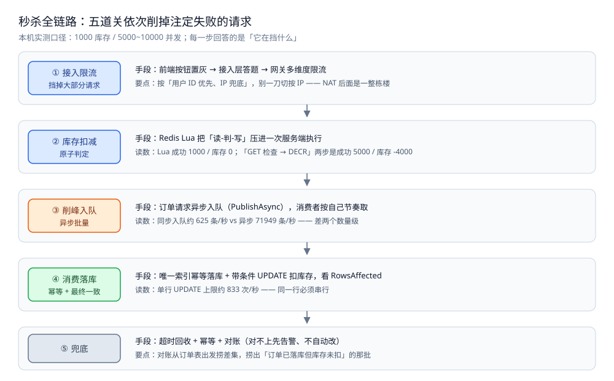
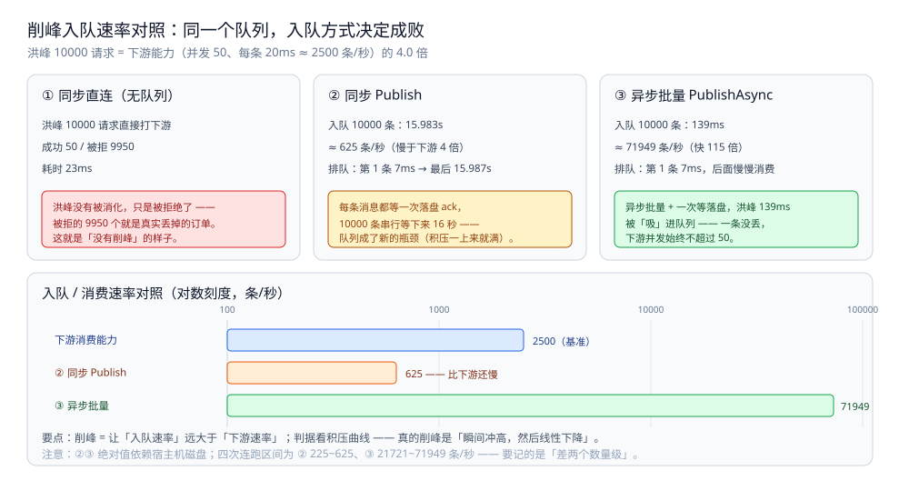

# 总体设计

> 本系统**整体方案**：分几层 / 几部分、各干什么、怎么配合、核心取舍在哪。
> **各部分的细节**在零件篇里；**数据落点**在存储全景里；**篇目清单与阅读顺序**在 README 里。
>
> 本目录收**秒杀系统**这道场景题：本篇是**总体设计**（整体形态 + 核心取舍 + 一次秒杀走哪几步），
> 篇目清单与阅读顺序见 [README.md](README.md)，数据落点见 [存储全景.md](存储全景.md)；五个专题各自成篇 ——
> [订单系统设计.md](订单系统设计.md)（状态机 / 幂等 / 分布式事务 / 分库分表 / 超时关单）、
> [库存系统设计.md](库存系统设计.md)（扣减一致性 / 防超卖 / 缓存与 DB 同步 / 分布式锁）、
> [支付系统设计.md](支付系统设计.md)（对账 / 幂等 / 重试 / 异步通知 / 分布式事务 / 资金安全）、
> [商品详情页设计.md](商品详情页设计.md)（多级缓存 / 击穿与穿透 / 本地 TTL / 静态化与 CDN —— **读的那一侧**）、
> [优惠券系统设计.md](优惠券系统设计.md)（高并发领取 / 防刷 / 分布式锁 / 异步发放 / 红包拆分）；
> 三段可运行骨架另见 [秒杀骨架.md](秒杀骨架.md)（Go，已编译校验）。
>
> 内容整理自个人学习笔记，并参考《大型网站技术架构：核心原理与案例分析》（李智慧）的伸缩性与可用性章节；参考资料与原始素材见 [素材清单](../../../素材清单.md)。
> **落地实现**：各篇实验全部在本机 Docker 环境跑通（Redis 7.4.11 / MySQL 8.0.46 / NATS 2.10 JetStream），
> 代码为 Go；正文所有 `text` 块都是本机真实运行结果（实验规模见每节标注）。

---

## 一、系统的整体形态是什么？

**本节要点**：秒杀系统的整体形态**由"99% 的请求注定失败"这一件事决定** —— 它不是一套组件清单，
而是一条**依次削掉注定失败请求的漏斗**：越靠前的层越便宜，越靠后的层越贵、也越精确。

一句话概括：**用一个可控的方式，处理掉绝大多数注定失败的请求。**



图怎么读：这张图是**漏斗的纵剖面** —— 从上到下依次是"每一层各挡掉一部分请求"，每一格都同时标着**它在挡什么**和**它自己的读数**（口径：1000 库存 / 5000~10000 并发，本机实测）。要把这张图当"分层清单"看，而不是当"性能对比"看：① 接入层先把注定失败的请求挡在业务之外（按用户 ID 优先、IP 兜底），② 预扣层用一次服务端原子判定决定"谁抢到"（Lua 成功 1000 / 库存 0，对照两步法成功 5000 / 库存 -4000），③ 削峰层把抢到的请求从"瞬时并发"变成"队列长度 + 等待"（同步约 625 条/秒 vs 异步 71949 条/秒），④ 落库层让数据库自己判断（单行 `UPDATE` 上限约 833 次/秒，所以同一行必须串行），⑤ 兜底层处理"抢到了没付款"（超时回收 + 从订单表出发捞差集）。**每一层的读数只说明"这一层为什么不便宜"，不构成层与层之间的性能比较。**

按数据流，整个系统分六层，每层只干一件事：

| 层 | 干什么 | 关键判据 | 细节在哪 |
|---|---|---|---|
| **接入层**（前端 / 答题 / 网关） | 把注定失败的请求挡在业务之外 | 按「用户 ID 优先、IP 兜底」，别一刀切按 IP | 3.3 · [限流算法.md](../../分布式/服务治理/限流算法.md) |
| **预扣层**（Redis Lua） | 把"能不能买到"压成**一次原子判定** | 「读-判-写」必须在服务端一次执行 | 2.1 |
| **削峰层**（消息队列） | 把瞬时并发换成**队列长度 + 等待** | 入队速率必须远大于下游速率 | 2.2 |
| **落库层**（消费者 + MySQL） | 幂等消费、带条件 UPDATE、唯一索引兜底 | **成功数对 ≠ 账对**，所以必须有对账 | 3.1 · [订单系统设计.md](订单系统设计.md) |
| **兜底层**（超时回收 / 对账 / 补偿） | 未支付归还库存、捞出账目差集 | 归还前**必须再查一次订单状态** | 3.3 |
| **读侧**（静态化 / CDN / 多级缓存） | 扛住商品详情页的读洪峰 | 读多写少 → 静态化 + 缓存 | [商品详情页设计.md](商品详情页设计.md) |

⭐ 六层的顺序不是随便排的：**前一层把请求挡住了，后一层才不会被压垮**；
反过来，越靠后的层越"贵"（一次行锁、一次落盘、一次对账），所以要尽量在**前面的层**就把请求淘汰掉。

⭐ 还有一条**扩展支线**（优惠券 / 红包发放）不在上面这条漏斗里 —— 它是「同一批手段（原子判定 + 唯一索引 + 异步）
用在另一种发放场景上」，券稀缺的是**份数**、红包稀缺的是**金额**；为什么单列，见 [README.md](README.md) 第一节的说明。

---

## 二、核心取舍在哪？

**本节要点**：三个取舍决定了这套方案的长相 —— **原子性放在哪、削峰选拒绝还是排队、瓶颈怎么绕**。
每个取舍都配本机实测对照；取舍的方向不是"谁更先进"，而是"**代价落在哪一侧可以接受**"。

### 2.1 取舍一：原子性的边界放在服务端

先看"不选它"会发生什么。库存是个**共享可变量**，而「读 → 判断 → 写」这三步在并发下**不是原子的** ——
这是这类系统唯一一个「**代码看起来完全正确、结果却是错的**」的问题。
**统一参数**：初始库存 **1000**、并发请求 **5000~10000**（每个请求买 1 件）；判定标准：**成功数 = 1000 且剩余 = 0 才算对**。

| 环境 | 写法 | 成功数 | 库存 | 结论 |
|---|---|---|---|---|
| **Go 内存** | 无保护「先查再减」 | 1158 / 1201 / 1266 | 0 | ❌ **超卖 158~266** |
| **Redis** | `GET` 检查 → `DECR`（两次往返） | **5000** | **-4000** | ❌ **全部成交** |
| **MySQL** | `SELECT` 后把「读到的值 - 1」写回 | **5000** | **990** | ❌ **丢失更新**（只减掉 10 次） |
| **MySQL** | `SELECT` 判断后 `SET stock = stock - 1` | 2872~2909 | **-1872~-1909** | ❌ 超卖 + 负库存 |
| Go 内存 | 互斥锁 | 1000 | 0 | ✅ 但对热点串行 |
| Go 内存 | 单 key `atomic.CompareAndSwap` | 1000 | 0 | ✅ 失败重试 237~313 次 |
| Redis | **Lua 脚本** | 1000 | 0 | ✅ 服务端一次执行 |
| MySQL | 单条 `UPDATE ... WHERE stock > 0` | 1000 | 0 | ✅ 看 `RowsAffected` |

⭐ **三个最值得记住的读数**：

1. **Redis 那行是 5000/5000** —— 不是"超卖一点点"，是**所有请求都成交了**：
   5000 个请求各自在自己的连接上读到的库存都还是 `1000`，于是**每一个都通过了 `> 0` 的检查**，然后各自去 `DECR`。
2. **MySQL 的「丢失更新」最阴** —— 成功 **5000**、库存却有 **990**（1000 个并发里真正减掉的只有 **10 次**）：
   顾客全都收到"下单成功"，账上却还剩 990 —— **系统自己完全没察觉**，低并发测试永远复现不出来。
3. **正确写法只有一条思路**：把「判断 + 修改」压进**一个原子操作**里 ——
   锁（串行）、CAS（重试）、Lua（服务端串行）、带条件的 UPDATE（行锁 + 当前读）。

选定"把判定压进一次原子操作"之后，紧接着还有一个**更根本的取舍：这个原子操作放在 Redis，还是放在 MySQL？**

Redis 侧的四个对照（同一批 5000 并发请求，Redis 7.4.11）：

```text
=== ① 客户端两步（GET 检查 → DECR）===
  第 1 轮：成功  5000  库存 -4000  超卖 +4000  耗时 720ms
  第 2 轮：成功  5000  库存 -4000  超卖 +4000  耗时 667ms
  第 3 轮：成功  5000  库存 -4000  超卖 +4000  耗时 674ms

=== ② 客户端只发 DECR，用返回值判断（<0 则视为失败）===
  第 1 轮：成功  1000  库存 -4000（负数 = 被扣穿，需回补）  耗时 315ms
  第 2 轮：成功  1000  库存 -4000（负数 = 被扣穿，需回补）  耗时 321ms
  第 3 轮：成功  1000  库存 -4000（负数 = 被扣穿，需回补）  耗时 347ms

=== ③ Lua 脚本（读-判-写在服务端一次执行）===
  第 1 轮：成功  1000  库存     0  耗时 434ms
  第 2 轮：成功  1000  库存     0  耗时 597ms
  第 3 轮：成功  1000  库存     0  耗时 642ms

=== ④ Lua 脚本（先 DECR，为负就 INCR 回补）===
  第 1 轮：成功  1000  库存     0  耗时 570ms
  第 2 轮：成功  1000  库存     0  耗时 533ms
  第 3 轮：成功  1000  库存     0  耗时 377ms
```

⭐ **② 与 ③ 的对照，是这一节最值钱的地方**：

- **②「先减再判」在客户端做**：成功数**是对的**（1000），但库存被扣成 **-4000**。
  这就是「**成功数对 ≠ 账对**」—— 你必须再写一次 `INCR` 把多扣的 4000 补回来，
  而**回补本身又是一次网络往返**（补的过程中库存是错的，其他人看到的可用量也是错的，甚至会再放大一波流量）。
- **④ 同样的「先减再判 + 回补」放进 Lua**：完全正确。
  **命令顺序一模一样，差别只在"这段逻辑跑在谁的进程里"**。

⭐ 由此得到这条判据，它比"记住用 Lua"重要得多：

> **原子性的边界在服务端。** 只要「读」和「写」之间隔着一次网络往返（或一次函数返回），
> 那个间隙就是竞态窗口 —— 无论你在客户端写得多小心。

⭐ 于是第一个取舍定了：**用 Redis 挡流量 + 异步落库保最终一致**。
调用侧只有在 Lua 返回值 `>= 0` 时才认为"抢到了"，然后**立刻把订单请求丢进消息队列**，
真正的落库由消费者慢慢做（见 2.2）。**代价写在明面上** —— 预扣与落库之间是**最终一致**
（所以必须能对账，见 3.3），换来的是绕开"同一行"的吞吐上限（见 2.3）。
Lua 脚本的完整写法与落库形态见 [库存系统设计.md](库存系统设计.md) 与 [秒杀骨架.md](秒杀骨架.md)。

### 2.2 取舍二：削峰 —— 拒绝还是排队？

**削峰不是让系统变快**，而是把「**不可控的雪崩**」换成「**可控的等待**」。
而且 ⚠️ **「用了消息队列」≠「削峰成功」** —— 入队吞吐必须远大于下游，否则队列自己就是新瓶颈。

固定条件：下游处理能力 **并发 50、每条 20ms（≈ 2500 条/秒）**，洪峰 **10000 个请求同时到达**（下游能力的 **4 倍**）。
用 NATS 2.10 JetStream（FileStorage）实测：

```text
下游能力：并发上限 50、每条处理 20ms（≈ 2500 条/秒）
洪峰：10000 个请求同时到达（下游能力的 4.0 倍）

=== ① 同步直连：请求直接打下游 ===
  成功    50  被拒  9950  耗时 23ms
  ⭐ 洪峰没有被消化，只是被拒绝了 —— 被拒的那部分就是真实丢掉的订单

=== ② JetStream 削峰：先入队，消费者按自己的节奏取 ===
  [同步 Publish] 入队 10000 条：耗时 15.983s（≈ 625 条/秒）
  消费完成 10000 条：成功 10000  失败 0  耗时 16.038s（≈ 623 条/秒）
  排队等待：第 1 条 7ms，最后 1 条 15.987s
  队列积压峰值 10000 条
  ⭐ 一条没丢、下游并发始终不超过 50 —— 代价是后面那部分订单要排队等待

=== ③ 同样的队列，换成异步批量入队（PublishAsync）===
  入队 10000 条（异步批量 + 等落盘）：耗时 139ms（≈ 71949 条/秒）
  队列积压峰值约 10000 条 —— 入队远快于消费，积压是必然的
  ⭐ 对比 ② ：同一个队列，**入队方式**决定了它能不能真的削峰
```

⭐ **读数说明（必读，否则会高估一个数量级）**：上面 ②③ 两段的**绝对值依赖宿主机磁盘状态** ——
本机 JetStream 用 `FileStorage`，每条消息都要 fsync，连跑四次的区间是：

| 场景 | 四次区间 | 结论（这个才是稳定的） |
|---|---|---|
| ② 同步 `Publish` 入队速率 | 225 ~ 625 条/秒 | **几百条/秒量级** |
| ③ 异步批量入队速率 | 21721 ~ 71949 条/秒 | **万条/秒量级** |

⭐ **要记住的不是 71949，而是「两者差两个数量级」** —— 这才是「入队方式决定削峰成败」的证据。
⚠️ §四 那句「入队速率必须远大于下游（2500 条/秒）」用 `FileStorage` 衡量会显得苛刻；
换内存存储的 NATS 或换读数更小的下游，这条约束会放松，但**结论方向不变**。

⭐ **三行结论，一行比一行重要**：

1. **① 是"没有削峰"的样子**：10000 个请求在 23ms 内被拒掉 9950 个。系统没垮 ——
   但**9950 个真实订单被丢掉了**，用户看到的是"活动太火爆，请稍后再试"。
2. **② 是"用了队列但削峰失败"的样子**：入队速率只有 **625 条/秒**，比下游（2500 条/秒）**还慢 4 倍**。
   原因不神秘：同步 `Publish` 每条消息都要**等一次落盘 ack**（一次往返 + 一次 fsync），
   10000 条串行等下来就是 16 秒 —— **队列成了新的瓶颈**，积压数从第一秒就是满的（10000）。
3. **③ 才是真的削峰**：`PublishAsync`（异步批量 + 一次等落盘）把入队抬到 **71949 条/秒**（快 115 倍），
   洪峰被"吸"进队列只用 139ms，下游按自己的 2500 条/秒慢慢消费 —— 一条不丢。

⭐ 由此给"削峰"下一个不带水分的定义：

> **削峰 = 让"入队速率"远大于"下游速率"，从而把"瞬时并发压力"换成"队列长度 + 等待时间"。**
> 判据很简单：**看积压曲线** —— 真的削峰，积压应该是「**瞬间冲高、然后线性下降**」；
> 如果积压一开始就是满的、而且不降，那是**生产侧也在被下游拖住**（② 就是这种）。

**代价必须一起讲**：③ 的第 1 条只等了 7ms，最后 1 条等了 **约 16 秒**。
这 16 秒就是"削峰"的价格 —— 秒杀业务可以接受（前端显示"排队中"），
但**换到支付回调那种链路就未必**（那里的等待意味着真金白银的时间差）。



图怎么读：上面三格是同一股洪峰（10000 请求，下游能力约 2500 条/秒）的三种接法——① 同步直连只成功 50、被拒 9950，洪峰没被消化只是被拒绝，那 9950 个就是真实丢掉的订单；② 同步 Publish 把 10000 条入队花 15.983s（≈ 625 条/秒，比下游还慢 4 倍），每条都等一次落盘 ack，队列反而成了新瓶颈，积压一上来就是满的；③ 异步批量 139ms 就把 10000 条「吸」进队列（≈ 71949 条/秒），一条没丢。下面那条对数刻度（100 → 100000，条/秒）把三者摆成一根轴，要记的是**差两个数量级**这件事本身——②③ 的绝对值依赖宿主机磁盘，四次连跑区间为 ② 225~625、③ 21721~71949。

### 2.3 取舍三：瓶颈是「同一行」——绕，而不是硬碰

前面都在说"怎么写对"，这里说"**为什么再怎么写也快不了**"—— 因为**同一行的 UPDATE 必须串行**。

同样 5000 个并发请求、1000 库存，MySQL 8.0.46（隔离级别 `REPEATABLE-READ`）的五组对照：

```text
=== ① SELECT 判断，再把「读到的值 - 1」写回（丢失更新）===
  第 1 轮：成功  5000  剩余   990  超卖 +4000  耗时 34.618s
  第 2 轮：成功  5000  剩余   996  超卖 +4000  耗时 31.949s
  第 3 轮：成功  5000  剩余   995  超卖 +4000  耗时 1m6.39s

=== ② SELECT 判断，但写 `stock = stock - 1`（判断与写入脱节）===
  第 1 轮：成功  2872  剩余 -1872  超卖 +1872  耗时 28.056s
  第 2 轮：成功  2900  剩余 -1900  超卖 +1900  耗时 32.406s
  第 3 轮：成功  2909  剩余 -1909  超卖 +1909  耗时 21.351s

=== ③ 单条 UPDATE ... WHERE stock > 0（看 RowsAffected）===
  第 1 轮：成功  1000  剩余     0  超卖    +0  耗时 5.996s
  第 2 轮：成功  1000  剩余     0  超卖    +0  耗时 6.715s
  第 3 轮：成功  1000  剩余     0  超卖    +0  耗时 6.903s

=== ④ 乐观锁：WHERE version = ? 失败就重读重试 ===
  第 1 轮：成功   767  剩余   233  超卖  -233  重试  92132 次  耗时 1m20.821s
  第 2 轮：成功   773  剩余   227  超卖  -227  重试  92167 次  耗时 1m30.806s
  第 3 轮：成功   773  剩余   227  超卖  -227  重试  92122 次  耗时 1m43.285s

=== ⑤ 悲观锁：事务内 SELECT ... FOR UPDATE ===
  第 1 轮：成功  1000  剩余     0  超卖    +0  耗时 28.719s
  第 2 轮：成功  1000  剩余     0  超卖    +0  耗时 32.248s
  第 3 轮：成功  1000  剩余     0  超卖    +0  耗时 21.771s
```

**读数一：③ 是唯一"又快又对"的，但它也只有 833 次/秒。**
5000 次扣减花 **6 秒** —— 换算过来 **≈ 833 次/秒**。
这不是 MySQL 慢（它空跑几万 QPS），而是**同一行的行锁让它必须排队**：
每次 `UPDATE` 都要拿到那一行的排他锁，改完才能放手。
⭐ 所以秒杀的**第一性瓶颈是"行"**，不是"库"：
**一台数据库的吞吐上限，在这里等于"每秒能串行地改多少次同一行"。**

**读数二：④ 乐观锁在热点行上是负优化。**
成功只有 **767~773**（**漏卖 227~233**！），重试 **9.2 万次**，耗时 **80~103 秒**（比 ③ 慢 15 倍）。
为什么漏卖：重试上限（20 次）撞满后只能放弃 ——
⭐ **乐观锁的隐含假设是"冲突很少"，而秒杀的库存行恰好是全系统冲突最多的一行**，假设与场景完全相反。

**读数三：⑤ 悲观锁正确但慢 4 倍。**
`SELECT ... FOR UPDATE` 把"读-判-写"锁成一个原子段，正确性没问题，
但它把并发彻底压成串行（21~32 秒，接近 ① 的开销）。
⭐ 一句话对比：**③ 让数据库自己判断（一次往返），⑤ 让你自己排队（三次往返 + 持锁）** —— 能用 ③ 就不要用 ⑤。

**那怎么办？把"一行"变成"多行"** —— 这就是**分段库存**。
Go 内存侧的实测（10000 并发请求 / 1000 库存，每种写法跑 3 轮）：

```text
=== ① 无保护（先查再减）===
  第 1 轮：成功  1158  剩余    0  超卖  +158  耗时 3.188ms
  第 2 轮：成功  1201  剩余    0  超卖  +201  耗时 3.459ms
  第 3 轮：成功  1266  剩余    0  超卖  +266  耗时 3.045ms

=== ② 互斥锁 ===
  第 1 轮：成功  1000  剩余    0  超卖    +0  耗时 3.654ms
  第 2 轮：成功  1000  剩余    0  超卖    +0  耗时 4.481ms
  第 3 轮：成功  1000  剩余    0  超卖    +0  耗时 3ms

=== ③ 单 key CAS（无锁自旋）===
  第 1 轮：成功  1000  剩余    0  CAS 失败重试     237 次  耗时 2.132ms
  第 2 轮：成功  1000  剩余    0  CAS 失败重试     308 次  耗时 2.118ms
  第 3 轮：成功  1000  剩余    0  CAS 失败重试     313 次  耗时 3.579ms

=== ④ 分段 CAS（16 段，起点按请求散列 + 轮询其他段）===
  第 1 轮：成功  1000  剩余    0  CAS 失败重试      14 次  耗时 3.518ms
  第 2 轮：成功  1000  剩余    0  CAS 失败重试      11 次  耗时 2.947ms
  第 3 轮：成功  1000  剩余    0  CAS 失败重试       9 次  耗时 2.52ms

=== ⑥ 分段数扫描（每种段数跑 5 轮，看重试次数与耗时的范围）===
  段数     1：成功  1000  剩余   0  重试    50~203   次  耗时 3.107ms~8.196ms
  段数     8：成功  1000  剩余   0  重试     6~30    次  耗时 3.533ms~7.509ms
  段数    64：成功  1000  剩余   0  重试     1~8     次  耗时 4.814ms~6.267ms
  段数   256：成功  1000  剩余   0  重试     1~5     次  耗时 10.509ms~12.737ms
  段数  1024：成功  1000  剩余   0  重试     0~5     次  耗时 37.142ms~44.728ms
```

⭐ 分段的收益是**冲突次数**（重试 200 量级 → 1~8 次，**约 20 倍**），
但代价很有意思：**段数从 256 开始耗时反而上升**（1024 段时 **37~44ms**，比 16 段慢 10 倍）。
原因是起点散列后请求要"扫段"，段越多扫的段越多 —— **分段不是越细越好**。

⚠️ **分段还有两个必须知道的坑**（都在下面实测出来了）：

**坑一：只试自己那一段时，起点分布一倾斜就漏卖。**

```text
=== ⑤ 分段 CAS：只试自己那一段时，起点分布决定成败 ===
  起点均匀 + 不轮询                   第 1 轮：成功  1000  剩余    0  漏卖    0  耗时 5.527ms
  起点均匀 + 不轮询                   第 2 轮：成功  1000  剩余    0  漏卖    0  耗时 2.002ms
  起点倾斜（都从段 0 起）+ 不轮询           第 1 轮：成功    63  剩余  937  漏卖  937  耗时 2.998ms
  起点倾斜（都从段 0 起）+ 不轮询           第 2 轮：成功    63  剩余  937  漏卖  937  耗时 2.005ms
  起点均匀 + 轮询其他段                 第 1 轮：成功  1000  剩余    0  漏卖    0  耗时 2.997ms
  起点均匀 + 轮询其他段                 第 3 轮：成功  1000  剩余    0  漏卖    0  耗时 4.002ms
```

—— 起点均匀时"只试一段"碰巧也能卖完（因为每段都有足够的请求）；
但**一旦流量倾斜**（同一批脚本、同一批网段、或者段的库存分配不均），
段 0 卖光之后剩下的请求全被拒，而其他段还有 **937** 件没卖出去。
⭐ 所以分段的正确性依赖「**起点散列均匀**」这个假设，**必须配"轮询其他段"兜底**。

**坑二：在单机 Redis 上，分段带不来任何收益，而"轮询兜底"会实打实地变慢。**

```text
=== ⑤ Lua 单 key vs 分段 key（16 段）===
  单 key（不打散）               第 1 轮：成功  1000  剩余    0  耗时 450ms
  单 key（不打散）               第 2 轮：成功  1000  剩余    0  耗时 450ms
  单 key（不打散）               第 3 轮：成功  1000  剩余    0  耗时 432ms
  16 段 + 轮询其他段             第 1 轮：成功  1000  剩余    0  耗时 6.129s
  16 段 + 轮询其他段             第 2 轮：成功  1000  剩余    0  耗时 6.806s
  16 段 + 轮询其他段             第 3 轮：成功  1000  剩余    0  耗时 7.031s
  16 段但只试自己那一段             第 1 轮：成功  1000  剩余    0  耗时 602ms
  16 段但只试自己那一段             第 2 轮：成功  1000  剩余    0  耗时 561ms
  16 段但只试自己那一段             第 3 轮：成功  1000  剩余    0  耗时 421ms
```

读这张表要连着看两行：**"只试一段"与单 key 基本持平（约 0.5s）** ——
说明分段的**收益为零**（Redis 单线程执行 Lua，本来就没有 CAS 冲突可省）；
而**"轮询其他段"慢到 6.1~7.0 秒（约 14 倍）** —— 那部分开销**全部来自扫段的额外往返**。
⭐ 所以不是"分段有害"，而是**在单机 Redis 上它既没收益、又要为兜底付出往返成本**。

⭐ 于是可以给"要不要分段"一条明确判据：

| 场景 | 分段有用吗 | 为什么 |
|---|---|---|
| **Go 内存**（多核 CAS） | ✅ 有用 | 核之间真的在抢同一个内存地址，分段能减少自旋 |
| **单机 Redis / 单机 MySQL 单行** | ❌ 反而更慢 | 服务端本来就是串行的，分段只增加往返与扫段成本 |
| **Redis Cluster / 分片 MySQL** | ✅ 有用 | 不同段的 key 落在**不同分片**上 → 行锁/单线程争用被真正分散 |

**一句话**：分段的本质是「**把争用挪到不同的物理资源上**」；
如果物理资源本来就只有一个（单机 Redis），分段只是把"排队"换成了"多跑几趟"。
所以第三个取舍是：**对"同一行"这个瓶颈，方案是"绕"（预扣到 Redis + 按分片分段），而不是"在 SQL 上硬碰"**。

---

## 三、各部分怎么配合？

**本节要点**：六层不是六个孤立的模块，而是通过**两条链**咬合起来的 —— 写侧是"漏斗 + 队列 + 落库"，
读侧是"静态化 + 缓存"；再加一条**贯穿性质**：防刷在最前面，兜底在最后面，对账把两头对上。

### 3.1 写链：一次抢购的数据流

```text
前端（置灰/倒计时）
   → 接入层（答题 / 网关多维度限流）
      → Redis Lua 原子预扣（返回值 >= 0 才算抢到）
         → 异步入队（批量入队，速率远大于下游）
            → 消费者取消息 → 幂等落库（带条件 UPDATE + 唯一索引兜底）
               → 支付 → 超时回收 / 对账
```

| 段 | 责任方 | 与谁耦合 | 细节在哪 |
|---|---|---|---|
| 预扣 | 库存服务 + Redis | 上承限流，下接队列 | 2.1 · [库存系统设计.md](库存系统设计.md) |
| 入队 | 库存服务 + MQ | 入队速率决定削峰成败 | 2.2 |
| 消费落库 | 订单服务 + MySQL | 幂等键来自预扣返回的请求 ID | [订单系统设计.md](订单系统设计.md) · [秒杀骨架.md](秒杀骨架.md) |
| 支付 | 支付服务 | 挂在订单状态机上 | [支付系统设计.md](支付系统设计.md) |

⭐ 关键的耦合点只有一句话：**"能不能买"在 Redis 一次判定，"卖出去多少"以 MySQL 为权威** ——
两者的差靠**对账**收敛（3.3）。

### 3.2 读链：商品详情页

秒杀商品**SKU 少、信息读多写少**，所以读侧和写侧是分离的（动静分离）：

| 段 | 手段 | 判据 | 细节在哪 |
|---|---|---|---|
| 静态化 | 详情页静态化 + CDN | 读多写少，内容不变的部分别每次算 | [商品详情页设计.md](商品详情页设计.md) |
| 多级缓存 | 本地缓存 → Redis → DB | 防击穿（singleflight / 逻辑过期）与穿透 | [商品详情页设计.md](商品详情页设计.md) |
| 库存展示 | 独立的库存缓存 key | ⭐ 展示用的库存**不等于**可扣减的库存 | [库存系统设计.md](库存系统设计.md) |

⭐ 读链与写链唯一的交点是**库存**：读链只读"展示值"，写链才扣"可扣减值"，
两者各自的缓存与同步策略见上面两篇。

### 3.3 防刷在最前、兜底在最后

**前五步解决"系统别死、账别错"，防刷解决"别让脚本把货抢光"**；
要按「**成本递增**」逐层加，前端能挡住的绝不留到服务端。

| 层 | 手段 | 挡什么 | 代价 |
|---|---|---|---|
| **前端** | 按钮置灰、倒计时、随机化参数名 | 手速正常的普通用户重复点 | 对脚本无效，只是减少无效流量 |
| **接入层** | 答题 / 滑块 / 验证码 | 纯脚本（无人值守） | 增加一步交互，影响体验 |
| **网关** | 按 IP / 用户 / 设备的**多维度限流** + 黑名单 | 单机高频、已知恶意特征 | 要处理 NAT（一个门店共用一个出口 IP —— 别一刀切按 IP） |
| **服务层** | **一人一单**（同用户同商品只允许一单） | 脚本换号循环抢 | 需要一次原子判定（同 2.1 的原子性判据） |
| **数据层** | **唯一索引**（`uk(user_id, sku_id)`） | ⭐ **前面全被绕过时的最后一道** | 无（索引成本） |

⭐ 两个容易答错的点：

1. **限流别只按 IP**：摄影工作室、校园、企业出口往往共用一个 NAT IP，按 IP 限流会**误伤整栋楼**。
   要按「用户 ID 优先、IP 兜底」的维度组合（维度设计与键的选择见 [限流算法.md](../../分布式/服务治理/限流算法.md)）。
2. **"一人一单"必须落到数据库唯一索引**：服务层的判重也可能被并发穿透（同一个用户两个并发请求同时通过检查）——
   **唯一索引是唯一不会骗人的那层**（两道防线的实测，以及 ⚠️「给已有脏数据的表补唯一索引会直接失败」的报错原文，
   见 [优惠券系统设计.md](优惠券系统设计.md) 第二节）。

**兜底解决"抢到了没付款怎么办"**：库存被"预扣"之后，用户可能**不付款** ——
不回收，库存就被永久占住；回收逻辑写错，会把已付款的订单也放回去（**超卖的反向事故**）。

| 环节 | 做法 | 关键判据 |
|---|---|---|
| **超时回收** | 下单时投一条"延迟消息"（或定时扫表），到点检查状态；未支付则**归还库存** | ⭐ 归还前**必须再查一次订单状态**（可能刚好付款成功） |
| **幂等** | 每个写操作带一个去重键（订单号 / `requestId`） | 消费者重投、用户重复提交都要靠它兜住 |
| **对账** | 定时比对「Redis 剩余库存 + 已下单数」与「DB 库存 + 订单表」 | 对不上不自动改，先**告警 + 人工确认** |
| **补偿** | 对账捞出「订单已落库但 `sku_stock` 未扣」（消费端条件 `UPDATE` 影响 0 行） | ⭐ **从订单表出发**算差集（MQ 侧无线索：重投会被 Ack 掉、消息不留痕）；人工确认后**补扣或撤单**，不自动改 |
| **占位卡死** | 网络类错误不释放 Redis 占位时，该 `(sku, uid)` 会被锁到占位 TTL 到期 | 兜底二选一：**缩短占位 TTL**（如 5 分钟，代价是同一用户多台设备会各占一次）或**按 uid 补偿释放**（确认 Redis 侧无扣减后主动 `Del`）；⚠️ 释放前必须确认「脚本没执行」，否则就是超卖 |
| **限购库存** | 活动结束后把"多预留的库存"（活动期预扣、实际未支付）一次性归位 | 归位要有**幂等标记**，避免重复归还（白扣回补的幂等键见 [优惠券系统设计.md](优惠券系统设计.md)，同一类要求的两个实例） |

⭐ 一条容易忽略的：**Redis 预扣和 DB 落库之间是"最终一致"**，所以**必须能对账**。
对账的粒度不用实时，但**必须有**；没有对账的预扣方案，等于把"账"交给了运气。

---

## 四、一次完整秒杀走哪几步？

**本节要点**：把六层串成一条端到端的链路，每一步都能落到具体的一篇；这也是回答场景题时该讲的顺序。

| # | 步骤 | 谁来做 | 关键点 | 落在哪 |
|---|---|---|---|---|
| ① | 用户点"立即抢购" | 前端 | 按钮置灰、倒计时（对脚本无效，只是减少无效流量） | 3.3 |
| ② | 答题 / 网关多维度限流 | 接入层 | 按用户 ID 优先、IP 兜底 | 3.3 |
| ③ | **Redis Lua 原子预扣** | 库存服务 | 「读-判-写」在服务端一次执行，返回值 `>= 0` 才算抢到 | 2.1 |
| ④ | 抢到的请求**异步入队** | 库存服务 | 入队速率必须远大于下游，否则队列自己就是瓶颈 | 2.2 |
| ⑤ | 返回前端"排队中" | 网关 | 用户等待时间就是削峰的价格（本机最后一条约 16 秒） | 2.2 |
| ⑥ | 消费者取消息、幂等落库 | 订单服务 | 去重键 + 带条件 `UPDATE`（`RowsAffected` 判定） | [订单系统设计.md](订单系统设计.md) |
| ⑦ | 建订单，唯一索引兜底 | MySQL | `uk(user_id, sku_id)` 挡住并发穿透 | 3.3 · [订单系统设计.md](订单系统设计.md) |
| ⑧ | 用户付款 | 支付服务 | 异步通知 + 幂等 + 对账 | [支付系统设计.md](支付系统设计.md) |
| ⑨ | 未支付 → **超时回收** | 延迟消息 / 定时任务 | 归还前必须再查一次订单状态 | 3.3 |
| ⑩ | 定时**对账** | 对账任务 | 从订单表出发捞差集，只告警不自动改 | 3.3 |

⭐ 回答场景题时可以照下面这个顺序讲（每层一句话，被追问再展开）：

```text
① 定指标：不超卖 / 不宕机 / 防刷 —— 这三个是互相冲突的，先说清取舍方向
② 定位置：库存扣减放 Redis（挡流量）+ 异步落库（保最终一致）
③ 说清"为什么不能先查再改"：读-判-写之间就是竞态窗口（可直接引用本机对照数据）
④ 过载保护：前端 + 接入层 + 网关限流，逐层削掉注定失败的请求
⑤ 削峰：入队异步，⚠️ 强调"入队速率必须远大于下游"，否则队列自己就是瓶颈
⑥ 说清瓶颈在哪：同一行的串行上限 → 分段 / 预扣是为了绕过它
⑦ 兜底：超时回收、幂等、对账 三件事
⑧ 收尾：给一个"如果并发再涨 10 倍"的演进方向
```

⚠️ 三个**常见的误区**：上来就列一堆中间件名字；
说"加 Redis 就不会超卖"（不提 Lua / 原子性）；
说"加消息队列就能削峰"（不看入队吞吐 —— 本机实测 ② 就是反例）。

---

## 五、这套方案的前提与边界是什么？

**本节要点**：这套方案的每个设计都建立在**三个互相冲突的硬指标**之上；换一组指标，方案就要换。

先看它要同时满足的三件事：

1. **不超卖**（正确性）—— 卖出的数量必须恰好等于库存；
2. **不宕机**（可用性）—— 99% 的请求注定失败，但系统不能跟着它们一起倒；
3. **防刷 / 公平**（业务性）—— 不能让脚本把货全抢走（黄牛）。

⭐ 这三个是**互相冲突**的：要"绝对不超卖"，最稳的是全程悲观锁（但慢 4 倍）；
要"绝对不宕机"，最稳的是拒绝一切超出能力的请求（但那 9950 个就是真丢单）。
本方案选的方向是：**正确性 > 可用性 > 公平**，并且把"精确"只留给**库存**这一件事，其余全部走最终一致。

| 维度 | 本方案 | 说明 |
|---|---|---|
| **适用** | 时间窗极短（1~10 秒打完）、SKU 少且稀缺、请求数远大于库存 | 峰值是均值的几百倍，才需要"预扣 + 削峰" |
| **不适用** | 库存充足、可以慢慢卖的普通商品 | 直接落库即可，不需要预扣与削峰 |
| **不适用** | 要求强一致的金融扣减（不接受最终一致） | 预扣与落库之间就是最终一致，靠对账兜 |
| **依赖的外部条件** | Redis（预扣）、MQ（削峰）、MySQL（权威源）、对账任务（兜底） | 谁是权威源、怎么同步见 [存储全景.md](存储全景.md) |

⚠️ **读数口径**：本篇所有读数来自**本机 Docker Desktop（WSL2）+ 端口映射**的单机环境，
网络与 IO 开销比真实生产高一个量级；所以读数只用来**对比不同写法的数量级关系**，
不作绝对性能指标（时序类数字都给了 3 轮范围）。

---

## 使用：本方案的组件清单

**本节要点**：这套方案在本机是用四个组件拼起来的，每个只承担漏斗里的一段职责；换组件时对照本表看它替掉的是哪一段。

| 组件 | 本机版本 | 部署形态 | 在本方案里干什么 |
|---|---|---|---|
| **Redis** | 7.4.11 | 单机（生产为 Cluster / 主从） | **预扣**：Lua 把「读-判-写」压成一次服务端执行；分段时是多个库存 key |
| **MySQL** | 8.0.46 | 单机，隔离级别 `REPEATABLE-READ` | **权威源**：库存行 + 订单表；唯一索引 `uk(user_id, sku_id)` 是防超卖的最后一道 |
| **NATS JetStream** | 2.10（FileStorage） | 单机 | **削峰队列**：异步批量入队（`PublishAsync`）+ 有界消费者 |
| **Go** | 1.26 | 单进程高并发 | 三段骨架：Lua 预扣 / 异步入队 / 消费落库 + 幂等 |

⭐ 组件的**权威源**与**同步路线**（哪份数据是权威、副本怎么追、冷热怎么分层）不在本篇 ——
见 [存储全景.md](存储全景.md) 第一、二节。

## 延伸追问

- **为什么不直接用数据库扛？** →
  2.3 的 ③ 给了答案：单行 `UPDATE` 的正确写法在本机只有 **833 次/秒**，
  因为同一行的行锁必须串行。数据库不是慢在"处理能力"，而是慢在"**同一行**"。
- **Redis 挂了怎么办？** →
  两条路：① 库存同步到 DB，Redis 挂了直接拒绝（**降级到底**，宁可少卖不可超卖）；
  ② 用本地方案兜底（单机令牌式预扣）。⭐ 关键是**不能在降级时放开超卖**，
  参考 [多副本共享状态.md](../../分布式/服务治理/多副本共享状态.md) 的「退回本地不等于 fail-open」。
- **怎么保证"一人一单"不被并发穿透？** →
  服务层判重会被并发穿透（两个请求同时通过检查），
  **必须落到数据库唯一索引** `uk(user_id, sku_id)` 上 —— 那是唯一不会骗人的一层。
- **Redis 预扣的库存和 DB 的库存对不上怎么办？** →
  这是**最终一致**的必然现象，所以**必须有对账**（3.3）。
  对账口径：`Redis 剩余 + 已下单未支付占用量 == DB 库存`，对不上先**告警不自动改**。
- **分段库存分多少段合适？** →
  见 2.3 的段数扫描：**16~64 段**收益已经拿满（重试降到 10 次以内），
  256 段之后耗时反而上升（1024 段 37~44ms）。分段数要跟着**分片数**走，不是越大越好。
- **消息队列选 Kafka 还是 NATS？** →
  秒杀要的是「**高吞吐入队 + 可重放 + 幂等消费**」，两者都能做；
  选型要点与对照见 [消息队列选型对比.md](../../../03-数据与中间件/中间件/消息队列/消息队列选型对比.md)，
  幂等与重投语义见 [Kafka.md](../../../03-数据与中间件/中间件/消息队列/Kafka.md)。
- **为什么本机实测的耗时看着不快？** →
  本机是 **Docker Desktop（WSL2）+ 端口映射**的单机环境，
  网络与 IO 开销比真实生产高一个量级；所以本篇的读数只用来**对比不同写法的数量级关系**，
  不作为绝对性能指标（时序类数字都给了 3 轮范围）。

## 关联

- [README.md](README.md) — 目录导读：七个问题点清单 / 篇目清单 / 阅读顺序 / 目录分工。
- [存储全景.md](存储全景.md) — 横切篇：秒杀的数据都存哪、谁是权威源、怎么同步。
- [限流算法.md](../../分布式/服务治理/限流算法.md) — 令牌桶 / 漏桶 / 滑动窗口的模型与选择口径（秒杀入口限流的算法层）
- [并发限制器.md](../../分布式/服务治理/并发限制器.md) — 与限流互补的另一轴：限「在途数」而不是限「速率」
- [稳定性三件套.md](../../分布式/服务治理/稳定性三件套.md) — 限流 / 熔断 / 降级的整体关系与 Redis + Lua 分布式限流
- [分布式锁.md](../../../03-数据与中间件/数据存储/NoSQL/Redis/分布式锁.md) — 「用锁扣库存」这条路的实现与 6 个真实故障点
- [MVCC与锁.md](../../../03-数据与中间件/数据存储/关系型/MySQL/MVCC与锁.md) — 2.3 那几组 MySQL 现象背后的锁与快照读原理
- [消息队列选型对比.md](../../../03-数据与中间件/中间件/消息队列/消息队列选型对比.md) — 削峰用哪个队列、投递语义怎么选
- [Kafka.md](../../../03-数据与中间件/中间件/消息队列/Kafka.md) — 幂等生产者 / 顺序 / 重投，削峰链路的削峰与去重细节
- [分布式ID.md](../../分布式/理论/分布式ID.md) — 订单号怎么生成（趋势递增、不暴露业务量）
- [分布式事务.md](../../分布式/理论/分布式事务.md) — 扣库存与建订单之间的一致性（本地消息表 / TCC 的适用边界）
- [分表与路由.md](../../../03-数据与中间件/数据存储/关系型/MySQL/分表与路由.md) — 订单表怎么分（秒杀订单量是平时的几十倍）
- [缓存问题与方案.md](../../../03-数据与中间件/数据存储/缓存/缓存问题与方案.md) — 商品页静态化时的缓存击穿与预热
- [README.md](../弹幕系统/README.md) — 同为场景题的「入口限流 + 削峰 + 落库」三层结构，可对照读
- [朋友圈设计.md](../社交互动系统/朋友圈设计.md) — 场景题的另一种推导：从要素分析到推拉模型
- [秒杀骨架.md](秒杀骨架.md) — 本篇全链路落成的三段骨架：Lua 预扣 / 异步入队 / 消费落库 + 幂等
- [订单系统设计.md](订单系统设计.md) — 订单侧的五个硬问题：状态机 / 幂等 / 分布式事务 / 分库分表 / 超时关单
- [库存系统设计.md](库存系统设计.md) — 库存侧的四个硬问题：扣减一致性 / 防超卖 / 缓存与 DB 同步 / 分布式锁
- [支付系统设计.md](支付系统设计.md) — 支付侧的六个硬问题：对账 / 幂等 / 重试 / 异步通知 / 分布式事务 / 资金安全
- [商品详情页设计.md](商品详情页设计.md) — 读的那一侧：多级缓存 / 击穿与穿透 / 本地 TTL / 静态化与 CDN（六组实测）
- [优惠券系统设计.md](优惠券系统设计.md) — 另一类稀缺资源：券的库存 5000 变 100、一人一张的两道防线、异步发放与红包拆分
- [README.md](../社交互动系统/README.md) — 并列的另一类高并发场景（互动层）：手段相通（原子判定 / 异步 / 分片），但痛点不在「扣减」而在「计数与排序」
- [存储选型与组合.md](../../../03-数据与中间件/数据存储/存储架构与场景/存储选型与组合.md) — 通用视角：数据角色、权威源与副本、冷热分层与多存储同步。
