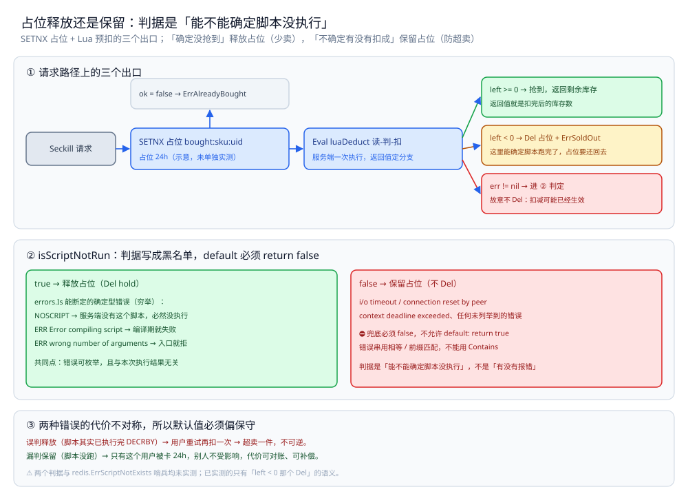
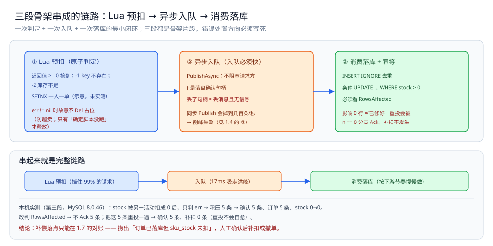

# 秒杀骨架

> 把 [总体设计.md](总体设计.md) 的全链路推导落成三段可运行骨架：**Lua 预扣**（原子判定）→ **异步入队**（削峰）→ **消费落库 + 幂等**。
>
> 内容整理自个人学习笔记，并参考《大型网站技术架构：核心原理与案例分析》（李智慧）的伸缩性与可用性章节；参考资料与原始素材见 [素材清单](../../../素材清单.md)。
>
> **校验口径**：`go build` / `go vet` / `gofmt -l` 通过（Go 1.26，`github.com/redis/go-redis/v9`）；文中的 `2.1` / `2.2` / `2.3` / `3.3` 均指 [总体设计.md](总体设计.md) 的对应小节。
>
> ⚠️ **三段都是骨架片段**（为可读性省略了 import、类型定义与多层错误包装）。其中
> **Lua 扣减、异步入队、带条件的 `UPDATE`** 三处逻辑取自 2.1~2.3 的实测程序，读数已在本机验证；
> **`SETNX` 一人一单**与**幂等消费整段**是**按语义补全的示意代码、未单独实测** —— 已在原处标注。
> ⚠️ 唯一的例外是**条件 `UPDATE` 影响 0 行的处置**：那一处本机实测过（MySQL 8.0.46，读数见第三段下方），
> 但**修法本身只做到「不静默丢」，没做到自愈** —— 原因写在代码注释里，不要当成已解决的问题。

---

## 一、Lua 预扣：为什么它能一次判定「抢到没抢到」？

**本节要点**：把「读-判-写」压进一次服务端执行，只回答一个问题 —— 「这个人能不能买到」；⚠️ 错误处置方向必须写死：**「确定没抢到」要释放占位（少卖），「不确定有没有扣成」要保留占位（防超卖）**。

```go
// 返回值 >= 0 表示扣减成功（值为剩余库存）；-1 key 不存在；-2 库存不足
const luaDeduct = `
local left = redis.call('GET', KEYS[1])
if not left then return -1 end
local n, want = tonumber(left), tonumber(ARGV[1])
if n < want then return -2 end
return redis.call('DECRBY', KEYS[1], want)
`

func Seckill(ctx context.Context, rdb *redis.Client, sku string, userID int64) (int64, error) {
	key := "stock:" + sku
	hold := fmt.Sprintf("bought:%s:%d", sku, userID)
	// ⚠️ 示意（未单独实测）：用 SETNX 占位实现「一人一单」；
	//    真正的兜底仍是 DB 唯一索引 —— 见 3.3 的两层设计
	ok, err := rdb.SetNX(ctx, hold, "1", 24*time.Hour).Result()
	if err != nil {
		return 0, err
	}
	if !ok {
		return 0, ErrAlreadyBought
	}
	left, err := rdb.Eval(ctx, luaDeduct, []string{key}, 1).Int64()
	if err != nil {
		// ⚠️ 这里**故意不 Del 占位**：`err != nil` 不等于「脚本没执行」——
		//    网络超时 / 连接中断时 Lua 很可能已在服务端执行完 DECRBY，只是确认包没回来。
		//    此时释放占位 → 用户重试 → 扣第二次 → **超卖 1 件**。
		//    只有「能确定脚本没跑」的错误才释放（判据见 isScriptNotRun 的实现骨架）。
		// ⚠️ 不释放的代价不是「全局少卖」——占位是**按 uid 定向**的：
		//    这一个用户被锁死 24h（他之后每次点都是 ErrAlreadyBought），
		//    别的用户不受影响。兜底见 3.3 兜底表的「占位卡死」那一行。
		if isScriptNotRun(err) {
			_, _ = rdb.Del(ctx, hold).Result()
		}
		return 0, err
	}
	if left < 0 {
		_, _ = rdb.Del(ctx, hold).Result() // 没抢到就释放占位（这里能确定脚本跑完了）
		return 0, ErrSoldOut
	}
	return left, nil
}
```

⚠️ 注意 `left < 0` 那个 `Del`：**"没抢到"不算数，占位要还回去** ——
否则用户第一次点显示售罄、后来有库存回流也永远买不了（这就是"占位泄漏"）。

⚠️ 但**不是所有失败都能释放占位**：`err != nil` 时脚本可能已经执行完了（见上面注释）。
两类错误的处置方向相反 ——
「确定没抢到」要**释放**（少卖），「不确定有没有扣成」要**保留**（防超卖），
**判据是「能不能确定脚本没执行」**，不是「有没有报错」。

⚠️ 不释放的代价要说准：占位是**按 (sku, uid) 定向**的，所以后果**不是全局少卖**，
而是**这个用户被卡住 24h**（他之后每次点都撞 `SetNX` 失败 → `ErrAlreadyBought`），
其他用户完全不受影响。兜底手段见 3.3 兜底表最后一行。



图怎么读：上半是**请求路径上的三个出口** —— `left >= 0` 抢到并返回剩余库存；`left < 0` 走 `Del 占位 + ErrSoldOut`（这里能确定脚本跑完了）；只有 `err != nil` 才进 `isScriptNotRun` 判定。下半把那条黑名单判据摊开：`true → 释放占位（Del hold）` 只收 NOSCRIPT、编译期失败、参数个数不对这类**确定与本次执行结果无关**的错误；`false → 保留占位（不 Del）` 收 i/o timeout、connection reset by peer、context deadline exceeded 和任何未列举到的错误，兜底必须 false，不允许 `default: return true`。最下面一屏是方向为什么必须偏保守：**误判释放**的代价是超卖一件（不可逆），**漏判保留**的代价只是这个用户被卡 24h（可对账、可补偿）。

### 1.1 `isScriptNotRun`：判据必须写成黑名单

⚠️ **这是一个决定「超卖还是少卖」的谓词，判据方向必须写死**：
写反一次、或有人加个 `default: return true`兜底，就从「少卖一件」变成「超卖一件」。

```go
// ⚠️ 示意（未单独实测）：判据形状，不是完整实现。
//    方向写死：**只有「错误可枚举、且确定与本次执行结果无关」才返回 true**。
//    任何网络类 / 超时类一律 false —— 宁可少卖，不可超卖。
func isScriptNotRun(err error) bool {
	// 判据 1：能用errors.Is 断定的**确定型**错误（穷举，不是模糊匹配）
	switch {
	case errors.Is(err, redis.ErrScriptNotExists): // 服务端没有这个脚本 → 必然没执行
		return true
	}
	// 判据 2：错误串精确匹配「启动期失败」那几类。
	//    ⚠️ 必须是**相等/前缀**匹配，不能用 strings.Contains(err.Error(), ...) ——
	//    包含匹配会把「脚本执行到一半网络断了」这类也匹配进去，方向就反了。
	switch err.Error() {
	case "ERR Error compiling script", // 编译期就失败，脚本体从未开始执行
		"ERR wrong number of arguments": // 参数个数不对，入口就拒了
		return true
	}
	// ⛔ 兜底必须 return false，**不允许 return true**。
	//    i/o timeout / connection reset by peer / context deadline exceeded /
	//    任何没列举到的错误 → 一律保留占位。
	return false
}
```

⚠️ **为什么必须是黑名单**（这是本段最关键的一句）：
白名单 + `default: return true` 的写法下，**任何没预料到的错误都会释放占位** ——
而「没预料到」恰恰是最危险的一类（未来的库版本、新的错误包装）。
黑名单 + `default: return false` 下，**漏判的代价只是少卖一件**（可对账、可补偿），
**误判的代价是超卖一件**（不可逆）。⚠️ 两种错误的代价不对称，所以默认值必须偏保守。

⚠️ **逐处标注（铁律：跑不了的要在正文里标）**：
- ⚠️ **`isScriptNotRun` 的两个判据都是未实测**：本机**没有构造过**「脚本已执行但确认包丢失」，
  也没有逐一验证过 Redis 客户端在 `NOSCRIPT` / 编译错 / 超时三种情况下返回的具体错误值。
  上面的错误串是**按文档与常见实现写的示意**，落地前必须先用真实客户端跑一遍打印 `err` 确认。
- ⚠️ **`redis.ErrScriptNotExists` 这个哨兵错误未实测**：不同客户端版本是否导出、
  是否被 `errors.Is` 识别，都要验。
- 已实测的只有「`left < 0` 那个 `Del` 的语义」——它不依赖本函数。

## 二、异步入队：为什么入队必须快？

**本节要点**：异步入队用「**可能重投 / 可能丢**」换请求路径不阻塞，所以消费者**必须幂等**；⚠️ 单条异步入队并不提升吞吐，真正的吞吐收益只在批量形态上（2.2 的 ③）。

```go
// 用 JetStream 的 PublishAsync 异步入队
func Enqueue(ctx context.Context, js jetstream.JetStream, order Order) error {
	payload, _ := json.Marshal(order)
	// ⚠️ 上面那个读数是**10000 条批量入队**的（2.2 的 ③），**单条调用拿不到这个收益** ——
	//    它来自批量对 fsync 的摊薄，不是异步本身。
	//    这里用 PublishAsync 的唯一理由是**不阻塞请求方**（请求路径上不等落盘）。
	//    批量场景才用 <-js.PublishAsyncComplete() 等整批落盘（那是 ③ 的读数来源）。
	f, err := js.PublishAsync(subjectOrderCreated, payload)
	if err != nil {
		return err // 只有「入队调用本身」的失败会走这里
	}
	// ⭐ 关键：`f` 是**落盘确认的句柄**，丢掉它 = 丢消息且**无任何信号**。
	//    生产里必须二选一：
	//      ① 注册回调/挂指标（下面示范 select 的写法，骨架里为省篇幅只留形状）；
	//      ② 或干脆同步 Publish 等确认（代价：入队掉到几百条/秒，削峰失败）。
	//    ⚠️ 只 return err 的写法会让「入队成功但落盘失败」静默消失，
	//    而这一段代码整体已经在做「可能丢」的取舍 —— 丢要有信号，否则对账都无从下手。
	go func() {
		select {
		case <-f.Ok():
		case e := <-f.Err():
			log.Printf("order enqueue failed: %v", e) // 兜底：告警 + 1.7 对账捞出
		}
	}()
	return nil
}
```

⚠️ 这里的取舍要写进注释：**异步入队 = 用"可能重投 / 可能丢"换请求路径不阻塞**，
所以消费者**必须幂等**（下一段就是它）。⚠️ **单条异步入队并不提升吞吐** ——
真正的吞吐收益只在批量形态上（2.2 的 ③）；如果业务不能容忍重投或丢失，就退回同步 `Publish` 加确认 ——
但要清楚：**同步意味着入队速率掉到几百条/秒，削峰会失败**（2.2 的 ②）。

## 三、消费落库：怎么保证同一条消息只处理一次？

**本节要点**：幂等靠**唯一索引 + `INSERT IGNORE`**，扣减靠**带条件的 `UPDATE` + 看 `RowsAffected`**；⚠️ `err` 为 nil 不代表扣成功，**影响 0 行也不等于修好了** —— 重投会被 `n == 0` 分支 Ack 掉，补扣不会发生。

```go
func Consume(ctx context.Context, msg jetstream.Msg, db *sql.DB) error {
	var o Order
	if err := json.Unmarshal(msg.Data(), &o); err != nil {
		// 脏消息**显式 Ack 掉**：return nil 只是不报错，JetStream 照样按
		// MaxDeliver 重投，N 次后才进 DLQ —— 那是「有限次重投」不是「丢弃」。
		// 想保留重投机会就 return err（并把 MaxDeliver 设小）；这里选直接丢弃。
		return msg.Term() // Term = 确认并停止重投，不再进 DLQ
	}
	// ⚠️ 示意（未单独实测）：幂等靠「唯一索引 + INSERT IGNORE」——
	//    重投、重复提交都靠它兜住；真正的扣减在下面那条条件 UPDATE 上
	res, err := db.ExecContext(ctx, `
		INSERT IGNORE INTO seckill_order (order_no, user_id, sku_id, status, created_at)
		VALUES (?, ?, ?, 'PENDING_PAY', NOW())`, o.OrderNo, o.UserID, o.SKU)
	if err != nil {
		return err
	}
	if n, _ := res.RowsAffected(); n == 0 {
		// 已经处理过（重复投递），确认掉即可 —— 不要重复扣任何东西
		return msg.Ack()
	}
	// 真正的扣减：让数据库自己判断库存够不够（2.3 的 ③）
	ures, err := db.ExecContext(ctx, `
		UPDATE sku_stock SET stock = stock - 1
		WHERE sku_id = ? AND stock > 0`, o.SKU)
	if err != nil {
		return err
	}
	// ⭐ 必须看 RowsAffected（本机实测，见下）：**err 为 nil 不代表扣成功**。
	//    DB 侧 stock 被另一个活动扣成 0 时，这条 UPDATE 匹配不到行、
	//    **影响 0 行但不报错** —— 只判 err 就会 Ack 掉这条消息，
	//    订单已落库、库存永远没扣，超卖一个身位。
	if n, _ := ures.RowsAffected(); n == 0 {
		// 不Ack：让这条**再被投递一次**。⚠️ 但**下一跳就会被确认掉、消息不留痕** ——
		//    重投时 `INSERT IGNORE` 必然 n==0（订单已落库）→ 命中上面那个分支
		//    直接 `return msg.Ack()`，`UPDATE` 再也不会执行。
		//    实测（见下方读数）：5 条不 Ack 的消息重投一遍 → **5 条全被 Ack、0 条补扣**。
		// ⛔ 所以**不要指望重投能自愈，也不要指望 MQ 侧留下线索**：
		//    重投不产生 DLQ 记录、消息被确认后就没了，**补偿的唯一证据只在 DB 侧**
		//    （订单在、`sku_stock` 未扣）。对账必须**从订单表出发**，
		//    拿订单与库存的差集，而不是去 MQ 那边捞消息。
		// 这段只保证「不静默丢」，真正的补偿落点是 3.3 的对账 + 告警。
		return errors.New("扣库存影响 0 行：订单已落库，等待对账补偿")
	}
	return msg.Ack()
}
```

⚠️ **这段的 `RowsAffected` 不是"保险起见"，是本机实测到的真实故障**（MySQL 8.0.46，
`stock` 被另一活动扣成 0 后，本活动消费者积压 5 条消息）：

```text
=== M3 DB 侧 stock 被另一活动扣成 0 后，本活动消费者的条件 UPDATE 影响 0 行===
  只判 err（文档原骨架）：积压 5 条 → 确认掉 5 条；订单表 5 条；stock 0→0
  ⛔ 5 条订单已落库但 stock 一条都没扣 —— 且消息被确认掉，永远不会重投（超卖一个身位）
  判 RowsAffected（修法）：积压 5 条 → 确认掉 0 条、不 Ack 5 条；订单表 5 条；stock 0→0
  把这 5 条重投一遍：确认掉 5 条（走INSERT IGNORE 的 n==0 分支直接 Ack）
  ⛔ 补扣成功的条数 = 0 —— stock 仍是 0。重投**不会自愈**，只多绕一圈后被静默 Ack
  → 补偿落点只能在 3.3 的对账：捞出「订单已落库但 sku_stock 未扣」，人工确认后补扣或撤单
```

⭐ **这组读数要同时说明两件事**，缺一件就变成另一个错误结论：
① 不判 `RowsAffected` → 消息被静默确认，**超卖一个身位**；
② 判了 `RowsAffected` 不 Ack 也**不等于修好了** —— 重投会走 `n == 0` 分支被 Ack 掉，
**补扣不会发生**、而且**消息不留痕**（不进 DLQ、MQ 侧无线索）。
真正的自愈需要订单状态机（`PENDING_PAY` → 扣成功才置 `STOCK_OK`），本骨架没做到，
所以**只能把不一致交给对账，且对账要从订单表出发**（见上面注释）。

⭐ 三段连起来的顺序就是完整链路：
**Lua 预扣（挡住 99% 的请求）→ 入队（17ms 吸走洪峰）→ 消费落库（按下游节奏慢慢做）**，
每一步都在前面那节有对应的实测数据支撑。



图怎么读：三格横排就是链路的三段 —— ① Lua 预扣（原子判定）：返回值 `>= 0` 抢到、-1 key 不存在、-2 库存不足，配 `SETNX` 一人一单（示意，未实测），`err != nil` 时**故意不 Del 占位**（只有「确定脚本没跑」才释放，防超卖）；② 异步入队：`PublishAsync` 不阻塞请求方，`f` 是落盘确认句柄，**丢了句柄 = 丢消息且无信号**，同步 `Publish` 会掉到几百条/秒、削峰失败；③ 消费落库 + 幂等：`INSERT IGNORE` 去重、条件 `UPDATE ... WHERE stock > 0`，必须看 `RowsAffected` —— 影响 0 行 ≠ 已修好，重投会被 `n == 0` 分支 Ack、补扣不发生。最下面一屏是第三段的本机实测（MySQL 8.0.46）：只判 err → 积压 5 条 → 确认 5 条、订单 5 条、`stock 0→0`；改判 `RowsAffected` → 不 Ack 5 条，把这 5 条重投一遍 → 确认 5 条、**补扣 0 条（重投不会自愈）**，所以补偿落点只能在 3.3 的对账。

---

## 延伸追问

- **三段骨架里哪一段真的在本机跑过？** → **Lua 预扣、异步入队、带条件的 `UPDATE`** 三处逻辑取自 [总体设计.md](总体设计.md) 的实测程序，读数已验证；**`SETNX` 一人一单**与**幂等消费整段**是按语义补全的示意代码、未单独实测（原处已标注）。
- **条件 `UPDATE` 影响 0 行时为什么只做「不静默丢」？** → 本机实测过这一处（MySQL 8.0.46），但**修法只做到不静默丢、没做到自愈** —— 真正的补偿落点在 [总体设计.md](总体设计.md) 3.3 的对账 + 告警，原因写在代码注释里。
- **为什么异步入队要强调「入队速率远大于下游」？** → 队列只负责吸走洪峰，入队本身若只有几百条/秒，队列自己就成了瓶颈（见 [总体设计.md](总体设计.md) 2.2 的削峰实测）。
- **这套骨架能直接上生产吗？** → 不能。它是「一次判定 + 一次入队 + 一次落库」的最小闭环，省了连接池、重试退避、全链路对账等生产件；读懂它是为了对齐**原子性边界**。

## 关联

- [总体设计.md](总体设计.md) — 整体形态 / 核心取舍 / 全链路推导（本篇的上游）
- [订单系统设计.md](订单系统设计.md) — 状态机 / 幂等 / 分布式事务 / 分库分表 / 超时关单
- [库存系统设计.md](库存系统设计.md) — 扣减一致性 / 防超卖 / 缓存与 DB 同步 / 分布式锁
- [支付系统设计.md](支付系统设计.md) — 幂等 / 异步通知 / 重试退避 / 对账 / 资金安全
- [分布式锁.md](../../../03-数据与中间件/数据存储/NoSQL/Redis/分布式锁.md) — 锁扣库存这条路的实现与故障点
- [消息队列选型对比.md](../../../03-数据与中间件/中间件/消息队列/消息队列选型对比.md) — 削峰用哪个队列、投递语义怎么选
