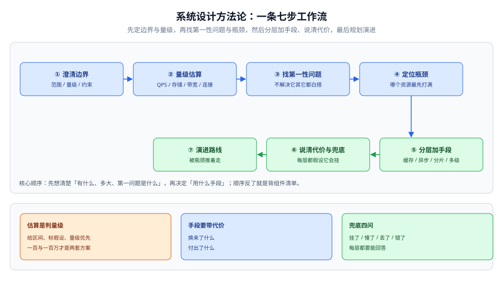
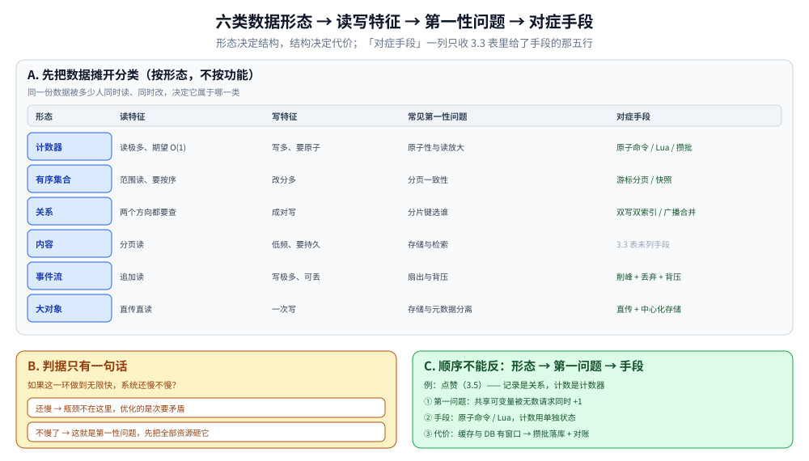
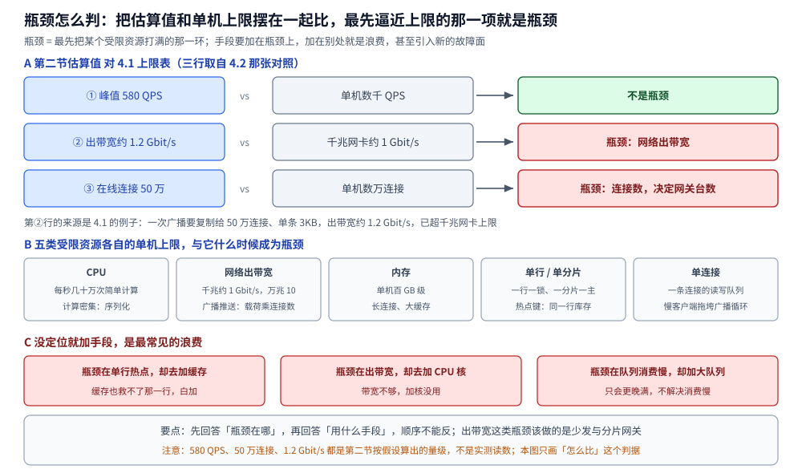
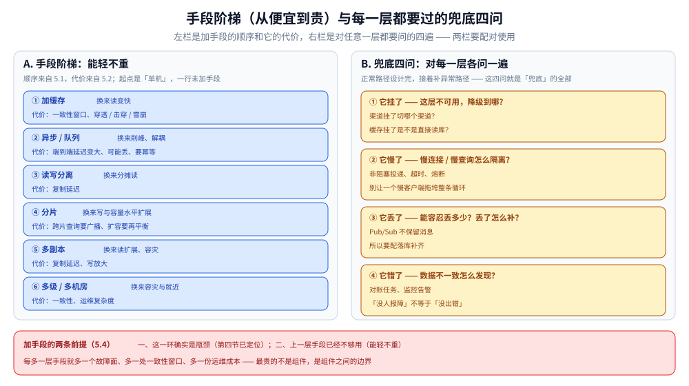

# 系统设计方法论

> 把「给定一个场景，你怎么把它设计出来」拆成一条可执行的工作流：**澄清边界 → 量级估算 → 找数据形态与第一性问题 → 定位瓶颈 → 分层加手段 → 说清代价与兜底 → 规划演进**；末尾给一份可评审的设计文档结构。
>
> 内容整理自个人学习笔记，素材见 [素材清单](../../素材清单.md)。

---

## 一、为什么动手画方框之前要先问清边界？

**本节要点**：**边界决定方案，而不是方案反过来决定边界**。同一个「设计一个通知系统」，日活一千和日活一亿是两个完全不同的系统。先问清楚，再动手。

### 1.1 不问边界就画图，等于在猜需求

拿到一个场景，第一反应往往是「上缓存、上消息队列、上分库分表」——但这些是**手段**，手段只有在瓶颈确定之后才有意义。而瓶颈来自边界：

- 「设计一个订单系统」——是**秒杀瞬时写入**（写热点）还是**后台批量下单**（吞吐优先）？
- 「设计一个通知系统」——只要**站内信**（读多写少、全在自家机房），还是要**短信 + App 推送 + 回执**（外部依赖多、失败面大）？
- 「设计一个信息流」——是**好友动态**（关系有上限、可以推到收件箱）还是**明星关注**（粉丝无上限、必须拉取聚合）？

> 这些边界不同，就会导致**数据形态不同 → 第一性问题不同 → 整套方案不同**。跳过澄清直接给方案，等于把「我猜的需求」当成「你要的需求」。

### 1.2 必须先问清的三类、六个问题

把边界拆成「范围、量级、约束」三类，每类问两个问题：

| 类别 | 问题 | 为什么它决定方案 |
|---|---|---|
| **范围** | 这件事**必须做到**什么？ | 功能清单决定有几种数据形态（见第三节） |
| **范围** | 什么**明确不做**？ | 「不做」比「做」更省事——砍掉范围，复杂度直接消失 |
| **量级** | 用户 / 日活 / 峰值并发大概多少？ | 量级决定要不要分片、要不要异步（见第二节） |
| **量级** | 读多还是写多？读写比多少？ | 读多写少优化读（缓存），写多读少优化写（队列） |
| **约束** | 一致性 / 可用性 / 延迟，哪一条可以让？ | 决定「能容忍丢多少、乱序多久」（见第五节代价） |
| **约束** | 现成有什么（组件、预算、团队、上线时间）？ | 能复用的组件不该重造 |

### 1.3 澄清的产出：一张「约束卡」

澄清不是聊天，要落成一张能贴在文档开头、随时回看的表。**没问到的先写「待确认」，不要替对方假设**：

```text
维度                 取值                 来源 / 备注
──────────────────────────────────────────────────────────
功能范围             站内信 + App 推送     短信本期不做
日活 / 峰值并发       ?（待确认）           影响是否要异步与分片
读写比               读:写 ≈ 100:1         决定优化方向
一致性               可丢失、可乱序         通知不是资金，不必强一致
延迟目标             P99 < 1s（端到端）     回执另算，不占这个预算
现成组件             已有 Redis / Kafka     优先复用，不新引入 MQ
```

> ⭐ 一句话：**约束卡上写「待确认」不是无能，是诚实**。替对方假设一个量级，后面整套推导都建在沙子上；写「待确认」反而把问题推回去，让边界真正被确定下来。

### 1.4 澄清的边界：问清「不做什么」比问「做什么」更难

「要做什么」对方通常会主动说；「**不做什么**」往往要你自己问出来——而它才真正决定复杂度：

- 不做短信 → 少一条外部依赖与一套模板审核；
- 不做回执 → 少两条异步链路的对账；
- 不做「已读」→ 少一套未读位与状态同步。

> ⚠️ 范围每多一项，往往就多一类数据形态、多一条要兜底的链路。**澄清阶段砍掉一项不做，比设计阶段优化十项都省事**。

---

## 二、量级估算怎么做才不心虚？

**本节要点**：估算的目的**不是算得准，而是判断量级**——一百 QPS 和一百万 QPS 差一万倍，方案完全不同。方法只有四个公式，纪律是「给区间、标假设、单位统一」。

### 2.1 QPS：从日活推到峰值

```text
平均 QPS = 日活 DAU × 人均操作次数 ÷ 86400
峰值 QPS = 平均 QPS × 峰值因子        （峰值因子按业务取，常见 3~10）
```

举例（**假设值，不是实测**）：日活 100 万、人均操作 10 次 → 平均 ≈ 116 QPS；峰值因子取 5 → 峰值约 **580 QPS**。

> ⚠️ 这里的数字是**算出来的假设**，不是量出来的读数。写进文档时必须带上「假设 DAU=100 万、人均 10 次」这句话——否则读的人无法判断它是否可信，也无法在假设变化时重算。

### 2.2 存储：单条 × 条数 × 副本 × 时间

```text
日增存储 = 单条记录字节 × 每日新增条数
总存储   = 日增存储 × 保留天数 × 副本数
```

举例（**假设值**）：一条通知 200 字节、每天 1000 万条 → 日增约 2 GB；保留 90 天、3 副本 → 约 **540 GB**。

> 换算口诀：**1 万 × 1KB = 10MB；百万 × 1KB = 1GB；一亿 × 1KB = 100GB**。先把单条字节数定下来，再乘条数和天数，量级不会差一个数量级。

### 2.3 带宽：QPS × 单条载荷

```text
出带宽(bit/s) = QPS × 单条载荷字节 × 8
```

举例（**假设值**）：峰值 580 QPS × 3 KB/条 × 8 ≈ **14 Mbit/s**。

> 长连接系统的带宽要**按连接数乘**，不能只按 QPS：一次广播要发给房间里每一条连接，同一份载荷会被复制 N 份（见 [README.md](弹幕系统/README.md) 的扇出模型）。

### 2.4 连接数：长连接系统特有的量

```text
在线连接数    ≈ 峰值同时在线用户数
长连接内存下限 ≈ 在线连接数 × 单连接缓冲字节
```

举例（**假设值**）：峰值 50 万连接 × 每连接 16 KB 缓冲 → 约 **8 GB 内存**；这还没算每连接一条读循环 / 写循环的栈与调度开销。

> ⭐ 连接数是**长连接系统**（弹幕、IM、推送）的第一约束：它决定单机能扛多少、需要多少台网关，以及「单连接缓冲能不能随便开大」。

### 2.5 估算的纪律

| 纪律 | 反面写法 | 正确写法 |
|---|---|---|
| **给区间，不给点值** | 「QPS 是 580」 | 「峰值约 500~600 QPS」 |
| **标出假设来源** | 只写一个数字 | 「假设 DAU=100 万、人均 10 次」 |
| **单位统一** | 混用 B / KB / MB | 先全部折成字节再相乘 |
| **量级优先** | 纠结 580 还是 620 | 两者同量级、同方案；一万与一百万才需要两套方案 |



图怎么读：横排的七个格子就是本篇的工作流顺序（①澄清边界 → ⑦演进路线），右下角三个小框是贯穿全程的三条纪律 ——
估算只为判量级（给区间、标假设，一百与一百万才是两套方案）、每个手段要带代价、兜底四问每一层都要能回答。
⚠️ 这张图只管**顺序**，各步的判据都在对应小节里展开；第五节的「手段阶梯 × 兜底四问」另有配对图。

---

## 三、怎么从数据里找出「第一性问题」？

**本节要点**：**先把要处理的数据分类，再问「哪一类最先出问题」**。第一性问题 = 「不解决它，其它优化都是白搭」的那一个；把资源砸在它上面，才叫对症下药。

### 3.1 先给数据分类（按形态，不按功能）

拿到场景，先把数据摊开分类——**形态决定结构，结构决定代价**：

| 形态 | 例子 | 读特征 | 写特征 | 常见第一性问题 |
|---|---|---|---|---|
| **计数器** | 点赞数、未读数 | 读极多、期望 O(1) | 写多、**要原子** | 原子性与读放大 |
| **有序集合** | 榜单、时间线 | 范围读、要按序 | 改分多 | 分页一致性 |
| **关系** | 好友、关注 | 两个方向都要查 | 成对写 | 分片键选谁 |
| **内容** | 正文、图片 | 分页读 | 低频、要持久 | 存储与检索 |
| **事件流** | 弹幕、日志 | 追加读 | 写极多、可丢 | 扇出与背压 |
| **大对象** | 视频、附件 | 直传直读 | 一次写 | 存储与元数据分离 |

> 这张表和 [README.md](社交互动系统/README.md) 里的「四类数据形态」是同一套判据：**同一份数据被多少人同时读、同时改**，决定了它属于哪一类。



图怎么读：上半是一张六行的对照表，按「形态 → 读特征 → 写特征 → 常见第一性问题 → 对症手段」五列排开；其中「内容」那一行的手段列写的是 **3.3 表未列手段** —— 3.3 那张表确实只给了五行手段，图没有替它编。下半左栏是判断第一性问题的那唯一一句话，两条分支就是它的答案；下半右栏把 3.5 的点赞例子拆成三行，顺序是**先认形态 → 再认第一问题 → 最后才是手段**，反过来就变成了背组件清单。

### 3.2 第一性问题 = 「不解决它，其它都白搭」

判断第一性问题只有一句话：

> **如果这一环做到无限快，系统还慢不慢？**
>
> - 还慢 → 瓶颈不在这里，你优化的是次要矛盾；
> - 不慢了 → 这就是第一性问题，**先把全部资源砸它**。

例如库存扣减场景里，第一性问题不是「缓存不够大」，而是「**同一行库存的并发扣减**」——库存行只要还是单点，缓存加多少都无济于事。这正是「瓶颈是同一行」那句判据的由来（见 [总体设计.md](秒杀系统/总体设计.md)）。

### 3.3 形态 → 第一性问题对照

| 数据形态 | 第一性问题 | 对症手段（在别篇展开） |
|---|---|---|
| 计数器 | 一份状态被并发改，怎么不丢不重 | 原子命令 / Lua / 异步攒批 |
| 有序集合 | 翻页时排名会漂 | 游标分页 / 快照 |
| 关系 | 两个方向都要快，但一个分片键只优化一个方向 | 双写双索引 / 广播合并 |
| 事件流 | 生产速度远超消费速度 | 削峰 + 丢弃 + 背压 |
| 大对象 | 业务节点别搬字节 | 直传 + 中心化存储 |

### 3.4 不要一上来就报组件

「我用 Redis + Kafka + 分库分表」不是设计，是一张购物清单。**组件是手段，第一性问题才是目标**：先说「这道题的第一性问题是什么」，再说「我用什么手段、付出什么代价」。顺序反了，就变成了背组件。

### 3.5 一个例子：从形态到第一问题

把第三节的方法走一遍——「设计一个点赞功能」：

```text
① 数据形态：点赞记录是「关系」（用户 × 内容），点赞数是「计数器」
② 第一问题：点赞数是共享可变量，被无数请求同时 +1 → 原子性与读放大
③ 对症手段：用原子命令 / Lua 保证原子；计数用单独的状态，而不是 COUNT(*)
④ 代价：缓存与 DB 之间有一段窗口 → 异步落库 + 定期对账
```

> ⭐ 注意顺序：**先认形态，再认第一问题，最后才是手段**。反过来「先想用 Redis，再找理由」就本末倒置了。完整推导见 [评论点赞设计.md](社交互动系统/评论点赞设计.md)。

---

## 四、为什么先定位瓶颈、再挑手段？

**本节要点**：瓶颈 = **最先把某个受限资源打满的那一环**。手段要加在瓶颈上，加在别处就是浪费，甚至可能引入新的故障面。

### 4.1 瓶颈的判据：受限资源 + 量级对比

每一种资源都有一个「单机上限」，把估算值和它对一下，就知道谁是瓶颈：

| 受限资源 | 单机量级 | 什么时候成为瓶颈 |
|---|---|---|
| CPU | 每秒几十万次简单计算 | 计算密集（序列化、加解密） |
| 网络出带宽 | 千兆网卡约 1 Gbit/s、万兆约 10 Gbit/s | 广播 / 推送类（载荷 × 连接数） |
| 内存 | 单机百 GB 级 | 长连接、大缓存 |
| 单行 / 单分片 | 一行一锁、一分片一主 | 热点键（同一行库存、同一个大 V） |
| 单连接 | 一条连接的读写队列 | 慢客户端拖垮广播循环 |

**哪一项估算值最先逼近上限，哪一项就是瓶颈。** 例如一次广播要复制给 50 万连接、单条 3KB → 出带宽约 1.2 Gbit/s 已超千兆网卡上限，**瓶颈在网络出带宽**；这时该做的是「少发（合并 / 降采样）、分片网关」，而不是「加 CPU」。

### 4.2 用量级估算就能预判瓶颈

第二节的估算不是走流程，它和上面这张上限表**放在一起**才是瓶颈判据：

```text
估算值（第二节）        vs    单机上限（4.1）      →     结论
峰值 580 QPS            vs    单机数千 QPS          →     不是瓶颈
出带宽 ≈ 1.2 Gbit/s     vs    千兆 1 Gbit/s         →     ★ 瓶颈
在线连接 50 万          vs    单机数万连接          →     ★ 瓶颈
```

### 4.3 没定位就加手段，是最常见的浪费

- 瓶颈在「单行热点」，你却去**加缓存**——缓存也救不了那一行，白加。
- 瓶颈在「网络出带宽」，你却去**加 CPU 核数**——带宽不够，加核没用。
- 瓶颈在「队列消费慢」，你却去**加大队列**——队列只会更晚满，不解决消费慢（见 [编排与落库.md](弹幕系统/编排与落库.md)：「队列一满就开始丢，落库变快变慢都救不回来」）。

> ⭐ 一句话：**先回答「瓶颈在哪」，再回答「用什么手段」。顺序不能反。**



图怎么读：A 屏就是 4.2 那张三行对照 —— 蓝色是第二节估出来的量级（峰值 580 QPS、出带宽约 1.2 Gbit/s、在线连接 50 万），灰色是 4.1 的单机上限（单机数千 QPS、千兆网卡约 1 Gbit/s、单机数万连接），绿色 / 红色是结论：只有「不是瓶颈」与「★ 瓶颈」两种，判据是**最先逼近上限的那一项**。B 屏摊开 4.1 的五类受限资源（CPU、网络出带宽、内存、单行 / 单分片、单连接），每格写它的单机量级和它什么时候变成瓶颈 —— 手上有估算值，对着这张表逐行比就能预判，不用等监控报警。C 屏是判错的代价：瓶颈在单行热点却加缓存、瓶颈在出带宽却加 CPU 核、瓶颈在队列消费慢却加大队列，三条都是「手段加在非瓶颈处」。⚠️ 注意：图里的数字全部是第二节按假设算出的量级（DAU=100 万、峰值因子 5、50 万连接 × 3KB），**不是实测读数**，本图的重点是「怎么比」这套判据。

---

## 五、分层加手段时，怎么不把话说满？

**本节要点**：手段可以分层叠，但**每个手段必须同时说出代价**，并且**每一层都要假设「它挂了会怎样」**。只讲手段不讲代价，等于把风险藏起来。

### 5.1 加手段的顺序：从便宜到贵

同一个瓶颈，手段按「代价从小到大」排，能轻不重：

```text
单机          → 加缓存（少查 DB）
              → 异步 / 队列（削峰、解耦；代价：延迟与丢失窗口）
              → 读写分离（分摊读；代价：复制延迟）
              → 分片（分摊写与容量；代价：跨片查询与再平衡）
              → 多级 / 多机房（容灾与就近；代价：一致性、运维复杂度）
```

### 5.2 每个手段配一句「代价」

代价的句式只有一句：**「我换来了什么，代价是什么」**。

| 手段 | 换来 | 代价 |
|---|---|---|
| 缓存 | 读变快 | 一致性窗口、穿透 / 击穿 / 雪崩 |
| 异步队列 | 削峰、解耦 | 端到端延迟变大、可能丢、要幂等 |
| 分片 | 写与容量水平扩展 | 跨片查询广播、扩容再平衡 |
| 多副本 | 读扩展、容灾 | 复制延迟、写放大 |
| 推送（写扩散） | 读便宜 | 写放大 ∝ 粉丝数 |

> ⚠️ 说「我用了 X，没有缺点」是最不可信的表述。任何手段都有代价；**说不出代价，说明没想清楚它换来了什么**。

### 5.3 兜底：假设每一层都会挂

设计完「正常路径」，还要补「**异常路径**」——对每一层问四个问题：

1. **它挂了**：这层不可用，降级到哪？（渠道挂了切哪个渠道？缓存挂了直接读库？）
2. **它慢了**：慢连接 / 慢查询怎么隔离？（非阻塞投递、超时、熔断）
3. **它丢了**：能容忍丢多少？丢了怎么补？（Pub/Sub 不保留消息，要配落库补齐）
4. **它错了**：数据不一致怎么发现？（对账任务、监控告警）

**这四问就是「兜底」的全部**。把它写进文档，比任何漂亮的架构图都更能证明方案真的想过。

### 5.4 手段不是越多越好

每多一层手段，就多一个**故障面**、多一处**一致性窗口**、多一份**运维成本**。所以加手段的前提是：

- 这一环**确实是瓶颈**（第四节已定位）；
- 且**上一层手段已经不够用**（能轻不重，见 5.1）。

> ⚠️ 「能一招解决就不要叠三招」。设计里最贵的从来不是某个组件，而是**组件之间的边界**——每多一个组件，边界上就多一条要保证的契约。



图怎么读：左栏是 5.1 的阶梯，从「加缓存」排到「多级 / 多机房」（起点「单机」没画进图），每级第一行写它换来什么、第二行写它的代价，代价口径全部来自 5.2 那张表；右栏是 5.3 的四问，关键是**这四问要对每一层各问一遍**，不是整份方案只答一次；底部红框是 5.4 的两条前提。两栏要配对着用 —— 阶梯回答「加到哪一层为止」，四问回答「这一层的兜底写没写全」。

---

## 六、系统上线之后怎么演进？

**本节要点**：设计不是一次成型，而是**沿着「瓶颈迁移」的路径演进**。要知道什么时候该升级，更要知道什么时候不该动。

### 6.1 演进主线：瓶颈会「搬家」

解决一个瓶颈，瓶颈往往跑到下一环：

```text
单机（瓶颈 = 算力）
  → 读写分离（瓶颈 = 主库写 / 复制延迟）
  → 缓存（瓶颈 = 一致性 / 冷启动）
  → 分片（瓶颈 = 跨片查询 / 再平衡）
  → 多级多机房（瓶颈 = 一致性 / 运维复杂度）
```

**这不是「越复杂越好」，而是「瓶颈跑到哪，就追到哪」**。

### 6.2 触发演进的信号

| 信号 | 说明 | 该动作 |
|---|---|---|
| 容量逼近上限 | 估算或监控显示某资源常年 > 70% | 提前扩容或分片 |
| 尾延迟恶化 | P99 抖动、慢查询增多 | 定位到具体一环，再针对性优化 |
| 故障面扩大 | 一个组件挂导致全站不可用 | 加隔离、降级、多副本 |
| 成本失控 | 单位请求成本上升 | 重新权衡「用复杂度换成本」 |

### 6.3 什么时候不该动

- **量级没到**：一百 QPS 的系统不需要分片，过早分片只是把复杂度提前买进来。
- **瓶颈没定位**：不知道慢在哪就重构，多半白改。
- **代价大于收益**：为了省 5% 的成本引入一个新组件、一套新运维，多半不划算。

> ⭐ 一句话：**演进是「被瓶颈推着走」，不是「照着大厂架构图抄」**。抄来的分层里，很多层在你这儿根本不是瓶颈。

### 6.4 演进的反面：别拆得比瓶颈快

- **瓶颈还在单机，你先把系统拆成微服务**——复杂度上来了，单机瓶颈一点没解决；
- **读还没成为瓶颈，你先把缓存做到三级**——一致性风险先来了。

> ⭐ 一句话：**演进的每一步都要有「当前瓶颈」作理由**。说不出这一步解决的是哪个瓶颈，这一步就先别做。

---

## 使用：设计文档的结构

**本节要点**：把上面六步落成一份可评审的文档——**结构固定，每一节回答一个「凭什么」**，评审时最该盯的是「代价」与「兜底」两节。

一份可评审的设计文档，按下面十节写；**每一节都回答一个「凭什么」**：

```text
1.  背景与目标       —— 解决什么问题，成功长什么样（可量化）
2.  需求与约束       —— 约束卡（第一节）：范围 / 量级 / 一致性 / 延迟 / 现成组件
3.  量级估算         —— 第二节：QPS / 存储 / 带宽 / 连接数，写清假设
4.  数据形态与分类   —— 第三节：有哪几类数据，各自什么形态
5.  第一性问题与瓶颈 —— 第三、四节：不解决它其它都白搭的是哪个、瓶颈在哪个资源
6.  总体方案         —— 一张图 + 一段话：数据怎么流、分层怎么分
7.  关键设计点       —— 每个点三句话：问题 → 手段 → 代价（第五节）
8.  数据模型与接口   —— 表结构、关键接口、幂等键
9.  兜底与监控       —— 5.3 的四问：挂了 / 慢了 / 丢了 / 错了分别怎么办
10. 演进与开放问题   —— 第六节：什么信号触发下一步；还有什么没定
```

**评审时重点看四件事**（也正好对应最容易漏的四节）：

| 看什么 | 一句话判据 |
|---|---|
| **约束是否写清** | 量级、一致性、延迟都写了吗？没写就是没想清 |
| **量级是否支撑选型** | 「为什么要分片」能用量级估算回答吗？答不上来就是拍脑袋 |
| **手段是否带代价** | 每个关键设计点后面有没有「代价是……」？没有就是藏风险 |
| **兜底是否覆盖** | 挂了 / 慢了 / 丢了 / 错了四问都有答案吗？ |

> ⚠️ 文档里最不值钱的是那张架构图本身，最值钱的是**第 7 节的「代价」和第 9 节的「兜底」**——图谁都能画，代价和兜底才证明方案真的想过。

---

## 延伸追问

- **估算精度不够怎么办？** → 估算是为了判断**量级**，不是给精确答案。580 QPS 与 620 QPS 同量级、同方案；一万与一百万才需要两套方案。**先把量级拉开，再谈精度**。
- **没有真实数据，假设从哪来？** → 三个来源：现成产品的公开量级、同类系统历史数据、以及「最坏情况」假设。**关键是把假设显式写在文档里**，而不是藏在心里，方便别人替换与复核。
- **第一性问题和瓶颈是一回事吗？** → 不完全。**第一问题是「哪个环节错了会导致全盘皆错」**（偏正确性与必要性），**瓶颈是「哪个资源最先被打满」**（偏容量与性能）。先回答前者，再在前者解决后回答后者。
- **小系统也要写这么长的文档吗？** → 不需要。十节可以压成三行：**要做什么、多大、第一问题是什么**。结构的意义是「别漏」，规模可以随量级伸缩。

## 关联

- [README.md](README.md) — 本目录导读：通用场景与三个专题系统怎么配合
- [文件存储与上传架构.md](文件存储与上传架构.md) — 同目录的「共性零件」：业务无状态、数据中心化
- [总体设计.md](秒杀系统/总体设计.md) — 一套完整推导范例：写侧热点（同一行）怎么定位与解决
- [README.md](弹幕系统/README.md) — 另一套推导范例：扇出与丢弃，瓶颈在带宽与背压
- [README.md](社交互动系统/README.md) — 数据形态分类与三步骨架的完整应用
- [README.md](../分布式/README.md) — 本文所用「零件」（限流 / 熔断 / 一致性）的原理线
- [可观测性选型对比.md](../../03-数据与中间件/中间件/可观测性/可观测性选型对比.md) — 落地后的链路追踪与监控：兜底与瓶颈定位都依赖它
> 反向引用（本篇被下列文档引到）：[存储选型与组合.md](../../03-数据与中间件/数据存储/存储架构与场景/存储选型与组合.md)
