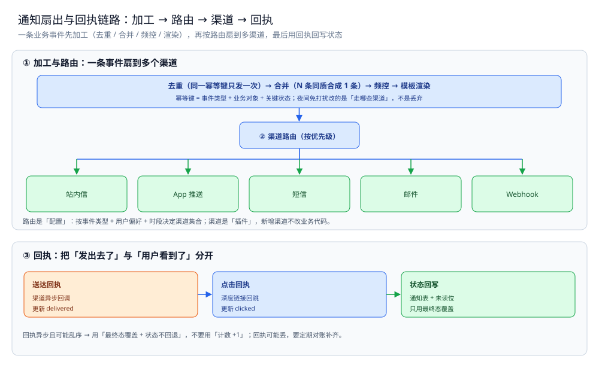
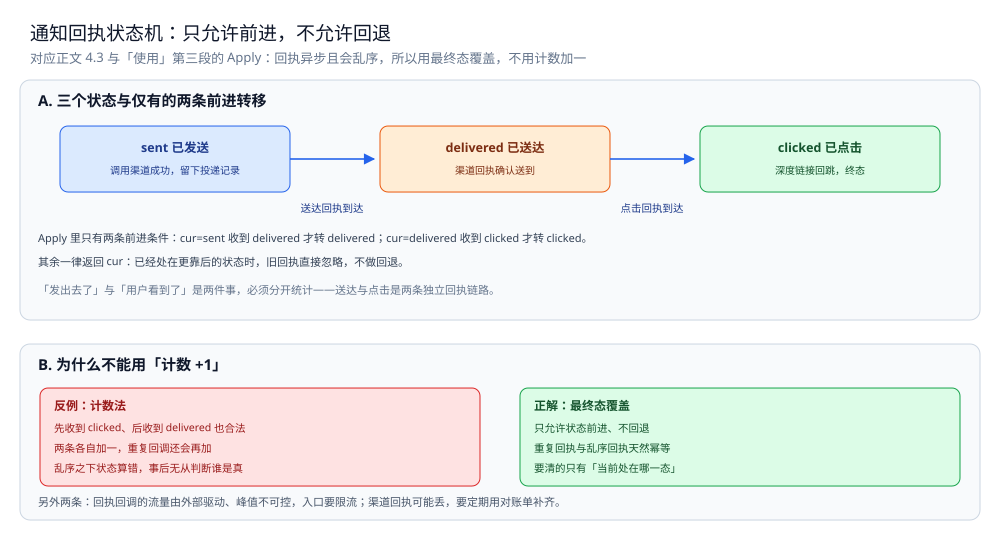
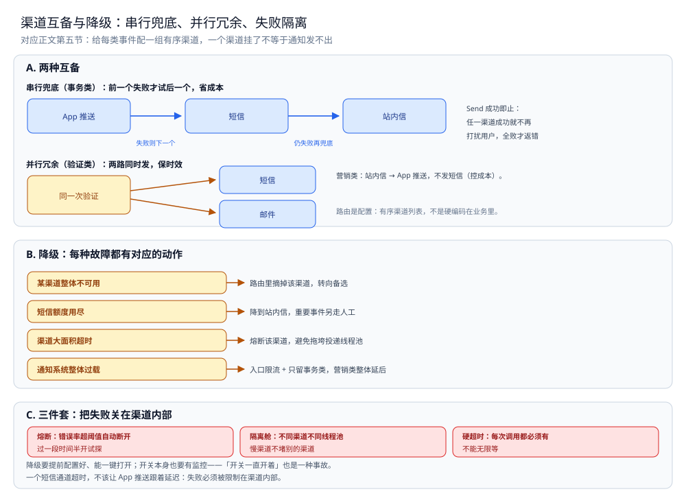

# 通知系统设计

> 把「统一通知」拆成六块工程问题：渠道抽象与路由、模板与渲染、去重合并与频控、可靠投递与回执、优先级与降级、通知表与未读位；每一块都讲清实现方式与代价。
>
> 内容整理自个人学习笔记，素材见 [素材清单](../../素材清单.md)。

---

## 一、为什么通知系统要先做「渠道抽象」？

**本节要点**：通知的本质是**一条业务事件，按规则落到一个或多个渠道**。渠道是外部依赖，会变、会挂、会新增；所以第一件事不是挑渠道，而是**把「发什么」和「怎么发」拆开**，让业务只关心前者。

### 1.1 一条业务事件要落到多个渠道

一次「订单已发货」，用户可能同时收到：

- **站内信**：进 App 的消息中心，可回溯、可标未读；
- **App 推送**：走厂商通道，触达最快，但依赖设备 token；
- **短信**：最强触达、最贵，通常只留给重要节点；
- **邮件**：适合长文与附件，触达慢；
- **Webhook**：给外部系统回调，不是给人看的。

> 关键观察：**渠道之间的差异（协议、时效、成本、回执能力）远大于它们的共性**。如果让业务代码直接调每种渠道的 SDK，业务会被渠道细节污染——新增一个渠道就要改所有业务点。

### 1.2 渠道接口：把「怎么发」和「发什么」分开

抽象出一个 **`Channel` 接口**，业务只依赖它：

```go
// Channel 是「一个投递渠道」的统一抽象。
// 业务侧只认这个接口，不认具体是短信还是推送。
// ⚠️ 未实测：本轮未在本机运行（无渠道沙箱），下面为按语义补全的骨架片段（省略 import 与错误包装）。
type Channel interface {
	Name() string
	// Send 把一条已渲染好的消息投给指定接收者，返回一个渠道内的消息号（用于后续回执对账）。
	Send(ctx context.Context, to Recipient, msg RenderedMsg) (ReceiptID string, err error)
}
```

渠道实现的差异全部收在接口背后：

| 渠道 | 接收者 `to` | 载荷 | 回执能力 |
|---|---|---|---|
| 站内信 | uid | 结构化（进通知表） | 送达 = 已写库；点击可测 |
| App 推送 | deviceToken | 标题 + 摘要 + 深度链接 | 厂商回执（部分） |
| 短信 | phone | 短文本（模板变量已替换） | 通常无细粒度回执 |
| 邮件 | email | HTML / 纯文本 | 打开 / 点击（像素与跳转） |
| Webhook | callbackURL | JSON + 签名 | HTTP 状态码 + 重试 |

### 1.3 路由：谁决定一条通知走哪些渠道

**路由规则不该硬编码在业务里**，而应是一份可配置的策略表：按「事件类型 + 用户偏好 + 场景」决定渠道集合。

| 决定因素 | 例子 | 作用 |
|---|---|---|
| 事件类型 | 营销 vs 事务 | 事务类必发，营销类可关 |
| 用户偏好 | 关闭了短信、只留推送 | 尊重用户选择 |
| 场景 / 时段 | 夜间只发站内信 | 与频控一起做免打扰 |
| 成本预算 | 短信按额度发 | 控成本 |

> ⭐ 一句话：**渠道是「插件」，路由是「配置」，业务只发一个事件**。这样新增渠道 = 加一个 `Channel` 实现 + 改一行路由，而不是改所有业务点。



图怎么读：上半是**一条事件的旅程**——先加工（去重、合并、频控、渲染），再交给按优先级排列的路由，最后扇到站内信、推送、短信、邮件、Webhook 五个渠道；下半是**回执链路**，送达回执与点击回执各自产生、合并回写到通知表与未读位。要留意两处易误读：免打扰改的是「走哪些渠道」而不是丢弃；回写只用最终态覆盖，不用计数累加（细节见四、五两节）。

---

## 二、模板与渲染怎么和业务代码解耦？

**本节要点**：模板负责把「结构化事件」变成「面向某渠道、某种语言的可发送文本」。渲染要有**唯一入口**，否则同一条通知在不同渠道会拼出不同的字。

### 2.1 模板 = 变量 + 多语言 + 渠道适配

一条通知的模板至少包含三层信息：

```text
模板标识     order_shipped
渠道         站内信 / 推送 / 短信 / 邮件      （同事件、不同渠道各一份模板）
语言         zh-CN / en-US                    （多语言）
变量         {orderNo} {itemName} {eta}
渠道约束     短信 ≤ 70 字、推送标题 ≤ 20 字（超出要截断或换模板）
```

**渠道约束要写进模板元数据**，而不是让调用方现拼：短信有字数上限、推送标题会被系统截断、邮件可以很长。否则同一段文案发给不同渠道，长的那条会被偷偷截断。

### 2.2 渲染时机：入队前渲染还是投递时渲染

| 方案 | 做法 | 代价 |
|---|---|---|
| **入队前渲染** | 生产者在写入待发队列前就渲染好 | 队列里存的是最终文本；但**改了模板不会影响已入队消息** |
| **投递前渲染** | 队列只存「模板 ID + 变量」，投递时渲染 | 模板可热更新、可回放重试；但**投递链路每次都要查模板**，且变量必须是可持久化的纯净数据 |

> 取舍判据：**要不要「改了模板重发历史」**。需要就投递前渲染（存模板 ID + 变量，别存渲染结果）；不需要就入队前渲染（更省一次查表）。很多系统折中为「存模板 ID + 变量 + 渲染结果快照」，兼顾重试一致与可回溯。

### 2.3 模板版本与审核

- **版本化**：模板改一次就是一个新版本，历史版本保留——否则「这条通知当时到底长什么样」就查不出来了。
- **审核**：对外的短信 / 推送模板通常要走审核（渠道方与合规），所以模板不能由业务随意改，要走发布流程。
- **灰度**：新模板先发小流量，看点击率与投诉，再全量。

> ⚠️ 常见坑：把模板当成「一坨字符串常量」硬编码在代码里。结果是**改一个错别字要发版**，多语言更是没法维护。模板应当是**数据**，不是代码。

---

## 三、同一件事为什么会重复通知？怎么去重合并？

**本节要点**：重复来自三处——**重试、同一事件多次触发、多条同质事件**。前两者靠幂等键去重，第三者靠**合并**：把短时间内同一类的 N 条通知压成 1 条。

### 3.1 去重的键：业务幂等键

**幂等键**是「这件事只该通知一次」的唯一标识，通常由「事件类型 + 业务对象 + 关键状态」拼成：

```text
order_shipped:orderNo=20260101-001
comment_reply:commentId=8899:receiver=42
```

去重的手段分两层：

| 层 | 手段 | 作用 |
|---|---|---|
| 入口 | Redis `SETNX` 幂等键 | 挡住重复触发与重试，快 |
| 落库 | 通知表唯一索引 `uk(event_key, receiver, channel)` | 最终防线，缓存失误也兜得住 |

> 这与点赞「一人一赞」是同一套手法（见 [评论点赞设计.md](社交互动系统/评论点赞设计.md) 二）：**先用内存判重，再用唯一索引兜底**。缓存会丢、会过期，唯一索引不会。

### 3.2 合并：把 N 条合成一条

有些通知天然可合并——「10 个人赞了你」「20 条新评论」。合并的关键是**合并窗口 + 合并键**：

```text
合并键   event_type + receiver + 业务对象     （例：like + uid=42 + postId=7）
合并窗口 一段时间内（如 60s）的同键通知
输出     「张三等 10 人赞了你的帖子」，计数随窗口内的新事件累加
```

| 要不要合并 | 判据 |
|---|---|
| **可以合并且应该合并** | 同质、可累加、用户对逐条不敏感（点赞、关注、系统提示） |
| **不能合并** | 每条信息都不同且都要看到（每条评论的正文、每条私信） |

> ⭐ 合并的代价是**延迟**：为了攒够一个窗口，通知会晚发几十秒。所以**事务类通知（订单、支付）一般不合并**，营销与社交类才合并。

### 3.3 频控与夜间免打扰

去重解决「重复」，频控解决「太多」：

| 手段 | 规则示例 | 落在哪 |
|---|---|---|
| **总量频控** | 每用户每天推送 ≤ N 条 | 网关侧按 uid 计数 |
| **同类频控** | 同一类型通知 1 小时内至多 1 条 | 合并键 + 时间窗 |
| **夜间免打扰** | 22:00–08:00 只发站内信，推送顺延到次日 | 路由策略改渠道集合 |
| **降级合并** | 超频后不丢弃，转成一条「你有 N 条未读」 | 频控与合并联动 |

> ⚠️ 免打扰的常见错误是「直接丢弃」——用户醒来后发现重要通知不见了。正确做法是**改渠道（站内信兜底）或顺延**，而不是删掉。

---

## 四、投递怎么做到「可靠 + 可回收」？

**本节要点**：投递要回答三件事——**怎么发得可靠**（重试 / 幂等）、**发失败了怎么办**（死信 / 告警）、**发出去之后到底看没看到**（回执）。「发出去了」和「用户看到了」是两件事，必须分开统计。

### 4.1 投递链路：直投还是过队列

| 方案 | 特点 | 适合 |
|---|---|---|
| **同步直投** | 业务调用渠道 SDK，拿到结果才返回 | 渠道快、强一致要求高的少量通知 |
| **异步过队列** | 业务只写队列，投递由消费者做 | 削峰、解耦、可重试——通知的主流选择 |

异步化的代价是**端到端延迟变大、且要处理重复投递**（消费者可能重试），所以**渠道侧也必须幂等**：用 `ReceiptID` 或幂等键，重复投递不产生重复触达。

### 4.2 重试与死信

```text
投递失败 → 按退避重试（如 1s / 5s / 30s，有限次）
        → 仍失败 → 进死信队列（DLQ）
        → 死信里的消息：人工排查 / 定时补发 / 直接告警
```

| 决定 | 判据 |
|---|---|
| 重试几次 | 渠道的**可重试错误**（超时、5xx）才重试；**不可重试错误**（手机号非法）直接进死信 |
| 重试间隔 | 退避，避免打爆正在抖动的渠道 |
| 是否阻塞 | 重试**不能阻塞**同批其他消息——要按渠道隔离 |

> ⚠️ 重试的副作用是**重复触达**。所以「重试」与「幂等」必须成对出现：**没有幂等的重试就是给用户发垃圾**。

### 4.3 回执：送达与点击两条链路

回执把「发出去」和「被看到」分开：

| 回执 | 产生方式 | 用途 |
|---|---|---|
| **送达回执** | 渠道异步回调（推送厂商、短信状态报告、邮件投递结果） | 判断渠道是否真的送到了 |
| **点击回执** | 深度链接 / 落地页跳转带埋点 | 判断通知有没有效果 |

回执的处理要点：

1. **异步且可能乱序**：先到「已送达」再到「已点击」是常态，反序也可能；**回写时只用最终态覆盖，不要用「计数 +1」**，否则乱序会把状态算错。
2. **要对账**：渠道回执可能丢，所以需要定期用渠道侧对账单补齐（与支付对账同理，见 [支付系统设计.md](秒杀系统/支付系统设计.md)）。
3. **要限流**：回执回调的流量由外部驱动、峰值不可控，入口要能扛住。

> ⭐ 一句话：**没有回执的通知系统，只能证明「我们发了」，证明不了「用户看到了」**。这两句话在事故复盘里差别巨大。



图怎么读：三个状态 `sent`（已发送）、`delivered`（已送达）、`clicked`（已点击）之间**只有两条前进边** —— cur 是 `sent` 时收到送达回执才转 `delivered`，cur 是 `delivered` 时收到点击回执才转 `clicked`，其余一律保持原状态。下半张对照的是「计数 +1」为什么在乱序下会算错：先点击后送达同样合法，两条各自加一，事后就分不清谁在前；而「只允许前进、不回退」让重复回执和乱序回执都变成无操作。图里的「入口要限流」「定期对账补齐」对应上面处理要点的第 2、3 条。

---

## 五、渠道挂了切哪个？

**本节要点**：渠道是外部依赖，一定会挂。设计要给出**优先级、互备、降级、熔断**四件套，让「一个渠道挂了」不等于「通知发不出」。

### 5.1 渠道优先级与互备

给每个「事件类型」配一组**有序渠道**，前一个失败就尝试后一个：

```text
事务类：App 推送 → 短信 → 站内信
营销类：站内信 → App 推送（不发短信，控成本）
验证类：短信 → 邮件（同一次验证可两路并行）
```

互备要区分**串行兜底**（前一个失败才发后一个，省成本）与**并行冗余**（两路同时发，保时效）。验证码类常并行，事务分类常串行。

### 5.2 降级策略

| 故障 | 降级动作 |
|---|---|
| 某渠道整体不可用 | 路由里**摘掉**该渠道，转向备选 |
| 短信额度用尽 | 降到站内信，重要事件另走人工 |
| 渠道大面积超时 | 熔断该渠道，避免拖垮投递线程池 |
| 通知系统整体过载 | 入口限流 + 只保留事务类，营销类整体延后 |

> ⚠️ 降级要**提前配置好、且能被一键打开**，而不是等出事时现写。降级开关本身也要有监控，否则「开关一直开着」也是一种事故。

### 5.3 熔断与隔离

- **熔断**：某渠道错误率超阈值就自动断开，过一段时间半开试探（原理见 [README.md](../分布式/README.md) 的服务治理线）。
- **隔离**：不同渠道用**不同的线程池 / 队列**，避免一个慢渠道把其他渠道的通知一起堵死（这是「隔离舱」思想）。
- **超时**：每次调用渠道都要有**硬超时**，不能无限等。

> ⭐ 一句话：**渠道的失败必须被限制在渠道内部**。一个短信通道超时，不该让 App 推送也跟着延迟。



图怎么读：上半是两种互备形态——**串行兜底**按有序渠道逐个尝试，前一个失败才试后一个，任一渠道成功就停止（省成本，事务类用这种）；**并行冗余**是同一次验证两路同时发出（保时效，验证码类用这种）。中间是 5.2 那张表的重述：四种故障各对应一个动作，摘渠道、降站内信、熔断、入口限流。下半的三件套（熔断、隔离线程池、硬超时）就是「失败被限制在渠道内部」的具体手段。⚠️ 本节是设计口径，**图中不含任何实测延迟或成功率数字**。

---

## 六、通知表和未读位怎么设计？

**本节要点**：站内信是唯一「存在自己库里」的渠道，所以它要单独设计表与未读位。核心是**未读不能靠 `COUNT(*)` 现算**，而要用**计数位**维护。

### 6.1 通知表结构

```sql
-- 一条站内信一行；其它渠道的投递记录可用另一张投递日志表。
CREATE TABLE notification (
  id          BIGINT PRIMARY KEY,
  receiver    BIGINT      NOT NULL,
  event_key   VARCHAR(96) NOT NULL,
  template_id VARCHAR(64) NOT NULL,
  payload     JSON        NOT NULL,      -- 变量（供投递前渲染 / 回溯）
  is_read     TINYINT     NOT NULL DEFAULT 0,
  created_at  DATETIME    NOT NULL,
  UNIQUE KEY uk_event (event_key, receiver),   -- 幂等兜底
  KEY idx_receiver_read (receiver, is_read, id) -- 拉列表 + 数未读
);
```

两个设计点：

1. **`uk_event`** 兜住重复投递（3.1 的第二层防线）。
2. **`idx_receiver_read`** 同时服务「拉某人的通知列表（按 id 倒序）」与「数未读」——但**未读数不要真的用它 `COUNT`**，见 6.2。

### 6.2 未读计数与清零

| 方案 | 做法 | 代价 |
|---|---|---|
| **现算 `COUNT(*)`** | 每次打开 App 数一次 | 未读多、读频繁时是 O(条数) 扫描，不可取 |
| **计数位**（推荐） | Redis `INCR` 一条未读 +1，已读 -1 | 要保证与 DB 一致（可定期对账重算） |

- **单条已读 / 全部已读**都要能原子改计数；
- 计数位是**派生数据**（见 [README.md](社交互动系统/README.md) 的「计数」形态），随时可以从 `notification` 表重算，所以允许短时偏差；
- 「小红点」与「未读条数」最好分开：红点用布尔位（有/无未读），条数用计数位。

### 6.3 站内信写扩散还是读扩散

站内信列表是**读自己一个人的数据**（`WHERE receiver = me`），天然是**读扩散**（按需查库），不需要为每个人预先写收件箱——这跟 feed 的「一个人发给很多人」正好相反：

| | 站内信 | feed（一发给多） |
|---|---|---|
| 数据规模 | 每人一份、私有 | 一份内容对应多读者 |
| 适合 | **读扩散**：按需查 `receiver` 索引 | 视粉丝数推拉结合 |
| 为何 | 读者只有一个，预写没有收益 | 读者很多，预写可能摊薄读成本 |

> ⭐ 一句话：**读扩散还是写扩散，看「一份数据的读者有几个」**。站内信读者只有一个（本人），读扩散最省；feed 读者很多，才需要考虑推。

### 6.4 存储分工：通知、模板、回执分别存哪？

通知系统里其实有好几种角色的数据，别混在一张表里：

| 数据 | 角色 | 存储 | 理由 |
|---|---|---|---|
| 通知表（站内信本体） | 权威源 | MySQL | 唯一真相，要按 `receiver` 点查、要可回溯 |
| 模板（含版本） | 权威源 | MySQL | 配置数据，审核发版后要留历史版本 |
| 回执记录（送达 / 点击） | 权威源 | MySQL（投递日志表） | 外部渠道回调产生，丢了不可重建 |
| 未读位 / 计数 | 缓存 | Redis | 高频自增，可从通知表重算，可丢 |
| 频控计数 | 缓存 | Redis（带 TTL） | 短周期累计，过期即失效，无需持久 |
| 待发消息队列 | 临时状态 | 消息队列 | 送达即出队，属过渡态而非真相 |

⭐ 判据还是那一句「**丢了能不能重建**」：通知表、模板、回执都是不能重建的**权威源**，落 MySQL；未读、频控是能从权威源重算的**副本**，放 Redis。

详细分工见 [存储选型与组合.md](../../03-数据与中间件/数据存储/存储架构与场景/存储选型与组合.md)。

---

## 使用：通知投递与回执的 Go 骨架

**本节要点**：把前六节压成三段骨架——**渠道抽象 + 路由**（一）、**去重合并 + 频控**（三）、**扇出投递 + 回执回写**（四、五）。

> ⚠️ **未实测**：本轮**未在本机运行**这三段代码，原因是本机没有各渠道的沙箱（短信 / 推送 / 邮件都要外部账号）也没有 Redis 实例。下面为**按语义补全的可编译骨架片段**（省略 import、类型定义与错误包装）；凡是外部依赖都用接口占位，未接真实实现，因此**不给任何性能或正确性读数**。

**第一段：渠道抽象与路由**

```go
// Recipient 是「发给谁」，按渠道取不同字段。
type Recipient struct {
	UID         int64
	Phone       string
	Email       string
	DeviceToken string
}

// RenderedMsg 是渲染后的消息（标题 + 正文 + 跳转）。
type RenderedMsg struct {
	Title string
	Body  string
	Link  string
}

// Dispatcher 按事件类型选渠道集合，并逐个尝试（串行兜底）。
type Dispatcher struct {
	channels map[string]Channel
	routes   map[string][]string // eventType -> 有序渠道名
}

// Send 依次尝试路由里的渠道：前一个失败就试下一个（见 5.1 串行兜底）。
// ⚠️ 未实测：渠道实现为空壳，未接真实渠道。
func (d *Dispatcher) Send(ctx context.Context, eventType string, to Recipient, msg RenderedMsg) error {
	var lastErr error
	for _, name := range d.routes[eventType] {
		ch, ok := d.channels[name]
		if !ok {
			continue // 渠道未配置：跳过，而不是整条失败
		}
		if _, err := ch.Send(ctx, to, msg); err == nil {
			return nil // 成功即止；任一渠道成功就不打扰用户
		} else {
			lastErr = err // 记录失败，继续试下一个
		}
	}
	return lastErr
}
```

**第二段：去重合并 + 频控（示意，未接 Redis）**

```go
// Dedup 用幂等键做入口去重：已存在则视为重复，直接返回。
// 真实的 SETNX 与 TTL 由 Redis 承担；这里用接口占位。
// ⚠️ 未实测：未接 Redis，仅示意调用点。
type Deduper interface {
	// MarkOnce 原子地把 key 置为「已处理」，返回 isFirst。
	MarkOnce(ctx context.Context, key string, ttl time.Duration) (isFirst bool, err error)
}

// MergeBuffer 把同一合并键的短窗口事件压成一条。
// 合并键 = eventType + receiver + 业务对象；窗口内计数累加，窗口到点再投递。
type MergeBuffer struct {
	buf map[string]*mergeEntry
}

type mergeEntry struct {
	count   int
	firstAt time.Time
	// ...
}
```

**第三段：扇出投递 + 回执回写**

```go
// Receipt 是一条回执：送达或点击，由渠道异步回调产生。
type Receipt struct {
	ReceiptID string
	Kind      string // "delivered" | "clicked"
	At        time.Time
}

// Apply 把回执回写到投递记录。
// ⚠️ 关键点（见 4.3）：用「最终态覆盖 + 单调比较」，不要用「计数 +1」——
// 因为回执会乱序到达，计数法在乱序下会把状态算错。
func Apply(cur Status, r Receipt, gotAt time.Time) Status {
	next := cur
	if r.Kind == "clicked" && cur == StatusDelivered {
		next = StatusClicked // 已送达 → 已点击：允许前进
	}
	if r.Kind == "delivered" && cur == StatusSent {
		next = StatusDelivered
	}
	// 已经是更靠后的终态就不再回退：乱序的旧回执直接忽略。
	_ = gotAt
	return next
}

type Status int

const (
	StatusSent Status = iota
	StatusDelivered
	StatusClicked
)
```

---

## 延伸追问

- **站内信和其它渠道要不要共用一张表？** → 建议分开：站内信是**可回溯的内容**（要拉列表、要未读位），其它渠道是**投递记录**（关心状态与回执）。混在一张表里，未读查询会被投递日志拖累。
- **通知和「消息中心」是一回事吗？** → 不完全。通知系统负责**把事件送到各渠道**；消息中心是**站内信的 UI 与已读管理**。前者是投递基础设施，后者面向用户。
- **为什么回执要用「最终态覆盖」而不是「计数」？** → 因为回执**异步且乱序**。「计数 +1」在乱序（先点击后送达）下会把状态算错；而「只允许状态前进、不回退」天然幂等，重复回执也不出错。
- **合并窗口越长越好吗？** → 不是。窗口越长，单条越省，但**通知延迟越大**、用户等待越久。窗口要按「用户对这类通知的敏感度」定：点赞可以一分钟，支付必须即时。

## 关联

- [评论点赞设计.md](社交互动系统/评论点赞设计.md) — 「判重 + 计数 + 异步攒批」的同一套手法，用在通知去重与未读计数上
- [支付系统设计.md](秒杀系统/支付系统设计.md) — 回执 / 对账 / 重试退避 / 幂等的同源设计
- [数据导入导出设计.md](数据导入导出设计.md) — 同样的「同步 / 异步」判据与任务状态机
- [README.md](README.md) — 本目录导读：场景设计题的入口
- [总体设计.md](秒杀系统/总体设计.md) — 写侧总纲：状态机、幂等、异步的完整推导
- [README.md](弹幕系统/README.md) — 同为「生产远快于消费」的扇出型场景，可对照削峰与丢弃
- [README.md](../../03-数据与中间件/中间件/可观测性/README.md) — 投递失败率、回执到达率、渠道健康度的监控与追踪
- [存储选型与组合.md](../../03-数据与中间件/数据存储/存储架构与场景/存储选型与组合.md) — 通用视角：数据角色、权威源与副本、冷热分层与多存储同步。
> 反向引用（本篇被下列文档引到）：[机器人与开放平台.md](IM系统/机器人与开放平台.md)、[群聊.md](IM系统/群聊.md)、[音视频信令.md](IM系统/音视频信令.md)
