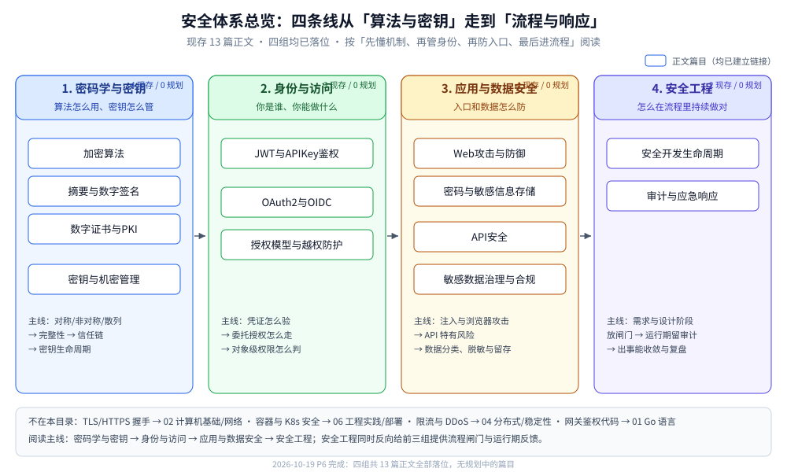

# 安全

> 覆盖：一个后端系统在**密码学与密钥、身份与访问、应用与数据安全、安全工程**四个面上的安全机制与工程判据。
>
> 不覆盖：TLS 握手、证书校验与排障见 [HTTPS与TLS.md](../../02-计算机基础/网络/应用层/HTTPS与TLS.md)；
> 容器与 K8s 侧的安全机制见 [K8s部署流程.md](../部署/k8s/K8s部署流程.md)；
> 限流、熔断与 DDoS 的应用层防护见 [稳定性/README.md](../../04-架构与系统/分布式/稳定性/README.md)。
>
> 内容整理自个人学习笔记。本文件只给阅读顺序与分组边界，每篇的知识点描述见
> [全仓知识点目录](../../目录.md)。
>
> 目录实数：现存 13 篇正文（`密码学与密钥/` 4 · `身份与访问/` 3 · `应用与数据安全/` 4 · `安全工程/` 2）；
> 四组均已落位，暂无规划中的篇目。

## 一、先读哪几篇

| 目标 | 阅读顺序 | 一句话 |
|---|---|---|
| 只补 Web 漏洞与上线自查 | [Web攻击与防御.md](应用与数据安全/Web攻击与防御.md) → [密码与敏感信息存储.md](应用与数据安全/密码与敏感信息存储.md) | 先把入口被打穿的方式看全，再处理「泄露后最值钱的口令」 |
| 做登录、网关鉴权与开放 API | [JWT与APIKey鉴权.md](身份与访问/JWT与APIKey鉴权.md) → [摘要与数字签名.md](密码学与密钥/摘要与数字签名.md) → [数字证书与PKI.md](密码学与密钥/数字证书与PKI.md) | 从「凭证怎么验」走到「签名与证书为什么可信」 |
| 接第三方登录 / SSO | [OAuth2与OIDC.md](身份与访问/OAuth2与OIDC.md) → [JWT与APIKey鉴权.md](身份与访问/JWT与APIKey鉴权.md) → [授权模型与越权防护.md](身份与访问/授权模型与越权防护.md) | 授权码 + PKCE 拿令牌，再验身份，最后判资源权限 |
| 排查「改成别人的 ID 就能看」 | [授权模型与越权防护.md](身份与访问/授权模型与越权防护.md) → [JWT与APIKey鉴权.md](身份与访问/JWT与APIKey鉴权.md) | 先分清横向/纵向越权，再回到凭证与网关边界 |
| 打密码学底座 | [加密算法.md](密码学与密钥/加密算法.md) → [摘要与数字签名.md](密码学与密钥/摘要与数字签名.md) → [数字证书与PKI.md](密码学与密钥/数字证书与PKI.md) | 对称 / 非对称 / 散列 → 完整性 → 信任链 |
| 做静态加密与密钥托管 | [密钥与机密管理.md](密码学与密钥/密钥与机密管理.md) → [加密算法.md](密码学与密钥/加密算法.md) | 先定 KEK / DEK 分层与轮换口径，再回到算法与信封加密 |
| 校对口令存储 | [密码与敏感信息存储.md](应用与数据安全/密码与敏感信息存储.md) → [加密算法.md](密码学与密钥/加密算法.md) | 先看慢哈希与加盐，再回到散列算法的性质 |
| 做对外开放 API | [API安全.md](应用与数据安全/API安全.md) → [授权模型与越权防护.md](身份与访问/授权模型与越权防护.md) → [JWT与APIKey鉴权.md](身份与访问/JWT与APIKey鉴权.md) | 先看对象级授权与 SSRF，再回到凭证与 scope |
| 做数据合规与上线审查 | [敏感数据治理与合规.md](应用与数据安全/敏感数据治理与合规.md) → [安全开发生命周期.md](安全工程/安全开发生命周期.md) | 先盘清数据与留存删除，再把安全活动嵌进流程 |
| 准备应急与复盘 | [审计与应急响应.md](安全工程/审计与应急响应.md) → [敏感数据治理与合规.md](应用与数据安全/敏感数据治理与合规.md) | 先建审计事件与证据链，再谈泄露定级与通知 |

## 二、分组与篇目

### 2.1 密码学与密钥

| 篇目 | 一句话 |
|---|---|
| [加密算法.md](密码学与密钥/加密算法.md) | 对称 / 非对称 / 散列三类算法的清单与选型、密钥长度、RSA 原理与信封加密 |
| [摘要与数字签名.md](密码学与密钥/摘要与数字签名.md) | 摘要、签名、HMAC、算法弃用线、开放 API 的防篡改与防重放 |
| [数字证书与PKI.md](密码学与密钥/数字证书与PKI.md) | X.509 字段、CSR 签发、证书链验证、证书自动化与常见事故 |
| [密钥与机密管理.md](密码学与密钥/密钥与机密管理.md) | 根密钥 / KEK / DEK 分层、KMS / Vault / HSM 职责、机密生命周期与泄漏面、KEK 重包与 DEK 重加密、丢失与泄露止损 |

### 2.2 身份与访问

| 篇目 | 一句话 |
|---|---|
| [JWT与APIKey鉴权.md](身份与访问/JWT与APIKey鉴权.md) | JWT 三段、`exp`、401/403、Bearer、API Key，以及鉴权在网关流水线里的位置 |
| [OAuth2与OIDC.md](身份与访问/OAuth2与OIDC.md) | 四方角色、授权码 + PKCE、access / refresh / ID token、OIDC 身份层、刷新轮换、SSO 与常见实现漏洞 |
| [授权模型与越权防护.md](身份与访问/授权模型与越权防护.md) | ACL / RBAC / ABAC / ReBAC 的选型、对象级授权、IDOR / BOLA、多租户隔离、权限缓存与越权测试 |

### 2.3 应用与数据安全

| 篇目 | 一句话 |
|---|---|
| [Web攻击与防御.md](应用与数据安全/Web攻击与防御.md) | SQL 注入、XSS、CSRF、头注入、Cookie 窃取、上传、DDoS、CORS 与 CSP、安全响应头 |
| [密码与敏感信息存储.md](应用与数据安全/密码与敏感信息存储.md) | 口令哈希、盐、慢哈希、工作因子、Go / Java 实现与失败锁定 |
| [API安全.md](应用与数据安全/API安全.md) | OWASP API Top 10、BOLA / BFLA、批量赋值与过度暴露、SSRF、参数污染、幂等与 API 资产清单 |
| [敏感数据治理与合规.md](应用与数据安全/敏感数据治理与合规.md) | 分类分级、字段清单、脱敏 / 令牌化 / 加密 / 哈希、日志与导出、留存删除、DSAR 与 PIPL / GDPR / 等保映射 |

> 注意：`密码与敏感信息存储` 讲的是**口令（password）**的存储，不是密码学；算法一侧从
> [加密算法.md](密码学与密钥/加密算法.md) 进入。

### 2.4 安全工程

| 篇目 | 一句话 |
|---|---|
| [安全开发生命周期.md](安全工程/安全开发生命周期.md) | 七阶段安全活动、DFD + STRIDE、SAST / DAST / SCA / IAST、供应链与 SBOM、CI 门禁与风险接受 |
| [审计与应急响应.md](安全工程/审计与应急响应.md) | 审计事件模型、采集与留存、哈希链与外部锚点、IR 六阶段、取证与证据链、泄露通知与复盘 |

## 三、依赖关系

| 篇目 | 建议先读 | 为什么 |
|---|---|---|
| [摘要与数字签名.md](密码学与密钥/摘要与数字签名.md) | [加密算法.md](密码学与密钥/加密算法.md) | 先知道散列与非对称的性质，才理解「签名只签摘要」 |
| [数字证书与PKI.md](密码学与密钥/数字证书与PKI.md) | [摘要与数字签名.md](密码学与密钥/摘要与数字签名.md) | 证书本质上是 CA 对「公钥 + 身份信息」的签名 |
| [密钥与机密管理.md](密码学与密钥/密钥与机密管理.md) | [加密算法.md](密码学与密钥/加密算法.md) | 先知道对称算法与信封加密，再谈 KEK / DEK 的分层与轮换 |
| [JWT与APIKey鉴权.md](身份与访问/JWT与APIKey鉴权.md) | [摘要与数字签名.md](密码学与密钥/摘要与数字签名.md) | JWT 的签名与 HMAC 校验是凭证可信的底座 |
| [OAuth2与OIDC.md](身份与访问/OAuth2与OIDC.md) | [JWT与APIKey鉴权.md](身份与访问/JWT与APIKey鉴权.md) | ID token 的格式与验签建立在 JWT 之上 |
| [授权模型与越权防护.md](身份与访问/授权模型与越权防护.md) | [JWT与APIKey鉴权.md](身份与访问/JWT与APIKey鉴权.md)、[OAuth2与OIDC.md](身份与访问/OAuth2与OIDC.md) | 先确认主体与 scope，再谈对象级授权 |
| [密码与敏感信息存储.md](应用与数据安全/密码与敏感信息存储.md) | [加密算法.md](密码学与密钥/加密算法.md)、[摘要与数字签名.md](密码学与密钥/摘要与数字签名.md) | 先分清散列与加密，再理解为什么口令要用慢哈希 |
| [Web攻击与防御.md](应用与数据安全/Web攻击与防御.md) | [加密算法.md](密码学与密钥/加密算法.md) | 先建立认证 / 加密 / 完整性三个目标，再看七类攻击各自破坏哪一条 |
| [API安全.md](应用与数据安全/API安全.md) | [授权模型与越权防护.md](身份与访问/授权模型与越权防护.md)、[Web攻击与防御.md](应用与数据安全/Web攻击与防御.md) | 先分清对象级授权与注入入口，再看批量赋值、SSRF 与资源消耗 |
| [敏感数据治理与合规.md](应用与数据安全/敏感数据治理与合规.md) | [密码与敏感信息存储.md](应用与数据安全/密码与敏感信息存储.md)、[密钥与机密管理.md](密码学与密钥/密钥与机密管理.md) | 先能区分哈希 / 加密 / 令牌化，再谈字段级治理与留存删除 |
| [安全开发生命周期.md](安全工程/安全开发生命周期.md) | [Web攻击与防御.md](应用与数据安全/Web攻击与防御.md)、[API安全.md](应用与数据安全/API安全.md) | 威胁建模与门禁要先知道具体攻击面，否则只是流程表演 |
| [审计与应急响应.md](安全工程/审计与应急响应.md) | [安全开发生命周期.md](安全工程/安全开发生命周期.md)、[授权模型与越权防护.md](身份与访问/授权模型与越权防护.md) | 审计要覆盖 SDL 识别出的决策点，取证要能还原授权判定 |

## 四、与其它目录的分工

| 相关目录 / 篇目 | 分工 |
|---|---|
| [HTTPS与TLS.md](../../02-计算机基础/网络/应用层/HTTPS与TLS.md) | TLS 握手、证书校验、mTLS 落地与 HTTPS 排障的单一来源 |
| [安全与认证.md](../../03-数据与中间件/中间件/RPC框架/gRPC/安全与认证.md) | gRPC 的 TLS / mTLS 与 token 凭据 |
| [稳定性/README.md](../../04-架构与系统/分布式/稳定性/README.md) | 限流、熔断、降级与 DDoS 的应用层防护 |
| [K8s部署流程.md](../部署/k8s/K8s部署流程.md) | Secret 投递、RBAC 与 Pod 侧的安全边界 |
| [容器原理.md](../部署/docker/容器原理.md) | Namespace / cgroup / rootfs 这些容器隔离机制本身 |
| [从零实现网关.md](../../01-编程语言/go/网络编程/从零实现网关.md) | 网关鉴权流水线与内部头剥离的代码实现 |
| [端到端加密.md](../../04-架构与系统/系统设计/IM系统/端到端加密.md) | 业务域内的端到端加密与密钥体系 |
| [内容审核与合规.md](../../04-架构与系统/系统设计/IM系统/内容审核与合规.md) | IM 内容审核、留存与取证，与数据治理篇的边界 |
| [日志与错误规范.md](../../01-编程语言/go/工程实践/日志与错误规范.md) | 结构化日志写法与请求上下文；审计事件的 schema 与留存策略不放这里 |
| [可观测性选型对比.md](../../03-数据与中间件/中间件/可观测性/可观测性选型对比.md) | 指标 / 链路 / 日志三件套的分工；审计链路只强调完整性、留存与防篡改 |

## 五、已知缺口与维护约定

### 5.1 规划中的篇目

当前无规划篇目。四个分组都已落位，共 13 篇正文。

### 5.2 维护约定

- 新增篇目先全仓 `grep`，确认不与 Web 攻击、JWT、PKI / TLS、网关实现重复；重复的只写判据和链接。
- 每篇的配图放在所属分组的 `images/`；正文图片行前后各留一个空行。
- 新篇完成后同步本文件的篇目表、[全仓知识点目录](../../目录.md) 与反向引用。
- 涉及具体法条与合规结论时，只做工程映射，并注明需法务确认。
