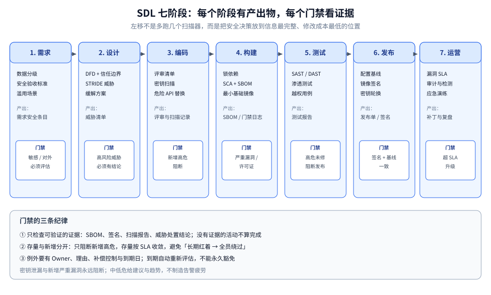
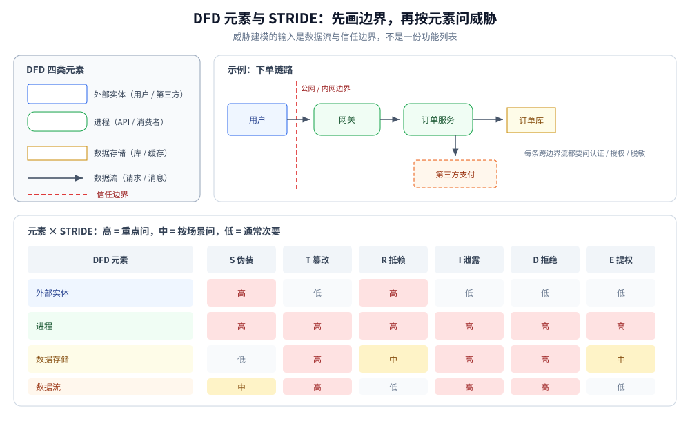
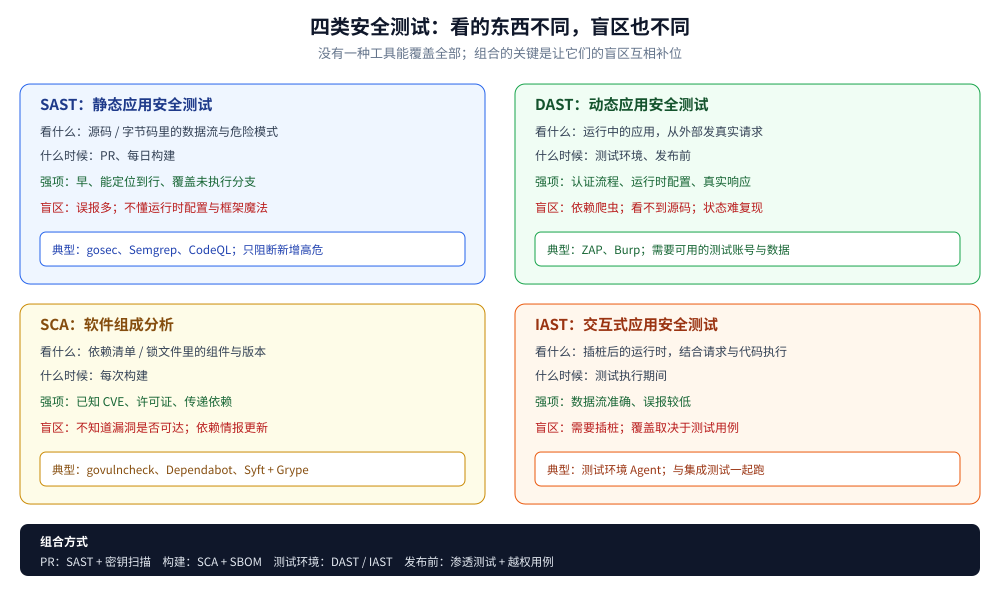
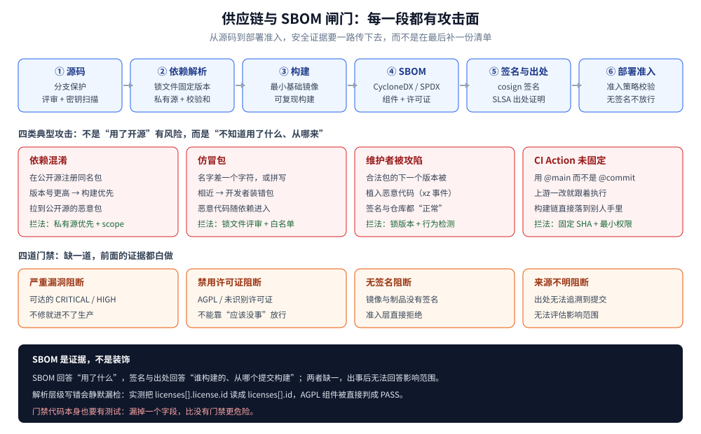

# 安全开发生命周期

> 覆盖：把安全活动嵌进需求、设计、编码、构建、测试、发布、运营七个阶段；
> 威胁建模（DFD + STRIDE）、SAST / DAST / SCA / 密钥扫描的分工、
> SBOM 与供应链、CI 门禁的阈值与风险接受。
>
> 不覆盖：SQLi、XSS、CSRF、CORS 等具体攻击原理见 [Web攻击与防御.md](../应用与数据安全/Web攻击与防御.md)；
> API 越权、批量赋值与 SSRF 见 [API安全.md](../应用与数据安全/API安全.md)；
> 密钥托管与轮换见 [密钥与机密管理.md](../密码学与密钥/密钥与机密管理.md)；
> 流水线本身的搭建见 [CI-CD面试题.md](../../部署/CI-CD面试题.md)；
> 运行期审计、取证与复盘见 [审计与应急响应.md](审计与应急响应.md)。
>
> 内容整理自个人学习笔记。实测口径：SBOM 组件的漏洞与许可证门禁用
> `golang:1.26-alpine` 运行，输出见「具体使用」第 2 小节；
> CI 配置、STRIDE 工作表与风险接受流程为构造示例，未接入真实流水线与制品库。

---

## 一、为什么要把安全活动「左移」？

**本节要点**：左移不是让开发顺手做点安全检查，而是把安全决策放到**信息最完整、修改成本最低**的阶段；
越晚发现，修复要动的设计、数据和发布窗口越多。

### 1.1 修复成本随阶段上升

| 发现问题阶段 | 典型修复动作 | 代价 |
|---|---|---|
| 需求 | 改一条验收标准 | 一次讨论 |
| 设计 | 改数据流、信任边界、权限模型 | 改文档 + 评审 |
| 编码 | 改实现、补测试 | 改代码 + 回归 |
| 测试 | 回滚需求、补设计、改代码 | 跨团队返工 |
| 发布后 | 应急修复、数据订正、通知、取证 | 线上事故 + 合规成本 |

⭐ 表中的倍数因团队与系统而异，但趋势稳定：**一个在设计阶段就能避免的越权，
到了线上往往要用「改数据 + 通知 + 复盘」来收尾**。

### 1.2 七个阶段各放什么安全活动



| 阶段 | 安全活动 | 产出物 | 门禁 |
|---|---|---|---|
| 需求 | 确定数据分级、合规要求、滥用场景 | 安全需求清单、验收标准 | 敏感数据 / 对外暴露必须评估 |
| 设计 | 画数据流、标信任边界、威胁建模 | 威胁清单、缓解方案 | 高风险威胁必须有处置结论 |
| 编码 | 安全编码规范、代码评审、密钥扫描 | 评审记录、扫描结果 | 新增高危问题阻断 |
| 构建 | 依赖锁定、SCA、SBOM、产物签名 | SBOM、签名、构建溯源 | 严重漏洞 / 禁用许可证阻断 |
| 测试 | SAST / DAST / 渗透测试 / 模糊测试 | 测试报告、缺陷单 | 未修复的高危缺陷阻断发布 |
| 发布 | 配置基线、密钥轮换、发布评审 | 配置清单、变更记录 | 生产配置与基线一致 |
| 运营 | 漏洞监控、补丁 SLA、审计、应急 | 补丁记录、事件复盘 | 超 SLA 的漏洞升级 |

⚠️ 左移最常见的失败是「只加了工具，没有改流程」：CI 里多跑一个扫描器，
但没人看结果、没有阈值、没有 Owner，最后所有人都学会点「忽略」。

## 二、威胁建模怎么从一张图开始？

**本节要点**：威胁建模不是写一份大文档，而是用**数据流图 + 信任边界**把系统拆开，
再对每类元素问 STRIDE 六个问题，最后只留下「值得处理」的威胁。

### 2.1 先画 DFD：四类元素与一条边界

| DFD 元素 | 画法 | 例子 |
|---|---|---|
| 外部实体（External Entity） | 矩形 | 用户、第三方支付、合作方系统 |
| 进程（Process） | 圆 / 圆角矩形 | API 服务、定时任务、消息消费者 |
| 数据存储（Data Store） | 两条平行线 / 圆柱 | MySQL、Redis、对象存储、日志 |
| 数据流（Data Flow） | 带箭头线 | 请求、响应、消息、文件 |
| 信任边界（Trust Boundary） | 虚线 | 公网 / 内网、租户 / 平台、服务 / 第三方 |

信任边界是重点：**跨边界的每一条流，都要回答「谁认证、谁授权、数据要不要脱敏 / 加密」**。
没有边界的 DFD 只是架构图，不能用来找威胁。

### 2.2 STRIDE：对每类元素问六个问题

| 威胁 | 破坏的目标 | 典型问题 | 典型缓解 |
|---|---|---|---|
| **S**poofing | 认证 | 调用方能否伪装成别人 | 强认证、mTLS、签名 |
| **T**ampering | 完整性 | 数据 / 消息能否被改 | 校验、HMAC、参数化、只追加 |
| **R**epudiation | 不可抵赖 | 操作能否被否认 | 审计日志、哈希链、时间同步 |
| **I**nformation disclosure | 机密性 | 数据会不会多给、乱放 | 字段级授权、脱敏、加密 |
| **D**enial of service | 可用性 | 资源能否被耗尽 | 限流、配额、大小上限、隔离 |
| **E**levation of privilege | 授权 | 能否越权做更高动作 | 默认拒绝、对象级授权、最小权限 |

### 2.3 元素 × STRIDE 的适用矩阵

不是每个元素都要问六遍：外部实体主要担心 S / R，数据流主要担心 T / I / D，
进程六类都可能，数据存储主要担心 T / I / D。



| 元素 | S | T | R | I | D | E |
|---|---|---|---|---|---|---|
| 外部实体 | 高 | 低 | 高 | 低 | 低 | 低 |
| 进程 | 高 | 高 | 高 | 高 | 高 | 高 |
| 数据存储 | 低 | 高 | 中 | 高 | 高 | 中 |
| 数据流 | 中 | 高 | 低 | 高 | 高 | 低 |

### 2.4 从威胁到行动

每条威胁至少写清四件事：

```text
威胁：攻击者改 URL 里的 order_id，读取别人的订单
位置：GET /api/orders/{id}（进程 P2，跨租户信任边界）
影响：个人信息泄露；横向越权
缓解：查询强制带 tenant_id + owner_id；跨主体返回 404；补越权集成测试
验证：测试用例 / 代码位置 / 上线后的审计断言
Owner：订单服务组；状态：已修复 / 接受 / 待办
```

评级建议用「可能性 × 影响」，并绑定数据分级与暴露面：
**公网可达 + 敏感个人信息 + 无认证** 的组合，不能因为「实现很简单」就降级。

## 三、安全编码与代码审查要查什么？

**本节要点**：代码评审看的是**边界与默认值**：输入从哪里来、输出到哪里去、
权限在哪里判、密钥在哪里放、错误信息给了谁。

### 3.1 一张评审清单

| # | 检查点 | 常见问题 |
|---|---|---|
| 1 | 输入边界 | 是否在入口校验类型、长度、范围、枚举；是否信任了客户端校验 |
| 2 | 输出上下文 | HTML / JS / URL / SQL / 命令行是否按上下文处理 |
| 3 | 查询构造 | 是否全部参数化；ORM 的 `Raw` / `Where` 是否拼接 |
| 4 | 授权位置 | 是否每个对象操作都判归属；是否只靠前端隐藏 |
| 5 | 认证与凭证 | 令牌是否校验签名、`exp`、`aud`、`iss`；是否可撤销 |
| 6 | 密钥与配置 | 是否硬编码、进镜像、进日志；是否从密钥服务读取 |
| 7 | 加密用法 | 是否用了安全随机数、AEAD、正确的 nonce；是否自己造算法 |
| 8 | 错误处理 | 是否把堆栈、SQL、内部路径返回给客户端 |
| 9 | 文件与命令 | 是否拼接 shell；上传是否双白名单；解压是否限制 |
| 10 | 日志与审计 | 是否记录敏感数据；安全事件是否可追溯 |

### 3.2 语言相关的危险 API

| 语言 | 高危点 | 替代 |
|---|---|---|
| Go | `template.HTML` / `text/template` 渲染 HTML、`exec.Command("sh", "-c", ...)`、`InsecureSkipVerify: true`、`math/rand` 生成令牌 | `html/template`、参数化命令、`crypto/rand`、正常证书校验 |
| Java | `Statement` 拼接 SQL、`Runtime.exec` 拼字符串、`ObjectInputStream` 反序列化、`XXE` 默认开启 | `PreparedStatement`、进程参数数组、白名单反序列化、禁用外部实体 |
| PHP | `eval`、`unserialize`、`include $_GET[...]`、`addslashes` 防注入 | 参数化 PDO、`json_decode`、固定 include 路径、预处理 |

### 3.3 静态扫描与密钥扫描

| 工具类型 | 能做什么 | 不能做什么 |
|---|---|---|
| SAST（如 gosec、Semgrep、CodeQL） | 在源码里找危险模式与数据流 | 不知道运行时配置与真实权限 |
| 密钥扫描（gitleaks、trufflehog） | 在提交 / 历史里找凭证 | 不判断凭证是否仍有效 |
| Lint / 规范检查 | 统一写法、拦截明显错误 | 不懂业务语义 |

⭐ 密钥扫描要覆盖**提交历史**，不只看当前文件；一旦发现真实密钥，
第一动作是**吊销 / 轮换**，不是删掉那一行。

## 四、SAST、DAST、SCA、IAST 各能发现什么？

**本节要点**：四类工具看的对象不同——源码、运行中的应用、依赖、运行时插桩；
没有一种能覆盖全部，组合使用才有意义。



| 类型 | 看什么 | 什么时候跑 | 强项 | 盲区 |
|---|---|---|---|---|
| **SAST** | 源码 / 字节码 | PR、每日构建 | 早、能定位到行、覆盖未执行分支 | 误报多；不懂运行时配置与框架魔法 |
| **DAST** | 运行中的应用（黑盒） | 测试环境、发布前 | 真实请求、认证流程、配置问题 | 覆盖依赖爬虫；看不到源码；状态难复现 |
| **SCA** | 依赖清单 / 锁文件 | 每次构建 | 已知 CVE、许可证、传递依赖 | 不知道漏洞是否可达；新漏洞依赖情报更新 |
| **IAST** | 插桩后的运行时 | 测试执行期间 | 数据流准确、误报较低 | 需要插桩；覆盖取决于测试用例 |

补充手段：

- **密钥扫描**：提交前 + CI + 历史扫描；
- **容器 / IaC 扫描**：镜像基础层、K8s YAML、Terraform 配置；
- **模糊测试**：解析器、协议、文件格式；
- **渗透测试**：发布前的业务逻辑与越权，工具替代不了人。

⭐ 一个常见误区：**SCA 报了 CVE 不等于可利用**。要结合依赖是否被调用、
输入是否可控、版本是否受影响来定级；但「不可达」的结论要有证据，
不能因为「应该没用到」就忽略。

## 五、供应链安全：依赖、构建、产物怎么管？

**本节要点**：现代应用的大部分代码不是自己写的。供应链攻击的目标不是你的业务逻辑，
而是**依赖解析、构建环境、制品仓库**这三段信任链。



### 5.1 依赖解析阶段的攻击

| 攻击 | 手法 | 防护 |
|---|---|---|
| 依赖混淆 | 抢注内部包名到公共仓库，让构建优先拉到恶意包 | 内部包使用私有 scope / 私有仓库；禁止公共源覆盖内部包 |
| 仿冒包 | 与热门包名差一个字符 | 依赖评审、锁文件、来源校验 |
| 维护者被攻陷 | 在合法包的新版本里植入恶意代码 | 锁版本、延迟升级、SBOM diff、行为监控 |
| 传递依赖 | 直接依赖干净，深层依赖有问题 | 锁定完整依赖图、SCA 覆盖传递依赖 |

### 5.2 构建与产物

- **锁文件 + 校验和**：构建必须可复现，不能每次解析到不同版本；
- **最小基础镜像**：减少系统包与攻击面；非 root 运行；
- **SBOM**：每次构建生成 SPDX / CycloneDX，包含传递依赖，随制品一起存；
- **产物签名与溯源**：用 Sigstore / cosign 签名，记录构建来源（SLSA provenance）；
- **部署准入**：K8s admission controller 校验签名、SBOM 策略与镜像来源；
- **CI 自身**：Action / 插件按 commit SHA 固定，令牌最小权限，保护分支与环境审批。

### 5.3 SBOM 怎么用于门禁

SBOM 不是一份「合规附件」，而是可查询的资产清单。门禁至少查三类：

| 检查 | 判据 | 动作 |
|---|---|---|
| 严重漏洞 | `CRITICAL` / `HIGH` 且受影响版本 | 阻断，除非有风险接受 |
| 许可证 | GPL / AGPL / SSPL 等与分发方式冲突 | 阻断或法务评审 |
| 组件来源 | 未知仓库、无校验和、非锁定版本 | 阻断 |

实测（完整输出见「具体使用」第 2 小节）：

```text
[FAIL] golang.org/x/crypto v0.17.0 — HIGH CVE-2023-48795
[PASS] github.com/foo/bar v1.2.3
[FAIL] github.com/baz/qux v0.9.0 — 许可证 AGPL-3.0-only 在拒绝清单
[FAIL] github.com/old/lib v1.0.0 — CRITICAL CVE-2024-0001
门禁结果：FAIL（3 个阻断项）
```

## 六、CI 门禁怎么设才不沦为形式？

**本节要点**：门禁要**少而硬**：密钥泄漏与新增高危永远阻断，历史存量按基线逐步收敛，
其余给建议；每个例外都要有 Owner、理由与到期日。

### 6.1 阻断与建议分开

| 门禁 | 触发 | 阈值 | 动作 |
|---|---|---|---|
| 密钥扫描 | 每次提交 / 构建 | 任何真实凭证 | **阻断**，并立即轮换 |
| 新增高危漏洞 | PR diff | 新增 `CRITICAL` / `HIGH` | **阻断** |
| 存量高危 | 全量扫描 | 超过 SLA 未修 | 升级，不阻断日常 PR |
| 依赖许可证 | 构建 | 拒绝清单命中 | **阻断**或法务评审 |
| SBOM 生成 | 每次构建 | 缺失 / 解析失败 | **阻断** |
| SAST 中危 | PR | 新增 | 建议，计入趋势 |
| DAST | 测试环境 | 高危 | 发布前阻断 |
| 镜像签名 | 部署 | 无签名 / 来源不明 | **阻断** |

### 6.2 存量与新增要分开算

直接在存量项目上开「全量高危阻断」，通常结果是流水线长期红着、所有人绕过。
更可行的做法是**基线 + 棘轮**：

1. 首次扫描记录存量清单与数量；
2. 只阻断**新增**问题；
3. 给存量设修复 SLA（按严重度与暴露面）；
4. 每次修复后下调基线，不允许回升。

### 6.3 风险接受不是「点忽略」

例外必须有记录：

```text
漏洞 / 规则：CVE-2024-XXXX（HIGH）
组件与版本：example.com/lib v1.2.3
不可达证据：调用链未触达受影响的解析函数（附扫描 / 代码位置）
补偿控制：WAF 规则、出站限制、功能开关关闭
Owner：支付服务组 / 安全负责人
到期：2026-12-31（到期自动重新评估）
审批：安全委员会 / 架构评审记录链接
```

⭐ 没有到期日的风险接受等于永久豁免；到期后要重新判断，而不是自动续期。

## 七、发布与运营阶段还要做什么？

**本节要点**：发布不是 SDL 的终点。配置基线、密钥轮换、漏洞监控与应急响应，
决定「已经上线的系统」能不能持续保持安全。

| 阶段 | 动作 | 证据 |
|---|---|---|
| 发布前 | 威胁模型复核、渗透测试、配置基线检查 | 评审记录、测试报告、配置 diff |
| 发布中 | 灰度、特性开关、回滚预案、密钥轮换 | 发布单、监控指标 |
| 发布后 | 漏洞情报监控、补丁 SLA、依赖升级 | 补丁记录、升级 PR |
| 持续 | 审计日志、异常检测、应急演练 | 审计报表、演练复盘 |
| 事件后 | 根因分析、检测缺口、行动项 | 复盘文档、Owner 与截止日期 |

运行期的审计事件模型、IR 六阶段与取证见 [审计与应急响应.md](审计与应急响应.md)。

## 八、一个可落地的最小 SDL 清单

**本节要点**：先做能留下证据的六件事，再谈平台化；没有证据的活动等于没做。

| # | 阶段 | 最小活动 | 证据 |
|---|---|---|---|
| 1 | 需求 | 数据分级 + 安全验收标准 | 需求文档中的安全条目 |
| 2 | 设计 | 一张带信任边界的 DFD + STRIDE 威胁清单 | 威胁表与处置结论 |
| 3 | 编码 | 代码评审清单 + 密钥扫描 | 评审记录、扫描报告 |
| 4 | 构建 | 锁文件 + SCA + SBOM | SBOM 文件、门禁日志 |
| 5 | 测试 | 新增代码 SAST + 测试环境 DAST | 扫描报告、缺陷闭环 |
| 6 | 发布 | 配置基线 + 镜像签名 + 回滚预案 | 发布单、签名验证记录 |
| 7 | 运营 | 漏洞 SLA + 审计 + 应急演练 | 补丁记录、演练复盘 |

## 应用场景

| 场景 | 重点 | 最小做法 |
|---|---|---|
| 新系统立项 | 数据流与信任边界还没固化 | 需求阶段做数据分级，设计阶段做 STRIDE |
| 存量系统改造 | 历史漏洞多、没人认领 | 先盘点资产与依赖，基线 + 棘轮 |
| 外包 / 供应商交付 | 代码与构建过程不可见 | 合同约定 SBOM、扫描报告、签名与验收门禁 |
| 开源项目 | 维护者与依赖风险 | 锁版本、签名发布、披露流程、最小权限 CI |
| 金融 / 医疗 | 合规与数据敏感 | 威胁建模 + 影响评估 + 审计与保留 |
| 云原生 / 多集群 | 镜像与配置漂移 | 镜像签名、SBOM、admission 准入、IaC 扫描 |
| 快速迭代团队 | 门禁容易成为瓶颈 | 只硬阻断密钥与新增高危，其余建议 + 趋势 |

## 具体使用

**本节要点**：下面给四段可直接套用的模板：STRIDE 工作表、SBOM 门禁、
CI 配置骨架与风险接受记录。SBOM 门禁已实测，其余为构造示例。

### 1) STRIDE 工作表

```json
[
  {
    "id": "T-001",
    "element": "GET /api/orders/{id}",
    "stride": "Elevation of privilege",
    "threat": "改 order_id 读取他人订单",
    "impact": "个人信息泄露，横向越权",
    "likelihood": "high",
    "mitigation": "查询带 tenant_id + owner_id；跨主体 404",
    "verification": "越权集成测试 + 审计断言",
    "owner": "order-service",
    "status": "fixed"
  },
  {
    "id": "T-002",
    "element": "webhook 回调地址",
    "stride": "Information disclosure",
    "threat": "回调 URL 指向云元数据或内网服务",
    "impact": "凭证泄露、内网探测",
    "likelihood": "medium",
    "mitigation": "协议白名单 + 全部解析结果检查 + 固定 IP 拨号",
    "verification": "SSRF 用例集",
    "owner": "open-platform",
    "status": "open"
  }
]
```

### 2) SBOM 门禁：漏洞严重度 + 许可证

```go
type LicenseEntry struct {
    License License `json:"license"`
}

type Component struct {
    Name            string          `json:"name"`
    Version         string          `json:"version"`
    Licenses        []LicenseEntry  `json:"licenses"`
    Vulnerabilities []Vulnerability `json:"vulnerabilities"`
}

var denySeverity = map[string]bool{"CRITICAL": true, "HIGH": true}
var denyLicense = map[string]bool{
    "GPL-3.0-only":    true,
    "AGPL-3.0-only":   true,
    "SSPL-1.0":        true,
}

for _, c := range doc.Components {
    for _, v := range c.Vulnerabilities {
        if denySeverity[strings.ToUpper(v.Severity)] {
            reasons = append(reasons, v.Severity+" "+v.ID)
        }
    }
    for _, l := range c.Licenses {
        if denyLicense[l.License.ID] {
            reasons = append(reasons, "许可证 "+l.License.ID)
        }
    }
}
```

```text
== 第一次构建：有高危漏洞与许可证冲突 ==
SBOM：CycloneDX 1.5，组件数 = 4
[FAIL] golang.org/x/crypto v0.17.0 — HIGH CVE-2023-48795
[PASS] github.com/foo/bar v1.2.3
[FAIL] github.com/baz/qux v0.9.0 — 许可证 AGPL-3.0-only 在拒绝清单
[FAIL] github.com/old/lib v1.0.0 — CRITICAL CVE-2024-0001
门禁结果：FAIL（3 个阻断项）

== 修复后：升级依赖、替换许可证 ==
[PASS] golang.org/x/crypto v0.31.0
[PASS] github.com/foo/bar v1.2.3
[PASS] github.com/baz/qux v0.9.0
[PASS] github.com/old/lib v1.1.0
门禁结果：PASS（0 个阻断项）
```

⭐ 注意 CycloneDX 的许可证结构是 `licenses[].license.id`，
解析层级写错会**静默漏检**（第一次运行时 AGPL 组件曾被误判为 PASS）；
门禁代码本身也要有测试。

### 3) CI 门禁骨架（构造示例，未接真实流水线）

```yaml
stages: [secret-scan, build, sast, sca-sbom, test, sign]

secret-scan:
  script:
    - gitleaks detect --source . --redact --exit-code 1

build:
  script:
    - go build ./...
    - go test ./...

sast:
  script:
    - gosec -severity high -confidence medium ./...

sca-sbom:
  script:
    - govulncheck ./...
    - syft dir:. -o cyclonedx-json > sbom.json
    - python gate_sbom.py sbom.json   # 严重漏洞 / 许可证 / 来源检查

sign:
  script:
    - cosign sign --yes "$IMAGE_DIGEST"
```

⚠️ CI 里的 Action / 插件要按 **commit SHA** 固定，而不是 `@main`；
令牌给最小权限，生产部署走环境审批。CI 自身被攻陷时，前面所有门禁都会失效。

### 4) 风险接受记录模板（构造示例）

```text
编号：RA-2026-014
对象：example.com/lib v1.2.3 的 CVE-2024-XXXX（HIGH）
不可达证据：调用链只使用 Encode，不触发受影响的 Decode 分支
补偿控制：关闭该功能开关；出站白名单限制
Owner：支付服务组（技术）/ 安全负责人（审批）
到期：2026-12-31
复核方式：到期前重新扫描；组件升级后自动关闭本记录
```

## 延伸追问

- **左移是不是让开发承担所有安全责任？** → 不是。开发提供业务上下文并修复代码，
  安全团队提供标准、工具、评审与例外裁决；责任是共同的，但决策点要明确。
- **威胁建模一定要用 STRIDE 吗？** → 不一定。STRIDE 适合按元素系统扫一遍；
  也可以用攻击树、滥用用例、LINDDUN（隐私）等。关键是**有边界、有威胁、有处置**。
- **SAST 误报太多怎么办？** → 先按规则与路径分级，只阻断新增高危；
  对确认的误报做有期限的抑制，并记录理由；不要全局关闭规则。
- **SCA 报了高危 CVE 就一定要马上升级吗？** → 先确认版本是否受影响、代码是否可达、
  输入是否可控；有补偿控制可以短期接受，但要有 Owner 与到期日。
- **SBOM 生成出来谁看？** → 构建门禁看漏洞与许可证；应急时看「哪些产品受某个组件影响」；
  采购与合规看来源与许可证。没有查询场景的 SBOM 只是附件。
- **镜像签名能防什么？** → 防「制品在仓库或传输过程中被替换」，配合来源溯源还能确认
  是哪个流水线、哪次提交构建的；它不防代码本身的漏洞。
- **CI 门禁失败了能不能先跳过？** → 可以，但要走 break-glass：审批、记录原因、
  限定范围与时限，事后补修复；不能让「跳过」成为默认路径。
- **安全指标看什么？** → 新增高危的修复时长、存量下降趋势、密钥泄漏次数、
  门禁覆盖率、例外数量与到期率；不要只看「扫描了多少次」。
- **开源项目也要做 SDL 吗？** → 要，但可以更轻：依赖锁定、签名发布、披露渠道、
  最小权限 CI、发布前扫描；社区项目最缺的往往是「有人对安全报告负责」。

## 关联

- **上游/总纲**：[README.md](../README.md) — 安全目录的分组与阅读路线
- **同组下游**：[审计与应急响应.md](审计与应急响应.md) — 运行期审计、IR 六阶段与取证
- **攻击原理**：[Web攻击与防御.md](../应用与数据安全/Web攻击与防御.md) — SDL 要防的具体 Web 漏洞
- **API 风险**：[API安全.md](../应用与数据安全/API安全.md) — 威胁建模在 API 场景的落点
- **数据合规**：[敏感数据治理与合规.md](../应用与数据安全/敏感数据治理与合规.md) — 数据分级、影响评估与删除
- **密钥与签名**：[密钥与机密管理.md](../密码学与密钥/密钥与机密管理.md) — 签名密钥、构建凭证与轮换
- **摘要与签名**：[摘要与数字签名.md](../密码学与密钥/摘要与数字签名.md) — 制品签名与完整性校验的算法底座
- **流水线**：[CI-CD面试题.md](../../部署/CI-CD面试题.md) — 构建、测试、发布流水线本身
- **部署准入**：[K8s部署流程.md](../../部署/k8s/K8s部署流程.md) — 镜像、Secret 与 Pod 侧的安全边界
