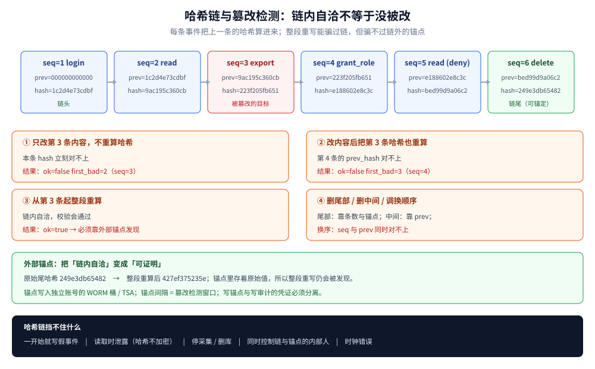
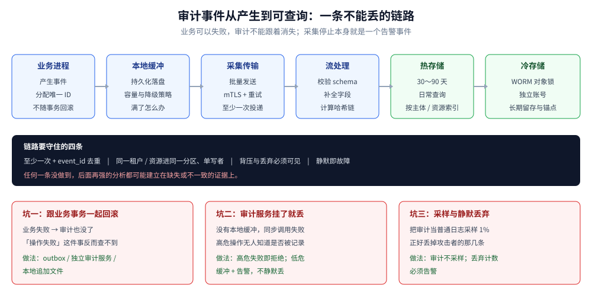
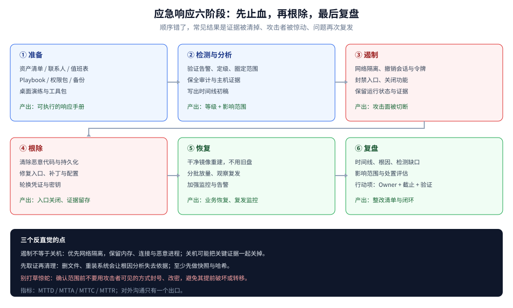

# 审计与应急响应

> 覆盖：审计事件模型与字段、审计写入与采集链路、哈希链的防篡改边界、
> 留存与访问控制、应急响应六阶段、取证与证据链、泄露通知与复盘。
>
> 不覆盖：日志框架与结构化日志写法见 [日志与错误规范.md](../../../01-编程语言/go/工程实践/日志与错误规范.md)；
> 指标 / 链路 / 日志三件套的选型见 [可观测性选型对比.md](../../../03-数据与中间件/中间件/可观测性/可观测性选型对比.md)；
> K8s 自身的 audit 配置见 [K8s部署流程.md](../../部署/k8s/K8s部署流程.md)；
> 数据分级、删除传播与合规映射见 [敏感数据治理与合规.md](../应用与数据安全/敏感数据治理与合规.md)；
> 具体 Web 攻击原理见 [Web攻击与防御.md](../应用与数据安全/Web攻击与防御.md)。
>
> 内容整理自个人学习笔记。实测口径：追加式哈希链的生成、校验与四种篡改场景用
> `golang:1.26-alpine` 运行，输出见「具体使用」第 2 小节；
> 采集链路、外部锚点、取证工具与通知流程为方案 / 模板，未接入真实 SIEM 与线上环境；
> 涉及法条的部分只做工程映射，具体义务需法务确认。

---

## 一、审计日志和普通日志到底差在哪？

**本节要点**：普通日志回答「系统刚才发生了什么」，审计日志回答「**谁在什么时候对什么做了什么，结果如何，事后能不能证明没被改过**」。目的不同，对完整性、保存期限与访问控制的要求就完全不同。

### 1.1 六个维度的差别

| 维度 | 普通日志 | 审计日志 |
|---|---|---|
| 目的 | 排障、观测、容量分析 | 追责、合规、取证、检测 |
| 读者 | 研发、运维 | 安全、审计、法务、监管 |
| 完整性 | 可采样、可降级、可丢 | **不可采样、不可静默丢** |
| 保存期限 | 通常 7～30 天 | 6 个月起，按法规与合同延长 |
| 防篡改 | 一般不要求 | **必须可验证** |
| 字段 | 可随版本变化 | 稳定、版本化、语义明确 |
| 访问 | 团队内可查 | 最小权限，**查审计的人也要被审计** |
| 内容 | 可含调试细节 | 不含口令、令牌、完整敏感数据 |

⚠️ 最常见的错误是「把应用日志换个索引名就叫审计」：日志可以因为采样、异步丢弃、轮转删除而缺失，审计不行；日志字段可以随迭代改，审计字段改了会让历史查询与取证断档。

### 1.2 哪些动作必须记审计

审计事件应落在**安全决策点**，而不是每个函数入口：

| 类别 | 典型事件 |
|---|---|
| 认证 | 登录成功 / 失败、MFA 变更、令牌刷新异常、会话撤销 |
| 授权 | 拒绝访问、角色授予 / 回收、策略变更、跨租户访问 |
| 数据 | 敏感数据读取、导出、批量查询、删除、共享 |
| 管理 | 配置修改、功能开关、白名单变更、密钥与证书操作 |
| 特权 | 超级管理员进入租户、break-glass、代操作（on-behalf-of） |
| 安全控制 | 审计配置变更、日志采集停止、告警规则修改 |

⭐ **拒绝事件往往比成功事件更有价值**：连续 403、跨租户 404、批量导出被拒，都是检测信号。只记成功操作，等于把攻击者的试探全部丢掉。

### 1.3 审计不是「越多越好」

全量记录所有读请求会带来三个问题：存储成本、查询噪音、敏感数据扩散。可按「数据分级 × 操作类型」决定：

- 普通配置读取：不记，或只记聚合指标；
- 个人信息 / 支付 / 密钥相关读取：记；
- 导出、批量查询、跨主体访问：**必记**，并记录查询条件与返回条数；
- 所有拒绝与权限变更：**必记**。

## 二、一条审计事件应该记哪些字段？

**本节要点**：审计事件要能独立回答「谁、何时、对什么、做了什么、结果如何、为什么」；字段一旦发布就要稳定，敏感值只存引用或不可逆摘要。

### 2.1 核心字段

| 字段 | 说明 | 常见坑 |
|---|---|---|
| `event_id` | 全局唯一，幂等去重用 | 用自增 ID 会在多实例下冲突 |
| `occurred_at` | 事件发生时间（UTC，毫秒） | 只记落库时间，时钟漂移后无法排序 |
| `recorded_at` | 审计系统接收时间 | 与发生时间混为一个字段 |
| `actor_type` | `user` / `service` / `system` | 服务账号被当成用户，追责断链 |
| `actor_id` | 用户 ID、服务名、凭证 ID | 只记用户名，改名后无法关联 |
| `on_behalf_of` | 代操作的真实主体 | 管理员代登录时丢失原始身份 |
| `tenant_id` | 租户 / 组织 | 多租户系统必填，不能从请求头取 |
| `action` | 稳定动词，如 `order.read`、`role.grant` | 用自然语言句子，无法聚合 |
| `resource_type` / `resource_id` | 资源类型与 ID | 只记 URL，路径参数化后无法还原 |
| `resource_tenant_id` | 资源所属租户 | 跨租户访问检测的关键 |
| `result` | `allow` / `deny` / `error` | 只记成功，丢掉攻击试探 |
| `reason_code` | 拒绝原因，如 `no_membership` | 只写「无权限」，无法区分策略与故障 |
| `source_ip` / `user_agent` | 来源 | 直接信任 `X-Forwarded-For` |
| `request_id` / `trace_id` | 关联业务请求与链路 | 与业务日志使用不同 ID |
| `policy_version` | 判定所用策略版本 | 事后无法解释「当时为什么放行」 |
| `schema_version` | 事件结构版本 | 字段变更后历史数据无法解析 |

### 2.2 敏感字段怎么处理

- **口令、令牌、Cookie、私钥**：永远不记；
- **手机号、身份证、银行卡、邮箱**：优先记内部 ID；确需关联时记 **HMAC**（按租户加盐），不记明文；
- **请求体**：默认不记；需要复现时记字段名与长度，或脱敏后的摘要；
- **错误信息**：记错误码与内部错误 ID，不把堆栈和 SQL 写进审计。

### 2.3 写入必须独立于业务事务

审计事件不能跟着业务事务一起回滚，否则「操作失败」这件事本身也消失了。三种常见做法：

| 做法 | 机制 | 代价 |
|---|---|---|
| 同库 Outbox | 业务事务内写 outbox 表，提交后由 relay 投递 | 与业务库耦合；relay 要保证不丢 |
| 独立审计服务 | 业务同步 / 异步调用审计 API | 审计服务故障时的降级策略要明确 |
| 本地追加文件 + Agent | 进程写本地文件，Agent 采集 | 容器盘要持久化；文件轮转不能丢事件 |

⭐ **审计写入失败时怎么办**要提前定义：高危操作（授权变更、密钥操作、批量导出）**失败即拒绝**；低危操作可进本地缓冲并告警，但**不能静默丢弃**。

## 三、哈希链能发现篡改吗，边界在哪？

**本节要点**：哈希链能让「改一条、删一条、换顺序」留下可验证的痕迹，但它只保证**链内自洽**；要把「整段重写」也拦住，必须把链头定期锚定到链外。

### 3.1 链是怎么长出来的

每条事件计算：

```text
hash_n = SHA-256(prev_hash || canonical_json(event_n 去掉 hash 字段))
prev_hash_1 = 64 个 0
```

三个细节决定它是否可靠：

1. **规范化序列化**：JSON 键顺序、空格、时间格式必须固定，否则同一条事件重算得到不同哈希；
2. **单写者 / 单分区**：同一条链只能有一个写入者，或按 `tenant_id` 分区，每区一条链；
3. **序号与链头**：`seq` 连续；链头（第一条的哈希）与总条数要单独保存。



### 3.2 六种篡改与检测点

| 篡改方式 | 会被谁发现 |
|---|---|
| 只改内容，不重算哈希 | 本条 `hash` 对不上 |
| 改内容并重算本条 | 下一条的 `prev_hash` 对不上 |
| 把该条之后整段重算 | 链内自洽，**只有外部锚点能发现** |
| 删除尾部若干条 | 链仍自洽，需要条数 / 链头 / 锚点 |
| 删除中间一条 | 后一条 `prev_hash` 对不上 |
| 调换两条顺序 | `seq` 与 `prev_hash` 同时对不上 |

### 3.3 外部锚点：把「自洽」变成「可证明」

每隔固定时间（或固定条数）把当前链尾哈希写到**审计系统管不到的地方**：

- 对象存储的 **WORM / Object Lock** 桶，放在独立账号；
- 时间戳服务（TSA）或透明日志；
- 另一个安全域里的只追加表；
- 极端情况下打印 / 离线介质归档。

锚点间隔就是**篡改检测窗口**：攻击者改了链、也改了当前存储，但只要锚点还在，下一次校验就会发现链尾对不上。

⚠️ 锚点本身也要防篡改：写锚点的凭证不能与写审计的凭证相同，最好连账号都不同。

### 3.4 哈希链挡不住什么

- **一开始就写假事件**：应用主动伪造「用户 A 删除了订单」，链完全合法；
- **读取时泄露**：哈希不提供机密性，敏感字段仍要脱敏 / 加密；
- **可用性攻击**：删库、停采集、打满存储，链再完整也查不到；
- **内部人同时控制链与锚点**：能整段重写并重锚，需要职责分离与第三方留存；
- **时钟错误**：时间戳不可信时，事件顺序只能依赖 `seq`。

⭐ 不要把哈希链说成「区块链」：这里没有共识、没有多方副本，只有**单方可验证的追加日志**。它的价值在于提高篡改成本、留下检测点，而不是让篡改不可能。

## 四、审计数据怎么采集、保存和告警？

**本节要点**：链路要保证「不丢、有序、可查、可告警」；存储要分层并按法规留存；**采集停止本身就是一个必须告警的事件**。

### 4.1 一条典型的采集链路



| 环节 | 职责 | 关键配置 |
|---|---|---|
| 业务进程 | 产生事件，分配 `event_id` | 审计写入不随业务事务回滚 |
| 本地缓冲 | 审计服务不可用时暂存 | 持久化盘、容量上限、满了之后的策略 |
| 采集 / 传输 | 批量发送、压缩、重试 | mTLS、至少一次、背压 |
| 流处理 | 校验 schema、补全字段、计算哈希链 | 按租户 / 流分区、单写者 |
| 热存储 | 最近 30～90 天查询 | 索引 `actor`、`resource`、`result`、`request_id` |
| 冷存储 | 长期留存 | WORM / Object Lock、独立账号 |
| SIEM / 告警 | 关联分析与实时检测 | 规则 + 基线，避免只堆规则 |

### 4.2 不丢事件的四个约定

1. **至少一次投递 + `event_id` 去重**：宁可重复，不可丢失；查询侧按 ID 去重。
2. **顺序只保证到分区**：同一租户 / 同一资源的事件进同一分区；跨分区不要求全序。
3. **背压可见**：缓冲积压、发送失败、schema 拒绝都要有指标；不能只打一行日志。
4. **静默即故障**：某类事件连续 N 分钟为零，触发告警——攻击者常先关采集再动手。

### 4.3 留存与访问

| 数据 | 建议留存 | 说明 |
|---|---|---|
| 热存储 | 30～90 天 | 日常查询与事件响应 |
| 温存储 | 6～12 个月 | 按需恢复，成本较低 |
| 冷存储 | 1～3 年或按法规 | WORM，不可改不可删 |
| 法务保全 | 事件相关数据**停止删除** | legal hold 优先于常规留存策略 |

工程映射（需法务确认）：《网络安全法》要求留存网络日志不少于 **6 个月**；等保 2.0 对审计记录的保护与留存有对应要求；PIPL / GDPR 同时要求「最小必要」和「到期删除」——**审计留存与个人信息删除要在制度上分层处理**，不能因为「要留审计」就无限期保留明文个人信息。

访问控制至少做到：

- 审计库与业务库**账号分离**，业务账号无写审计库权限；
- 审计查询只读，**查询行为本身也记审计**；
- 支持按租户、时间、主体授权查询，避免一个账号看全量；
- 导出审计数据要审批，并记录导出范围。

### 4.4 值得告警的行为

| 信号 | 可能含义 |
|---|---|
| 短时间大量 `deny` | 越权扫描、凭证失效、策略误配 |
| 角色授予 / 回收 | 权限变更，需确认是否走审批 |
| 批量导出 / 大结果集查询 | 数据外带 |
| 管理员非工作时间登录 | 账号被盗或内部风险 |
| 跨租户访问 | 越权或代码缺陷 |
| 密钥 / 证书操作 | 高风险变更 |
| 审计采集中断、链校验失败 | 攻击者正在清痕迹 |

## 五、应急响应六阶段怎么走？

**本节要点**：应急响应是**有顺序的**：先确认与止损，再根除与恢复，最后复盘；顺序错了，常见结果是「证据被清掉、攻击者被惊动、问题复发」。



| 阶段 | 目标 | 关键动作 | 产出 |
|---|---|---|---|
| 准备 | 出事前就位 | 资产清单、联系人、Playbook、权限包、备份、演练 | 可执行的响应手册 |
| 检测与分析 | 确认「是不是、有多大」 | 验证告警、定级、圈定范围、保全证据 | 事件等级、影响范围、时间线初稿 |
| 遏制 | 止血 | 隔离主机、撤销会话 / 令牌、封禁入口、关闭功能 | 攻击面被切断 |
| 根除 | 去掉根因 | 清除恶意代码、修复漏洞、轮换凭证、补检测 | 入口关闭、证据留存 |
| 恢复 | 安全地恢复业务 | 干净镜像重建、分批放量、加强监控 | 业务恢复、复发监控 |
| 复盘 | 防止再来一次 | 时间线、根因、检测缺口、行动项 | 复盘报告与整改清单 |

### 5.1 先定级，再决定动作

| 等级 | 判据（示例） | 响应要求 |
|---|---|---|
| S1 | 核心数据泄露 / 生产全面不可用 / 勒索 | 立即拉起 IC，全员响应，通知管理层与法务 |
| S2 | 单租户数据泄露 / 核心功能受损 / 管理员账号失陷 | 30 分钟内响应，限定范围止损 |
| S3 | 单主机失陷 / 可疑但未确认 | 当班处理，按需升级 |
| S4 | 低风险异常 / 策略告警 | 工单跟踪，趋势分析 |

定级看**影响 × 范围 × 是否仍在持续**，不要只看告警工具的 severity。

### 5.2 角色与沟通

| 角色 | 职责 |
|---|---|
| 事件指挥（IC） | 统一决策与节奏，避免多头指挥 |
| 技术处置 | 遏制、根除、恢复 |
| 取证 | 保全证据、维护证据链 |
| 沟通 | 对内同步、对外口径 |
| 法务 / 合规 | 通知义务、保留要求、合同与监管沟通 |
| 管理层 | 资源协调与对外授权 |

⭐ **对外沟通只有一个出口**。工程团队不要在群里转发未确认的截图、客户信息或攻击细节；这些内容既可能误导，也可能成为新的泄露源。

### 5.3 遏制阶段的三个反直觉点

- **遏制不等于关机**：关机可能丢失内存中的恶意进程、密钥与连接信息；优先**网络隔离**，保留运行状态；
- **先取证再清理**：删除恶意文件、重装系统会让根因分析失去依据；至少先做快照与哈希；
- **不要打草惊蛇**：在确认范围和取证方案前，避免用攻击者可见的方式封号、改密，可能导致其提前破坏或转移。

## 六、取证时哪些动作会毁掉证据？

**本节要点**：取证的核心不是「找到东西」，而是**证明找到的东西没有被动过**；顺序上先取易失数据，再取持久数据，全程维护证据链。

### 6.1 易失性顺序

| 顺序 | 数据 | 为什么先取 |
|---|---|---|
| 1 | CPU 寄存器 / 缓存 | 秒级消失 |
| 2 | 内存 | 进程、密钥、连接、恶意代码常只在内存 |
| 3 | 网络连接 / 路由 / ARP | 重启或断网后消失 |
| 4 | 运行中的进程与句柄 | 进程退出后难恢复 |
| 5 | 磁盘 / 文件系统 | 持久，但可被删除或覆盖 |
| 6 | 远程日志 / 审计 | 可能被轮转或篡改 |
| 7 | 备份 / 归档 | 最后手段，可能已被污染 |

### 6.2 证据链（chain of custody）

每一份证据至少记录：

```text
案件编号：IR-2026-017
证据编号：E-003
来源：prod-app-07 /var/log/audit/audit.log
采集人：张三（安全响应）
采集时间：2026-10-19T11:20:00Z
采集方式：只读挂载 + sha256sum
原始哈希：9f2c...（采集时）
副本哈希：9f2c...（封存时）
存放位置：证据库 / 案件 IR-2026-017 / E-003
移交记录：2026-10-19T12:05Z 张三 → 李四（法务）
```

要点：

- **先哈希，再复制**；分析只在副本上做；
- 原始介质写保护，必要时用写阻断器；
- 每次移交记录时间、人员、目的；
- 证据库独立账号、访问留痕、加密存储。

### 6.3 云上取证的特殊点

- 控制平面日志（谁创建了实例、改了安全组）通常比主机日志更早被触发；
- 对象存储要开访问日志，注意「读」也可能泄露数据；
- 快照要在隔离账号 / 隔离 VPC 中分析，避免污染生产；
- 云厂商的日志留存时间有限，**先导出再分析**；
- 所有时间统一 UTC，并记录时钟偏差。

### 6.4 会毁证据的动作

| 动作 | 后果 |
|---|---|
| 重启 / 关机 | 内存、连接、临时文件丢失 |
| 直接删除恶意文件 | 样本与落地路径丢失 |
| 重装系统 / 重建实例 | 根因与横向痕迹丢失 |
| 用被攻陷的账号登录排查 | 行为混入日志，甚至再次被控 |
| 修改文件时间 / 清理日志 | 时间线不可信 |
| 在生产库上直接跑分析脚本 | 改变数据状态，影响取证与业务 |

## 七、泄露事件怎么定级、什么时候通知？

**本节要点**：通知义务由**数据类别、影响人数、是否可补救、是否持续**共同决定；工程侧要先能回答「泄露了什么、涉及谁、是否加密」，否则法务无法判断。

### 7.1 先回答五个问题

1. 泄露了哪些字段？是否属于个人信息 / 敏感个人信息 / 重要数据？
2. 涉及多少人、哪些租户、是否跨境？
3. 数据是否加密 / 脱敏？密钥是否同时泄露？
4. 泄露是否仍在持续？攻击者是否仍有访问？
5. 是否已采取有效措施避免危害？

### 7.2 法规的工程映射

| 法规 | 触发条件（概要） | 时限 / 对象 | 工程侧要准备 |
|---|---|---|---|
| 中国《个人信息保护法》 | 个人信息泄露、篡改、丢失 | **立即**采取补救并通知个人与主管部门；采取措施能有效避免危害的，可不通知个人，但仍应报告主管部门 | 受影响人清单、字段与数量、已采取措施 |
| GDPR | 个人数据泄露，除非 unlikely risk | 监管机构 **72 小时内**；高风险时通知个人 | 处理活动记录、风险评估、通知模板 |
| 《网络安全法》 / 等保 | 网络安全事件 | 按规定向主管部门报告；网络日志留存不少于 6 个月 | 事件等级、影响范围、日志证据 |
| PCI DSS / 卡组织 | 卡数据泄露 | 按合同与卡组织规则 | 卡号范围、取证报告、收单方沟通 |

⚠️ 表中只做工程映射，**具体是否触发、通知谁、多久内通知，必须由法务结合业务所在地确认**；不同法域可能同时适用。

### 7.3 通知内容与节奏

一份可用的通知至少包含：

- 发生了什么、发现时间、影响时间窗；
- 涉及的数据类别与大致人数；
- 可能造成的后果；
- 已采取的遏制与补救措施；
- 个人可以做什么（改密、监控账户、警惕钓鱼）；
- 联系方式与后续更新渠道。

⭐ 不要为了「等调查完」拖过法定期限：可以先按已知事实通知，再更新；但**不能先给一个事后被推翻的确定结论**。对外口径由沟通负责人统一发布。

## 八、复盘怎么避免变成「写份报告」？

**本节要点**：复盘要解释三件事——**怎么进来的、为什么没早点发现、为什么影响这么大**；行动项必须有 Owner、截止日期和验证方式。

### 8.1 时间线从审计日志来

| 时间点 | 事件 | 来源 |
|---|---|---|
| 10:02 | 攻击者使用泄露凭证登录 | 认证审计 |
| 10:05 | 连续访问 37 个订单，跨 3 个租户 | 授权审计 / 拒绝事件 |
| 10:11 | 导出 1.2 万条记录 | 数据导出审计 |
| 10:26 | 告警触发（异常导出量） | SIEM |
| 10:31 | 值班确认并拉起 IC | 工单 |
| 10:40 | 撤销会话、封禁出口 IP | 变更记录 |
| 12:10 | 完成凭证轮换与影响范围确认 | 事件记录 |

时间线要**区分「事件发生时间」与「我们发现时间」**；两者之间的差距就是 MTTD。

### 8.2 三个根因问题

| 问题 | 要找什么 | 反面写法 |
|---|---|---|
| 怎么进来的 | 初始入口、凭证来源、漏洞或配置 | 「员工安全意识不足」 |
| 为什么没早发现 | 缺哪条检测、阈值是否过高、日志是否缺失 | 「告警太多没看」 |
| 为什么影响这么大 | 权限过大、缺少隔离、导出无上限 | 「攻击者太狡猾」 |

### 8.3 行动项与指标

行动项要可验证：

```text
编号：A-01
问题：导出接口没有条数上限，单次可导出 1.2 万条
动作：单次导出上限 1000 条；超过走审批；记录导出条件与条数
Owner：数据平台组
截止：2026-11-15
验证：集成测试 + 审计断言 + 灰度观察一周
```

常用指标：

- **MTTD**：从事件发生到发现；
- **MTTA**：从告警到响应；
- **MTTC**：从响应到遏制；
- **MTTR**：从发现到恢复；
- 复发率、外部报告发现占比、Playbook 覆盖率、行动项按期完成率。

⭐ 指标用于改进流程，不用于排名个人；把 MTTD 变成 KPI 的直接后果是「把告警阈值调低、把时间线写短」。

## 九、从零落地要先做哪几件事？

**本节要点**：先保证「关键动作有记录、记录改不了、出事有人管」，再谈 SIEM 规则与自动化；没有前三条，后面的分析都建立在流沙上。

| # | 要做的事 | 验收证据 |
|---|---|---|
| 1 | 定义事件 schema 与稳定动作名 | schema 文档 + 版本号 |
| 2 | 覆盖认证、授权、数据导出、权限变更、密钥操作 | 事件清单与代码位置 |
| 3 | 审计写入独立于业务事务 | 回滚测试：业务失败仍有审计 |
| 4 | 防篡改存储 + 定期外部锚点 | 链校验任务 + 锚点记录 |
| 5 | 留存策略 + 法务保全流程 | 留存配置 + legal hold 记录 |
| 6 | 审计库最小权限，查询留痕 | 账号与权限清单 |
| 7 | 关键告警：拒绝激增、批量导出、权限变更、采集静默 | 告警规则与演练记录 |
| 8 | IR 角色、联系人、三份 Playbook | 值班表 + 手册 |
| 9 | 取证工具包与证据链模板 | 模板 + 一次桌面演练 |
| 10 | 复盘模板与行动项跟踪 | 最近一次复盘与闭环 |
| 11 | 定期做篡改测试与桌面演练 | 测试报告、改进项 |

## 应用场景

| 场景 | 重点 | 最小做法 |
|---|---|---|
| 后台管理系统 | 谁改了配置、谁给了权限 | 管理操作全记；角色变更双人审批；查询留痕 |
| 多租户 SaaS | 跨租户访问与数据隔离 | 事件带 `tenant_id` 与 `resource_tenant_id`；按租户分链 / 分区 |
| 支付 / 金融 | 交易可追溯、不可抵赖 | WORM 存储、长期留存、导出审批、对账审计 |
| 医疗 / 个人信息 | 敏感数据访问与泄露通知 | 读取与导出审计；字段级脱敏；受影响人清单可快速生成 |
| 开放 API / 平台 | 第三方调用与 scope 变更 | 记录 key、scope、对象归属与拒绝原因 |
| 云与容器平台 | 控制平面变更 | 记录谁改了安全组 / 镜像 / 密钥；与业务审计分开 |
| 内部威胁 / break-glass | 特权滥用 | 代操作记录 `on_behalf_of`；限时授权；操作回放 |
| 供应链事件 | 哪些产品受某组件影响 | SBOM + 构建审计 + 制品签名，按组件反查 |

## 具体使用

**本节要点**：下面给六段材料：事件结构、哈希链实测、外部锚点、IR 手册、定级矩阵与复盘模板。哈希链已实测，其余为构造示例。

### 1) 审计事件结构（构造示例）

```go
type AuditEvent struct {
	EventID        string    `json:"event_id"`
	OccurredAt     time.Time `json:"occurred_at"`
	RecordedAt     time.Time `json:"recorded_at"`
	ActorType      string    `json:"actor_type"`
	ActorID        string    `json:"actor_id"`
	OnBehalfOf     string    `json:"on_behalf_of,omitempty"`
	TenantID       string    `json:"tenant_id"`
	Action         string    `json:"action"`
	ResourceType   string    `json:"resource_type"`
	ResourceID     string    `json:"resource_id"`
	ResourceTenant string    `json:"resource_tenant_id"`
	Result         string    `json:"result"`
	ReasonCode     string    `json:"reason_code,omitempty"`
	SourceIP       string    `json:"source_ip"`
	RequestID      string    `json:"request_id"`
	PolicyVersion  string    `json:"policy_version"`
	SchemaVersion  int       `json:"schema_version"`
	Seq            int64     `json:"seq"`
	PrevHash       string    `json:"prev_hash"`
	Hash           string    `json:"hash"`
}
```

### 2) 哈希链：生成、校验与四种篡改（实测）

```go
func canonical(e Event) []byte {
	e.Hash = ""
	b, _ := json.Marshal(e)
	return b
}

func eventHash(prev string, e Event) string {
	h := sha256.New()
	h.Write([]byte(prev))
	h.Write(canonical(e))
	return hex.EncodeToString(h.Sum(nil))
}

func appendEvent(chain []Event, e Event) []Event {
	prev := strings.Repeat("0", 64)
	if len(chain) > 0 {
		prev = chain[len(chain)-1].Hash
	}
	e.PrevHash = prev
	e.Hash = eventHash(prev, e)
	return append(chain, e)
}

func verify(chain []Event) (bool, int) {
	prev := strings.Repeat("0", 64)
	for i, e := range chain {
		if e.PrevHash != prev {
			return false, i
		}
		if e.Hash != eventHash(prev, e) {
			return false, i
		}
		prev = e.Hash
	}
	return true, -1
}
```

```text
== 1. 追加式哈希链 ==
seq=1 alice    login      console    allow prev=000000000000 hash=1c2d4e73cdbf
seq=2 alice    read       order-1001 allow prev=1c2d4e73cdbf hash=9ac195c360cb
seq=3 alice    export     order-report allow prev=9ac195c360cb hash=223f205fb651
seq=4 alice    grant_role bob:admin  allow prev=223f205fb651 hash=e188602e8c3c
seq=5 alice    read       order-2002 deny  prev=e188602e8c3c hash=bed99d9a06c2
seq=6 alice    delete     order-1001 allow prev=bed99d9a06c2 hash=249e3db65482
原始链校验：ok=true first_bad=-1 事件数=6 头哈希=1c2d4e73cdbf 尾哈希=249e3db65482

== 2. 只改第 3 条内容，不重算哈希 ==
校验：ok=false first_bad=2（seq=3）

== 3. 改内容后把第 3 条哈希也重算 ==
校验：ok=false first_bad=3（seq=4，第 4 条的 prev_hash 对不上）

== 4. 把第 3 条之后整段重算 ==
校验：ok=true first_bad=-1（链内自洽，但尾哈希已变，需要外部锚点才能发现）
原始尾哈希=249e3db65482
重算尾哈希=427ef375235e
```

⭐ 第 4 种情况是哈希链最容易被误解的地方：**链内校验通过不等于没被改**。它之所以还能被发现，是因为外部锚点里保存了原始尾哈希 `249e3db65482`，而重算后变成了 `427ef375235e`。

### 3) 外部锚点与校验任务（方案，未接真实对象存储）

```text
每 5 分钟或每 10 万条：
  1. 读取当前链尾 hash 与事件数
  2. 写入独立账号的 WORM 桶：anchor-{chain}-{time}.json
  3. 记录写入结果与对象版本号

每日校验：
  1. 重放链，逐条校验 prev_hash 与 hash
  2. 取最近锚点中的 hash 与条数，与当前链尾比对
  3. 不一致 → S1 告警：审计链可能被篡改
  4. 校验任务本身失败也要告警（不能静默跳过）
```

⚠️ 锚点写入凭证与审计写入凭证分离；锚点桶禁止删除与覆盖，保留期不短于审计留存期。

### 4) IR 手册模板（构造示例）

```text
事件编号：IR-2026-017
等级：S2
IC：值班安全负责人
发现方式：SIEM 异常导出告警
影响：租户 t-42 的订单数据，约 1.2 万条

1. 检测与分析
   - 确认告警真实性（审计事件 + 业务日志 + 网络）
   - 圈定 actor、时间窗、资源范围
   - 保全：审计导出、应用日志、网关日志、相关主机快照

2. 遏制
   - 撤销该用户全部会话与刷新令牌
   - 封禁来源 IP / ASN（确认不误伤）
   - 关闭导出功能（如仍持续）

3. 根除
   - 确认凭证来源（钓鱼 / 泄露 / 内部）
   - 轮换相关密钥与凭证
   - 修复导致越权的代码或配置

4. 恢复
   - 干净镜像重建受影响实例
   - 分批恢复流量，观察 24 小时
   - 加强导出告警阈值

5. 复盘
   - 时间线、根因、检测缺口、行动项（Owner + 截止日）
```

### 5) 定级矩阵（构造示例）

| 影响 \ 范围 | 单用户 | 单租户 | 多租户 / 全量 |
|---|---|---|---|
| 低（无敏感数据、可快速恢复） | S4 | S3 | S2 |
| 中（个人信息、短时不可用） | S3 | S2 | S1 |
| 高（敏感个人信息、资金、长时间不可用） | S2 | S1 | S1 |

定级后 15 分钟内拉起对应角色；S1/S2 必须同步法务与沟通负责人。

### 6) 复盘模板（构造示例）

```text
事件：IR-2026-017
等级：S2
时间线：发生 / 发现 / 遏制 / 恢复（各时间点与来源）
影响：数据类别、数量、租户、是否已通知
根因：初始入口 + 权限过大 + 导出无上限
检测缺口：为什么 24 分钟后才由 SIEM 发现
做得好：会话撤销与证据保全及时
待改进：
  A-01 导出上限与审批（Owner / 截止 / 验证）
  A-02 新增跨租户访问告警（Owner / 截止 / 验证）
  A-03 把本次时间线加入桌面演练（Owner / 截止 / 验证）
指标：MTTD 24m / MTTA 5m / MTTC 9m / MTTR 1h30m
```

## 延伸追问

- **审计日志和普通日志能不能用同一套系统？** → 可以共用采集与存储技术，但**不能共用同一套保留、采样与访问策略**。审计需要更强的完整性、更长的留存和更严的读权限；混在一起最常见的后果是「日志轮转把证据删了」。
- **只记成功操作行不行？** → 不行。拒绝事件是发现越权扫描、凭证失效、策略误配的主要信号；只记成功等于把攻击者的试探全部丢弃。
- **哈希链能防内部人篡改吗？** → 只能提高成本并留下检测点。内部人若同时控制链存储与外部锚点，仍可整段重写；要靠职责分离、独立账号、WORM 与第三方留存把「同时控制」变得困难。
- **链校验通过就说明审计可信吗？** → 不是。它只说明「链内自洽且与锚点一致」，不证明事件内容真实：应用可以在写入前就伪造事件，时钟也可能不准。审计的可信度还依赖采集覆盖、字段语义和职责分离。
- **审计数据要保存多久？** → 先看适用法规与合同：网络日志通常不少于 6 个月，行业与合同可能更长；同时受「最小必要 / 到期删除」约束。做法是**审计元数据长期留、明文个人信息按治理策略脱敏或删除**，而不是一刀切。
- **发现入侵后第一件事是关机吗？** → 不是。优先网络隔离并保全内存与连接信息；直接关机可能丢失关键证据，也会让攻击者留下的持久化机制难以定位。
- **什么时候必须通知用户 / 监管？** → 由数据类别、影响人数、是否可补救、是否持续等共同决定；PIPL、GDPR、等保与行业规则各有触发条件与时限。工程侧先把「泄露了什么、涉及谁、是否加密」查清，法务再判断通知义务。
- **复盘为什么不能写「安全意识不足」？** → 这种结论无法验证也无法执行。要落到具体机制：哪条权限过大、哪个导出没有上限、哪条检测缺失、哪个审批形同虚设，并给出 Owner、截止日期与验证方式。
- **MTTD 越短越好吗？** → 方向是对的，但不能单独当 KPI：压低阈值的代价是误报和疲劳，甚至促使团队改时间线。要同时看误报率、行动项完成率与复发率。

## 关联

- **上游/总纲**：[README.md](../README.md) — 安全目录的分组与阅读路线
- **同组上游**：[安全开发生命周期.md](安全开发生命周期.md) — 威胁建模、CI 门禁与发布前安全活动
- **数据分级与删除**：[敏感数据治理与合规.md](../应用与数据安全/敏感数据治理与合规.md) — 泄露影响评估、留存与删除传播
- **授权与越权**：[授权模型与越权防护.md](../身份与访问/授权模型与越权防护.md) — 审计要覆盖的授权决策点
- **凭证与密钥**：[JWT与APIKey鉴权.md](../身份与访问/JWT与APIKey鉴权.md) — 会话撤销、令牌失效与凭证轮换
- **密钥轮换**：[密钥与机密管理.md](../密码学与密钥/密钥与机密管理.md) — 事件后的密钥止损与轮换
- **摘要与签名**：[摘要与数字签名.md](../密码学与密钥/摘要与数字签名.md) — 哈希链、证据哈希与签名的算法底座
- **攻击原理**：[Web攻击与防御.md](../应用与数据安全/Web攻击与防御.md) — 需要检测与取证的入口
- **API 风险**：[API安全.md](../应用与数据安全/API安全.md) — 对象级授权与批量导出风险
- **日志写法**：[日志与错误规范.md](../../../01-编程语言/go/工程实践/日志与错误规范.md) — 结构化日志与请求上下文
- **可观测性**：[可观测性选型对比.md](../../../03-数据与中间件/中间件/可观测性/可观测性选型对比.md) — 指标、链路、日志的分工
- **稳定性**：[稳定性/README.md](../../../04-架构与系统/分布式/稳定性/README.md) — 故障处置、降级与复盘
- **部署与审计配置**：[K8s部署流程.md](../../部署/k8s/K8s部署流程.md) — 工作负载隔离与平台侧审计边界
- **流水线**：[CI-CD面试题.md](../../部署/CI-CD面试题.md) — 构建、测试、发布流水线本身
