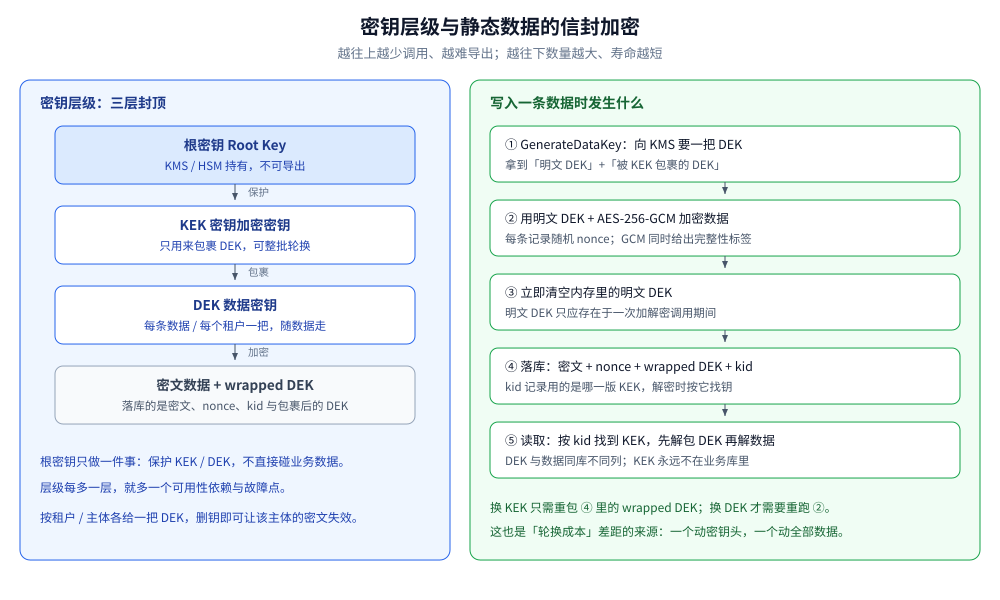
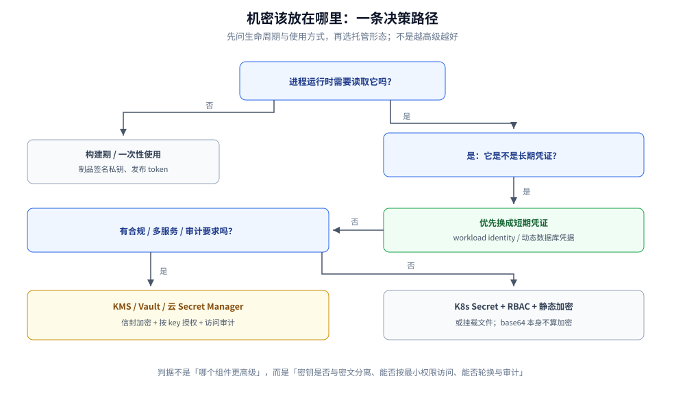
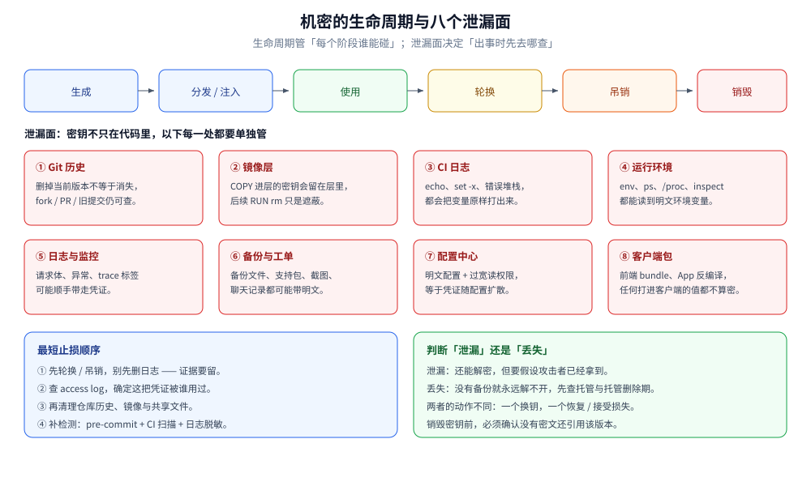
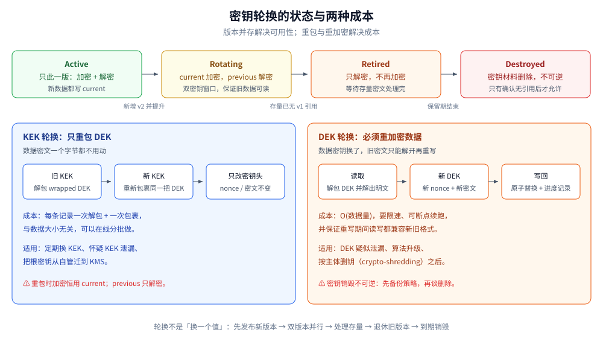

# 密钥与机密管理

> 覆盖：静态数据加密的密钥层级（根密钥 / KEK / DEK）、KMS / Vault / HSM 的职责边界、
> 机密从生成到销毁的生命周期与泄漏面、KEK 与 DEK 两种轮换的成本、密钥丢失或泄露后的止损。
>
> 不覆盖：对称 / 非对称 / 散列算法本身见 [加密算法.md](加密算法.md)；
> 签名、证书与信任链见 [摘要与数字签名.md](摘要与数字签名.md)、[数字证书与PKI.md](数字证书与PKI.md)；
> K8s Secret 的投递方式与 RBAC 见 [K8s部署流程.md](../../部署/k8s/K8s部署流程.md)；
> 配置中心字段级 `ENCv1:` 的完整实现见
> [Nacos.md](../../../03-数据与中间件/中间件/注册与配置中心/Nacos.md)；
> IM 设备侧的端到端密钥体系见
> [端到端加密.md](../../../04-架构与系统/系统设计/IM系统/端到端加密.md)。
>
> 内容整理自个人学习笔记。实测口径：KEK / DEK 信封加密、版本选择、重包与重加密的差别用
> `golang:1.26-alpine` 实测，输出见「具体使用」第 2、3 小节；KMS / Vault / HSM 未接真实服务（本机无部署），
> 按官方 API 语义整理，涉及处均标注为「未实测」。

---

## 一、密钥和机密有什么区别？为什么「加密」不是终点？

**本节要点**：密钥是算法的输入，机密是「拿到就能冒用身份或访问数据」的凭证；
加密只是把风险从数据转移到密钥——**密钥本身的存放，才是这类系统的主问题**。

| 概念 | 是什么 | 例子 | 主要管什么 |
|---|---|---|---|
| **密钥** | 算法输入的一段比特 | AES-256 key、RSA 私钥、HMAC key | 随机源、长度、用途、版本、生命周期 |
| **机密** | 需要授权才能读取的凭证 | 数据库口令、API Key、OAuth client secret、token | 谁能读、怎么注入、何时轮换、泄漏后怎么吊销 |
| **交集** | 私钥与对称密钥本身也是机密 | KEK、DEK、签名私钥 | 既按密钥管，也按机密管 |

**加密不消灭风险，只转移风险**。密文和密钥放在同一个库里，等于没有加密；备份文件里同时有密文和密钥，
也等于没有加密。判断一套方案是否成立，看的是**密钥与密文是否处在不同的信任域**，而不是字段长得像不像密文。

| 威胁 | 加密能挡吗 | 还要做什么 |
|---|---|---|
| 磁盘 / 备份被拖走 | 能：没有密钥解不开 | 密钥不与备份同处；备份单独加密 |
| 应用进程被入侵 | 不能：内存里有明文 DEK | 最小权限、短命 DEK、审计、进程隔离 |
| 代码仓库 / 镜像泄漏 | 不能 | 密钥不进 git 与镜像；提交前扫描 |
| 云厂商或托管方内部人员 | 部分：取决于 HSM / KMS 边界 | 评估信任边界与密钥不可导出性 |
| 内部人越权 | 不能 | 权限分离、双人审批、访问审计 |

⚠️ **base64 不是加密**。K8s Secret、`.env`、配置文件里的 base64 只是编码，谁拿到文件谁就能还原——
这一点在 [K8s部署流程.md](../../部署/k8s/K8s部署流程.md) 第五节已经实测过。

一套可用的密钥与机密体系，至少要守住三个不变量：

1. **分离**：密钥不与密文、不与备份、不与代码放在同一个地方；
2. **最小权限**：按用途、按环境、按租户拆 key，只给需要的那一方 `Decrypt` 权限；
3. **可轮换、可审计**：每次使用有版本、有日志，泄漏时能换、能查、能吊销。

## 二、密钥为什么要分层？KEK 和 DEK 各管什么？

**本节要点**：分层的唯一目的是让「换密钥」的成本可控——
**换 KEK 只动密钥头，换 DEK 才需要动数据**。这也决定了轮换能不能在线做。

| 层次 | 存放 | 寿命 | 数量级 | 用途 |
|---|---|---|---|---|
| **根密钥**（Root Key） | KMS / HSM 内部，不可导出 | 很长 | 很少 | 保护 KEK，不直接碰业务数据 |
| **KEK**（Key Encryption Key） | KMS / Vault，或由根密钥保护 | 中长 | 按环境 / 租户 | 包裹（wrap）DEK |
| **DEK**（Data Encryption Key） | 与数据同库，但以**包裹后**的形态存在 | 短 | 每条数据 / 每个租户一把 | 真正加密数据 |
| **派生密钥** | 不单独存储，用时由 KDF 派生 | 与上层一致 | 按用途 | 把一把根材料拆成加密 / 认证等专用子钥 |

**为什么不用一把密钥加密所有数据**：

- 一把泄漏就是**全量泄漏**，爆炸半径无法收缩；
- 轮换要重加密全量数据，成本高到实际上不会做；
- 无法按租户、按主体单独删钥，也就做不了「删钥即失效」；
- 密钥只有一份，所有服务都得能拿到，权限无法收窄。

### 2.1 信封加密：KEK 只包 DEK，DEK 才碰数据



写入一条数据的过程：

1. 向 KMS 申请一把 DEK，拿到**明文 DEK**与**被 KEK 包裹的 DEK**；
2. 用明文 DEK + AES-256-GCM 加密数据，每条记录生成随机 nonce；
3. 立即清空内存里的明文 DEK；
4. 落库：密文、nonce、wrapped DEK、`kid`（KEK 版本号）；
5. 读取时按 `kid` 找到 KEK，先解包出 DEK，再解数据。

⭐ 这套结构的关键收益是**两种轮换的成本被拆开了**：
换 KEK 只需要把 wrapped DEK 解包再重包，数据密文一个字节都不用动；
换 DEK 才必须解出明文、重新加密、写回。

### 2.2 别和「传输向的信封加密」混为一谈

[加密算法.md](加密算法.md) 里的信封加密是：**用接收方的 RSA 公钥加密对称密钥，再发过去**。
本篇的 KEK / DEK 是：**用自己的 KMS 密钥包裹数据密钥，再存起来**。

| 维度 | 传输向（RSA 信封） | 存储向（KEK / DEK） |
|---|---|---|
| 保护对象 | 一次消息 / 一次会话 | 落盘的数据 |
| 密钥属于谁 | 接收方 | 数据所有者 |
| 轮换主体 | 接收方换密钥对 | 数据所有者换 KEK / DEK |
| 典型实现 | TLS、加密邮件 | 云 KMS、Vault Transit、数据库 TDE |

### 2.3 按租户 / 按主体拆 DEK

多租户系统里，**每个租户一把 DEK** 是很实用的粒度：

- 一个租户的密钥泄漏，不会波及别的租户；
- 需要删除某个租户的数据时，删掉它的 DEK，密文立刻变成不可解的垃圾
  （crypto-shredding，见 [冷热数据分层.md](../../../03-数据与中间件/数据存储/存储架构与场景/横切篇/冷热数据分层.md)）；
- 可以按租户做 key policy 与审计，满足「数据隔离」的合规要求。

⚠️ 删钥前必须确认**备份、快照、归档**里也没有该 DEK 的副本，否则「已删除」只是主库层面成立。

### 2.4 派生密钥：HKDF 只解决「拆分」，不解决「随机」

需要从一份根材料得到多个用途不同的子密钥时，用 **HKDF**：

```go
sub, err := hkdf.Key(sha256.New, root, []byte("tenant-salt-v1"), "tenant:"+tenantID, 32)
```

`info` 参数把用途与租户绑定进来，同一个根材料在不同 `info` 下得到不同子钥；
**不要把同一把 key 同时用于加密和 HMAC**，也不要用口令代替随机密钥——
HKDF 不会给低熵输入增加熵，口令应该先经过慢哈希（见
[密码与敏感信息存储.md](../应用与数据安全/密码与敏感信息存储.md)）。

**层级不要无限套**：三层（根 → KEK → DEK）已经足够。
每多一层，就多一个启动时的依赖、一个缓存点和一个故障模式。

## 三、KMS、Vault 和 HSM 各管什么？什么时候必须上？

**本节要点**：KMS 解决「密钥不落地 + 可审计」，Vault 解决「动态凭证 + 租约」，
HSM 解决「密钥材料不出硬件边界」；三者都不是「存密码的数据库」。

| 形态 | 密钥在哪 | 典型能力 | 代价 | 适用 |
|---|---|---|---|---|
| **HSM** | 硬件内部，不可导出 | 根密钥、签名、密钥生成 | 贵、运维重、容量有限 | CA 根、支付与强合规场景 |
| **云 KMS** | 托管服务内部，只暴露 API | `Encrypt` / `Decrypt` / `GenerateDataKey` / `ReEncrypt`、审计、多区域 | 云绑定、网络延迟、按调用计费 | 大多数云上业务 |
| **Vault Transit** | Vault 内部 | 加密即服务、密钥版本、`rewrap` | 自运维、要处理解封与高可用 | 多云 / 自建、统一策略 |
| **Vault 动态凭证** | Vault 内部 | 短期数据库账号、租约与吊销 | 应用需改造连接管理 | 想消灭长期口令 |
| **K8s Secret** | etcd | 注入 Pod | 默认只是 base64、权限较粗 | 非高敏、已开 RBAC 与静态加密 |
| **文件 / 环境变量** | 进程或磁盘 | 简单直接 | 极易泄漏 | 本地开发、低敏配置 |

### 3.1 KMS 的 API 语义

不同云厂商名字不同，但核心语义一致：

```text
GenerateDataKey(KeyId, KeySpec=AES_256)
  -> Plaintext(DEK) + CiphertextBlob(wrapped DEK)
Decrypt(CiphertextBlob) -> Plaintext(DEK)
ReEncrypt(CiphertextBlob, DestinationKeyId) -> 新的 wrapped DEK
```

要点：

- **密钥材料不出 KMS 边界**，业务只拿到「明文 DEK」或「包裹后的 DEK」；
- `GenerateDataKey` 是存储向信封加密的入口，**不要拿 KMS 直接加密业务数据**；
- `ReEncrypt` 只是换 KEK，等价于本篇的 Rewrap，不解业务数据；
- key policy / IAM 决定谁能 `Decrypt`，审计日志决定事后能不能查。

### 3.2 Vault 的两类用法

- **Transit**：把 Vault 当「加密即服务」，应用把明文交给 Vault，拿回密文；
  密钥版本与 `rewrap` 由 Vault 管。适合不希望密文与密钥在同一侧的场景。
  代价是**每次加解密都要经过 Vault**，必须考虑延迟与可用性。
- **动态凭证**：应用不再持有长期数据库口令，而是向 Vault 申请一个带 TTL 的临时账号；
  租约到期自动吊销。适合把「长期密码」换成「短期凭证」，但应用要能处理连接重建。

### 3.3 工作负载身份：先消灭引导密钥

如果应用要调用 KMS / Vault，它自己也需要一份凭证。**不要再造一个长期 AK/SK**，
而是用平台提供的**工作负载身份**：K8s ServiceAccount + 云厂商的 workload identity、
Vault 的 Kubernetes auth 等。应用从运行环境拿到短期身份，再由平台换取目标服务的访问权。

判据很简单：**如果启动配置里还有一份「永久有效、能解密所有数据」的静态密钥，那它迟早会泄漏**。

### 3.4 可用性与调用成本

KMS 一旦成为运行时依赖，就会出现在故障链上：

| 问题 | 做法 |
|---|---|
| 每条记录都调一次 KMS | ❌ 延迟与配额都扛不住；按对象 / 租户取 DEK 并在进程内缓存 |
| KMS 短暂不可用 | 已缓存的 DEK 可继续服务；新解包失败时要明确 **fail-closed** 还是降级 |
| 跨区域容灾 | 使用多区域 key 或跨区副本；确认解密路径也做了容灾 |
| 明文 DEK 缓存到磁盘 | ❌ 缓存只在内存；进程退出即丢 |
| 所有环境共用一把 key | ❌ 按环境、租户、用途拆 key，泄漏时才能缩小范围 |



图怎么读：先按「运行时要不要读」分成构建期一次性使用与运行期注入两条路；运行期再问「是不是长期凭证」，
能短期化就优先换成工作负载身份或动态账号；剩下无法短期化的，才按合规、多服务与审计要求选
KMS / Vault，或落到 K8s Secret + RBAC + 静态加密。最下面一行不代表「更安全」，
它只说明攻击面更小、权限更容易收窄、轮换更容易做。

## 四、机密从生成到销毁要管哪几步？泄漏面在哪？

**本节要点**：机密的生命周期是六个阶段；绝大多数事故不是算法被破，
而是某个阶段把明文放到了不该在的地方。



| 阶段 | 关键动作 | 失败后果 |
|---|---|---|
| **生成** | 用 CSPRNG 生成足够长度；不用时间戳、口令、可预测序列 | 密钥可被枚举，后面所有保护失效 |
| **分发 / 注入** | 按敏感度选注入方式；传输走受信通道 | 明文进入环境变量、日志或聊天记录 |
| **使用** | 只存在内存；不写日志、不回显、不放进错误信息 | 一次调试输出就足以泄漏 |
| **轮换** | 版本化、双版本并行、先发布后退休 | 轮换期全量不可用，或旧密钥永久有效 |
| **吊销** | 撤销会话、租约、下游缓存；确认生效 | 「已经换了」但旧凭证仍能访问 |
| **销毁** | 确认没有密文 / 备份引用；不可逆操作要审批 | 误删导致数据永久不可恢复 |

**注入方式怎么选**：

| 方式 | 谁能看到 | 能否热更新 | 适用 |
|---|---|---|---|
| **环境变量** | `ps`、`/proc`、`docker inspect`、崩溃转储、子进程 | 否 | 低敏、短生命周期 |
| **挂载文件** | 同机同权限的进程；注意文件权限 | 可（进程重新读） | 配置文件、证书、需要轮换 |
| **Secret Manager SDK** | 只有进程内 | 可 | 高敏、需要审计与细粒度授权 |
| **stdin / 一次性 token** | 启动期进程 | 否 | 引导凭证、CI 临时凭证 |
| **写死在代码 / 镜像** | 所有能看仓库或镜像的人 | 要发版 | ❌ 禁止 |

**八个泄漏面**（与配图一致）：

1. **Git 历史**：删掉当前版本不等于消失，fork、PR、旧提交仍可查；
2. **镜像层**：`COPY` 进层的密钥会留在层里，后续 `RUN rm` 只是遮蔽；
3. **CI 日志**：`echo`、`set -x`、错误堆栈都会把变量原样打出来；
4. **运行环境**：`env`、`ps`、`/proc`、`docker inspect` 都能读到明文环境变量；
5. **日志与监控**：请求体、异常、trace 标签可能顺手带走凭证；
6. **备份与工单**：备份文件、支持包、截图、聊天记录都可能带明文；
7. **配置中心**：明文配置 + 过宽读权限，等于凭证随配置扩散；
8. **客户端包**：前端 bundle、App 反编译，任何打进客户端的值都不算密。

**检测手段**：提交前扫描（gitleaks / trufflehog）、CI 中的 secret scanning、日志脱敏规则、
以及在关键位置放**金丝雀凭证**——它一旦被调用就说明泄漏路径被触发。
扫描只能发现「长得像密钥」的东西，**权限收紧与分离**才是兜底。

## 五、密钥怎么轮换？为什么「换一把」比想象中难？

**本节要点**：轮换分两种——**换 KEK 只重包 DEK，换 DEK 必须重加密数据**；
版本号与双密钥窗口是保证轮换期不停机的两个前提。



### 5.1 四个状态

| 状态 | 加密用哪版 | 解密允许哪版 | 退出条件 |
|---|---|---|---|
| **Active** | 当前版本 | 当前版本 | 新增新版本 |
| **Rotating** | **只用 current** | current + previous | 存量密文全部处理完 |
| **Retired** | 不参与加密 | 只解密旧密文 | 保留期结束且无引用 |
| **Destroyed** | — | 不可解密 | 不可逆，必须审批 |

⭐ **轮换期最容易写错的一条**：加密永远只用 current，previous 只负责解密。
如果两边都拿去加密，就会在同一批数据里产生两种版本的密文，进度无法判断。

### 5.2 两种轮换的成本

| 动作 | 改什么 | 成本 | 能否在线 |
|---|---|---|---|
| **KEK 轮换 / Rewrap** | 只改 wrapped DEK 与 `kid` | 每条记录一次解包 + 一次包裹，与数据大小无关 | 能，可分批限速 |
| **DEK 轮换 / Re-encrypt** | 解出明文，用新 DEK 与新 nonce 重写密文 | O(数据量)，要限速、可断点续跑 | 能，但要保证新旧格式双读 |

### 5.3 不同机密的轮换手法

| 机密类型 | 轮换怎么做 | 容易漏的点 |
|---|---|---|
| **数据库口令** | 双账号或双口令并行，应用先切新再停旧 | 连接池、后台任务、定时脚本还在用旧口令 |
| **API Key** | 新旧并存一段时间，第三方逐个切换 | 不知道谁还在用旧 key，只能靠访问日志 |
| **签名密钥** | 新公钥先发布到 JWKS，重叠期后再移除旧钥 | 验证方缓存公钥，轮换后仍拿旧钥验签 |
| **TLS 证书** | 新证书先上线，确认客户端兼容后再换旧 | 客户端证书固定（pinning）会直接失败 |
| **数据密钥** | 先重包 / 重加密，再退休旧版本 | 备份、归档、消息队列里的旧密文 |

**轮换会打断什么**：长连接与连接池、进程内缓存、未消费的消息、离线客户端、第三方对接方、
以及所有「启动时读一次就再也不读」的组件。轮换方案必须把这些都列出来，而不是只改一个配置项。

⚠️ **nonce 不能复用**：用同一把 DEK 重新加密时，必须生成新的随机 nonce。
GCM 下 nonce 复用会直接破坏机密性与完整性。

## 六、密钥丢了或泄露了怎么止损？

**本节要点**：先分清「丢失」和「泄露」：丢失是可用性问题，泄露是保密性问题；
两者的第一步都不是删日志。

| 情形 | 本质 | 第一步 | 后续 |
|---|---|---|---|
| **密钥丢失** | 解不开数据 | 查托管删除期、备份、跨区副本 | 恢复；无法恢复则接受数据永久损失 |
| **密钥泄露** | 攻击者能解密或冒用 | **轮换 / 吊销**，保留证据 | 查访问日志、评估爆炸半径、重加密、通知 |
| **两者同时** | 既不可用又不可信 | 按泄露处理，同时评估恢复路径 | 重建密钥体系，复盘权限与流程 |

**丢失**：

- 云 KMS 的密钥删除通常有**等待期**（几天到几十天），期内可以取消删除；
- HSM 里的密钥往往**不可导出**，备份靠复制或托管方的多副本，而不是导出一个文件；
- 如果既没有托管副本也没有备份，**密文就永久不可解**。这不是故障，而是设计时必须接受的边界。

**泄露**：

1. **先止血**：轮换密钥、吊销会话与租约、禁用旧凭证；
2. **再定位**：查 KMS / Vault / 网关的访问日志，确认这把凭证被谁、从哪里、用于什么；
3. **评估爆炸半径**：受影响的是单个租户、单个环境，还是全量数据；
4. **必要时重加密**：DEK 泄漏必须重加密数据；KEK 泄漏至少重包，若怀疑明文 DEK 也被拿走，则按 DEK 泄漏处理；
5. **保留证据**：不要先删日志、不要先清理仓库历史；
6. **补齐流程**：权限分离、审批、扫描规则、监控告警。

**crypto-shredding 的边界**：删掉某个主体的 DEK 确实能让它的密文失效，
但前提是**该 DEK 的所有副本都被删除**。备份、快照、归档里只要还有一份，就不算删除。
不可逆的销毁动作必须有双人审批和明确的影响清单。

## 七、落地时最容易踩哪些坑？

**本节要点**：密钥管理的失败很少来自密码学，更多来自「把密钥放在了方便的位置」。

| 反模式 | 为什么危险 | 正确做法 |
|---|---|---|
| 密钥硬编码在代码里 | 进 git 历史、进镜像层，删不掉 | KMS / Vault / 挂载文件注入 |
| 把 base64 当加密 | 任何人可逆 | 真正加密，密钥与密文分离 |
| 所有数据共用一把 DEK | 一处泄漏全量失守，无法按租户删钥 | 按对象 / 租户拆 DEK |
| KEK 和密文放同一个库 | 拖库即全泄 | KEK 放 KMS / Vault |
| 密文不带 `kid` | 不知道该用哪版密钥解 | 密文头写版本与 `kid` |
| 每条记录调一次 KMS | 延迟、配额、成本都不可接受 | 按对象取 DEK 并缓存 |
| 轮换不设双版本窗口 | 换钥瞬间旧数据全部不可读 | current 加密、previous 解密 |
| 销毁前不查引用 | 旧密文永久不可解 | 引用清单 + 保留期 + 审批 |
| 明文写日志 / 错误信息 | 一次排查就泄漏 | 脱敏、禁回显、结构化日志过滤 |
| 高敏值放环境变量 | `ps` / inspect / 崩溃转储可见 | 挂载文件或 Secret Manager |
| 备份不单独加密 | 备份泄漏绕过主库所有防护 | 备份独立 KEK，密钥不与备份同处 |

一个简单的自检问题：**「如果我现在拿到这台机器的磁盘和数据库备份，能解出业务数据吗？」**
如果答案是能，说明密钥与密文没有真正分离。

## 应用场景

| 场景 | 密钥层级 | 轮换单位 | 说明 |
|---|---|---|---|
| **数据库字段加密** | KEK + 行 / 租户 DEK | 重包 DEK 或重加密字段 | 与 [Nacos.md](../../../03-数据与中间件/中间件/注册与配置中心/Nacos.md) 的字段级 `ENCv1:` 同一类做法 |
| **对象存储 / 文件** | KMS + 每对象 DEK | 重包或按对象重加密 | 云上多是托管形态（SSE-KMS 等），密钥仍要按桶 / 租户规划 |
| **配置中心敏感值** | 应用侧 KEK + 字段密文 | 双密钥（current / previous） | 密钥不进配置中心；实现见 Nacos 第九节 |
| **服务间凭证** | 平台工作负载身份 + 短期 token | 优先换短期凭证 | 与 [K8s部署流程.md](../../部署/k8s/K8s部署流程.md)、[安全与认证.md](../../../03-数据与中间件/中间件/RPC框架/gRPC/安全与认证.md) 配合 |
| **备份与快照** | 备份专用 KEK + 备份 DEK | 与生产分开轮换 | 密钥不能跟备份放在同一个存储账号 |
| **多租户 SaaS** | 每租户 DEK | 删钥即 shred | 删钥前处理备份与归档 |
| **开放平台 / IM** | 每应用或每机器人一把 key | 新旧并存后停旧 | 见 [机器人与开放平台.md](../../../04-架构与系统/系统设计/IM系统/机器人与开放平台.md) |

## 具体使用

### 1) 密文格式：把版本和 `kid` 写进头部

```text
v1.<kid>.<b64 wrappedDEK>.<b64 nonce>.<b64 ciphertext>
```

| 字段 | 作用 |
|---|---|
| `v1` | 外层格式版本，换格式时留升级位 |
| `kid` | KEK 版本号，解密时按它找钥 |
| `wrappedDEK` | 被 KEK 包裹的 DEK（含包裹用的 nonce） |
| `nonce` | 数据加密的随机 nonce，每次加密都不同 |
| `ciphertext` | AES-GCM 密文 + 16 字节认证标签 |

### 2) Keyring 与信封加密（已实测）

```go
type Keyring struct {
	current  string
	versions map[string][]byte
}

func Seal(kr *Keyring, plain []byte) (Record, error) {
	kek, kid, err := kr.currentKEK()
	if err != nil {
		return Record{}, err
	}
	dek := random(32)
	defer wipe(dek)
	nonce := random(12)
	data := gcmFor(dek).Seal(nil, nonce, plain, nil)

	wrapNonce := random(12)
	wrapped := gcmFor(kek).Seal(nil, wrapNonce, dek, nil)
	return Record{
		Kid:        kid,
		WrappedDEK: append(wrapNonce, wrapped...),
		Nonce:      nonce,
		Data:       data,
	}, nil
}

func Open(kr *Keyring, r Record) ([]byte, error) {
	dek, err := unwrapDEK(kr, r)
	if err != nil {
		return nil, err
	}
	defer wipe(dek)
	return gcmFor(dek).Open(nil, r.Nonce, r.Data, nil)
}
```

`unwrapDEK` 先按 `r.Kid` 从 Keyring 取 KEK，再解开 `wrappedDEK`；
两种失败要分开报错：**未知 kid** 说明密文来自别的环境或密钥已销毁，**解包失败**说明 KEK 不匹配或密文被篡改。

实测输出（明文为 43 字节，`golang:1.26-alpine`）：

```text
明文长度           = 43 字节
记录1 kid          = k2026-07
wrappedDEK 长度    = 60 字节（12 nonce + 32 DEK + 16 tag）
data 长度          = 59 字节（12 nonce + 43 明文 + 16 tag）
整条记录长度       = 189 字节（base64 后）
用同版本 KEK 解密   = true，还原一致=true
同一明文再加密一次  = data 相同? false（随机 DEK + 随机 nonce）
```

⭐ 注意最后一行：**同一明文两次加密得到的密文不同**，这是随机 DEK + 随机 nonce 的直接结果。
如果密文相同，说明 nonce 或 DEK 被复用了，GCM 的安全前提已被破坏。

### 3) 轮换：重包 DEK 与重加密数据的差别（已实测）

```go
// 只换 KEK：数据密文与 nonce 原样保留。
func Rewrap(kr *Keyring, r Record) (Record, error) {
	if r.Kid == kr.current {
		return r, nil
	}
	dek, err := unwrapDEK(kr, r)
	if err != nil {
		return Record{}, err
	}
	defer wipe(dek)
	kek, kid, err := kr.currentKEK()
	if err != nil {
		return Record{}, err
	}
	wrapNonce := random(12)
	wrapped := gcmFor(kek).Seal(nil, wrapNonce, dek, nil)
	r.Kid = kid
	r.WrappedDEK = append(wrapNonce, wrapped...)
	return r, nil
}

// 换 DEK：必须解出明文再重新加密。
func ReEncrypt(kr *Keyring, r Record) (Record, error) {
	plain, err := Open(kr, r)
	if err != nil {
		return Record{}, err
	}
	return Seal(kr, plain)
}
```

实测输出：

```text
轮换后新记录 kid   = k2026-10
旧记录仍可解密     = true，还原一致=true
Rewrap 后 kid      = k2026-10，data 原样保留=true，解密一致=true
ReEncrypt 后 kid   = k2026-10，data 已变化=true，解密一致=true

篡改 1 字节后解密   = 报错：cipher: message authentication failed
kid 已销毁后解密    = 报错：未知 kid "k2026-07"：密钥已销毁，或密文来自别的环境
HKDF tenant:t-1001  -> 32 字节，指纹 5bd7ba67a3461003
HKDF tenant:t-1002  -> 32 字节，指纹 6198e15097dc076a
```

这组读数对应三个工程结论：

- **Rewrap 不碰数据**：`data 原样保留=true`，所以可以放心在线分批做；
- **ReEncrypt 必然改数据**：`data 已变化=true`，所以要限速、可断点续跑；
- **kid 是解密的入口**：删掉旧版本后，旧密文立即报「未知 kid」，这就是 crypto-shredding 的机制，
  也是「销毁前必须查引用」的原因。

### 4) 从文件或环境变量加载 KEK（示例，未实测）

```go
func LoadKEK() ([]byte, error) {
	if path := os.Getenv("APP_KEK_FILE"); path != "" {
		raw, err := os.ReadFile(path)
		if err != nil {
			return nil, fmt.Errorf("读取 KEK 文件失败: %w", err)
		}
		return normalizeKEK(raw)
	}
	if v := os.Getenv("APP_KEK"); v != "" {
		return normalizeKEK([]byte(v))
	}
	return nil, errors.New("未配置 KEK：拒绝以无密钥状态启动")
}

func normalizeKEK(raw []byte) ([]byte, error) {
	raw = bytes.TrimSpace(raw)
	if len(raw) == 32 {
		return raw, nil
	}
	if b, err := base64.StdEncoding.DecodeString(string(raw)); err == nil && len(b) == 32 {
		return b, nil
	}
	if b, err := hex.DecodeString(string(raw)); err == nil && len(b) == 32 {
		return b, nil
	}
	return nil, errors.New("KEK 必须是 32 字节原文，或 44 字符 base64 / 64 字符 hex")
}
```

这段代码的边界：

- 文件优先于环境变量，因为挂载文件的可见面比环境变量小；
- **格式归一化要严格**，长度不对直接失败，不要「自动补零」；
- 一旦检测到密文而 KEK 缺失，应该 **fail-fast**，不要带着空密钥继续启动——
  这类「静默降级」比直接崩溃更难排查。

### 5) KMS 侧的等价调用（未实测）

```text
# 写入
GenerateDataKey(KeyId=<kek-id>, KeySpec=AES_256)
  -> Plaintext=<明文 DEK>，CiphertextBlob=<wrapped DEK>
AES-256-GCM(明文 DEK, 数据) -> 密文
落库：密文 + nonce + CiphertextBlob + KeyId 版本

# 读取
Decrypt(CiphertextBlob) -> Plaintext=<明文 DEK>
AES-256-GCM(明文 DEK, 密文) -> 明文

# 只换 KEK
ReEncrypt(CiphertextBlob, DestinationKeyId=<新 kek>)
  -> 新的 wrapped DEK；业务数据不变
```

不同云厂商与 Vault 的方法名不同，**语义是同一套**：
业务侧永远只持有「明文 DEK」或「包裹后的 DEK」，根密钥不出托管边界。

## 延伸追问

- **为什么不能直接用 KMS 加密业务数据？** → 每次调用都有网络延迟与配额，成本也高；正确姿势是 KMS 只包裹 DEK，业务用 DEK 本地加密，一次数据写入只调一次 KMS。
- **KEK 和 DEK 同时泄漏怎么办？** → 按最坏情况处理：换 KEK 并重包只是止损的一半，DEK 泄漏意味着数据本身可被解密，必须用新 DEK 重加密全量数据。
- **删除 KMS 密钥后数据就没了吗？** → 密文还在，但**永久不可解**。多数 KMS 有删除等待期，期内可取消；等待期结束后不可逆，所以销毁必须有审批与引用清单。
- **为什么 base64 不算加密？** → 它是可逆编码，没有密钥；K8s Secret 默认就是 base64，能读 Secret 的人等于能拿到明文。
- **KMS 挂了业务还能读数据吗？** → 已缓存明文 DEK 的进程可以继续；需要新解包的请求会失败。要明确选择 fail-closed（拒绝写入）还是降级（只读缓存），并把 DEK 缓存限制在内存。
- **轮换期间新旧密文都能读吗？** → 能。用 `kid` 选版本，current 负责加密，previous 只负责解密；等存量处理完再退休旧版本。
- **为什么不直接给每个租户一个数据库？** → 隔离更强但成本高；按租户拆 DEK 是在共享存储下获得「可控爆炸半径 + 可删钥」的折中，两者可以叠加。
- **HKDF 能代替随机 DEK 吗？** → 不能。HKDF 只做确定性派生，不会增加熵；DEK 必须是 CSPRNG 生成的随机值。HKDF 适合从根材料派生用途子钥。
- **Vault 的动态凭证和 KMS 有什么区别？** → KMS 保护密钥，Vault 除了加密还能签发带 TTL 的动态账号与租约；前者解决「密钥不落地」，后者解决「长期口令不存在」。
- **密钥管理系统自己怎么防拖库？** → 根密钥放 HSM / KMS，Vault 用自动解封，访问走工作负载身份，开启审计，按 key 收窄权限，关键操作双人审批。
- **应用被入侵时，加密还有意义吗？** → 有，但有限：攻击者能拿到进程内明文 DEK，只能保护「其他租户 / 其他对象」和「已经落盘的旧数据」；真正的边界是最小权限、短命 DEK 与快速轮换。
- **为什么轮换后还有旧 key 能用？** → 双版本窗口是刻意保留的，否则旧密文会在轮换瞬间不可读；关键是**加密只用 current**，并且有时间点退休 previous。

## 关联

- **上游/底座**：[加密算法.md](加密算法.md) — 对称 / 非对称 / 散列算法与传输向信封加密
- **完整性/签名**：[摘要与数字签名.md](摘要与数字签名.md) — 签名私钥也是机密，涉及签发密钥的轮换
- **信任链**：[数字证书与PKI.md](数字证书与PKI.md) — CA 私钥托管、证书签发与轮换
- **实现落地**：[Nacos.md](../../../03-数据与中间件/中间件/注册与配置中心/Nacos.md) — 字段级 `ENCv1:` 密文、双密钥轮换与工具链
- **部署侧**：[K8s部署流程.md](../../部署/k8s/K8s部署流程.md) — Secret 投递、RBAC、静态加密与三条纪律
- **业务域**：[端到端加密.md](../../../04-架构与系统/系统设计/IM系统/端到端加密.md) — 设备侧的身份 / 会话 / 消息三层密钥
- **开放平台**：[机器人与开放平台.md](../../../04-架构与系统/系统设计/IM系统/机器人与开放平台.md) — 应用密钥的签发与新旧并存
- **对照**：[OAuth2与OIDC.md](../身份与访问/OAuth2与OIDC.md) — refresh token 轮换与重放检测
- **存储用例**：[可查询加密.md](../../../03-数据与中间件/数据存储/NoSQL/MongoDB/可查询加密.md) — 驱动侧加解密与 KMS 的配合
> 反向引用（本篇被下列文档引到）：[安全开发生命周期.md](../安全工程/安全开发生命周期.md)、[审计与应急响应.md](../安全工程/审计与应急响应.md)、[API安全.md](../应用与数据安全/API安全.md)、[敏感数据治理与合规.md](../应用与数据安全/敏感数据治理与合规.md)
