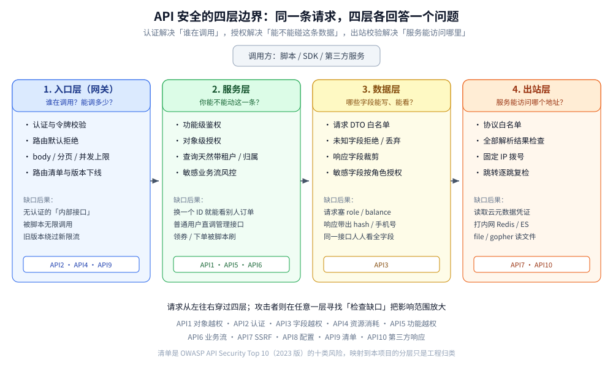
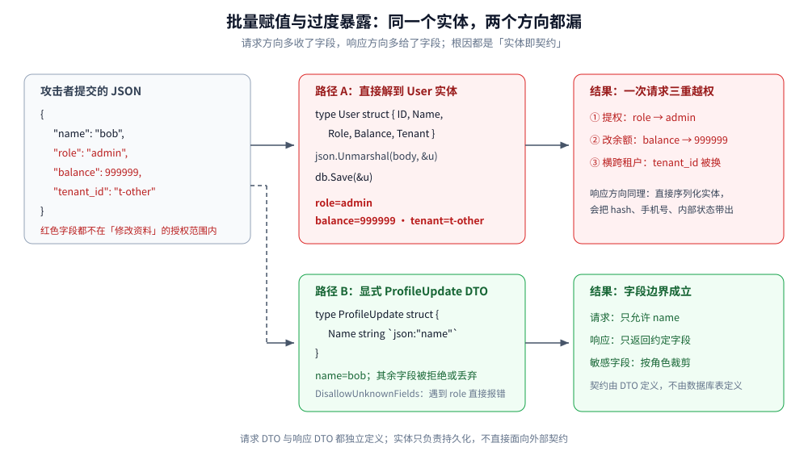
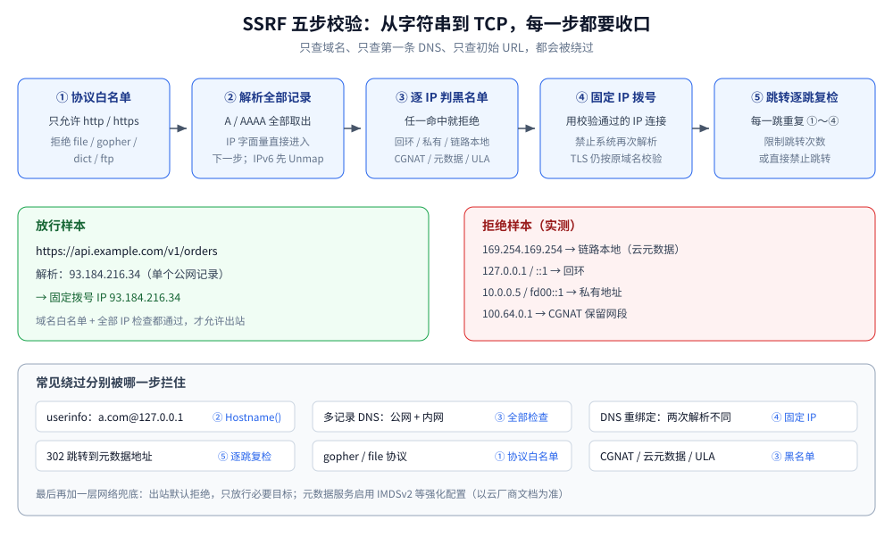

# API 安全

> 覆盖：API 作为「机器入口」与网页不同的攻击面，以及工程上必须补齐的四层防线：
> 对象级授权、字段级白名单、出站地址校验、资源与重放控制；另含 API 清单、版本与第三方依赖治理。
>
> 不覆盖：JWT / API Key 的格式、验签与 401/403 见 [JWT与APIKey鉴权.md](../身份与访问/JWT与APIKey鉴权.md)；
> OAuth2 / OIDC 的授权流程见 [OAuth2与OIDC.md](../身份与访问/OAuth2与OIDC.md)；
> RBAC / ABAC / ReBAC 与多租户隔离见 [授权模型与越权防护.md](../身份与访问/授权模型与越权防护.md)；
> SQL 注入、XSS、CSRF、CORS 与安全响应头见 [Web攻击与防御.md](Web攻击与防御.md)；
> 限流算法、熔断与降级见 [稳定性/README.md](../../../04-架构与系统/分布式/稳定性/README.md)；
> 签名算法、时间窗与 nonce 见 [摘要与数字签名.md](../密码学与密钥/摘要与数字签名.md)。
>
> 内容整理自个人学习笔记。实测口径：批量赋值、SSRF 主机校验、跳转复检与 DNS 重绑定
> 用 `golang:1.26-alpine` 运行，输出见「具体使用」第 1～3 小节；
> 网关限流、幂等存储与真实云元数据访问为构造示例，未做线上实测。

---

## 一、API 和网页的攻击面为什么不一样？

**本节要点**：网页的安全模型建立在浏览器上——同源策略、Cookie、表单 Token；
API 的调用方是脚本，这些约束**一个都不在**，所以 API 必须把边界下沉到「对象、字段、出站地址」上。

| 维度 | 浏览器页面 | API |
|---|---|---|
| 调用方 | 人，经浏览器 | 脚本、SDK、第三方服务 |
| 同源策略 | 生效，跨站读响应受限 | **不适用**，任何 HTTP 客户端都能直接调 |
| 身份携带 | Cookie 自动携带 | `Authorization` 头、API Key、mTLS、签名 |
| 主要威胁 | XSS、CSRF、点击劫持 | **对象越权、字段越权、SSRF、资源耗尽、重放** |
| 返回内容 | HTML，问题常在「回显」 | JSON / XML，问题常在「多给了什么、多收了什么」 |
| 流量形态 | 页面导航，天然有间隔 | 单客户端可高并发、批量、自动化遍历 |
| 版本 | 页面即版本 | 多版本长期并存，容易留下影子接口 |

⭐ 一句话：**网页防的是「浏览器替攻击者做的事」，API 防的是「攻击者拿着合法凭证做得更多的事」**。
因此 API 的安全检查不能只放在登录处，而要落在每一次「读哪个对象、写哪些字段、访问哪个地址」上。

## 二、OWASP API Top 10 把风险分成了哪几层？

**本节要点**：把风险清单映射到「入口、服务、数据、出站」四层，才知道每一项该由谁修；
只记排名没有意义。

| 编号 | 风险 | 主要落点 | 一句话判据 |
|---|---|---|---|
| API1 | Broken Object Level Authorization（BOLA） | 服务层 | 每个带 ID 的接口，是否校验「这个对象属于当前主体」 |
| API2 | Broken Authentication | 入口层 | 每个路由是否默认要求认证，令牌是否可撤销、可过期 |
| API3 | Broken Object Property Level Authorization | 数据层 | 请求能否写进不该写的字段，响应是否多返回了字段 |
| API4 | Unrestricted Resource Consumption | 入口层 | 请求体、分页、并发、计算量是否有上限 |
| API5 | Broken Function Level Authorization（BFLA） | 服务层 | 管理动作是否按角色/权限判定，而不是只藏菜单 |
| API6 | Unrestricted Access to Sensitive Business Flows | 服务层 | 下单、领券、发短信等业务流是否有频率与风控 |
| API7 | Server Side Request Forgery（SSRF） | 出站层 | 服务端代用户访问 URL 时，目标是否被限制在公网白名单 |
| API8 | Security Misconfiguration | 全层 | TLS、CORS、错误页、调试端点、默认口令是否收口 |
| API9 | Improper Inventory Management | 入口层 | 是否存在没人认领的旧版本、测试接口、影子 API |
| API10 | Unsafe Consumption of APIs | 出站层 | 调用第三方 API 时，是否把它的响应当成可信输入 |



这十项里，**API1、API3、API5 属于「授权」，API7、API10 属于「出站」，API4、API6 属于「配额与业务风控」**，
API2、API8、API9 属于「资产与配置」。四类问题的修法完全不同，混在一起谈「加强 API 安全」通常什么都落不了地。

## 三、为什么「接口鉴权通过」不等于「这个对象归你」？

**本节要点**：认证回答「你是谁」，功能级鉴权回答「你能不能调这个接口」，
对象级授权回答「这条数据是不是你的」——**三层缺一层，BOLA 就成立**。

```text
GET /api/orders/1002
Authorization: Bearer <bob 的合法令牌>

只做认证：      令牌有效 → 200，返回 1002 的订单        ← BOLA
加功能级鉴权：  bob 有 order:read → 仍然返回别人的订单   ← 还是 BOLA
加对象级授权：  1002.owner_id == bob.id ? 200 : 404      ← 正确
```

| 层级 | 判断内容 | 典型缺口 |
|---|---|---|
| 认证 | 令牌是否有效、是否过期 | 无令牌也能调的「内部接口」 |
| 功能级授权 | 这个主体能否调用这个接口 / 这个 HTTP 方法 | 菜单隐藏了，接口没鉴权；`GET` 校验了，`DELETE` 没校验 |
| 对象级授权 | 这个主体能否操作**这一条**资源 | 只按 ID 查，不带 `owner_id` / `tenant_id` |
| 字段级授权 | 这个主体能否读写**这个字段** | 普通用户可以改 `role`、看别人的手机号 |

工程上最稳的写法是**让查询天然带边界**，而不是查出来再判断：

```sql
SELECT id, status, amount FROM orders
WHERE id = ? AND tenant_id = ? AND owner_id = ?;
```

影响行数为 0 时统一返回 `404`，避免用 `403` 确认「对象存在但不属于你」。
跨租户、跨主体的列表、计数、导出、搜索、排序都要复用同一套边界条件。
模型选型与多租户分层见 [授权模型与越权防护.md](../身份与访问/授权模型与越权防护.md)，本篇不再重复。

## 四、批量赋值和过度暴露为什么总是一起出现？

**本节要点**：两者是同一个根因的两面——**把数据库实体同时当成了请求体和响应体**。
请求方向叫批量赋值（mass assignment），响应方向叫过度数据暴露（excessive data exposure）。



### 4.1 请求方向：攻击者把不该写的字段一起塞进来

假设更新资料接口直接把 JSON 解到用户实体：

```go
type User struct {
    ID      int64   `json:"id"`
    Name    string  `json:"name"`
    Role    string  `json:"role"`
    Balance float64 `json:"balance"`
    Tenant  string  `json:"tenant_id"`
}

var u User
json.Unmarshal(body, &u) // 攻击者可控的 body 直接落到实体
db.Save(&u)
```

请求体里加三个字段，就能同时完成提权、改余额、跨租户：

```json
{"name":"bob","role":"admin","balance":999999,"tenant_id":"t-other"}
```

实测（完整输出见「具体使用」第 1 小节）：

```text
直接解到 User：name=bob role=admin balance=999999 tenant=t-other
显式 DTO + DisallowUnknownFields：name="bob" err=json: unknown field "role"
显式 allowlist：保留=[name] 丢弃=[balance role tenant_id]
```

### 4.2 响应方向：序列化把内部字段全带出去

同一个实体直接序列化返回，常见泄漏包括：

- `password_hash`、`salt`、`mfa_secret`；
- `role`、`is_admin`、`internal_status`；
- 别人的手机号、身份证、地址；
- 内部主键、租户 ID、风控分、成本价。

⭐ **不要指望在实体上加 `json:"-"` 就安全**：ORM 复制、MapStruct、`map[string]any` 组装、
日志与消息队列都可能绕过这个标签。正确做法是**请求 DTO 与响应 DTO 都独立定义**，
在转换处显式列出字段；敏感字段再加字段级授权。

### 4.3 四条落地规则

| 规则 | 做法 | 防住什么 |
|---|---|---|
| 请求 DTO 白名单 | 只为允许修改的字段建结构体；PATCH 允许的字段单独列 | 批量赋值、提权 |
| 未知字段拒绝 | `DisallowUnknownFields()` 或显式 allowlist 提取 | 客户端悄悄塞字段 |
| 响应 DTO 白名单 | 列表/详情各建返回结构体，不直接返回 ORM 实体 | 过度暴露 |
| 字段级授权 | 敏感字段按角色/场景裁剪（本人、管理员、导出） | 同接口不同人看到不同字段 |

⚠️ `DisallowUnknownFields` 是「全有或全无」：客户端多传任何字段都会报错，
适合内部 API 或契约严格的场景；对外 API 更常用「只取 allowlist、其余静默丢弃」，
但**丢弃时必须记审计或指标**，否则客户端以为字段生效了。

## 五、SSRF 为什么防不住一个「看起来正常」的 URL？

**本节要点**：SSRF 的判据不是「URL 长得像不像内网」，而是**服务端最终拨到哪个 IP**。
从字符串到 TCP 连接之间，至少有协议、用户信息、DNS、多记录、跳转、重绑定六个空子。

### 5.1 攻击者真正想要什么

服务端代用户取 URL 的场景很多：头像 URL 转存、网页抓取、Webhook 回调、PDF/截图渲染、
开放平台配置回调地址、导入远程文件。攻击者把 URL 换成：

| 目标 | 例子 | 能拿到什么 |
|---|---|---|
| 云元数据 | `http://169.254.169.254/latest/meta-data/` | 临时凭证、实例信息 |
| 本机管理端口 | `http://127.0.0.1:8080/admin` | 绕过边界直接打管理接口 |
| 内网服务 | `http://10.0.0.5:9200/_cat/indices` | Elasticsearch、Redis、数据库 |
| 容器网络 | `http://172.17.0.1:2375/` | Docker API |
| 非 HTTP 协议 | `gopher://127.0.0.1:6379/_INFO` | 构造 Redis 命令 |
| 文件协议 | `file:///etc/passwd` | 本地文件读取 |

### 5.2 六种绕过方式与对应判据

| 绕过 | 长什么样 | 只查字符串会怎样 | 正确判据 |
|---|---|---|---|
| userinfo 混淆 | `https://api.example.com@127.0.0.1/` | 以为主机是 `api.example.com` | 用解析后的 `Hostname()`，它返回 `127.0.0.1` |
| 十进制/八进制 IP | `http://2130706433/`、`http://0177.0.0.1/` | 正则不认为是 IP | 交给统一的 IP 解析库，拒绝非常规写法 |
| IPv6 与映射地址 | `http://[::1]/`、`http://[::ffff:127.0.0.1]/` | 只检查 IPv4 | 先 `Unmap()`，再按 IPv4 规则判断 |
| 多记录 DNS | 域名同时返回公网 IP 和内网 IP | 只检查第一条 | **所有解析结果都要检查，任一命中内网就拒绝** |
| 跳转 | 第一跳公网，302 到元数据地址 | 只校验初始 URL | 每一跳都重新校验，或直接禁止跳转 |
| DNS 重绑定 | 第一次解析公网，第二次解析内网 | 校验与拨号各解析一次 | 校验后**固定 IP 拨号**，不再让系统解析 |

### 5.3 防线顺序：先协议、再地址、最后拨号

```text
① 协议白名单：只允许 http / https
② 解析主机：拿到全部 A / AAAA 记录；IP 字面量直接进入下一步
③ 逐 IP 拒绝：loopback / private / link-local / multicast / unspecified /
   CGNAT 100.64/10 / 云元数据 / IPv4-mapped IPv6
④ 固定拨号：用第 ③ 步选出的 IP 建立连接，禁止再次解析
⑤ 跳转复检：每一跳重复 ①～④；跳转次数设上限
⑥ 网络兜底：出站默认拒绝，只放行必要目标；元数据服务改用 IMDSv2 等强化配置
```



实测 12 条 URL（完整输出见「具体使用」第 2 小节）：

```text
[ 1] 放行  https://api.example.com/v1/orders      → 固定拨号 IP 93.184.216.34
[ 3] 拒绝  http://169.254.169.254/latest/meta-data/ → 命中 链路本地地址
[ 4] 拒绝  http://127.0.0.1:8080/admin              → 命中 回环地址
[ 7] 拒绝  http://100.64.0.1/                       → 命中 CGNAT 保留网段
[ 9] 拒绝  https://rebind.example/                  → 全部记录中有一条 127.0.0.1
[10] 拒绝  https://api.example.com@127.0.0.1/       → Hostname() 实际是 127.0.0.1
[11] 拒绝  file:///etc/passwd                       → 协议 "file" 不在白名单
```

⭐ 两个最容易漏的点：**多记录必须全部检查**（第 9 条），
以及**跳转后的第二跳必须重新校验**（实测第 1 跳被拒绝，原因见第 3 小节）。
只做「域名黑名单」或「正则匹配内网前缀」都挡不住这些变体。

## 六、参数污染、资源消耗与重放该怎么防？

**本节要点**：API 的稳定性与安全性在这里重合——**同一份输入在不同层被解释成不同值**（参数污染），
**一个客户端能消耗无限资源**（资源耗尽），**同一份合法请求能被重复使用**（重放）。

### 6.1 参数污染：同一份请求，网关和业务看到的不一样

| 形态 | 例子 | 风险 |
|---|---|---|
| 重复 query 参数 | `?role=user&role=admin` | 网关取第一个、框架取最后一个，鉴权与业务判断不一致 |
| JSON 重复键 | `{"amount":1,"amount":9999}` | 解析器行为不一，签名与落库可能取到不同值 |
| 类型混淆 | `"id": [1,2]` vs `"id": 1` | 强类型解码失败或静默取首元素 |
| 数组/标量混用 | `?tag=a&tag=b` | 过滤条件被放大或绕过 |

做法：**安全相关参数拒绝重复**；网关与业务使用同一套解析规则；
签名覆盖**规范化后的请求**（方法、路径、排序后的 query、body 哈希），而不是原始字符串。
签名与防重放细节见 [摘要与数字签名.md](../密码学与密钥/摘要与数字签名.md)。

### 6.2 资源消耗：先有上限，再谈优化

| 资源 | 必须设的上限 |
|---|---|
| 请求体 | 按接口设最大字节数，超限直接 `413` |
| 分页 | `page_size` 有硬上限；禁止 `limit=1000000` |
| 批量接口 | 单次 ID 数量上限，如 100 |
| 文件/图片 | 大小、像素、解压后大小、格式白名单 |
| 正则/模板 | 避免灾难性回溯；用户可控正则加超时或禁用 |
| 并发 | 按 key / 租户 / IP 限制并发数，而不只是 QPS |
| 计算 | 导出、报表、搜索聚合走异步任务与配额 |

限流算法（令牌桶、漏桶、滑动窗口）与分布式配额见
[稳定性/README.md](../../../04-架构与系统/分布式/稳定性/README.md)。
API 侧要额外按**主体 + 租户 + 接口成本**计数：一次导出和一次查询不能算同一个配额单位。

业务流还要有独立风控（API6）：领券、下单、发验证码、抽奖这些接口，
即使鉴权和限流都正常，也可能被脚本按合法节奏刷。做法是设备指纹、行为速度、
人机校验、库存与资格校验组合，而不是单纯调低 QPS。

### 6.3 重放与幂等：合法请求也不能用第二次

| 场景 | 机制 | 关键点 |
|---|---|---|
| 开放 API 防篡改 | 时间戳 + nonce + 签名 | 签名覆盖方法、路径、body 哈希；nonce 在有效期内只能用一次 |
| 支付/下单防重复 | 幂等键 `Idempotency-Key` | 键要绑定**主体 + 接口 + 请求体哈希**，不能只按 key 去重 |
| Webhook 接收 | 签名 + 时间窗 + 事件 ID 去重 | 先验签再落库；过期事件直接拒绝 |
| 重试 | 指数退避 + 抖动 | 只对幂等请求自动重试；非幂等请求先查结果 |

⚠️ 幂等键最常见的错误是「只存 key、不存请求体」：攻击者用同一个 key 换一份金额不同的请求，
服务端返回第一次的结果或直接覆盖，都会造成对账问题。**key 与 body 哈希必须一起校验**。

## 七、API 清单、版本与第三方依赖怎么管？

**本节要点**：你无法保护不知道存在的接口。API9（清单缺失）与 API10（不安全消费）
是两类「不在业务代码里」的风险，必须由网关、构建与契约测试来兜。

### 7.1 先有一张 API 清单

每个对外或对内暴露的接口至少登记：

| 字段 | 用途 |
|---|---|
| 方法 + 路径 + 版本 | 唯一标识 |
| 负责人 / 团队 | 出问题能找到人 |
| 暴露范围 | 公网 / 合作伙伴 / 内网 / 仅集群内 |
| 认证方式 | OAuth2 / API Key / mTLS / 签名 / 无 |
| 数据分级 | 是否含个人信息、支付信息、密钥 |
| 生命周期 | 现行 / 弃用 / 下线日期 |

清单的来源优先选**网关路由表 + OpenAPI 契约**，不要靠人工维护 Excel。
定期扫：旧版本路径、`/debug`、`/actuator`、`/swagger`、测试域名、未登记的 404 变体。
影子 API 往往没有新版本的鉴权与限流，是最容易被忽略的入口。

### 7.2 版本与下线

- 新版本不能默认继承旧版本的宽松配置，认证、CORS、限流要逐版本核对；
- 弃用要给出 `Deprecation` / `Sunset` 响应头与迁移窗口；
- 下线前先看网关访问日志，确认没有调用方，再摘路由；
- 契约测试覆盖「旧版本是否仍按契约返回」，避免升级时静默破坏调用方。

### 7.3 把第三方 API 当不可信输入

调用第三方（API10）时，常见错误是「它是合作方，所以它的响应可以直接用」：

| 风险 | 做法 |
|---|---|
| 响应字段注入 | 按自己的 DTO 解析，不直接把对方 JSON 透传给前端 |
| 超大响应 | 限制响应体大小、超时、重定向次数 |
| 证书与域名 | 校验 TLS；固定目标域名，不跟随任意跳转 |
| 重试放大 | 只重试幂等请求，带退避与上限 |
| 供应链 | 锁定 SDK 版本，纳入依赖扫描与 SBOM（见安全工程篇） |

## 八、上线前怎么给 API 做一遍安全体检？

**本节要点**：按「入口 → 服务 → 数据 → 出站」走一遍，每一项都要能指出代码或网关配置的位置。

| # | 检查项 | 通过判据 |
|---|---|---|
| 1 | 每个路由默认要求认证 | 新增路由不显式放行就必须带凭证；健康检查等白名单单独登记 |
| 2 | 每个带 ID 的接口都有对象级校验 | 查询/更新/删除均带 `owner_id` 或 `tenant_id`；跨主体返回 404 |
| 3 | 管理动作有功能级校验 | 不依赖前端隐藏菜单；`DELETE`、批量、导出单独判权 |
| 4 | 请求使用显式 DTO | 不存在「body 直接解到 ORM 实体」；敏感字段不可写 |
| 5 | 响应使用显式 DTO | 不返回 ORM 实体；敏感字段按角色裁剪 |
| 6 | 所有出站 URL 走统一校验 | 协议白名单、全部解析结果检查、固定 IP 拨号、跳转复检 |
| 7 | 资源上限齐全 | body、分页、批量、并发、文件、计算量都有硬上限 |
| 8 | 重放与幂等 | 开放 API 有 nonce/时间窗；下单支付有幂等键 + body 哈希 |
| 9 | 清单与版本 | 网关路由与 OpenAPI 能对上；弃用版本有下线计划 |
| 10 | 错误与日志 | 不回显堆栈/SQL；审计记录主体、对象、动作、结果 |

## 应用场景

| 场景 | 主要风险 | 优先措施 |
|---|---|---|
| 开放平台 / 第三方 API | 越权、重放、配额滥用 | scope + 对象级授权 + 签名/nonce + 按应用配额 |
| 移动端 / BFF | 批量赋值、过度暴露 | 请求/响应 DTO + 字段级裁剪 + 证书固定（按需） |
| 内部微服务 | 误以为内网可信 | 服务身份（mTLS / workload identity）+ 默认拒绝 + 出站白名单 |
| Webhook 回调 | 伪造、重放、SSRF | 验签 + 时间窗 + 事件去重；回调地址做 SSRF 校验 |
| 远程图片/文件导入 | SSRF、解析漏洞 | 协议与地址白名单 + 大小/像素限制 + 独立沙箱处理 |
| GraphQL | 过度查询、字段越权 | 深度/复杂度限制 + 字段级授权 + 禁用 introspection（按环境） |
| 多租户 SaaS | 横向越权、数据串租户 | 每条查询带租户 + 跨租户 404 + 导出审计 |
| API 网关 | 配置漂移、影子路由 | 路由清单 + 配置即代码 + 定期 diff |

## 具体使用

**本节要点**：下面四段代码对应四类问题：请求字段白名单、SSRF 地址校验、
跳转与重绑定复检、出站拨号固定。前 3 段已实测，第 4 段为构造示例。

### 1) 批量赋值：显式 DTO 与 allowlist

```go
type User struct {
    ID      int64   `json:"id"`
    Name    string  `json:"name"`
    Role    string  `json:"role"`
    Balance float64 `json:"balance"`
    Tenant  string  `json:"tenant_id"`
}

type ProfileUpdate struct {
    Name string `json:"name"`
}

payload := `{"name":"bob","role":"admin","balance":999999,"tenant_id":"t-other"}`

var u User
_ = json.Unmarshal([]byte(payload), &u) // 危险：字段全部可控

dec := json.NewDecoder(strings.NewReader(payload))
dec.DisallowUnknownFields()
var dto ProfileUpdate
err := dec.Decode(&dto) // 严格模式：遇到 role 直接报错
```

```text
直接解到 User：name=bob role=admin balance=999999 tenant=t-other
显式 DTO + DisallowUnknownFields：name="bob" err=json: unknown field "role"
显式 allowlist：保留=[name] 丢弃=[balance role tenant_id]
```

⭐ 严格模式适合内部契约；对外 API 若不能因未知字段报错，就用 allowlist 提取，
并对被丢弃的字段打点，确认没有客户端依赖它们。

### 2) SSRF：协议白名单 + 全部解析结果检查

```go
var blockedPrefixes = []struct {
    p      netip.Prefix
    reason string
}{
    {netip.MustParsePrefix("100.64.0.0/10"), "CGNAT 保留网段"},
    {netip.MustParsePrefix("169.254.169.254/32"), "云元数据地址"},
}

func blockReason(a netip.Addr) string {
    switch {
    case a.IsUnspecified():
        return "未指定地址"
    case a.IsLoopback():
        return "回环地址"
    case a.IsLinkLocalUnicast():
        return "链路本地地址"
    case a.IsMulticast():
        return "组播地址"
    case a.IsPrivate():
        return "私有地址"
    }
    for _, bp := range blockedPrefixes {
        if bp.p.Contains(a) {
            return bp.reason
        }
    }
    return ""
}
```

```text
[ 1] 放行  https://api.example.com/v1/orders                    → 固定拨号 IP 93.184.216.34
[ 2] 拒绝  https://metadata.google.internal/computeMetadata/v1/ → 目标 169.254.169.254 命中 链路本地地址
[ 4] 拒绝  http://127.0.0.1:8080/admin                          → 目标 127.0.0.1 命中 回环地址
[ 6] 拒绝  http://10.0.0.5/                                     → 目标 10.0.0.5 命中 私有地址
[ 7] 拒绝  http://100.64.0.1/                                   → 目标 100.64.0.1 命中 CGNAT 保留网段
[ 9] 拒绝  https://rebind.example/                              → 目标 127.0.0.1 命中 回环地址
[10] 拒绝  https://api.example.com@127.0.0.1/                   → 目标 127.0.0.1 命中 回环地址
[11] 拒绝  file:///etc/passwd                                   → 协议 "file" 不在白名单
[12] 拒绝  gopher://127.0.0.1:6379/_INFO                        → 协议 "gopher" 不在白名单
```

### 3) 跳转复检与 DNS 重绑定

```go
client.CheckRedirect = func(req *http.Request, via []*http.Request) error {
    if _, err := validateURL(req.URL.String()); err != nil {
        return fmt.Errorf("第 %d 跳被拒绝: %w", len(via), err)
    }
    return nil
}
```

```text
发起请求 → 拒绝原因=第 1 跳被拒绝: 目标 169.254.169.254 命中 链路本地地址

第一次解析校验：IP=93.184.216.34 err=<nil>
第二次解析校验：err=目标 127.0.0.1 命中 回环地址
结论：拨号必须直连第一次校验通过的 IP；交给系统再解析一次就会被换进内网
```

### 4) 固定 IP 拨号（构造示例，未单独实测）

```go
func pinnedDialer(ip string) func(context.Context, string, string) (net.Conn, error) {
    d := &net.Dialer{Timeout: 5 * time.Second}
    return func(ctx context.Context, network, addr string) (net.Conn, error) {
        _, port, err := net.SplitHostPort(addr)
        if err != nil {
            return nil, err
        }
        return d.DialContext(ctx, network, net.JoinHostPort(ip, port))
    }
}

transport := &http.Transport{
    DialContext:           pinnedDialer(validatedIP),
    TLSHandshakeTimeout:   5 * time.Second,
    ResponseHeaderTimeout: 5 * time.Second,
    MaxResponseHeaderBytes: 64 << 10,
}
```

⚠️ 自己实现 `DialContext` 要注意：如果 URL 用的是域名，TLS 的 SNI 与证书校验仍然要针对原域名，
不能因为改成 IP 拨号就跳过证书主机名校验。更稳的方案是把出站请求交给**统一出口代理**，
由代理执行同一套白名单，业务代码不允许直连外网。

## 延伸追问

- **为什么内网服务也不能默认信任内网请求？** → 因为攻击者一旦拿到一个 SSRF 或一台被攻陷的机器，
  就站在内网里了。服务身份、mTLS、默认拒绝和对象级授权，在内网同样需要。
- **API Key 放在 query 参数里有什么问题？** → 会进入访问日志、浏览器历史、代理日志和 Referer。
  应放在 `Authorization` 头；无法改的第三方场景至少用短期凭证并限制权限。
- **为什么有了网关鉴权还要业务层判权？** → 网关知道「这个 token 能不能调这个路径」，
  不知道「这条订单是不是他的」。对象与字段信息在业务数据里，只能在服务层判。
- **`DisallowUnknownFields` 会不会太严格？** → 内部契约适合；对外 API 要考虑客户端兼容性，
  可改用 allowlist 提取并对丢弃字段打点。两种都比「直接解到实体」安全。
- **只校验 URL 的域名白名单够不够？** → 不够。域名可能被解析到内网、可能 302 跳转、
  可能被 DNS 重绑定。必须检查**全部解析结果**、**固定 IP 拨号**、**逐跳复检**。
- **为什么多记录 DNS 要全部检查？** → 攻击者可以让域名同时返回一个公网 IP 和一个内网 IP，
  只检查第一条就会放行；实际拨号可能选中内网那条。任一命中内网就拒绝。
- **限流能代替业务风控吗？** → 不能。限流只限制速率，合法节奏下的刷券、撞库、下单仍然成立；
  业务流需要资格、库存、设备、行为与人工校验组合。
- **幂等键为什么要绑定请求体哈希？** → 否则同一个 key 可以被换成不同金额/不同对象的请求，
  服务端按 key 返回旧结果或覆盖，造成重复扣款或对账错误。
- **GraphQL 的越权与 REST 有什么不同？** → 入口只有一个，风险集中在字段级解析器与嵌套查询；
  要按字段做授权，并限制查询深度/复杂度，不能只在最外层判断。

## 关联

- **上游/总纲**：[README.md](../README.md) — 安全目录的分组与阅读路线
- **同组前置**：[JWT与APIKey鉴权.md](../身份与访问/JWT与APIKey鉴权.md) — 凭证格式、验签与 401/403
- **授权模型**：[授权模型与越权防护.md](../身份与访问/授权模型与越权防护.md) — BOLA / BFLA 的模型与多租户隔离
- **同组对照**：[Web攻击与防御.md](Web攻击与防御.md) — SQLi、XSS、CSRF、CORS 与安全响应头
- **数据侧**：[密码与敏感信息存储.md](密码与敏感信息存储.md) — 口令与敏感字段的存储
- **签名与防重放**：[摘要与数字签名.md](../密码学与密钥/摘要与数字签名.md) — HMAC、时间窗与 nonce
- **出站凭证**：[密钥与机密管理.md](../密码学与密钥/密钥与机密管理.md) — 服务身份、动态凭证与密钥轮换
- **限流与稳定性**：[稳定性/README.md](../../../04-架构与系统/分布式/稳定性/README.md) — 限流、熔断、降级
- **网关实现**：[从零实现网关.md](../../../01-编程语言/go/网络编程/从零实现网关.md) — 鉴权流水线与请求头处理
- **网关选型**：[网关选型对比.md](../../../03-数据与中间件/中间件/网关与代理/网关选型对比.md) — 限流、鉴权放在哪一层
- **开放平台案例**：[机器人与开放平台.md](../../../04-架构与系统/系统设计/IM系统/机器人与开放平台.md) — scope、配额与回调
> 反向引用（本篇被下列文档引到）：[安全开发生命周期.md](../安全工程/安全开发生命周期.md)、[审计与应急响应.md](../安全工程/审计与应急响应.md)、[敏感数据治理与合规.md](敏感数据治理与合规.md)
