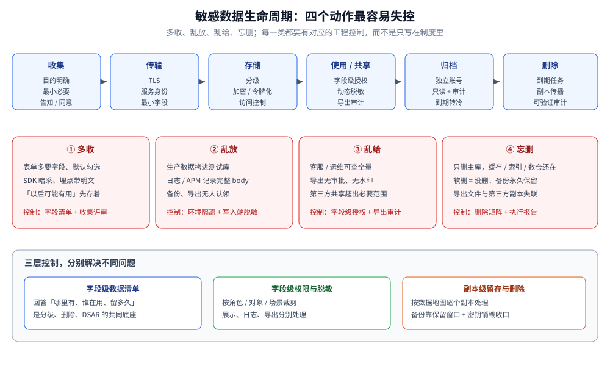
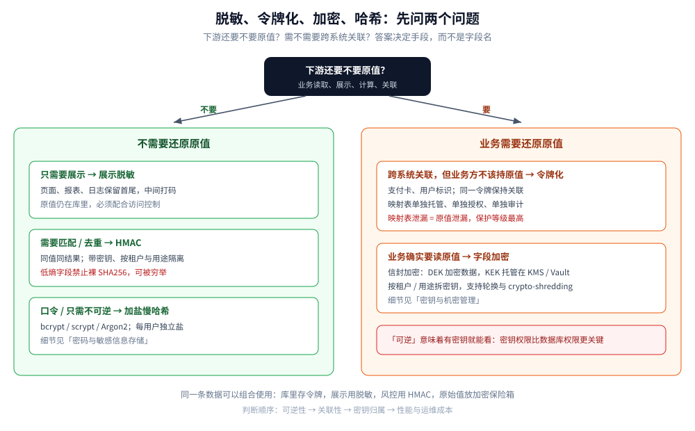
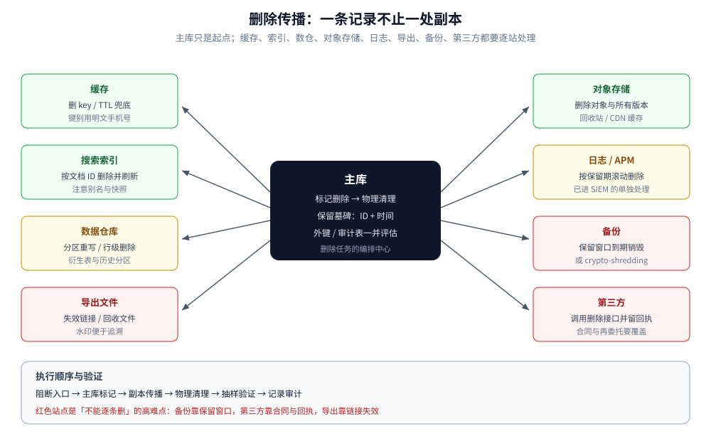

# 敏感数据治理与合规

> 覆盖：敏感数据的分类分级与字段清单、脱敏 / 令牌化 / 加密 / 哈希的选型、
> 日志与测试数据等旁路副本、保留与删除传播、个人信息权利请求，
> 以及 PIPL / GDPR / 等保 2.0 到工程证据的映射。
>
> 不覆盖：口令哈希与失败锁定见 [密码与敏感信息存储.md](密码与敏感信息存储.md)；
> KEK / DEK、KMS / Vault 与密钥轮换见 [密钥与机密管理.md](../密码学与密钥/密钥与机密管理.md)；
> API 字段越权与批量赋值见 [API安全.md](API安全.md)；
> 注入、XSS 等攻击原理见 [Web攻击与防御.md](Web攻击与防御.md)；
> 泄露事件的分级、取证与复盘见 [审计与应急响应.md](../安全工程/审计与应急响应.md)；
> IM 内容审核与留存见 [内容审核与合规.md](../../../04-架构与系统/系统设计/IM系统/内容审核与合规.md)。
>
> 内容整理自个人学习笔记。实测口径：展示脱敏、身份证校验位、Luhn、保留期与 HMAC 令牌化
> 用 `golang:1.26-alpine` 运行，输出见「具体使用」第 1～5 小节；
> 删除传播任务、DSAR 流程与合规映射为工程构造示例，未做线上实测。
> 涉及具体法条、适用范围与义务时，只做工程视角的映射，**不构成法律意见**，落地前需法务确认。

---

## 一、哪些数据算「敏感」？先分类还是先盘点？

**本节要点**：分类分级不能凭字段名拍脑袋，必须先有**字段级数据清单**；
清单回答「哪里有、谁在用、留多久、给过谁」，分级才有落点。

### 1.1 三个容易混淆的概念

| 概念 | 关注点 | 例子 | 工程后果 |
|---|---|---|---|
| 个人信息 | 能否关联到具体个人 | 姓名、手机号、设备 ID、IP、订单记录 | 告知、同意、访问与删除请求 |
| 敏感个人信息 | 泄露后容易导致人身、财产受损害或歧视 | 身份证、生物识别、金融账户、医疗健康、行踪、14 岁以下儿童信息 | 更高的授权门槛、单独同意、更严的访问控制与影响评估 |
| 重要数据 | 泄露可能影响国家安全、公共利益 | 大规模人口、地理、行业运行数据 | 按行业监管要求分级、评估与出境限制 |
| 业务敏感数据 | 泄露直接影响商业利益 | 成本价、风控规则、未发布活动、内部密钥 | 最小权限、脱敏、审计 |

⚠️ 两个常见误区：

1. **「不是身份证号就不敏感」**：手机号 + 地址 + 订单轨迹可以拼出完整画像；
   单看每个字段都不「敏感」，组合起来风险很高。
2. **「脱敏了就随便放」**：展示脱敏只改变显示值，原值仍在库里；
   如果副本没有同样的访问控制，脱敏只是换了层皮。

### 1.2 分类分级的落点：一张字段级清单

至少登记这些列，才能支撑后面的删除、导出与审计：

| 列 | 回答什么 | 例子 |
|---|---|---|
| 系统 / 表 / 字段 | 数据在哪 | `order_db.orders.receiver_phone` |
| 数据类别 | 是什么 | 个人信息 / 敏感个人信息 / 业务敏感 |
| 分级 | 泄露影响多大 | 公开 / 内部 / 敏感 / 核心 |
| 收集目的 | 为什么收 | 配送、售后、风控 |
| 法律依据 / 同意记录 | 凭什么处理 | 合同履行、同意、法定义务 |
| 存储位置与副本 | 有几份 | 主库、缓存、ES、数仓、备份、日志 |
| 保留期 | 留多久 | 订单完成后 3 年（以业务与法务确认的值为准） |
| 访问者 | 谁能看 | 角色、服务账号、第三方 |
| 共享 / 出境 | 给过谁 | 物流、支付、云服务、跨境 |
| 负责人 | 谁维护 | 业务 Owner + 数据 Owner |

⭐ 清单优先从**数据库 schema、ORM 模型、日志字段、对象存储桶、数仓表**自动采集，
再人工确认分级；纯靠问卷维护的清单，三个月后就会和真实系统脱节。

## 二、数据从收集到删除，哪些环节最容易失控？

**本节要点**：风险集中在四个动作——**多收、乱放、乱给、忘删**。
技术手段只能解决其中一部分，剩下的要靠流程与权限。



| 阶段 | 关键控制 | 常见失控 | 工程落点 |
|---|---|---|---|
| 收集 | 目的明确、最小必要、告知与同意 | 表单多要字段；默认勾选；SDK 暗采 | 字段清单评审、前端与 API 双向校验、同意记录 |
| 传输 | TLS、服务身份、最小字段 | 明文内网、日志打印完整请求 | mTLS、出站白名单、字段级日志策略 |
| 存储 | 分级存储、加密、访问控制 | 生产数据直接拷到测试；备份无人管 | 字段加密、独立密钥、环境隔离、备份加密 |
| 使用 / 共享 | 最小权限、脱敏、审计 | 客服可查全量；导出无审批；第三方超范围 | 字段级授权、动态脱敏、导出审批与水印 |
| 归档 | 到期转冷、限制访问 | 归档成「第二生产库」，权限更松 | 归档策略、独立账号、只读与审计 |
| 删除 | 到期清理、请求删除、传播到副本 | 只删主库；软删等于没删；备份永久保留 | 删除任务、墓碑、副本清单、删除审计 |

### 2.1 最小化要同时做四件事

| 最小化 | 判据 | 反例 |
|---|---|---|
| 收集最小 | 每个字段都能说出「不收集会怎样」 | 「以后可能有用」先收着 |
| 字段最小 | 接口只返回当前场景需要的字段 | 详情接口返回整行数据 |
| 权限最小 | 默认无权限，按角色与对象授权 | 客服默认能看全部用户 |
| 留存最短 | 每个类别有明确保留期与到期动作 | 「先永久保存，以后再说」 |

### 2.2 副本才是泄漏重灾区

主库通常有审计、堡垒机、加密和权限；真正松的是旁路：

- 应用日志、网关访问日志、APM / Trace 的请求体；
- Redis 缓存、Elasticsearch 索引、数据仓库与 BI  extracts；
- 备份、快照、离线导出、测试环境；
- 消息队列的积压消息与死信队列；
- 第三方 SDK、客服系统、邮件 / 短信服务商。

⭐ 判断一条数据「删干净没有」，不能只看主库；要按数据清单把**每一份副本**都列出来，
否则删除请求只完成了一部分。

## 三、脱敏、令牌化、加密、哈希怎么选？

**本节要点**：先问两个问题——**下游还要不要原值？需不需要跨系统关联？**
答案不同，选的手段完全不同；四者不是同义词。

### 3.1 四种手段的边界

| 手段 | 可逆 | 能否关联 | 典型用途 | 关键风险 |
|---|---|---|---|---|
| 展示脱敏 | 否（对使用者） | 否 | 页面、日志、报表只显示尾号 | 误以为原值也被处理 |
| 令牌化 | 是（凭映射） | 是（同一令牌） | 支付卡号、跨系统用户标识 | 映射表本身成为高价值目标 |
| 加密 | 是（凭密钥） | 是（解密后） | 字段加密、备份、对象存储 | 密钥管理不当等于没加密 |
| 哈希 | 否 | 可（确定性哈希） | 口令、去重、匹配 | 低熵数据可被字典/彩虹表反推 |

⚠️ **哈希不等于匿名化**：手机号、身份证号的空间有限，直接 `SHA256(手机号)` 可以被穷举。
需要「同值同结果、又不能反推」时，用带密钥的 HMAC，并按租户 / 用途隔离密钥；
需要抗暴力破解的口令存储则用慢哈希（见 [密码与敏感信息存储.md](密码与敏感信息存储.md)）。

### 3.2 选型决策树



```text
下游还要不要原值？
├─ 不要
│  ├─ 只需要展示 → 展示脱敏（保留首尾，中间打码）
│  ├─ 只需要匹配 / 去重 → HMAC（带密钥、按用途隔离）
│  └─ 只需要不可逆 → 加盐慢哈希（口令场景）
└─ 要
   ├─ 需要跨系统关联、但业务方不该拿原值 → 令牌化（映射表单独托管）
   └─ 业务确实要读原值 → 字段加密（信封加密，密钥进 KMS / Vault）
```

### 3.3 三种脱敏时机

| 时机 | 做法 | 适用 | 注意 |
|---|---|---|---|
| 展示脱敏 | 响应序列化 / 前端渲染时打码 | 页面、报表、日志 | 原值仍在应用内存与库中 |
| 静态脱敏 | 导出、测试数据生成时替换 | 测试环境、数据分析 | 要保证不可逆，避免用生产映射 |
| 动态脱敏 | 数据库代理 / 网关按角色改写结果 | 客服、运维查询 | 依赖代理覆盖所有入口，绕过即失效 |

⭐ 最稳的组合是**源头分级 + 字段级授权 + 出口脱敏**：
不要指望一个正则或一个代理覆盖所有路径。

## 四、日志、导出、测试数据为什么是最大的泄漏面？

**本节要点**：这些路径的共同点是「为了排障或分析，顺手把完整数据复制了一份」，
而复制时通常没有带上主库的访问控制。

### 4.1 日志：先决定「不记什么」

| 数据 | 默认策略 | 如果确实需要 |
|---|---|---|
| 请求 / 响应 body | 不记录 | 字段 allowlist，敏感字段打码 |
| `Authorization`、Cookie、API Key | 永不记录 | 只记录凭证 ID 与指纹 |
| 手机号、身份证、银行卡 | 打码 | 保留尾号用于排查 |
| SQL 参数 | 不打完整值 | 只记占位符与耗时 |
| 异常堆栈 | 可记录，但不回显给客户端 | 服务端日志保留，客户端返回错误码 |

日志脱敏要放在**写入端**（logger / 序列化器），而不是等 SIEM 再处理：
一旦明文已经落盘、被采集、被转发，删除成本很高。实测：

```text
原始：用户 13812345678（身份证 11010519491231002X，邮箱 alice.wang@example.com）用卡号 6222021234567890123 支付失败
脱敏：用户 138****5678（身份证 110105********002X，邮箱 a*********@example.com）用卡号 6222***********0123 支付失败
```

### 4.2 导出与报表

- 导出是**批量泄漏**的高危动作：要有独立权限、行数上限、审批与审计；
- 文件加水印 / 隐式标记，便于追溯泄露源；
- 下载链接短期有效、绑定用户，禁止公开桶；
- 报表与 BI 只给聚合结果，明细按需申请；
- 导出文件也要纳入保留期与删除传播，不能「导出即失联」。

### 4.3 测试数据

生产数据直接拷贝到测试环境是最常见的事故之一。三种做法，风险从高到低：

| 做法 | 风险 | 建议 |
|---|---|---|
| 直接拷生产库 | 极高：测试账号、外包、日志全都能看 | 禁止 |
| 生产数据简单替换姓名 | 高：手机号、地址、订单关联仍在 | 不推荐 |
| 合成数据 / 不可逆脱敏 | 低 | 首选；保留格式与关联关系 |

### 4.4 缓存、搜索与消息队列

- 缓存键不要用明文手机号 / 身份证；
- 搜索索引只放检索必要字段，敏感字段单独加密或令牌化；
- 消息队列设置 TTL，死信队列同样要清理；
- 第三方共享只给最小字段，并保留共享记录与撤回机制。

## 五、保留与删除：一条记录到底要删几处？

**本节要点**：删除不是一条 `DELETE`。要沿数据地图把**主库、缓存、索引、数仓、对象存储、
日志、备份、第三方**逐个处理，并留下可验证的审计。



### 5.1 保留期怎么定

保留期 = **业务必需的最短时间** ∩ **法规要求的最短/最长时间**，并由法务确认。
工程上把它做成可执行的策略，而不是文档里的一句话：

| 数据类型 | 保留策略示例 | 到期动作 |
|---|---|---|
| 订单交易记录 | 业务与税务要求期内保留 | 归档 → 到期清理 |
| 浏览 / 行为日志 | 短期（如 30～180 天） | 自动滚动删除 |
| 客服会话 | 服务质量与争议处理期内 | 到期清理或匿名化 |
| 营销线索 | 目的完成后尽快删除 | 定期清理 |
| 备份 | 固定保留窗口 | 窗口外自动过期 |

### 5.2 删除传播矩阵

| 副本 | 怎么删 | 难点 |
|---|---|---|
| 主库 | 硬删或软删 + 定期物理清理 | 软删不等于删除；外键与审计表可能留副本 |
| 缓存 | 删除 key / 设置 TTL | 键可能由明文派生，删不干净 |
| 搜索索引 | 按文档 ID 删除并刷新 | 别名、快照、副本可能残留 |
| 数据仓库 | 分区重写 / 行级删除 | 历史分区与衍生表 |
| 对象存储 | 删除对象与版本 | 版本控制、回收站、CDN 缓存 |
| 日志 / APM | 按保留期滚动 | 已转发到 SIEM 的部分要单独处理 |
| 备份 | 保留窗口到期 + 密钥销毁 | 不能逐条删除；用 crypto-shredding 收口 |
| 第三方 | 调用对方删除接口并留回执 | 依赖合同与对方配合 |

⚠️ **软删除的陷阱**：`deleted_at` 只是让业务查询看不到，数据仍在库里、仍可被导出、
仍会被备份。对个人信息删除请求而言，必须有**物理清理任务**或**加密密钥销毁**作为最终动作。

### 5.3 删除的可验证性

- 每个删除任务记录：范围、条数、执行时间、执行者、失败重试；
- 删除后抽样验证：主库、缓存、搜索、导出文件各查一次；
- 保留「删除墓碑」（只留 ID 与时间，不留内容），用于证明已处理；
- 备份删除不了时，记录保留窗口与 crypto-shredding 计划，作为合规说明的一部分。

### 5.4 个人信息权利请求（DSAR）

| 请求 | 工程动作 | 关键点 |
|---|---|---|
| 查阅 / 复制 | 汇总各系统数据，生成可读导出 | 先做身份核验，防止冒领 |
| 更正 | 更新主库并传播到副本 | 保留变更审计 |
| 删除 | 按删除矩阵执行 | 法定保留义务例外要说明 |
| 撤回同意 | 停止后续处理，评估是否需删除 | 不影响撤回前已进行的处理 |
| 限制 / 拒绝自动化决策 | 关闭画像 / 推荐，提供人工渠道 | 需要业务系统支持开关 |

流程要有 SLA、工单、身份核验与审计；不能靠工程同学临时写 SQL。

## 六、PIPL、GDPR、等保 2.0 分别要求什么？怎么落到工程？

**本节要点**：法规给的是原则与义务，工程要给的是**可验证的控制点与证据**。
下面的映射只用于系统设计，具体适用与义务以法务意见为准。

| 要求 | 典型来源 | 工程控制 | 可提供的证据 |
|---|---|---|---|
| 最小必要 | PIPL / GDPR | 字段清单、收集评审、接口字段白名单 | 数据清单、评审记录 |
| 告知与同意 | PIPL / GDPR | 同意管理、版本化隐私政策、单独同意场景 | 同意记录、版本号、撤回记录 |
| 目的限定 | PIPL / GDPR | 数据用途登记、跨用途审批 | 用途清单、访问审计 |
| 访问控制 | 等保 2.0 / PIPL / GDPR | 角色 + 对象级授权、最小权限、定期复核 | 权限矩阵、复核记录 |
| 审计 | 等保 2.0 / GDPR | 安全审计日志、保留期、防篡改 | 审计日志、哈希链 / 锚点 |
| 加密与完整性 | 等保 2.0 / PCI DSS | 传输 TLS、字段加密、备份加密 | 配置基线、密钥轮换记录 |
| 保留与删除 | PIPL / GDPR | 保留策略、删除任务、副本清单 | 删除工单、执行报告 |
| 数据主体权利 | PIPL / GDPR | DSAR 工单、身份核验、导出 / 删除流程 | 工单与 SLA 记录 |
| 影响评估 | PIPL / GDPR | 敏感信息、自动化决策、对外提供、跨境时做评估 | PIA / DPIA 文档 |
| 泄露通知 | PIPL / GDPR | 事件分级、通知模板、时限与联系人 | 事件记录、通知回执 |
| 跨境与共享 | PIPL / GDPR | 出境清单、合同、单独同意、传输评估 | 合同、评估报告、同意记录 |
| 支付卡数据 | PCI DSS | 不存 CVV；PAN 脱敏 / 令牌化；严格访问 | 扫描报告、访问审计 |

### 6.1 几条容易踩线的工程细节

- **「同意」不是一次弹窗**：要能证明「谁、在什么时候、同意了什么版本、用于什么目的」，
  并且能撤回；同意记录本身也是个人信息，要按同样标准保护。
- **「匿名化」不是「去名字」**：可重新识别的数据仍是个人信息；对外发布前要评估组合识别风险。
- **「境内存储」不等于「不出境」**：跨境访问、远程运维、海外备份都可能构成出境，
  需要按适用规则评估。
- **「日志里有手机号」也算存储**：日志、APM、备份都是处理活动，不能漏出数据清单。
- **「第三方 API」也是共享**：调用第三方处理个人信息要有合同与范围约定，不能只靠技术对接。

## 七、出了数据泄露先做什么？

**本节要点**：先控制影响、保留证据，再评估是否触发通知义务；
顺序错了可能扩大范围或破坏证据。完整的应急流程见
[审计与应急响应.md](../安全工程/审计与应急响应.md)，这里只列与个人信息相关的动作。

```text
发现 → 初步分级 → 隔离 / 止血 → 取证与范围评估 → 法务与负责人决策
     → 监管 / 个人通知（如触发）→ 修复 → 复盘与证据归档
```

| 动作 | 关键点 |
|---|---|
| 止血 | 吊销凭证、关闭入口、隔离主机；先保留内存与日志再重启 |
| 范围评估 | 哪些数据、多少人、是否敏感、是否已外传 |
| 通知判断 | 按适用法规与合同判断是否通知监管 / 个人；由法务拍板 |
| 通知内容 | 事件经过、可能影响、已采取措施、个人可采取的措施、联系方式 |
| 证据 | 时间线、日志、截图、哈希、保管链；通知与沟通记录一并归档 |

⚠️ 不要为了「先恢复服务」而清空日志、重建实例或覆盖磁盘；这些操作会让范围评估和通知判断失去依据。
GDPR 的 72 小时、PIPL 的「立即通知」等时限，从**知悉**起算，具体口径需法务确认。

## 八、落地检查清单

| # | 检查项 | 通过判据 |
|---|---|---|
| 1 | 有字段级数据清单 | 表 / 字段 / 分级 / 用途 / 保留期 / 访问者齐全 |
| 2 | 敏感字段有明确 Owner | 每个敏感字段能找到业务与数据负责人 |
| 3 | 收集有依据 | 每个字段能说出目的与法律依据 / 同意记录 |
| 4 | 接口字段最小 | 请求 / 响应 DTO 都是白名单，不返回整行实体 |
| 5 | 展示与日志脱敏 | 手机号、身份证、卡号、邮箱按规则打码；凭证不落日志 |
| 6 | 令牌化 / 加密 | 需要关联的用令牌；需要原值的字段加密且密钥托管 |
| 7 | 导出受控 | 独立权限、审批、行数上限、水印、审计 |
| 8 | 测试数据不含生产明文 | 合成数据或不可逆脱敏，抽检通过 |
| 9 | 保留与删除可执行 | 有到期任务、删除传播矩阵、执行报告 |
| 10 | DSAR 有流程 | 身份核验、SLA、工单、各系统协同 |
| 11 | 合规证据可导出 | 清单、同意、审计、评估、删除记录能按需提供 |
| 12 | 泄露预案可演练 | 联系人、模板、时限、取证工具与保管链明确 |

## 应用场景

| 场景 | 主要风险 | 优先措施 |
|---|---|---|
| 电商 / 外卖订单 | 手机号、地址、订单轨迹 | 展示脱敏、客服字段级授权、导出审计 |
| 金融 / 支付 | 卡号、账户、交易 | 令牌化、PCI DSS 范围收敛、密钥托管 |
| 医疗 / 健康 | 敏感个人信息、病历 | 强访问控制、字段加密、审计与影响评估 |
| 社交 / IM | 聊天内容、关系链、位置 | 端到端加密（按产品）、留存策略、内容审核边界 |
| HR / 内部系统 | 身份证、薪资、家庭信息 | 最小字段、分级授权、离职即回收 |
| 数据分析 / BI | 明细汇聚、二次使用 | 聚合优先、动态脱敏、用途审批 |
| 测试环境 | 生产数据拷贝 | 合成数据、不可逆脱敏、环境隔离 |
| 出海业务 | 跨境传输、当地法规 | 数据驻留、传输评估、合同与同意 |

## 具体使用

**本节要点**：下面五段都是可运行的最小实现，重点不在函数本身，而在
「哪些值必须保留、哪些必须打掉、哪些需要密钥」。完整程序见 `.workbuddy/tmp/p4/pii.go`。

### 1) 展示脱敏：保留可核对的最少片段

```go
func maskPhone(s string) string {
    r := []rune(s)
    if len(r) != 11 {
        return "***"
    }
    return string(r[:3]) + "****" + string(r[7:])
}

func maskID(s string) string {
    r := []rune(s)
    if len(r) != 18 {
        return "***"
    }
    return string(r[:6]) + strings.Repeat("*", 8) + string(r[14:])
}

func maskEmail(s string) string {
    at := strings.LastIndex(s, "@")
    if at <= 0 {
        return "***"
    }
    name := []rune(s[:at])
    return string(name[:1]) + strings.Repeat("*", len(name)-1) + s[at:]
}
```

```text
手机号   13812345678 → 138****5678
身份证   11010519491231002X → 110105********002X
邮箱     alice.wang@example.com → a*********@example.com
银行卡   6222021234567890123 → 6222***********0123
脱敏后的身份证还能通过校验吗 = false（星号不是数字，脱敏不可逆）
```

⭐ 脱敏后仍要能人工核对「是不是同一个人」，所以保留首尾；但**不能用脱敏值做关联键**，
关联要用令牌（第 4 小节）。

### 2) 身份证校验位：先校验再入库

```go
var idWeights = []int{7, 9, 10, 5, 8, 4, 2, 1, 6, 3, 7, 9, 10, 5, 8, 4, 2}

const idCodes = "10X98765432"

func idCheckDigit(first17 string) (byte, bool) {
    if len(first17) != 17 {
        return 0, false
    }
    sum := 0
    for i := 0; i < 17; i++ {
        c := first17[i]
        if c < '0' || c > '9' {
            return 0, false
        }
        sum += int(c-'0') * idWeights[i]
    }
    return idCodes[sum%11], true
}
```

```text
身份证前 17 位 11010519491231002 的校验位 = X
身份证 11010519491231002X 校验 = true
身份证 110105194912310021 校验 = false
```

### 3) 银行卡 Luhn 与保留期

```go
func luhnValid(s string) bool {
    sum, double := 0, false
    for i := len(s) - 1; i >= 0; i-- {
        d := int(s[i] - '0')
        if double {
            d *= 2
            if d > 9 {
                d -= 9
            }
        }
        sum += d
        double = !double
    }
    return sum%10 == 0
}

func expired(created, now time.Time, keepYears int) bool {
    return !created.AddDate(keepYears, 0, 0).After(now)
}
```

```text
银行卡 4111111111111111 Luhn = true
银行卡 4111111111111112 Luhn = false

创建于 2024-10-18 → 到期删除（截止日 2026-10-18）
创建于 2024-10-19 → 到期删除（截止日 2026-10-19）
创建于 2024-10-20 → 保留（截止日 2026-10-20）
创建于 2026-01-01 → 保留（截止日 2028-01-01）
```

⚠️ 校验位只证明「格式可能合法」，不证明证件 / 卡真实存在；它用于减少脏数据，
不能替代实名核验或支付渠道的验证。

### 4) 令牌化：同值同令牌、跨租户隔离

```go
func tokenize(key []byte, tenant, value string) string {
    m := hmac.New(sha256.New, key)
    m.Write([]byte(tenant))
    m.Write([]byte{0})
    m.Write([]byte(value))
    return "tok_" + hex.EncodeToString(m.Sum(nil))[:16]
}
```

```text
同租户同手机号两次：tok_69fd65cd99d78876 / tok_69fd65cd99d78876，相同=true
换一个租户：          tok_42ba49d54ea6d9ca，相同=false
令牌里能还原出原值吗 = false（只能拿令牌回查映射表）
```

⭐ 这里用的是「确定性令牌」：适合做关联、去重、风控命中；代价是同一输入总得到同一令牌，
所以**必须带密钥、按租户隔离**，避免跨租户碰撞与离线枚举。
需要随机令牌时，另建映射表并单独托管。

### 5) 日志脱敏：写入端处理

```go
var (
    reCard  = regexp.MustCompile(`\b\d{16,19}\b`)
    reID    = regexp.MustCompile(`\b\d{17}[\dXx]\b`)
    rePhone = regexp.MustCompile(`\b1[3-9]\d{9}\b`)
    reEmail = regexp.MustCompile(`\b[A-Za-z0-9._%+-]+@[A-Za-z0-9.-]+\.[A-Za-z]{2,}\b`)
)

func redactLog(s string) string {
    s = reCard.ReplaceAllStringFunc(s, maskCard)
    s = reID.ReplaceAllStringFunc(s, maskID)
    s = rePhone.ReplaceAllStringFunc(s, maskPhone)
    s = reEmail.ReplaceAllStringFunc(s, maskEmail)
    return s
}
```

```text
原始：用户 13812345678（身份证 11010519491231002X，邮箱 alice.wang@example.com）用卡号 6222021234567890123 支付失败
脱敏：用户 138****5678（身份证 110105********002X，邮箱 a*********@example.com）用卡号 6222***********0123 支付失败
```

⚠️ 正则脱敏只能兜底：字段一旦结构化，优先在日志模型里**不采集**；
正则的顺序也会影响结果（先处理长号码，再处理短号码），上线前要拿真实日志样本回归。

### 6) 删除传播任务（构造示例，未实测）

```sql
-- 主库：先标记，再由清理任务物理删除
UPDATE user_profile SET deleted_at = now() WHERE user_id = ? AND deleted_at IS NULL;

-- 定期物理清理：只删已过保留期且无法律保留的数据
DELETE FROM user_profile
WHERE deleted_at < now() - interval '30 days'
  AND user_id NOT IN (SELECT user_id FROM legal_hold);
```

任务编排要覆盖：缓存删除、搜索索引删除、数仓分区重写、对象存储版本删除、
导出文件失效、第三方删除调用与回执。每一站都记录条数与结果，失败可重试、可审计。

## 延伸追问

- **脱敏和加密有什么区别？** → 脱敏是「让人看不到原值」，通常是不可逆的展示处理；
  加密是「让没有密钥的人看不到」，有密钥就能还原。脱敏解决展示与最小化，加密解决存储与传输。
- **令牌化与加密怎么选？** → 需要跨系统关联、但业务方不该持有原值时用令牌化；
  业务确实要读原值时用字段加密。令牌化的映射表必须单独托管，否则等于把原值换了个地方放。
- **为什么手机号不能直接 SHA256？** → 手机号空间有限，攻击者可以穷举所有号段生成彩虹表。
  需要关联时用带密钥的 HMAC，并按租户 / 用途隔离密钥。
- **软删除算不算删除？** → 对业务查询算，对个人信息删除请求不算。必须有物理清理或密钥销毁，
  并覆盖缓存、索引、数仓、导出与备份。
- **备份里的数据怎么删？** → 通常不能逐条删。做法是固定保留窗口 + 到期销毁，必要时用
  crypto-shredding（销毁对应密钥）让备份中的密文不可解；并在合规说明中写清窗口。
- **同意记录要记什么？** → 主体、时间、政策版本、目的、范围、获取方式、撤回记录。
  同意记录本身也是个人信息，要按同等标准保护。
- **匿名化和去标识化有什么区别？** → 去标识化后仍可能通过组合信息重新识别，仍是个人信息；
  匿名化要求无法复原、不可识别，标准更高。对外发布前要做重识别风险评估。
- **日志里已经有无数据了怎么办？** → 先停止新增（改采集与脱敏），再按保留期清理历史，
  评估是否已外传 / 进入 SIEM；不要直接删库了事，要留处理记录。
- **第三方说「我们会脱敏」，还需要管吗？** → 需要。共享范围、字段、用途、保留期、
  再委托与泄露通知都要写进合同，并保留共享与删除回执。
- **合规做完了怎么证明？** → 用可导出的证据：数据清单、同意记录、权限矩阵、审计日志、
  影响评估、删除报告、演练记录。没有证据的控制点，在审计时等于不存在。

## 关联

- **上游/总纲**：[README.md](../README.md) — 安全目录的分组与阅读路线
- **同组前置**：[密码与敏感信息存储.md](密码与敏感信息存储.md) — 口令的慢哈希、加盐与工作因子
- **同组对照**：[API安全.md](API安全.md) — 字段越权、过度暴露与导出接口的资源限制
- **密钥与加密**：[密钥与机密管理.md](../密码学与密钥/密钥与机密管理.md) — KEK / DEK、字段加密与 crypto-shredding
- **算法底座**：[加密算法.md](../密码学与密钥/加密算法.md) — 对称 / 非对称 / 散列的性质与选型
- **摘要与签名**：[摘要与数字签名.md](../密码学与密钥/摘要与数字签名.md) — HMAC 与摘要的适用边界
- **事件响应**：[审计与应急响应.md](../安全工程/审计与应急响应.md) — 泄露分级、取证、通知与复盘
- **攻击视角**：[Web攻击与防御.md](Web攻击与防御.md) — 注入、XSS 等导致数据泄露的入口
- **领域边界**：[内容审核与合规.md](../../../04-架构与系统/系统设计/IM系统/内容审核与合规.md) — IM 内容审核与留存
- **部署侧**：[K8s部署流程.md](../../部署/k8s/K8s部署流程.md) — Secret 投递与运行时密钥暴露面
> 反向引用（本篇被下列文档引到）：[安全开发生命周期.md](../安全工程/安全开发生命周期.md)
