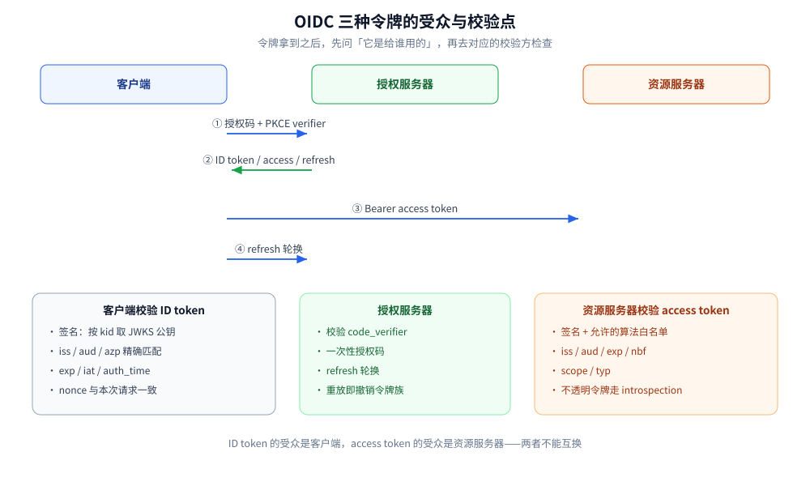
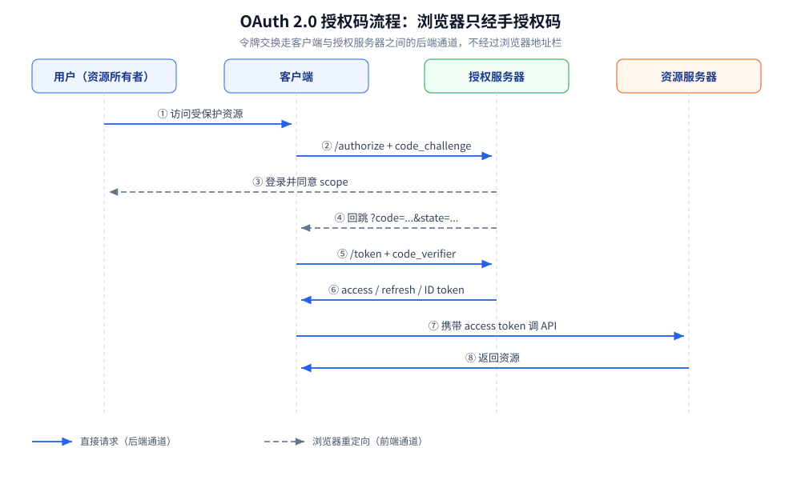
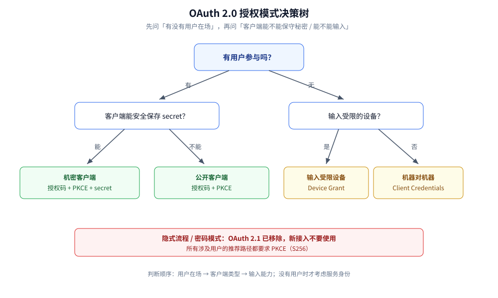

# OAuth 2.0 与 OIDC

> 覆盖：OAuth 2.0 的四方角色、授权码 + PKCE 流程、access / refresh / ID token 的分工，
> 以及 OIDC 在其上补出的身份层、令牌校验项、刷新轮换、SSO 与常见实现漏洞。
>
> 不覆盖：JWT 的三段结构与验签实现见 [JWT与APIKey鉴权.md](JWT与APIKey鉴权.md)；
> 签名与证书链的密码学原理见 [摘要与数字签名.md](../密码学与密钥/摘要与数字签名.md) 与
> [数字证书与PKI.md](../密码学与密钥/数字证书与PKI.md)；
> 拿到身份之后的资源级权限判断见 [授权模型与越权防护.md](授权模型与越权防护.md)。
>
> 内容整理自个人学习笔记。实测口径：PKCE 的 S256 计算与 verifier 校验用
> `golang:1.26-alpine` 运行，含 RFC 7636 官方测试向量，输出见第五节；
> 完整的授权码流程与 SSO 未接真实 IdP 实测，相关 `bash` 块为构造示例。

---

## 一、OAuth 2.0 解决的到底是什么问题？

**本节要点**：OAuth 2.0 是**委托授权**框架，不是登录协议。它要解决的是
「**让第三方应用在拿不到用户口令的前提下，拿到一份范围受限、到期失效的访问凭证**」。

反面场景是最容易理解的：一个照片打印服务要读用户的云相册，如果让用户直接交出云盘账号密码，
服务就拿到了账号的**全部权限**，而且用户改密码之前一直有效。OAuth 把这团风险拆成三件事：

| 问题 | OAuth 的答案 |
|---|---|
| 怎么证明「用户同意授权」 | 用户在**授权服务器**上登录并确认 scope，第三方应用不接触口令 |
| 第三方到底能做什么 | **access token 携带 scope**，范围由授权服务器签发时限定 |
| 凭证泄露后怎么止损 | access token **短命**；refresh token 可轮换、可撤销 |

⭐ 关键边界：**OAuth 回答「这个客户端能访问什么」，不回答「用户是谁」**。
「用某平台账号登录」是 **OIDC（OpenID Connect）** 在 OAuth 2.0 之上补的身份层；
只拿 access token 去判断「用户是谁」，是接入时最常见的概念错位。

## 二、四个角色和两类令牌分别是什么？

**本节要点**：先把四个角色分清，后面所有流程都是这四个角色之间的消息传递；
再看两类令牌，避免把「访问凭证」和「续期凭证」混在一起。

| 角色 | 职责 | 常见实现 |
|---|---|---|
| **资源所有者**（Resource Owner） | 有权授予访问的人，通常就是用户 | 浏览器前的登录者 |
| **客户端**（Client） | 代表资源所有者发起请求的应用 | Web 后端、SPA、CLI、另一个服务 |
| **授权服务器**（Authorization Server） | 认证用户、征得同意、签发令牌 | Keycloak、Auth0、Okta、自建 IdP |
| **资源服务器**（Resource Server） | 校验 access token 并提供资源 | 业务 API、网关后的微服务 |

客户端又分两类，这决定了它能不能保守秘密：

| 类型 | 能否安全保存 `client_secret` | 典型形态 | 授权码流程的要求 |
|---|---|---|---|
| **机密客户端**（confidential） | 能 | 有后端的 Web 应用、服务端服务 | 授权码 + 客户端认证（可再加 PKCE） |
| **公开客户端**（public） | 不能 | SPA、桌面应用、移动 App、CLI | 授权码 + **PKCE**（不能依赖 secret） |

两类令牌：

| 令牌 | 给谁用 | 生命周期 | 是否该被浏览器/前端读到 |
|---|---|---|---|
| **access token** | 资源服务器 | 分钟级到小时级 | 尽量不；SPA 优先走 BFF |
| **refresh token** | 授权服务器 | 天级到月级 | **不应该**；只留在能安全存储的一侧 |



> ⚠️ refresh token 不是「更长命的 access token」：它只能拿去**换新令牌**，
> 不能拿去访问资源。把 refresh token 发给资源服务器，等于把长期凭证暴露在业务链路上。

## 三、授权码流程为什么是默认选择？

**本节要点**：授权码流程把**令牌交换放到后端通道**（back channel），浏览器只经手一个
**一次性、短命、绑定客户端**的授权码；PKCE 再把「码被截获」这条风险补上。

```text
用户        客户端          授权服务器        资源服务器
 |            |                 |                 |
 |  1 访问受保护资源              |                 |
 |----------->|                 |                 |
 |            | 2 /authorize（code_challenge）      |
 |            |---------------->|                 |
 | 3 登录 + 同意 scope           |                 |
 |<-----------------------------|                 |
 |            | 4 302 回跳 ?code=...&state=...     |
 |            |<----------------|                 |
 |            | 5 /token（code + code_verifier）   |
 |            |---------------->|                 |
 |            | 6 access / refresh / ID token      |
 |            |<----------------|                 |
 |            | 7 带 access token 调 API           |
 |            |---------------------------------->|
```

图中 2、4 走**前端通道**（浏览器重定向），5、6 走**后端通道**（客户端直接连授权服务器）。
⭐ 这个分工是授权码流程的核心：**浏览器地址栏、历史记录、Referer 头里只会出现授权码**，
不会出现 access token 或 refresh token。



授权码本身还有四道约束：

1. **一次性**：换过令牌立即作废；
2. **短命**：通常几十秒到几分钟；
3. **绑定 `client_id` 与 `redirect_uri`**：别的客户端拿到码也换不了；
4. **绑定 PKCE 的 `code_verifier`**：公开客户端也能证明「换码的就是发起授权的那一方」。

### 3.1 为什么不直接用隐式流程

隐式流程（`response_type=token`）把 access token 直接放在重定向 URL 的 fragment 里返回。
它省掉了换码这一步，代价是令牌暴露在浏览器历史、日志、Referer 与恶意脚本可达的位置，
而且没有 refresh token、无法轮换。OAuth 2.1 草案已移除隐式流程与密码模式，
**新接入不应再使用**。

## 四、PKCE 为什么能把公开客户端也纳入授权码流程？

**本节要点**：PKCE（Proof Key for Code Exchange，RFC 7636）让客户端在**发起授权时**先提交
一个挑战值，在**换码时**再提交原像；截获授权码的攻击者没有原像，码就换不成令牌。

```text
客户端                                     授权服务器
  |  生成随机 code_verifier（43~128 字符）        |
  |  code_challenge = BASE64URL(SHA256(verifier)) |
  |                                            |
  |  授权请求 ...&code_challenge=...&code_challenge_method=S256
  |------------------------------------------->|
  |                                            | 保存 challenge，绑定本次授权码
  |  回跳 ?code=...                            |
  |<-------------------------------------------|
  |  换码请求 code=...&code_verifier=...        |
  |------------------------------------------->|
  |                                            | SHA256(verifier) == challenge ?
  |  access token                              |
  |<-------------------------------------------|
```

### 4.1 三种截获场景，PKCE 分别挡住什么

| 场景 | 没有 PKCE | 有 PKCE |
|---|---|---|
| 授权码在回跳 URL 中被偷看 | 可直接换令牌 | 没有 verifier，换不了 |
| 同一设备上恶意 App 注册了相同 scheme | 可截获回跳 | 换码时挑战值对不上 |
| 授权码被注入到攻击者自己的会话 | 可冒用 | 授权码与 verifier 绑定，注入失败 |

### 4.2 必须用 S256，并且拒绝降级

`code_challenge_method` 支持 `plain` 与 `S256`。`plain` 等于把 verifier 直接放在授权请求里，
攻击者截获 challenge 就拿到了原像，**只应作为无法计算 SHA-256 的古老客户端兼容项**。

⭐ 实现侧要守住两条：

- 授权服务器对 `plain` 默认关闭；客户端只发 `S256`；
- **不要在失败时回退到 `plain`**——「先试 S256，失败再降级」会把防护直接关掉。

### 4.3 本机实测：官方测试向量与随机 verifier

用 Go 标准库计算，verifier 取 RFC 7636 Appendix B 的官方测试向量：

```go
func s256(verifier string) string {
    sum := sha256.Sum256([]byte(verifier))
    return base64.RawURLEncoding.EncodeToString(sum[:])
}
```

```text
RFC 7636 verifier  = dBjftJeZ4CVP-mB92K27uhbUJU1p1r_wW1gFWFOEjXk
RFC 7636 challenge = E9Melhoa2OwvFrEMTJguCHaoeK1t8URWbuGJSstw-cM
verifier 合法       = true

随机 verifier      = wBGqkKbtYxr7r7oOydesn1Y6E15jmPbmOAEKGKVP-Co
长度 / 合法        = 43 / true
对应 challenge     = z--lUZklx7Wf_KtsZoBm35PJBohH9Z2zJ_sWgcz24Vs
随机 state         = -pdQgePfETMgufV13VQg5A (len=22)
非法 verifier      = "short" -> false
非法 verifier      = "with space 0123456789012345678901234567890123456789" -> false
非法 verifier      = "中文0123456789012345678901234567890123456789012345" -> false
```

⚠️ 随机 verifier 之所以是 43 字符：32 字节随机数做 base64url 无填充编码得到 43 个字符，
正好落在 RFC 要求的 43~128 区间。**verifier 必须用密码学随机源生成**，
不能用时间戳、用户 ID 或自增数。

### 4.4 `state` 与 PKCE 不是一回事

| 参数 | 防什么 | 校验时机 | 绑定对象 |
|---|---|---|---|
| `state` | 登录 CSRF：攻击者把自己的授权码塞进受害者的回调 | 换码**之前**，与本地会话中的值比对 | 用户的浏览器会话 |
| `code_verifier` | 授权码被截获或注入 | 换码时由授权服务器校验 | 发起授权的客户端实例 |
| `nonce`（OIDC） | ID token 重放 | 校验 ID token 时与授权请求中的值比对 | 本次认证请求 |

三者不能互相替代。**只做 PKCE 不做 `state`，仍然存在登录 CSRF**。

## 五、access token、refresh token、ID token 有什么区别？

**本节要点**：三种令牌的回答对象不同：access token 给资源服务器，refresh token 给授权服务器，
ID token 给客户端。**拿错令牌去错的地方用**，轻则 401，重则把认证与授权混为一谈。

| 维度 | access token | refresh token | ID token（OIDC） |
|---|---|---|---|
| 谁校验 | 资源服务器 | 授权服务器 | 客户端 |
| 内容 | scope、过期时间，可能带用户/租户 claim | 通常不透明，服务端有状态 | 用户身份 claim（`sub` / `iss` / `aud` 等） |
| 默认格式 | 不透明字符串，也可能用 JWT | 通常不透明 | **必须是 JWT** |
| 生命周期 | 分钟 ~ 小时 | 天 ~ 月 | 与一次认证会话相当，通常很短 |
| 能否访问 API | ✅ 就是干这个的 | ❌ | ❌ 受众是客户端，不是 API |
| 能否证明「用户是谁」 | 不应当作身份凭证 | ❌ | ✅ 但必须校验签名、`iss`、`aud`、`nonce` |

⭐ **两个高发错误**：

1. 资源服务器接受 ID token 当 access token —— ID token 的 `aud` 是客户端，
   不是资源服务器，受众根本不对；
2. 客户端把 access token 当身份信息解析 —— access token 的格式是实现细节，
   可能是加密的、也可能随时换格式；要身份就用 ID token 或 UserInfo。

## 六、OIDC 在 OAuth 2.0 上加了什么？

**本节要点**：OIDC = OAuth 2.0 授权流程 + **身份层**。它规定了 ID token 的格式与校验、
发现文档、公钥分发、标准 scope 与 UserInfo 接口，让「用某平台登录」有了可互操作的标准。

### 6.1 四个新增件

| 组件 | 作用 | 典型位置 |
|---|---|---|
| **ID token** | 一次认证的断言：谁、在什么时候、由谁认证 | 令牌端点返回 |
| **Discovery** | 客户端自动发现端点与能力 | `https://idp/.well-known/openid-configuration` |
| **JWKS** | 发布签名公钥，支持轮换 | discovery 文档里的 `jwks_uri` |
| **UserInfo** | 用 access token 拉取更多用户资料 | discovery 文档里的 `userinfo_endpoint` |

### 6.2 ID token 里哪些 claim 必须校验

| claim | 含义 | 校验口径 |
|---|---|---|
| `iss` | 签发者 | **精确匹配**预期的 issuer，不能只做前缀/包含 |
| `sub` | 用户在该 issuer 下的唯一标识 | 与 `iss` 组成身份主键；不要假设它等于邮箱 |
| `aud` | 受众 | 必须包含当前 `client_id` |
| `azp` | 授权方 | 多受众时校验它等于当前客户端 |
| `exp` / `iat` | 过期 / 签发时间 | 校验过期，允许少量时钟偏差 |
| `nonce` | 认证请求的随机值 | 必须与本次请求保存的值一致 |
| `auth_time` | 用户实际认证时间 | 有 `max_age` 要求时校验 |
| `acr` / `amr` | 认证上下文 / 方式 | 高安全场景按需校验（如是否 MFA） |

ID token 的签名验法与 JWT 相同，见 [JWT与APIKey鉴权.md](JWT与APIKey鉴权.md) 第一节；
公钥来自 JWKS，**必须按 `kid` 选键、限制允许的算法**，不能接受 `alg: none` 或客户端自选的算法。

### 6.3 标准 scope

| scope | 能拿到什么 |
|---|---|
| `openid` | **必带**，否则不是 OIDC 请求，也不会返回 ID token |
| `profile` | 姓名、昵称、头像等资料 |
| `email` | 邮箱与是否已验证 |
| `address` | 地址 |
| `phone` | 电话与是否已验证 |

⭐ scope 是**请求范围**，不是权限本身。用户或管理员可以在同意页缩减 scope；
资源服务器仍要按 access token 实际携带的 scope 做判断。

## 七、资源服务器校验令牌要查哪几项？

**本节要点**：JWT 形态的令牌要「先验签、再验 claim、最后验 scope」；不透明令牌走
introspection。**任何一项缺失都可能让伪造或错受众的令牌通过**。

### 7.1 JWT 形态

| 检查项 | 不查的后果 |
|---|---|
| 签名 + 算法白名单 | 接受 `none` 或 HMAC/非对称混淆，可自签令牌 |
| `iss` 精确匹配 | 接受其他租户/环境的令牌 |
| `aud` 包含当前资源服务器 | 接受发给别的服务的令牌（令牌透传） |
| `exp` / `nbf`（含时钟偏差） | 过期令牌长期可用 |
| `scope` / 权限 claim | 有令牌就能做所有事，scope 形同虚设 |
| `typ` / 令牌用途 | ID token、refresh token 被当作 access token |

### 7.2 不透明令牌

不透明令牌不能本地解析，只能调用授权服务器的 introspection 端点（RFC 7662）判断 `active`，
并检查返回的 `aud`、`scope`、`exp`。为避免每个请求都打一次授权服务器，可以按令牌哈希做**短 TTL 缓存**，
但 TTL 必须小于令牌剩余寿命，且撤销后要能尽快失效。

### 7.3 一个容易忽略的边界：令牌透传

服务 A 收到用户令牌后，又拿同一个令牌去调服务 B。此时：

- 令牌的 `aud` 可能只写了 A，B 校验会失败；
- 如果 B 不校验 `aud`，A 就获得了「替用户访问 B」的能力，超出了原本的授权范围。

正确做法是**令牌交换**（RFC 8693）或由 A 以自己的服务身份调用 B，而不是无脑透传。

## 八、刷新令牌为什么要轮换？

**本节要点**：refresh token 寿命长，一旦泄露，攻击者可以长期续命。轮换 + 重放检测把
「长期凭证」变成「一次性凭证链」，让泄露有时间窗和可观测信号。

```text
第 1 次刷新：RT-1 换 AT-2 + RT-2，RT-1 立即作废
第 2 次刷新：RT-2 换 AT-3 + RT-3，RT-2 立即作废
攻击者拿 RT-1 再来：命中「已使用」→ 判定重放 → 撤销整个令牌族
```

| 机制 | 作用 |
|---|---|
| 每次刷新都换新 RT | 旧 RT 只在极短窗口内有效 |
| 重放检测 | 已使用的 RT 再次出现 → 认为是泄露，撤销同族令牌 |
| 服务端存哈希 | 数据库泄露时不能直接拿去用 |
| 绑定客户端 | RT 只对签发它的 `client_id` 有效 |
| 绝对寿命 | 无论怎么刷新，超过上限必须重新登录 |

⚠️ 轮换的代价是**并发刷新**：多个标签页同时用同一个 RT 刷新，会把其中一个判成重放。
生产实现要给一个很短的宽限窗口，或让前端把刷新请求串行化，并在服务端记录「刚刚轮换」的映射。

## 九、SSO 与单点登出是怎么落地的？

**本节要点**：SSO 的本质是**授权服务器持有会话**，各应用只持有自己的会话或令牌；
登出要同时处理「应用会话」和「IdP 会话」，否则会出现「一个应用退了，另一个还能进」。

```text
浏览器 ── 登录 ──> IdP（建立 IdP 会话 Cookie）
   │                 │
   ├─ 访问应用 A ────> 重定向 IdP：已有会话 → 直接发码
   ├─ 访问应用 B ────> 重定向 IdP：已有会话 → 直接发码
   └─ 在 A 点登出 ──> A 清本地会话 → 通知 IdP 登出 → IdP 再通知 B（可选）
```

### 9.1 四种登出

| 方式 | 做法 | 适用 |
|---|---|---|
| **应用本地登出** | 只清应用自己的会话/令牌 | 单应用，能接受其他应用仍在线 |
| **RP-Initiated Logout** | 应用带 `id_token_hint` 跳 IdP 的 end-session 端点 | 常见 Web SSO |
| **Back-Channel Logout** | IdP 服务端直接 POST 登出令牌给各应用 | 不依赖浏览器可达性，适合移动端/多应用 |
| **Front-Channel Logout** | IdP 在 iframe 里加载各应用的登出地址 | 受第三方 Cookie 限制，逐渐少用 |

⭐ `post_logout_redirect_uri` 必须**预注册并精确匹配**，否则 IdP 就成了开放重定向器。

### 9.2 OIDC 与 SAML 怎么选

| 维度 | OIDC | SAML 2.0 |
|---|---|---|
| 令牌格式 | JWT（JSON） | XML 断言 |
| 移动端 / SPA | 友好 | 较重 |
| 企业既有身份体系 | 需要 IdP 支持 | 传统企业常见 |
| 实现复杂度 | 较低 | 较高（签名、加密、XML 规范化） |

新系统优先 OIDC；对接只支持 SAML 的企业 IdP 时再用 SAML，两者可以在同一个 IdP 上并存。

## 十、哪些实现细节最容易留下漏洞？

**本节要点**：OAuth 的协议本身不复杂，事故几乎都出在**回调校验、令牌存放和校验遗漏**上。

| 风险 | 错误写法 | 正确做法 |
|---|---|---|
| **开放重定向 / 码泄露** | `redirect_uri` 允许通配或任意子路径 | 预注册 + **精确字符串匹配**，禁止通配与路径穿越 |
| **登录 CSRF** | 不校验 `state` | 每次授权生成随机 `state`，回调先比对再换码 |
| **授权码截获** | 公开客户端不用 PKCE | 一律 S256；拒绝 `plain` 降级 |
| **Mix-up 攻击** | 多个 IdP 共用一个回调，不校验响应来源 | 按 issuer 区分客户端配置，校验 `iss` 与元数据 |
| **码注入** | 回调里收到码就直接换 | 码与 `state`、PKCE verifier、客户端绑定 |
| **令牌进 URL** | 隐式流程 / 把 token 拼在查询串 | 授权码流程；令牌只走 body 或 header |
| **令牌进日志** | 记录完整回调 URL / Authorization 头 | 日志脱敏，禁止打印完整令牌 |
| **受众不校验** | 只验签，不看 `aud` | 资源服务器校验 `aud` / `iss` / `exp` / `scope` |
| **算法混淆** | 信任令牌头里的 `alg` | 服务端固定允许算法，按 `kid` 取 JWKS 公钥 |
| **nonce 缺失** | ID token 不校验 `nonce` | 认证请求带随机 `nonce`，校验后立即丢弃 |
| **secret 放前端** | SPA 里硬编码 `client_secret` | 公开客户端只用 PKCE；需要 secret 就走 BFF |
| **refresh 泄露** | RT 长期不变、明文存库 | 轮换 + 重放检测 + 哈希存储 |
| **scope 过大** | 默认申请全部权限 | 最小 scope，按功能拆分，同意页展示真实范围 |

> ⚠️ 最后一条常被忽略：**同意页是安全边界，不是 UI 装饰**。
> 把「读取全部文件」写成「查看头像」这类诱导式同意，属于 consent phishing，
> 技术校验再严也拦不住用户主动点同意。

## 应用场景

先按「有没有用户在场、客户端能不能保守秘密」选流程：



| 场景 | 推荐流程 | 关键点 |
|---|---|---|
| 第三方「用 X 登录」 | 授权码 + PKCE + OIDC | 校验 ID token 的 `iss` / `aud` / `nonce` |
| 企业内部多系统 SSO | 授权码 + OIDC | IdP 会话 + 单点登出；按部门/组映射角色 |
| SPA / 移动端 | 授权码 + PKCE（优先 BFF） | 不保存 refresh token 在前端；短 access token |
| 服务间调用 | client credentials | 服务身份、最小 scope、令牌缓存到过期前 |
| CLI / 电视 / IoT | device authorization grant | `user_code` + 轮询，注意 `slow_down` |
| 开放平台替用户访问资源 | 授权码 + PKCE | 逐用户授权、scope 审核、撤销入口 |

## 具体使用

**本节要点**：下面给出授权请求、换码请求与 PKCE 计算的骨架；
完整流程需要真实 IdP，本文只实测了 PKCE 计算部分。

### 1) 构造授权请求

```bash
# 仅示意参数结构，未对真实 IdP 执行
https://idp.example.com/oauth2/authorize?
  response_type=code&
  client_id=web-app&
  redirect_uri=https%3A%2F%2Fapp.example.com%2Fcallback&
  scope=openid%20profile%20email&
  state=...&
  nonce=...&
  code_challenge=...&
  code_challenge_method=S256
```

### 2) 后端换码

```bash
# 仅示意，未对真实 IdP 执行；机密客户端还要带 client_secret 或私钥签名
curl -sS -X POST https://idp.example.com/oauth2/token \
  -H 'Content-Type: application/x-www-form-urlencoded' \
  --data-urlencode 'grant_type=authorization_code' \
  --data-urlencode 'code=...' \
  --data-urlencode 'redirect_uri=https://app.example.com/callback' \
  --data-urlencode 'client_id=web-app' \
  --data-urlencode 'code_verifier=...'
```

### 3) 生成 PKCE 参数（已实测）

```go
func newVerifier() (string, error) {
    b := make([]byte, 32)                    // 32 字节 → 43 字符 base64url
    if _, err := rand.Read(b); err != nil {
        return "", err
    }
    return base64.RawURLEncoding.EncodeToString(b), nil
}

func s256(verifier string) string {
    sum := sha256.Sum256([]byte(verifier))
    return base64.RawURLEncoding.EncodeToString(sum[:])
}
```

`verifier` 用 `crypto/rand` 生成，存进本次登录的会话；`challenge` 放进授权请求。
回调时先把 `state` 与会话比对，再把 `verifier` 随授权码一起发到令牌端点。

### 4) 发现 OIDC 配置

```bash
# 仅示意
curl -sS https://idp.example.com/.well-known/openid-configuration
# 从中取 authorization_endpoint / token_endpoint / jwks_uri / issuer
```

⚠️ discovery 文档本身也要通过 HTTPS 获取，并核对文档里的 `issuer` 与预期一致；
不要从令牌内容里反推端点。

## 延伸追问

- **OAuth 2.0 能直接当登录协议用吗？** → 不能。access token 只证明「某个客户端被授权」，
  不保证「用户此刻在场」，也不规定身份字段。要登录就用 OIDC 的 ID token。
- **授权码为什么不能直接当 access token 用？** → 它没有 scope、没有受众、寿命极短，
  且设计目标是「换令牌」；直接访问资源会在资源服务器侧缺少可校验的授权语义。
- **PKCE 能替代 `client_secret` 吗？** → 对公开客户端，PKCE 是替代方案；
  对机密客户端，二者解决的是不同问题（PKCE 防码截获，secret 证明客户端身份），高安全场景应同时使用。
- **`state` 放 localStorage 还是内存？** → 与发起授权的那个浏览器上下文绑定即可；
  SPA 用内存 + `sessionStorage`，不要放到 URL 里长期留存。
- **refresh token 该给 SPA 吗？** → 默认不该。更稳的形态是 BFF：浏览器只持有 HttpOnly 会话 Cookie，
  refresh token 留在后端。
- **access token 用 JWT 还是不透明令牌？** → 需要资源服务器本地快速校验、且能接受撤销延迟时用 JWT；
  需要即时撤销、令牌内容不想暴露时用不透明令牌 + introspection。两者都能配合 OAuth 流程。
- **为什么要校验 `azp`？** → 当一个 ID token 有多个受众时，`aud` 只说明「这些客户端都可以接收」，
  `azp` 才说明「这次是谁发起的」，用于防止令牌在客户端之间被挪用。
- **SSO 登出后 access token 还有效吗？** → 可能仍然有效直到过期。登出清的是会话与 refresh token，
  无状态 access token 只能靠短寿命止损；需要即时失效就要引入撤销/黑名单或改用不透明令牌。

## 关联

- **上游/总纲**：[README.md](../README.md) — 安全目录的分组、阅读路线与篇目边界
- **同组凭证**：[JWT与APIKey鉴权.md](JWT与APIKey鉴权.md) — JWT 三段结构、验签顺序、`exp` 与 401/403
- **下游授权**：[授权模型与越权防护.md](授权模型与越权防护.md) — 拿到身份后，资源级权限怎么判
- **密码学底座**：[摘要与数字签名.md](../密码学与密钥/摘要与数字签名.md) — 签名、HMAC 与恒定时间比较
- **公钥与证书**：[数字证书与PKI.md](../密码学与密钥/数字证书与PKI.md) — JWKS 公钥与证书链的信任基础
- **网关实现**：[从零实现网关.md](../../../01-编程语言/go/网络编程/从零实现网关.md) — 鉴权在网关流水线中的位置
- **开放平台**：[机器人与开放平台.md](../../../04-架构与系统/系统设计/IM系统/机器人与开放平台.md) — 第三方接入的 AppID / OAuth / 回调验签
- **选型对照**：[网关选型对比.md](../../../03-数据与中间件/中间件/网关与代理/网关选型对比.md) — 网关侧鉴权插件的能力边界
> 反向引用（本篇被下列文档引到）：[密钥与机密管理.md](../密码学与密钥/密钥与机密管理.md)
