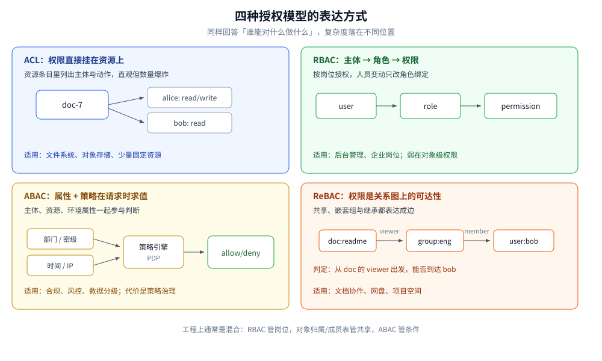
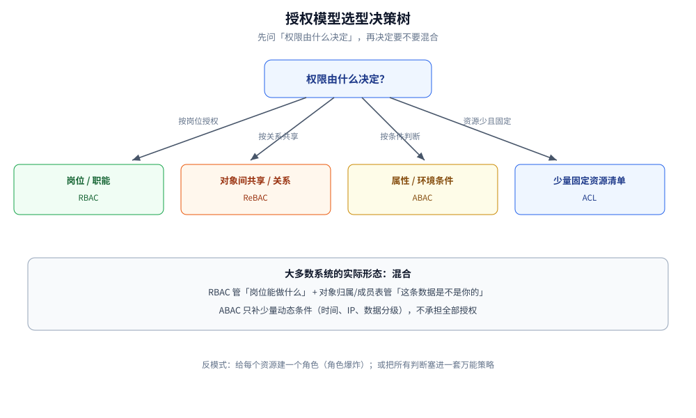
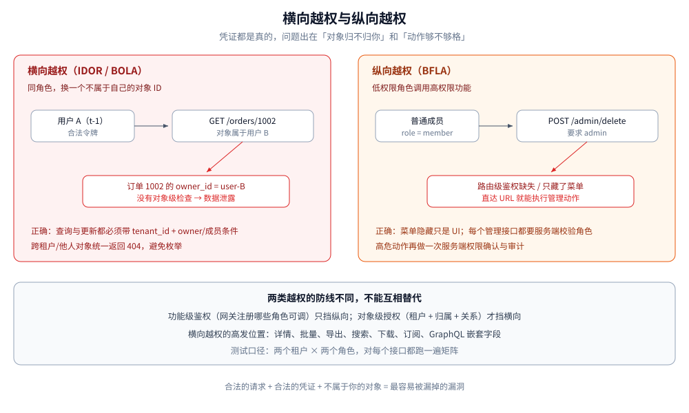

# 授权模型与越权防护

> 覆盖：认证之后的**授权决策**——ACL / RBAC / ABAC / ReBAC 四种模型怎么选，
> 功能级鉴权与对象级授权的区别，IDOR / BOLA 的成因，多租户隔离的分层，
> 以及权限缓存与越权测试的工程口径。
>
> 不覆盖：凭证怎么带、怎么验、401 与 403 怎么答见 [JWT与APIKey鉴权.md](JWT与APIKey鉴权.md)；
> 网关流水线与内部头剥离的代码见
> [从零实现网关.md](../../../01-编程语言/go/网络编程/从零实现网关.md)；
> SQL 注入、XSS 等攻击原理见 [Web攻击与防御.md](../应用与数据安全/Web攻击与防御.md)；
> K8s 自身的 RBAC 见 [K8s部署流程.md](../../部署/k8s/K8s部署流程.md)。
>
> 内容整理自个人学习笔记。实测口径：授权决策矩阵与租户边界用
> `golang:1.26-alpine` 运行，10 组用例输出见第八节；SQL 条件更新、缓存键与
> 中间件骨架为构造示例，未接真实数据库与缓存实测。

---

## 一、认证之后，授权到底要回答哪四个问题？

**本节要点**：认证只回答「你是谁」，授权要回答「**你能否对哪个对象做哪个动作，在什么条件下**」。
把这句话拆成四个输入，才能判断一个权限系统缺了哪一块。

| 输入 | 问题 | 例子 |
|---|---|---|
| **主体**（Subject） | 谁在操作 | 用户、服务账号、角色、用户组 |
| **动作**（Action） | 想做什么 | 读取、修改、删除、导出、审批 |
| **资源**（Resource） | 对哪个对象 | 订单 `order-1002`、文档 `doc-7`、租户 `t-1` |
| **上下文**（Context） | 在什么条件下 | 时间、IP、设备、风险等级、数据分级 |

⭐ 只检查前两项，就是常见的「**有权限进入这个接口，就能操作这个接口下的所有对象**」；
只检查前三项、不看上下文，则会出现「上班时间能导出全量数据，凌晨也能」这类缺口。

两条铁律：

1. **默认拒绝**（deny by default）：没有明确命中的规则就是拒绝，而不是放行；
2. **最小权限**：能只读就不给写，能只给单个对象就不给整个租户。

授权失败时，`401` 与 `403` 的语义必须分开：`401` 是「身份没确认」，`403` 是
「身份确认了，但不允许」。混用会触发客户端无意义的刷新重试，详见
[JWT与APIKey鉴权.md](JWT与APIKey鉴权.md) 第三节。

## 二、ACL、RBAC、ABAC、ReBAC 各自解决什么问题？

**本节要点**：四种模型不是四个竞品，而是**四种表达「谁和资源是什么关系」的方式**；
理解它们各自把复杂度放在哪里，比背定义更重要。



### 2.1 ACL：直接列出「谁能对这个资源做什么」

ACL（Access Control List）把权限挂在资源上：

```text
doc-7 的 ACL：
  alice  -> read, write
  bob    -> read
  group:eng -> read
```

| 优点 | 代价 |
|---|---|
| 语义直观，资源与权限一一对应 | 资源多、用户多时条目爆炸（N×M） |
| 适合少量固定资源 | 跨资源查询「我有哪些权限」很贵 |
| 文件系统、对象存储、数据库授权天然适用 | 难以表达角色继承与上下文 |

### 2.2 RBAC：把权限先授予角色，再把角色授予人

RBAC（Role-Based Access Control）在主体与权限之间加了一层「角色」：

```text
user --(多对多)--> role --(多对多)--> permission
```

| 能力 | 说明 |
|---|---|
| 角色继承 | `admin` 继承 `editor` 的全部权限，再加管理动作 |
| 职责分离 | 静态/动态分离：申请人与审批人不能是同一角色 |
| 管理成本低 | 人员变动只改角色绑定，不改资源清单 |

⭐ RBAC 的强项是「**按岗位**」的粗粒度权限，弱项是「**按对象**」的细粒度权限。
一旦为每个文档、每个项目建一个角色，就会遭遇 **role explosion**：
角色数量随资源数量线性增长，最后比直接维护 ACL 还难。

### 2.3 ABAC：按属性与策略在请求时求值

ABAC（Attribute-Based Access Control）不预先列举关系，而是写策略：

```text
allow if
  subject.department == resource.department
  and resource.classification <= subject.clearance
  and context.time between 09:00 and 18:00
```

| 优点 | 代价 |
|---|---|
| 能表达时间、地点、数据分级、风险等动态条件 | 策略语言与执行引擎复杂度高 |
| 一条策略覆盖大量资源 | 策略冲突、优先级、可解释性要专门设计 |
| 适合合规与强监管场景 | 每次请求可能要多查若干属性，性能与一致性要权衡 |

工程上通常用 **PEP / PDP** 拆分：业务代码是 PEP（执行点），把「主体、动作、资源、上下文」
交给 PDP（决策点），拿回 allow / deny。这样策略变更不必改业务代码，但多一次调用与缓存设计。

### 2.4 ReBAC：把权限看成关系图上的可达性

ReBAC（Relationship-Based Access Control）用关系元组描述权限，判定时在图上做遍历：

```text
doc:readme#owner@user:alice
doc:readme#viewer@group:eng#member
group:eng#member@user:bob
```

于是「bob 能不能读 readme」变成「从 `doc:readme#viewer` 出发，能否到达 `user:bob`」。
Google 的 Zanzibar、开源的 SpiceDB / OpenFGA 都属于这一类。

| 优点 | 代价 |
|---|---|
| 天然表达共享、嵌套组、继承与传递关系 | 图遍历有延迟，需缓存与索引 |
| 适合文档协作、网盘、项目空间 | 一致性模型复杂（新关系何时对判定可见） |
| 关系变更只改边，不重建角色 | 运维与调试门槛高于 RBAC |

### 2.5 横向对照

| 维度 | ACL | RBAC | ABAC | ReBAC |
|---|---|---|---|---|
| 权限挂在哪 | 资源 | 角色 | 策略 + 属性 | 关系边 |
| 粒度 | 单资源 | 岗位/功能 | 属性组合 | 对象与关系 |
| 动态条件 | 弱 | 弱 | 强 | 中（靠关系） |
| 关系继承 | 无 | 角色继承 | 策略表达 | 图遍历 |
| 管理成本 | 资源多时爆炸 | 低 | 高（策略治理） | 中高 |
| 典型场景 | 文件、桶、表授权 | 后台管理、企业岗位 | 合规、风控、数据分级 | 文档共享、协作空间 |

## 三、授权模型怎么选？

**本节要点**：先按「权限由什么决定」分流，再考虑混合。
**绝大多数业务系统不是四选一，而是 RBAC 做粗粒度 + 对象关系做细粒度 + ABAC 补条件。**



| 判据 | 优先选择 |
|---|---|
| 权限只由岗位/职能决定，与具体对象无关 | **RBAC** |
| 需要按文档/项目/群组共享，存在嵌套关系 | **ReBAC**（或用「所有者 + 成员表」的轻量版） |
| 需要时间、IP、数据分级、风险等条件 | **ABAC** 或「RBAC + 条件判断」 |
| 资源数量少且固定，权限逐条配置 | **ACL** |
| 既要后台角色，又要资源级共享 | **RBAC + 对象级授权**（最常见的组合） |

三个反模式：

1. **给每个资源建一个 RBAC 角色**：角色爆炸，管理成本反超收益；
2. **所有判断都塞进 ABAC 策略**：策略难写、难测、难解释，最后没人敢改；
3. **只在网关注册角色、业务层完全不查对象归属**：这就是下一节的越权温床。

## 四、为什么「接口鉴权」挡不住越权？

**本节要点**：网关/中间件能做的是**功能级**（能不能调用这个接口），
而越权大多发生在**数据级**（这个接口下的这个对象是不是你的）。



### 4.1 两类越权

| 类型 | 定义 | 例子 |
|---|---|---|
| **横向越权**（horizontal） | 同角色，访问别人的资源 | 用户 A 把 `/orders/1002` 改成自己的订单 ID |
| **纵向越权**（vertical） | 低权限角色调用高权限功能 | 普通成员调用 `/admin/users/delete` |

OWASP API Security Top 10 把对象级授权失效列为 **API1: BOLA**（Broken Object Level Authorization），
把功能级授权失效列为 **API5: BFLA**。它们与 SQL 注入、XSS 不是一类问题：
**请求完全合法，凭证也真实有效，只是对象不属于你**。

### 4.2 IDOR 的典型入口

IDOR（Insecure Direct Object Reference）指直接用客户端可控的标识符访问对象：

```text
GET  /api/orders/1002          ← 改 ID 就能看别人的订单
GET  /api/files?key=user-a/…   ← 对象键可猜
PUT  /api/users/42/profile     ← 改别人的资料
POST /api/export {ids:[...]}   ← 批量接口一次带多个 ID
GET  /api/search?q=…           ← 搜索结果未按租户过滤
```

⭐ 高发位置往往不是主详情接口，而是**批量、导出、搜索、下载、WebSocket 订阅、
GraphQL 嵌套字段**这些「顺带返回数据」的路径。

### 4.3 403 还是 404？

| 情形 | 建议 | 原因 |
|---|---|---|
| 同租户，角色不够 | **403** | 对象存在不是秘密，缺的是权限 |
| 跨租户，或对象属于其他用户 | **404** | 避免通过状态码枚举「这个 ID 是否存在」 |
| 对象确实不存在 | **404** | 与上一条保持一致，减少可观测差异 |

关键是**同一类情形在全站保持一致**。如果列表接口过滤掉了别人的数据，
详情接口却返回 403，攻击者仍能通过 403/404 的差异判断对象是否存在。

## 五、对象级授权该写在哪一层？

**本节要点**：正确顺序是「认证 → 路由级粗判 → 加载资源 → **对象级判定** → 带条件的写操作」；
判定不能只放在网关，也不能只放在前端。

```text
请求
  │
  ├─ 认证中间件：验令牌，得到 Principal{UserID, TenantID, Roles}
  ├─ 路由级鉴权：这个角色能不能调用这个接口（粗粒度）
  ├─ 加载资源：按 ID 读对象
  ├─ 对象级授权：租户 + 所有者/成员关系 + 动作
  └─ 数据访问：SQL 再带 tenant_id 条件，防止检查与执行之间被绕过
```

### 5.1 为什么「先查再判」还不够

```go
doc, err := repo.Get(ctx, docID)          // ① 只按 ID 查
if err != nil { return ErrNotFound }
if doc.TenantID != p.TenantID {           // ② 判租户
    return ErrNotFound
}
if !canEdit(p, doc) {                     // ③ 判角色/关系
    return ErrForbidden
}
repo.Update(ctx, doc)                     // ④ 更新时没再带条件
```

这段代码在单请求里看起来没问题，但有两个隐患：

1. **检查与执行分离**：① 与 ④ 之间对象可能被转移、删除或改租户（TOCTOU）；
2. **查询本身就跨租户**：① 已经把别的租户数据读进内存，一旦日志/异常把对象打出来就泄露了。

更稳的写法是把租户条件放进查询，把授权条件放进更新语句：

```sql
UPDATE documents
SET title = $1, updated_at = now()
WHERE id = $2
  AND tenant_id = $3
  AND (
    owner_id = $4
    OR EXISTS (
      SELECT 1 FROM document_members m
      WHERE m.document_id = documents.id
        AND m.user_id = $4
        AND m.role IN ('owner', 'editor')
    )
  );
```

`RowsAffected() == 0` 时再区分「对象不存在 / 无权限」：
跨租户统一返回 404，同租户无权限返回 403。**条件更新把「判定」和「执行」压成一条语句**，
并发下也不会出现「检查时有权、写入时已无权」。

### 5.2 列表与批量接口

| 接口形态 | 错误做法 | 正确做法 |
|---|---|---|
| 列表 | 查出全量再在应用层过滤 | SQL 直接按 `tenant_id` + 可见性过滤 |
| 批量按 ID 查 | 只校验第一个 ID | 对每个 ID 校验，或先按租户过滤再比对数量 |
| 导出 | 复用列表查询但不加分页/租户条件 | 与列表共用同一套授权查询 |
| 计数/聚合 | 只对明细过滤，统计没过滤 | 聚合查询同样带租户条件，避免侧信道 |
| GraphQL | 只校验顶层字段 | 每个嵌套 resolver 都做对象级检查 |

## 六、多租户隔离要做几层？

**本节要点**：租户隔离不是「JWT 里带个 `tenant_id`」就结束了，
它要沿着**入口 → 应用 → 数据 → 缓存 → 存储 → 异步任务**一路兜底。

| 层 | 要做什么 | 漏掉的后果 |
|---|---|---|
| 网关 / 入口 | **剥离**客户端传入的 `X-Tenant-Id` 等内部头 | 伪造头即可跨租户 |
| 认证 | 从可信令牌中取租户，写入请求上下文 | 业务层拿不到可信租户 |
| 服务 | 对象级授权时先比租户 | 同租户内的横向越权 |
| 数据访问 | 所有查询强制带 `tenant_id` | 一条漏写的 SQL 就泄露全量 |
| 数据库 | 可选的行级安全（RLS）做第二道闸 | 应用层漏判时无兜底 |
| 缓存 | 键包含租户前缀 | 命中别人的缓存 |
| 对象存储 | 前缀/桶隔离 + 签名 URL 限定对象 | 猜 key 下载他人文件 |
| 消息队列 | 消息头携带租户，消费端校验 | 异步任务处理错租户 |
| 日志 / 指标 | 带租户维度，但不记录敏感数据 | 无法定位，或日志本身泄露 |

### 6.1 共享库、共享 schema 还是独立库

| 形态 | 隔离强度 | 成本 | 适用 |
|---|---|---|---|
| 共享库共享表（`tenant_id`） | 低（靠应用与 RLS） | 最低 | 大量中小租户、SaaS 常规形态 |
| 共享库独立 schema | 中 | 中 | 租户数量可控、需要较强隔离 |
| 独立数据库 | 高 | 最高 | 大客户、强合规、需要独立备份/迁移 |

⭐ 选共享表就必须接受「**每一条查询都要带租户条件**」这个长期约束；
如果团队没有把握靠代码审查守住，至少加数据库 RLS 或 ORM 全局作用域作为兜底，
并给「绕过作用域」提供显式的、可审计的入口。

### 6.2 平台管理员的跨租户访问

平台管理员需要跨租户排障时，正确形态是：

- **显式进入某个租户上下文**（impersonation / support session），而不是全局 bypass；
- 每次进入都写审计日志：谁、何时、以什么理由、访问了哪个租户；
- 会话短时有效，操作范围受限，退出后立即失效。

⚠️ 「超级管理员直接跳过所有租户检查」是最容易被内部人滥用的设计，
也是事故复盘里最常见的根因之一。

## 七、权限缓存为什么会越权？

**本节要点**：权限是**会变的状态**，缓存键缺一维、失效晚一步，都会把旧权限继续放行。

```text
错误的键：user:42:can_edit
正确的键：tenant:t-1:user:42:doc:7:edit:v9
                                        ↑ 策略/角色版本
```

| 问题 | 后果 | 做法 |
|---|---|---|
| 键里没有资源 ID | 对 A 文档的判定被复用到 B 文档 | 键必须包含资源与动作 |
| 键里没有租户 | 跨租户命中 | 租户作为前缀 |
| 角色变更后不失效 | 被撤权的人继续有权限 | 角色版本号 + 主动失效 |
| TTL 过长 | 撤权延迟不可接受 | 敏感操作短 TTL 或实时判定 |
| 缓存「拒绝」过久 | 授权后仍被挡 | 负缓存要短，且可主动清除 |
| 把时间/IP 等动态属性缓存 | 条件已变仍放行 | 动态条件不缓存，或缓存极短 |

JWT 里的角色也是同一种「缓存」：令牌签发时写入 `role`，**撤权后旧令牌到期前仍然有效**。
所以高敏感操作（转账、删除、导出、权限变更）应在服务端**重新查一次当前权限**，
不能只信令牌里的 claim。

## 八、怎么系统性地测越权？

**本节要点**：准备**两个租户 × 两个角色**的固定夹具，对每个接口跑同一张矩阵；
重点不是「正常用户能访问」，而是「另一租户的用户拿不到」。

### 8.1 测试矩阵

| 用例 | 期望 |
|---|---|
| 同租户，资源所有者访问 | 允许 |
| 同租户，同角色访问他人资源（横向） | 403 / 404（按约定） |
| 同租户，低角色调用高权限接口（纵向） | 403 |
| 另一租户，相同角色访问 | 404（不泄露存在性） |
| 另一租户，管理员访问 | 404（租户边界优先于角色） |
| 无角色、非所有者 | 403 |
| 批量接口混入他人 ID | 整体拒绝或逐项过滤，不能部分泄露 |
| 导出 / 搜索 / 下载 / 订阅 | 与详情接口同一套过滤 |
| 错误信息与响应时间 | 不暴露对象是否存在 |

### 8.2 本机实测：10 组授权决策

用 Go 实现「租户边界 → 所有者 → 角色权限」三层判定：

```go
func authorize(p Principal, doc Document, act Action) Decision {
    if p.TenantID == "" || doc.TenantID != p.TenantID {
        return NotFound                  // 跨租户一律 404
    }
    if doc.OwnerID == p.UserID {
        switch act {
        case ActRead, ActUpdate, ActDelete:
            return Allow                 // 所有者对本人资源
        }
    }
    for _, role := range p.Roles {
        if roleActions[role][act] {
            return Allow
        }
    }
    return Forbidden
}
```

```text
租户 admin 删除他人文档          -> ALLOW
editor 修改他人文档            -> ALLOW
viewer 修改他人文档            -> DENY 403
viewer 读取他人文档            -> ALLOW
owner 删除本人文档             -> ALLOW
editor 跨租户读取             -> DENY 404
跨租户 admin 删除             -> DENY 404
无角色非 owner 读取            -> DENY 403
空 tenant 读取              -> DENY 404
viewer 管理成员              -> DENY 403
```

⭐ 注意两组顺序判据：

1. **租户检查在角色之前**：即使是 admin，跨租户也是 404；
2. **所有者关系独立于角色**：所有者对本人资源的读/改/删不依赖角色表，
   但「管理成员」这类动作仍然只由角色决定。

### 8.3 自动化清单

- 用两个租户的固定数据跑集成测试，**每个新接口必须补一行矩阵**；
- 对 ID 做随机化/越界测试（负数、超大数、别的租户前缀、URL 编码变体）；
- 给 ORM/DAO 加静态检查或单测，拦截「查询没带 `tenant_id`」；
- 审计日志断言：拒绝事件要能查到主体、资源、动作与原因；
- 上线前用低权限账号走一遍后台菜单与直达 URL，**隐藏菜单不等于没有接口**。

## 应用场景

| 场景 | 常用模型 | 关键动作 |
|---|---|---|
| 多租户 SaaS | RBAC + 租户隔离 | 每条查询带租户；跨租户 404 |
| 后台管理系统 | RBAC（可加职责分离） | 菜单隐藏 + 接口鉴权双保险 |
| 文档 / 网盘协作 | ReBAC 或「所有者 + 成员表」 | 共享、嵌套组、链接权限 |
| IM 群组 | 群主/管理员/成员 + 资源关系 | 踢人、禁言、撤回的消息权限 |
| 开放 API / 第三方应用 | scope + 对象级授权 | token 的 scope 不能替代对象归属判断 |
| 数据导出 / 报表 | RBAC + 数据分级 | 导出范围、脱敏、审计 |

## 具体使用

**本节要点**：下面给三段最小骨架：服务端取租户、对象级判定、条件更新；
其中判定函数已实测，SQL 与中间件仅示意。

### 1) 认证中间件写入可信租户

```go
type Principal struct {
    UserID   string
    TenantID string
    Roles    []string
}

func withPrincipal(next http.Handler) http.Handler {
    return http.HandlerFunc(func(w http.ResponseWriter, r *http.Request) {
        p, err := verifyToken(r)        // 验签 + 校验 exp / aud / iss
        if err != nil {
            writeErr(w, http.StatusUnauthorized, "unauthorized")
            return
        }
        if p.TenantID == "" {          // 缺失租户直接拒绝，不猜默认值
            writeErr(w, http.StatusUnauthorized, "tenant_missing")
            return
        }
        next.ServeHTTP(w, r.WithContext(withPrincipalCtx(r.Context(), p)))
    })
}
```

⭐ 租户只能来自**验签通过的令牌**或服务端会话；
请求头里的 `X-Tenant-Id`、query 里的 `tenant_id` 一律不可信。

### 2) 对象级判定

```go
if d := authorize(p, doc, ActUpdate); d != Allow {
    if d == NotFound {
        writeErr(w, http.StatusNotFound, "not_found")
        return
    }
    writeErr(w, http.StatusForbidden, "forbidden")
    return
}
```

返回值不要统一成 `403`：跨租户泄露「对象存在」本身就是信息泄露。

### 3) 条件更新

```go
res, err := db.ExecContext(ctx, updateDocSQL, title, docID, p.TenantID, p.UserID)
if err != nil { return err }
n, _ := res.RowsAffected()
if n == 0 {
    // 再查一次只为区分 404 / 403，查询仍带 tenant_id
    return classifyNoRows(ctx, p, docID)
}
```

### 4) 权限缓存键

```text
perm:{tenant}:{user}:{resource}:{action}:v{policyVersion}
```

角色变更、所有权转移、成员移除时递增对应主体的版本号；
高敏感操作绕过缓存，直接查当前权限。

## 延伸追问

- **RBAC 和 ABAC 到底怎么选？** → 先看权限是否只由岗位决定。是，用 RBAC；
  需要按时间、地点、数据分级动态判断，再在 RBAC 之上加 ABAC 条件。
  不要一开始就上通用策略引擎。
- **为什么不能只靠网关做鉴权？** → 网关知道「谁能调这个接口」，不知道
  「这条订单是不是他的」。对象级信息在业务数据里，必须由业务层或数据层判断。
- **跨租户为什么返回 404 而不是 403？** → 403 等于确认「这个对象存在，只是你没权限」，
  攻击者可以据此枚举 ID。404 把「不存在」和「不属于你」统一，减少信息泄露。
- **JWT 里的角色能直接信吗？** → 可以在短时间内信，但撤权后旧令牌到期前仍然有效。
  权限变更、敏感操作要在服务端重新判定，或让令牌短命 + 维护撤销名单。
- **多租户用共享表安全吗？** → 安全与否取决于「每条查询是否强制带租户条件」。
  共享表成本最低，但要配代码规范、静态检查、数据库 RLS 或可审计的绕过入口。
- **ReBAC 比 RBAC 先进吗？** → 不是。它擅长表达对象间关系与共享；如果权限只按岗位划分，
  ReBAC 只会增加图遍历、一致性与运维成本。
- **超级管理员要不要绕过所有检查？** → 不要做全局 bypass。应显式进入租户上下文、
  限时、限范围，并记录审计；否则一次内部滥用就是全量数据事故。
- **列表接口过滤了就够了吗？** → 不够。计数、聚合、导出、搜索、排序、报错信息都可能
  侧漏；它们必须复用同一套租户与可见性条件。

## 关联

- **上游/总纲**：[README.md](../README.md) — 安全目录的分组与阅读路线
- **同组前置**：[JWT与APIKey鉴权.md](JWT与APIKey鉴权.md) — 认证与凭证校验，本篇从「认证之后」开始
- **同组协议**：[OAuth2与OIDC.md](OAuth2与OIDC.md) — 委托授权与 scope；scope 不等于对象级权限
- **攻击视角**：[Web攻击与防御.md](../应用与数据安全/Web攻击与防御.md) — 注入、伪造头与越权的关系
- **网关实现**：[从零实现网关.md](../../../01-编程语言/go/网络编程/从零实现网关.md) — 剥离伪造租户头的代码位置
- **网关选型**：[网关选型对比.md](../../../03-数据与中间件/中间件/网关与代理/网关选型对比.md) — 多租户鉴权放在网关还是应用层的取舍
- **领域案例**：[机器人与开放平台.md](../../../04-架构与系统/系统设计/IM系统/机器人与开放平台.md) — 开放平台的 scope、配额与对象归属
- **对照**：[K8s部署流程.md](../../部署/k8s/K8s部署流程.md) — K8s 的 RBAC 是集群资源授权，与本篇的业务授权不是同一层
> 反向引用（本篇被下列文档引到）：[审计与应急响应.md](../安全工程/审计与应急响应.md)、[API安全.md](../应用与数据安全/API安全.md)
