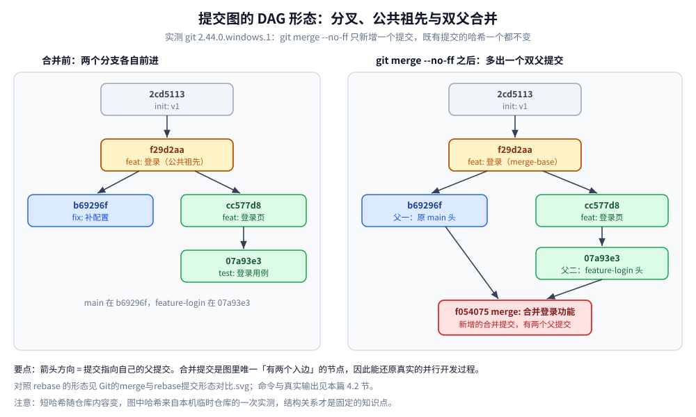
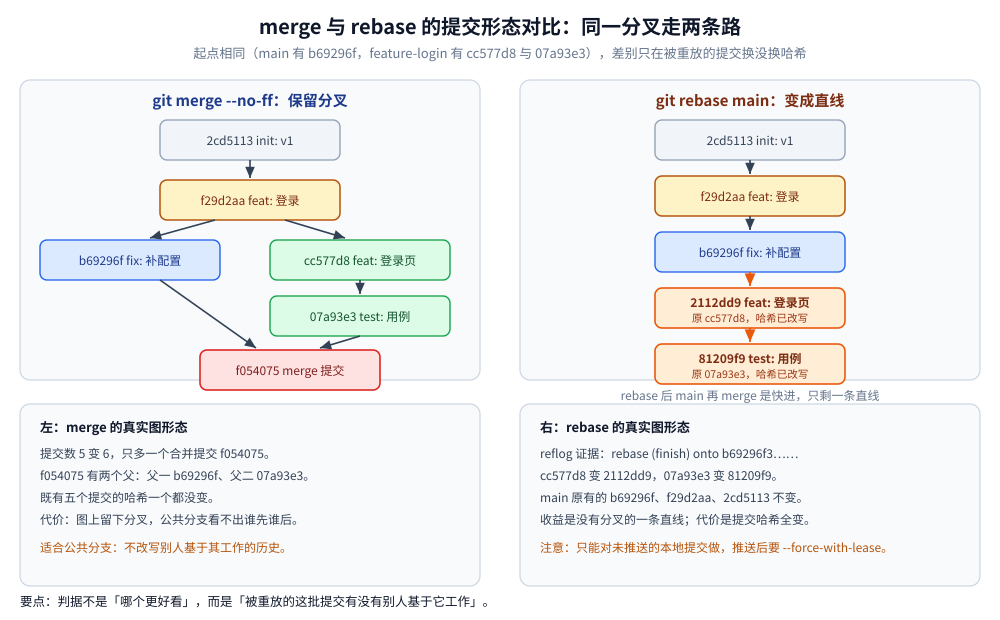
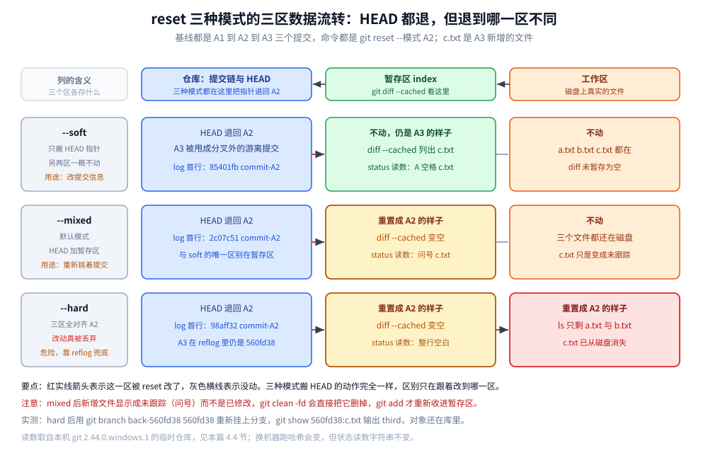
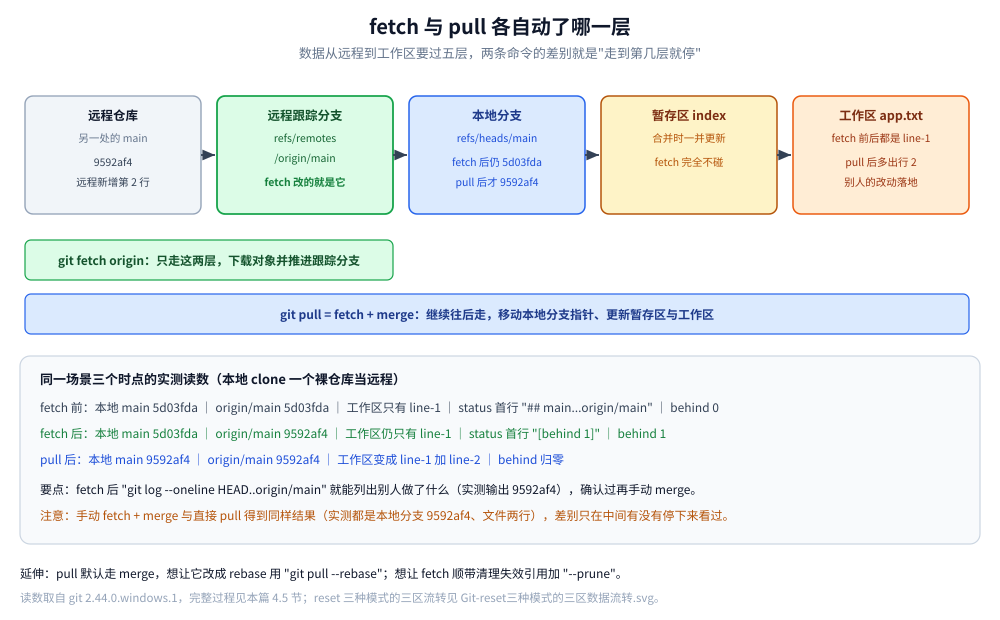

# Git 命令与使用场景

> 日常提交/拉取/合并/暂存命令、远程仓库操作，以及回滚代码、分支替换、pull vs fetch、merge vs rebase 等实战场景
>
> 内容整理自个人学习笔记。本次整理清理了导出残留、补全了缺失章节，并补充了 reset 三种模式对照与 reflog 兜底。

---

## 一、基本命令

### 1.1 切换分支

```bash
# 切换分支
git checkout test

# 切换到上一个分支
git checkout -

# 放弃工作区中所有未暂存的修改（⚠️ 不可恢复，暂存区的改动不受影响）
git checkout .
```

> ⭐ 新版 Git 推荐用 `git switch`（切分支）与 `git restore`（撤销文件改动）替代语义混杂的 `checkout`：
> `git switch test` / `git restore .`

### 1.2 拉代码

```bash
# 拉代码（= fetch + merge）
git pull

# 强制拉取，覆盖本地分支
git pull --force

# 一次性从所有远程仓库拉取所有分支和标签的最新变化（只更新远程跟踪引用，不改工作区）
git fetch --all
```

### 1.3 提交

```bash
# 1. 查看改动
git status

# 2. 添加所有改动到暂存区
git add .

# 3. 提交
git commit -m "feat: 完成预约订单接口"

# 4. 推送到远程
git push
```

### 1.4 合并

```bash
# 在当前分支 dev1 合并 dev2（合并前两边都应先 git pull 保证最新）
git merge dev2

# 合并出现冲突、想放弃这次合并
git merge --abort
```

### 1.5 推代码

```bash
# 推代码
git push

# 强制推送，覆盖远程分支（⚠️ 会覆盖他人提交）
git push origin test --force

# 更安全的强推：如果远程在你上次 fetch 之后有新提交，则拒绝推送
git push --force-with-lease
```

> ⭐ **优先用 `--force-with-lease` 而不是 `--force`**：前者相当于"乐观锁"，能防止误覆盖协作者的新提交。

### 1.6 暂存

```bash
# 暂存当前改动
git stash

# 暂存并带描述
git stash save "描述"
# 新版推荐写法：git stash push -m "描述"

# 查看暂存列表
git stash list

# 应用最近一个暂存，并删除该暂存记录
git stash pop
# 或指定：git stash pop stash@{0}

# 应用指定暂存，但保留暂存记录
git stash apply
# 或指定：git stash apply stash@{0}

# 删除栈顶 stash，不应用
git stash drop
# 或指定：git stash drop stash@{0}

# 删除所有 stash
git stash clear
```

> ⭐ `pop` = `apply` + `drop`。要**反复应用同一份暂存**（比如同一改动往多个分支上打）就用 `apply`。

### 1.7 操作远程分支

```bash
# 1. 初始化本地仓库
git init
git add .
git commit -m "init"

# 2. 添加 GitHub 远程
git remote add origin https://github.com/你的用户名/photography-server.git

# 3. 添加第二个远程（GitCode）
git remote add gitcode https://gitcode.com/你的用户名/photography-server.git

# 4. 推送到 GitHub 并关联上游
git push -u origin master

# 5. 推送到 GitCode
git push gitcode master

# 6. 更换远程仓库地址
git remote set-url origin git@github.com:Eleven-26/dev-notes.git

# 7. 查看所有远程
git remote -v
```

**删除本地与远程分支**：

```bash
# 删除本地分支 main
git checkout master
git branch -D main

# 删除远程分支 main
git push origin --delete main

# 清理本地已失效的远程跟踪引用（可选）
git remote prune origin
```

## 二、使用场景

### 2.1 回滚代码到某个版本（git reset）

```bash
# 回退到上个版本（--hard 会丢弃改动，--soft 不会丢弃已提交的内容）
git reset --hard HEAD^

# 回退到前 2 次提交之前，以此类推回退 n 次
git reset --hard HEAD~2

# 退到/进到指定 commit 的 sha 码
git reset --hard commit_id

# 将分支回退到指定提交，工作区维持现状不变，暂存区在现有基础上增加该 commit 之后的提交
# 例如提交了两次，id 为 A1、A2，想让 A2 的提交回到工作区，则执行：
git reset --soft A2
# ⚠️ 执行完不能 git pull，否则会把最新的提交又拉下来

# 默认模式：分支回退到指定提交，暂存区同步为该提交，工作区保持不变
git reset --mixed 16e6ccdb30e87b3531d8d85664bcfb2708c7c43b

# 分支回退到指定提交，暂存区和工作区都被同步为该提交
git reset --hard 16e6ccdb30e87b3531d8d85664bcfb2708c7c43b
```

**三种模式对照**（⭐ 高频混淆点）：

| 模式 | HEAD 指针 | 暂存区（index） | 工作区 | 典型用途 |
|---|---|---|---|---|
| `--soft` | ✅ 移动 | ❌ 不动 | ❌ 不动 | 撤销提交但保留改动，想重新提交（如改 commit message、合并多个 commit） |
| `--mixed`（默认） | ✅ 移动 | ✅ 重置 | ❌ 不动 | 撤销提交和暂存，改动回到工作区重新挑着提交 |
| `--hard` | ✅ 移动 | ✅ 重置 | ✅ 重置 | **彻底丢弃**改动（危险，不可恢复） |

### 2.2 撤销某次提交（git revert）

```bash
# 生成一个「反向提交」来抵消指定提交的改动，历史记录保留，适合已推送的提交
git revert <commit_id>

# 撤销最近一次提交
git revert HEAD

# 只回滚不自动提交（便于一次回滚多个提交后再统一提交）
git revert -n <commit_id>
```

> ⭐ **`reset` vs `revert` 的核心区别**：
> - `reset` 是**改写历史**（删除提交），适用于只有自己用的本地分支；
> - `revert` 是**新增一个反向提交**，历史完整保留，适用于**已经推送、他人可能已拉取**的公共分支。

### 2.3 将分支替换为另一分支

```bash
# 目标：把 test 分支重置为与 master 一致

# 1. 切换到 test 分支
git checkout test

# 2. 将本地 test 分支重置为远程 master 的内容
git reset --hard origin/master

# 3. 强推到远程 test 分支
git push origin test --force
```

> ⚠️ 这个操作会**丢弃 test 上原有的提交**，执行前可用 `git log test` 确认是否真的不需要了。

### 2.4 误删救回（reflog 兜底）

```bash
# 查看 HEAD 的移动历史（含被 reset/删除的提交）
git reflog

# 找到误操作前的 commit，把分支指回去
git reset --hard HEAD@{2}
```

> ⭐ `reflog` 是本地的"后悔药"，**reset --hard、误删分支、rebase 出错都能救**，
> 但仅对**已提交**的内容有效，且默认只保留 90 天。

## 三、易混淆命令的区别

### 3.1 git pull 和 git fetch

| 命令 | 行为 | 是否改工作区 |
|---|---|---|
| **git fetch** | 安全的、非侵入性操作：**仅下载远程变动**，不直接修改工作目录或当前分支 | ❌ 不改 |
| **git pull** | 更直接的同步操作：下载远程变动**并立即尝试合并**到当前工作分支 | ✅ 改 |

**git fetch** 为后续的手动合并、冲突解决或代码审查提供了充足的时间和空间，适合想"先看看远程有什么变化再决定"的场景。

**git pull** 相当于 `fetch + merge`：如果远程变动与本地无冲突，可以快速完成同步；如果有冲突，Git 会**暂停合并**，要求手动解决冲突后再继续。

> ⭐ 想看别人改了什么又不影响自己，就先 `fetch` 再 `git log HEAD..origin/master` 看差异，确认无误再合并。

### 3.2 git merge 和 git rebase

| 维度 | **git merge** | **git rebase** |
|---|---|---|
| 做法 | 把两个分支的最新快照做**三方合并**，生成一个**新的合并提交** | 把当前分支的提交**逐个"剪切"下来，在目标分支最新提交之后重放** |
| 提交历史 | **保留分叉结构**，能看出真实的分支合并过程 | **变成一条直线**，历史整洁 |
| 是否改写历史 | ❌ 不改 | ✅ **改写**（commit hash 全变） |
| 冲突处理 | 一次性解决 | **可能每个提交都要解决一次**冲突 |
| 适用场景 | 公共分支、多人协作（安全） | 个人本地分支整理提交后再合并（整洁） |
| 风险 | 历史较乱 | **已推送的分支不要 rebase**，否则他人拉取会冲突 |

> ⭐ 一句话准则：**「公共分支用 merge，私人分支用 rebase」**——rebase 是为了让提交历史好看，代价是改写历史，只对未推送的本地提交使用才安全。

## 四、实测：命令执行后提交图和三个区分别变成什么样？

**本节要点**：上面的命令都是"背下来就会"的写法，但 `merge` / `rebase` / `reset` / `fetch` 改的到底是**提交图的哪几个节点**、**工作区 / 暂存区 / 仓库的哪一区**，只有真跑一遍才有底。本节全部是实测输出，短哈希、`git status --short` 的左列右列都是原样粘贴。

### 4.1 实验环境与做法

- 运行时：`git version 2.44.0.windows.1`（Git Bash，Windows）。
- 实验仓库全部新建在仓库外的临时目录（`.workbuddy/tmp/round495/` 下的 `w2ra6-gitdemo`、`w2ra6-gitreset-*`、`w2ra6-gitremote` / `w2ra6-gitlocal`），**不在 `dev-notes` 主仓里做**，避免污染笔记仓库的历史。
- 提交作者与时间用环境变量固定（`GIT_AUTHOR_NAME` / `GIT_COMMITTER_NAME` 等），保证输出可复现；换机器跑出来哈希会变（父提交内容、时间戳都参与计算），**结构不变、短哈希变**，所以下面的哈希只用于对齐本节文字，不要当常量记。

### 4.2 先造出一个真实分叉：merge 之前的提交图

从第 2 个提交拉出 `feature-login`，`main` 上再补一个提交，得到两个分支各自前进的分叉：

```text
* 07a93e3 test: 登录用例
| * b69296f fix: 补配置
* | cc577d8 feat: 登录页
|/
* f29d2aa feat: 登录
* 2cd5113 init: v1
```

`git branch -v` 同一时刻的指针位置：`feature-login` 指向 `07a93e3`，`main` 指向 `b69296f`，两者的**公共祖先是 `f29d2aa`**（`git merge-base main feature-login` 的就是它）。上面这棵树里 `|/` 那一行就是分叉点，图上表现成两条竖线并成一条。



`git merge --no-ff feature-login` 之后，多出一个**有两个父提交**的合并提交，分叉结构原样保留：

```text
*   f054075 merge: 合并登录功能
|\
* | b69296f fix: 补配置
| * 07a93e3 test: 登录用例
| * cc577d8 feat: 登录页
|/
* f29d2aa feat: 登录
* 2cd5113 init: v1
```

`f054075` 的父提交是 `b69296f` 和 `07a93e3`（第一父是合并时所在分支的位置，第二父是被合并进来的分支头）。**被合并的五个提交一个都没变**——这就是第三节说的"merge 不改写历史"的具体含义。

### 4.3 rebase 重放：同一条提交信息，换一批哈希

把 `main` 退回合并前（`git reset --hard` 到 `b69296f`），在 `feature-login` 上执行 `git rebase main`，再回 `main` 执行 `git merge --ff-only feature-login`，提交图变成一条直线：

```text
* 81209f9 test: 登录用例
* 2112dd9 feat: 登录页
* b69296f fix: 补配置
* f29d2aa feat: 登录
* 2cd5113 init: v1
```

对照 rebase 前后的哈希，`git reflog show feature-login` 的真实输出：

```text
81209f9 feature-login@{0}: rebase (finish): refs/heads/feature-login onto b69296f356728752a84ad5099a73f31911ace33d
07a93e3 feature-login@{1}: commit: test: 登录用例
cc577d8 feature-login@{2}: commit: feat: 登录页
f29d2aa feature-login@{3}: branch: Created from main
```

三条实测结论：

| 提交 | rebase 前 | rebase 后 | 变了吗 |
|---|---|---|---|
| `feat: 登录页` | `cc577d8` | `2112dd9` | ✅ 变 |
| `test: 登录用例` | `07a93e3` | `81209f9` | ✅ 变 |
| `fix: 补配置`（在 `main` 上） | `b69296f` | `b69296f` | ❌ 不变 |
| `feat: 登录` / `init: v1` | `f29d2aa` / `2cd5113` | 同上 | ❌ 不变 |

**只有被重放的那批提交换哈希**（它们的父提交变成了 `b69296f`，父指针进了哈希计算），`main` 上原有的提交一个没动。`rebase (finish) ... onto b69296f3...` 这一行就是"重放到哪个提交之后"的凭据。



### 4.4 reset 三种模式：工作区 / 暂存区 / 仓库各改了哪一区

基线是三个提交的干净仓库（`commit-A1` ← `commit-A2` ← `commit-A3`，`c.txt` 是 A3 新增的文件），每次都执行 `git reset --<模式> A2`，也就是**把 HEAD 从 A3 退回 A2**。三个模式各用一个独立仓库跑，避免互相污染。

| 模式 | HEAD | `git status --short` 原样输出 | `git diff --cached --name-only` | `git diff --name-only` | 工作区实际文件 |
|---|---|---|---|---|---|
| `--soft` | 退回 A2 | `A  c.txt` | `c.txt` | （空） | `a.txt b.txt c.txt` |
| `--mixed` | 退回 A2 | `?? c.txt` | （空） | （空） | `a.txt b.txt c.txt` |
| `--hard` | 退回 A2 | （空） | （空） | （空） | `a.txt b.txt` |

逐条读这张表：

- **`--soft`**：左列 `A` 表示 `c.txt` **还在暂存区**（索引没动，仍是 A3 的样子），右列是空的说明工作区和索引一致。退回后直接 `git commit` 就把 A3 重新提交一次，这是"改提交信息 / 合并多个提交"的用法。
- **`--mixed`**：索引被重置成 A2，于是 `c.txt` 变成**未跟踪**（`??`）而不是"已修改"。注意这个区别——`git diff` 看不到它，`git add .` 才会重新收进来；反过来，`git clean -fd` 会把它删掉。
- **`--hard`**：三区全部对齐 A2，`git status` 干净，`ls` 少一个 `c.txt`，改动**真的没了**。

甩掉的提交并没有立刻消失，`git reflog` 里还留着：

```text
98aff32 HEAD@{0}: reset: moving to 98aff32
560fd38 HEAD@{1}: commit: commit-A3
98aff32 HEAD@{2}: commit: commit-A2
63ca649 HEAD@{3}: commit (initial): commit-A1
```

实测用 `git branch back-560fd38 560fd38` 把 A3 重新挂上分支，再 `git show 560fd38:c.txt` 输出 `third`——文件内容确实还在对象库里。所以 2.4 节那句"reset --hard 之后还能救"是对的，前提是**对象还没被 gc**。



### 4.5 fetch 与 pull：动的不是同一层

用一个裸仓库当远程，本地 `git clone` 之后，在另一处把工作副本的 `app.txt` 追加一行并 push（远程从 `5d03fda` 前进到 `9592af4`），然后逐条观察本地三个位置。

| 时点 | 本地分支 `main` | 远程跟踪分支 `origin/main` | 工作区 `app.txt` | `git status -sb` 首行 |
|---|---|---|---|---|
| fetch 前 | `5d03fda seed: 初始提交` | `5d03fda` | `line-1` | `## main...origin/main` |
| `git fetch origin` 后 | `5d03fda seed: 初始提交` | `9592af4 feat: 远程新增第 2 行` | `line-1` | `## main...origin/main [behind 1]` |
| `git pull origin main` 后 | `9592af4 feat: 远程新增第 2 行` | `9592af4` | `line-1` + `line-2 别人的改动` | `## main...origin/main` |

关键的一行是 `[behind 1]`：fetch **只把对象下载下来、把 `refs/remotes/origin/main` 往前推**，本地分支指针和工作区都没碰。要落进工作区还差第二步，`pull` 就是把这一步替你做了（等价于 `git fetch` + `git merge origin/main`，实测 `git reset --hard` 退回后手动 `merge origin/main` 的结果与 `pull` 完全一致：`main` 都是 `9592af4`、`app.txt` 都是两行）。



---

## 延伸追问

- **`reset` 和 `revert` 怎么选？** → 只看一件事：这段历史**有没有推给别人**。自己本地没推 → `reset` 干净利落；已经推了 → `revert` 生成反向提交，不动历史。
- **`rebase` 之后为什么不能直接 push？** → 提交哈希全变了，远端是另一条历史；只能 `--force-with-lease`，且**公共分支上不要做**（别人的工作会消失）。
- **`merge` 和 `rebase` 各自适合什么？** → 公共分支用 merge 保留真实分叉，个人分支整理提交用 rebase；判断依据是「被 rebase 的提交有没有人基于它工作」。
- **误删分支或提交还能救回来吗？** → 能：`git reflog` 找到哈希后重新建分支或 reset。⚠️ 默认保留 90 天，仓库被 gc 之后可能失效。
- **`git stash` 和临时提交哪个好？** → 短时间切分支用 stash；要跨设备或跨天就用临时提交——它可见、可推、可协作。
- **怎么定位是哪次提交改坏的？** → 先 `git log -S <字符串>` 或 `git log -p -- <file>` 找引入点，再用 `git blame` 看具体行；**先定位再讨论**，别靠猜。

## 关联

- [CI-CD面试题.md](../部署/CI-CD面试题.md) — 这些命令在流水线里的自动化用法
- [常用命令.md](../../02-计算机基础/linux/常用命令.md) — 同一台机器上的其他日常命令
> 反向引用（本篇被下列文档引到）：[LCS.md](../../02-计算机基础/算法/动态规划/线性与序列/LCS.md)、[GitLab-CI-CD.md](../部署/GitLab-CI-CD.md)
