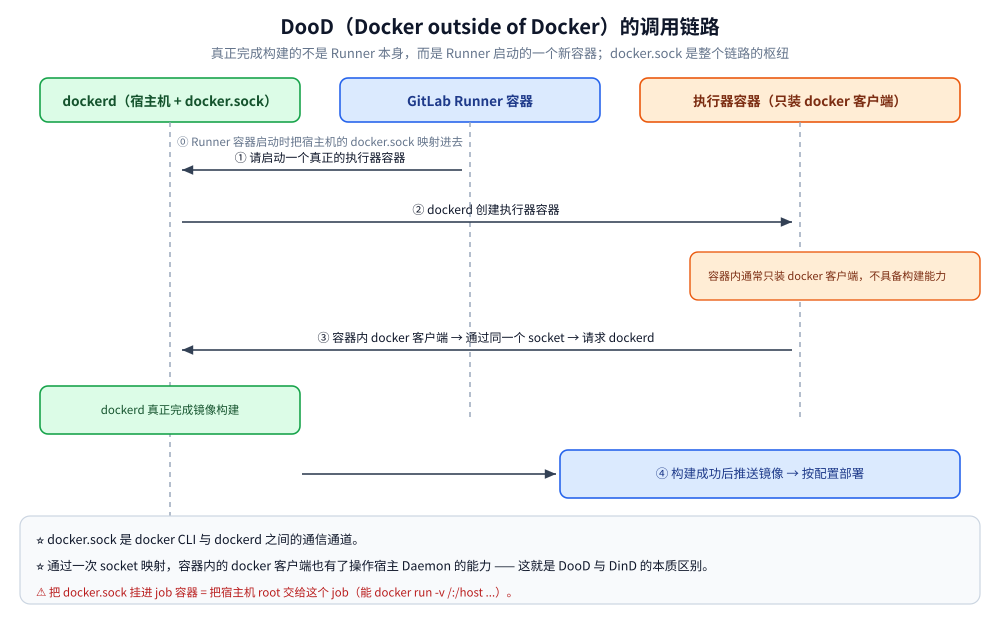
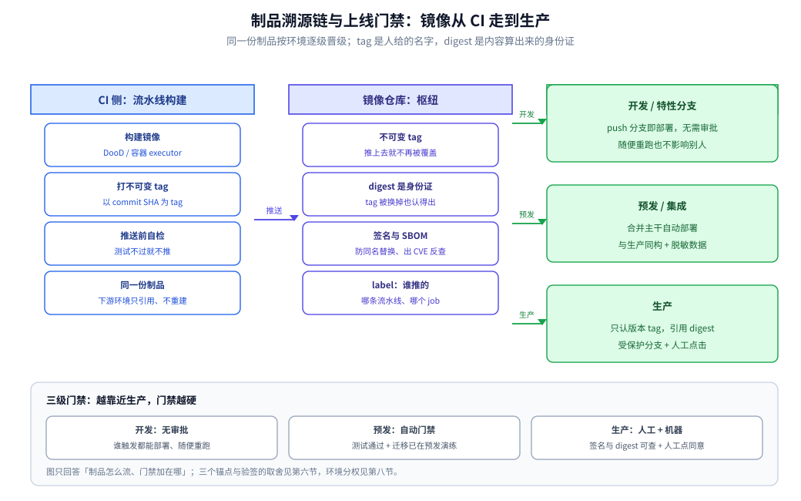

# CI/CD 面试题

> 覆盖：GitLab Runner、Docker-outside-of-Docker 模式、构建与部署两阶段，以及流水线上的工程细节（上下文与缓存、tag 策略、executor 选型、声明式部署与回滚、制品溯源与验签、数据库变更、环境分级与 Runner 权限、常见事故）。
>
> 不覆盖：**语法与用法手册**见 [GitLab-CI-CD.md](GitLab-CI-CD.md)——两篇分工明确、不重复：本篇讲"工程取舍与事故"，那篇讲"YAML 怎么写、怎么本地验证"。
>
> 内容整理自大厂 Go 后端面试真题，参考资料与原始素材见 [素材清单](../../素材清单.md)；本轮补充（镜像 tag 与缓存策略、Runner executor 选型、声明式部署与回滚、流水线事故、制品溯源与上线门禁）参考《Docker 技术入门与实战》（第 3 版，杨保华 / 戴王剑 / 曹亚仑）。
>
> 📎 **实测口径**：本篇为**纯文档整理**——**未起容器、未编译、未新增任何读数**。正文里的 `2 分钟`、`8 分钟`、`10 级优先级` 等数字全部是既有表述（分别见第五节与 [GitLab-CI-CD.md](GitLab-CI-CD.md)），本次只做整理、补写与配图。仓库里真正跑过的实测在姐妹篇：[GitLab-CI-CD.md](GitLab-CI-CD.md) 的 `gitlab-ci-local` 本地验证、[K8s部署流程.md](k8s/K8s部署流程.md) 的部署流程。

---

## 一、讲一下你公司的 CI/CD 流程（附 GitLab CI 完整案例）

**本节要点**：被问到"你们公司的 CI/CD 流程"，很多人第一反应是"我哪知道啊"。
这题的关键是**先想清楚"实习/工作到底要拿到什么"**，再决定怎么答。

### 1.1 先纠正一个认知

> **去公司不是"体验职场氛围"的**——职场氛围没什么好体验的，
> 你以后每天都能体验。
>
> **真正要做的是：尽自己所能，把能接触到的所有资源摸清楚，用来充实自己的简历。**
>
> 包括：
> - 能接触到的**项目**
> - 能接触到的**业务**
> - 能接触到的**基础架构 / 系统架构 / 系统设计**
> - 以及所有**和专业对口的东西**
>
> 从中**找到难点和亮点，尽可能讲明白，写进简历**——为秋招做准备。

**所以 CI/CD 这类基础设施流程，如果你能接触到，它就是一个很好的简历点。**
即使只是"用"过，也要把它搞清楚、能讲明白。

### 1.2 GitLab CI/CD 完整流程（案例）

#### 构建环境搭建

| 步骤 | 内容 |
|---|---|
| **① 搭建 GitLab + 代码仓库** | 代码仓库**只负责管理代码** |
| **② 注册 GitLab Runner（执行代理）** | 想让"push 代码后自动触发构建"，就必须注册 Runner。<br>通常在某分组（group）下的 `build` 部分添加 Runner 节点，<br>**所有构建任务都分配给这个 Runner** |
| **③ Runner 启动执行器（executor）** | Runner 根据配置**启动对应的执行器**去构建 **Docker 镜像**<br>（因为整体是容器化部署，**构建产物就是一个 Docker 镜像**） |

#### 核心考点：Docker-outside-of-Docker（DooD）模式

**先明确一个容易搞混的点**：

> **真正完成构建的不是 Runner 本身，而是 Runner 启动的一个新容器。**

**两种可选模式**：

| 模式 | 做法 |
|---|---|
| **DinD（Docker in Docker）** | 在容器内部**再启动一个新的 Docker Daemon**（套娃） |
| **DooD（Docker outside of Docker）** ⭐ 本案例采用 | **复用主机的 Docker Daemon**，通过 **socket 映射**让容器内的客户端调用主机 Daemon |

**DooD 的完整调用链路**：

```text
① 主机安装 Docker（docker CLI + dockerd + docker.sock）
        ↓
② 启动 GitLab Runner 容器，把宿主机的 docker.sock 映射进去
        ↓              （Runner 与 dockerd 之间靠 socket 通信）
③ Runner 通过 socket 向 dockerd 发请求：
   "帮我启动一个真正的执行器容器"
        ↓
④ 执行器容器内通常只装 docker 客户端（不具备构建能力）
        ↓
⑤ 容器内的 docker 客户端 → 通过同一个 socket → 请求 dockerd
        ↓
⑥ 由 dockerd 真正完成镜像构建
        ↓
⑦ 构建成功后推送镜像 → 按配置部署
```

**关键理解**：
- **`docker.sock` 是整个链路的枢纽**——它就是 docker CLI 与 dockerd 之间的通信通道；
- 通过**一次 socket 映射**，让容器内的 docker 客户端也有了操作宿主机 Daemon 的能力，
  **这就是 DooD 与 DinD 的本质区别**（DooD 不套娃，复用宿主 Daemon）。



#### 配置文件与两阶段流程

配置文件：**`.gitlab-ci.yml`**，里面**定义了一些变量**，
根据不同的流程（pipeline）**决定这次构建要部署到开发环境还是生产环境**。

| 阶段 | 说明 |
|---|---|
| **① 构建（Build）** | 打包镜像。**不论最终部署到哪里，这一步都是一样的** |
| **② 部署（Deploy）** | 通过变量判断目标环境：<br>• **开发环境**：登录 Docker → 创建/更新配置 → 删除旧的服务配置 → 更新并部署服务<br>• **生产环境**：大体相同，**区别在于生产环境的配置文件不是随便指定的，而是通过变量提供的** |

**多 Runner 的场景**：

> 可以**给不同 Runner 指定不同的 tag**，让它们运行不同的任务，
> 从而把应用程序**部署到不同的环境**。

### 1.3 面试怎么答这题

```text
① 先说清 CI/CD 的整体链路：代码仓库 → 触发 → Runner → 执行器 → 构建镜像 → 推送 → 部署
② 重点讲清 DooD 这个模式（socket 映射、为什么构建的不是 Runner 本身）
③ 讲两阶段：构建（与目标环境无关）+ 部署（靠变量区分开发/生产）
④ 如果公司用的是别的方案（Jenkins / GitHub Actions / ArgoCD），按同样结构替换即可
```

> **如果实习时确实没接触到 CI/CD**，也要诚实说明，
> 但可以讲**你自己搭过的方案**（哪怕是本地用 GitLab Runner 搭一遍），
> 因为流程和原理是通用的。

---

## 二、流水线里"构建镜像"这一段怎么做才对？

**来源**：本轮补充 · 参考《Docker 技术入门与实战》（第 3 版）

**本节要点**：核心是 **「CI 上构建和本地构建差在哪」**。三点答不全就等于没在 CI 上真搭过：context 的传输量、`.dockerignore` 的作用、以及「Runner 每次是新容器 → **本地层缓存天然是空的**」。第一节讲链路，这题讲**工程细节**——同样一句 `docker build`，在 CI 里要考虑上下文、缓存、tag 策略。

### 2.1 上下文与缓存

| 做法 | 收益 / 注意点 |
|---|---|
| 上下文只放**构建真正需要的文件**（必要时把上下文指到子目录，Dockerfile 用 `-f` 单独指定） | 少一次"把整个仓库打包发给 daemon" |
| 配 **`.dockerignore`**（`.git`、构建产物、`node_modules`、日志、测试数据、`.env`） | 传输变小 **+ 缓存不再被无关文件打爆**。常被当成"只是慢一点"，实际它会让**每次提交缓存全废**（`COPY . .` 的 key 是所有被 include 文件的校验和，见 [镜像构建与缓存.md](docker/镜像构建与缓存.md)） |
| **层缓存** vs **registry 缓存** | Runner 每次新容器 → **本地层缓存天然是空的**，这就是"CI 上为什么从零构建"；要复用只能把缓存搬到仓库（`cache-from` 拉旧层、构建完再推回），**缓存 tag 与发布 tag 分开管理** |

具体参数名与语法**以所用构建器（BuildKit / 平台）文档为准**。

### 2.2 Tag 策略 ⭐（它直接决定"能不能回溯"）

| 做法 | 评价 |
|---|---|
| 只推 `latest` | ❌ 无法回溯、无法灰度、回滚等于没有；两个环境的 `latest` 根本不是同一个东西 |
| **以 commit SHA（或 job ID）为主 tag** + 镜像里写 label（commit、构建时间、流水线 ID） | ✅ 镜像与代码提交**一一对应**；排查"节点上这个镜像是哪次构建出来的"时救命 |
| 额外打可读 tag（`main-<sha>`、`v1.2.3-<sha>`） | ✅ 便于人读，但**部署引用的是不可变的 SHA tag** |

> 核心一句话：**镜像必须不可变**——tag 推上去就不再被覆盖，"回滚"才是"换回一个旧 tag"，
> 而不是"赌它内容没变过"。

### 2.3 签名与 SBOM：要不要做（定性）

**签名/验签**防的是"这个镜像确实是流水线推的、没被篡改"（集群会拉公网镜像、多团队共用仓库时值得做）；
**SBOM** 解决"镜像里有哪些依赖、什么版本"，出 CVE 时能反查影响面（有合规要求或依赖面铺得太开时值得做）。
不必声称"都做了"，**说清它防什么事故、成本在哪（流水线时长、仓库与密钥管理**）更像做过。

---

## 三、Runner 的架构：executor 选型、并发与隔离 ⭐

**来源**：本轮补充 · 参考《Docker 技术入门与实战》（第 3 版）

**本节要点**：核心是 **「隔离与并发」**：executor 选型（shell / docker / k8s）直接决定 job 之间会不会互相污染；DooD 相当于把宿主 docker 的能力交给流水线。要讲清楚的是「你怎么选、代价是什么」。

### 3.1 三种 executor

| executor | job 在哪跑 | 优点 | 代价 |
|---|---|---|---|
| **shell** | Runner 所在机器上**直接执行脚本** | 最简单、零冷启动 | **环境互相污染**、并发不安全、结果不可复现 |
| **docker** | 每个 job 起一个**容器**（`image:` 指定） | 环境声明式、干净、可复现 | 要宿主 daemon；构建镜像走 DooD（第一节）或 DinD |
| **kubernetes** | 每个 job 在集群里**建一个 Pod** | 弹性最好、限额与节点隔离统一由 K8s 管 | 缓存/卷要走 PVC，排障链路更长 |

**生产为什么基本都选容器化 executor**：① 构建环境写死在 YAML（`image` 带版本），换 Runner 结果一致；
② job 之间文件系统与工具链互不可见，**可以安全并发**；③ 不会把宿主机的全局状态越滚越脏。

### 3.2 并发与隔离

| 维度 | 关注点 |
|---|---|
| Runner 并发上限 | 调太高会把宿主**磁盘 IO** 打满（常是瓶颈，不是 CPU），构建反而更慢 |
| 工作目录 | 同一克隆目录不能并发复用，否则互踩（见第五节） |
| job 资源限额 | 给 job 容器设 CPU/内存上限，避免一个 job OOM 拖垮整机其他 job |

### 3.3 DooD 的代价（机制见第一节，这里只补风险）

> 把 `docker.sock` 挂进 job 容器 = **把宿主机 root 交给这个 job**：能在 job 里
> `docker run -v /:/host ...` 的人，就能读写宿主文件系统。
> 所以**只给确实要构建镜像的 job 开 socket**；产物是普通文件的（编译 + 打包）不要开；
> 要更强隔离就换成"在 Pod 里构建"的方案，代价是缓存与速度。

---

## 四、部署阶段：声明式还是脚本、密钥怎么进、回滚怎么做

**来源**：本轮补充 · 参考《Docker 技术入门与实战》（第 3 版）

**本节要点**：核心是 **「声明式 vs 命令式」与密钥治理**。密钥一旦被 `COPY` 进镜像层就永远留在 `docker history` 里，`RUN rm` 只是遮蔽；而回滚的前提是**镜像不可变**。

| | **命令式**（流水线里 `kubectl apply` / `compose up` / 脚本） | **声明式（GitOps 思路）** |
|---|---|---|
| 谁决定"应该是什么样" | 流水线在**那一刻**执行的命令 | **Git 里的期望状态**，集群侧控制器不断把现实拉向它 |
| 手动 `kubectl edit` 会不会被发现 | 不会，且**没人知道集群和仓库不一致** | 会被纠回（漂移无处藏） |
| 谁有集群写权限 | **CI 侧持有 kubeconfig** → CI 被攻破 = 集群被攻破 | CI 只改 Git，**集群自己拉取** → 凭证不进 CI |
| 回滚 | 重跑旧流水线（还得祈祷当时参数一样） | **Git revert**，审计天然完整 |
| 成本 | 上手快 | 多一个控制器；"为什么不生效"要看控制器日志 |

> 表述：**小团队/单集群用命令式没问题，一旦出现过"集群状态和仓库对不上"就该往声明式走**——
> 讲清适用边界比站队重要。

**密钥三条原则**：① **不进镜像**（`COPY . .` 带进去的 `.env`/私钥，`docker history` 与层里**永远都在**，
后面 `RUN rm` 只是遮蔽，见 [网络与存储.md](docker/网络与存储.md)）；② **不进明文环境变量与日志**（`docker inspect`
的 `.Config.Env`、`kubectl describe pod` 都能看到明文，要 `envFrom` + Secret 引用；流水线会 echo 出变量）；
③ **运行时注入 + 最小暴露**（挂载成文件 / 外部密钥服务按需拉取 / 用**流水线级变量作用域**而不是全局变量）。

**回滚**：前提是镜像不可变 + 清单里记的是哪个 tag/digest → ①"改一行版本号再部署一次"；
② K8s 里可 `rollout undo` 走 ReplicaSet 历史（见 [K8s部署与生命周期面试题.md](k8s/K8s部署与生命周期面试题.md) 的第四节）；
③ ⭐ **回滚只回滚代码，不回滚数据**——所以要求"迁移向后兼容"（先加列后改逻辑，旧版本读得懂新 schema），
否则回滚 = 故障延长。**这一条几乎一定会被追问"那你们怎么保证兼容"**，要主动说出来（展开见第七节）。

---

## 五、流水线上的常见事故（比"会配 YAML"更值钱）⭐

**来源**：本轮补充 · 参考《Docker 技术入门与实战》（第 3 版）

**本节要点**：**这个环节比「会配 YAML」值钱**——真正的区分点是**有没有被线上事故教育过**。答案要落到「现象 → 根因 → 该加什么门禁」，而不是罗列插件。

| 事故 | 为什么会这样 | 怎么防 |
|---|---|---|
| ⚠️ Runner 上定时 `docker system prune -a`，之后**构建突然巨慢/失败** | 容器被 `rm` 后它用的基础镜像就成了"无主"，`-a` 把它们连同 `cache-from` 的旧层一起当垃圾删了 | 只清悬空/按时间加条件，或干脆只 `builder prune`；范围对照见 [命令速查](docker/命令速查.md) 第六节 |
| 构建时间从 2 分钟变 8 分钟 | 缓存未命中：无 `.dockerignore`、基础镜像升版、`RUN` 顺序把不常变的放后面 | 看输出里 `CACHED` 停在第几层，从第一层非缓存处往上查 |
| `COPY . .` 把 secrets / 测试数据 / 大文件带进镜像 | 上下文里有什么就拷什么，"本地能跑"≠"仓库里没有 `.env`" | `.dockerignore` + 构建后抽查镜像内容（`docker history`） |
| 并发 job 共用工作目录，互相覆盖文件 | shell executor 或直接 build 到宿主同一目录时，两个 job 同时 `git checkout` 不同分支 | 每个 job 独立目录（容器化 executor 天然解决），或按 job ID 分目录 |
| 部署"成功"但线上还是旧版本 | tag 可变（覆盖推 `latest`）+ 节点 `imagePullPolicy` 认为不用重拉 | 用 SHA tag（见本文第二节）；K8s 侧的坑见 [K8s部署与生命周期面试题.md](k8s/K8s部署与生命周期面试题.md) 的第二节 |

---

## 六、制品怎么溯源与验签？

**本节要点**：制品（构建产物就是镜像）上线之后要能回答两件事——**"它是哪次提交构建出来的"**与**"它确实出自这条流水线、没被人换过"**。前者靠不可变标识（commit SHA + 镜像 digest）与镜像 label，后者靠签名与"部署时引用 digest"。这一节把第二节的约束收成一条能走的链路。

### 6.1 溯源链上的三个锚点

| 锚点 | 存在哪里 | 回答什么问题 |
|---|---|---|
| **commit SHA** | 镜像 tag、OCI label | 这份制品对应**哪一次代码提交**（给人看的对应关系） |
| **镜像 digest**（`sha256:...`） | 镜像仓库按内容算出的摘要 | tag 被覆盖之后，节点上跑的**还是不是同一个镜像** |
| **流水线 ID / job ID** | 镜像 label、构建日志 | 是**哪条 pipeline、哪个 job** 推上来的（追责与重放） |

> 一句话：**tag 是人给的名字，digest 是内容算出来的身份证**。名字可以被覆盖，身份证不会。

### 6.2 部署引用 digest，而不是 tag

- 生产清单里写 `image: <你的仓库>/app@sha256:<摘要>`（或写一个永不覆盖的 SHA tag）；
- 好处：**"节点上跑的是不是清单里那个"变成可校验的事实**，第五节里"部署成功但线上还是旧版本"那类坑不再靠运气；
- 代价：每换一版都要改清单——而这正好是声明式想要的（改动落在 Git 里，可审计、可 revert）。



### 6.3 验签与 SBOM：说清"防哪件事"

- **签名 / 验签**（如 cosign 那类工具）防的是"**公网镜像、多团队共用仓库**时，别人推了一个同名 tag 的镜像"——部署前验签，验不过就不上；
- **SBOM** 是"镜像里装了哪些依赖、什么版本"的清单，出 CVE 时用它**反查影响面**；
- 两者都**不是默认必需**：小团队、单仓库、镜像不外流时，"**不可变 tag + digest 部署**"已经拿走了大部分收益，剩下的是**合规成本**换来的（定性见 2.3）。

---

## 七、数据库变更与回滚怎么配合上线？

**本节要点**：第四节说过"沉淀下来的原则是**回滚只回代码、不回数据**"，这一节讲怎么让**代码至少能回滚**——关键是把"改 schema"和"改逻辑"**拆成两步走，且每一步都对新旧两个版本同时安全**。数据库是流水线里唯一"重跑一次就还原不了"的东西。

### 7.1 为什么 schema 变更不能和发版绑死

滚动更新时**新旧两个版本的实例同时在跑**：新 schema 上线时旧代码还在读；回滚时代码回到旧版本，但**它写过的数据回不去**。

| 变更类型 | 能不能和发版同一批做 | 为什么 |
|---|---|---|
| 加列 / 加表 / 加索引（可空、有默认值） | 可以（先于发版做） | 旧代码不读这一列也不受影响 |
| 改列类型 / 列改名 / 删列 | ❌ 不能 | 旧实例仍在按旧形态读写 |
| 加非空约束 / 唯一约束 | 要分两步 | 先加列 → 回填 → 再加约束；直接加会对存量数据失败 |

### 7.2 扩展—切换—收缩（三步走）

1. **扩展（Expand）**：加新列 / 新表，应用**双写**（新旧都写），旧代码照常读旧列；
2. **切换（Migrate）**：**回填**历史数据 → 观察一致 → 代码切到读新列；
3. **收缩（Contract）**：确认**没有实例再读旧列**之后，才删旧列。

> 判据：**任意一步回滚，两个版本都要能正常跑**。做不到，就先别进下一步。

### 7.3 迁移脚本谁执行、失败了怎么办

- 迁移由**独立的 job / 一次性任务**执行，**不塞进应用启动流程**——否则滚动更新的每个实例都会并发跑一遍迁移；
- 迁移脚本要**幂等**、**可中断**（用不长时间锁表的写法）；
- 出错的兜底顺序：**先停发版**（门禁拦截）→ 判断迁移是否已部分生效 → 能回滚脚本的回滚，不能的**向前修**（迁移往前走通常比回滚更安全）。

---

## 八、环境分级、审批与 Runner 权限怎么收口？

**本节要点**：CI 既能构建、又能部署，**等于手里攥着生产环境的钥匙**。这一节讲三件事怎么收口：**环境分级**（谁能在哪一环动手）、**审批**（什么时候必须有人点同意）、**Runner 最小权限**（把工具的能力切到它真正需要的那一块）。

### 8.1 环境分级：同一份流水线、不同环境不同门禁

| 环境 | 谁触发 | 需要审批 | 允许做的事 |
|---|---|---|---|
| 开发 / 特性分支 | 开发者 push 分支 | 否 | 随时部署、随便重跑 |
| 预发 / 集成 | 合并到主干 | 否（自动） | 与生产同构，但用**脱敏或人造数据** |
| 生产 | 主干 + 打版本 tag | 是 | 只有版本 tag 能进，且**引用 digest** |

> 判据：**权限按环境分，不按人分**——同一个人能合主干，不等于他能直接发生产。

### 8.2 审批与门禁：把"必须有人看一眼"写进流水线

- 生产 job 挂**手动触发**（`when: manual`）并绑定**受保护分支**：只有受保护分支 + 人工点同意才能跑；
- 门禁清单（至少这几条）：测试通过、**镜像已签名且 digest 可查**、迁移脚本已在预发演练、**回滚方式写在 MR 里**；
- 门禁要**"少而硬"**：项目列得越多、越容易被点"跳过"，最后形同虚设。

### 8.3 Runner 权限最小化

- **只给真正要构建镜像的 job 开 `docker.sock`**（第三节：挂 socket = 把宿主机 root 交给这个 job）；
- Runner 的凭证（仓库、集群 kubeconfig、密钥服务）**按环境分开**，生产 Runner 读不到开发用的密钥；
- 生产部署走"**CI 只改 Git、集群自己拉**"（第四节声明式），CI 侧就**不留 kubeconfig**；
- 流水线变量设成**只在受保护分支可用**，避免"随便一个 MR 就能 echo 出密钥"。

---

## 九、应用场景

**本节要点**：这套东西值不值，不看"YAML 写得多漂亮"，而看**团队规模、环境数量与合规要求**——同一套知识在不同规模下，收益重心并不一样。

| 落地场景 | 这一段流水线在起什么作用 | 规模 / 形态差异 |
|---|---|---|
| 单体应用日常发版 | DooD 构建 + 层缓存 + SHA tag + 命令式部署（见 [GitLab-CI-CD.md](GitLab-CI-CD.md)） | 单仓库、单集群；命令式够用，"不可变 tag + `.dockerignore`"就是最值钱的两条 |
| 多环境（开发 / 预发 / 生产） | 靠**变量**切换部署清单、靠 **Runner tag** 分流（第一节） | 环境一多，变量要收成流水线模板，否则"改一处漏两处" |
| 多团队共用镜像仓库 | 签名 + digest 部署 + SBOM（第六节） | 仓库共享之后，"这个镜像谁推的、有没有被换"必须答得上来 |
| 有审计 / 合规要求 | 审批门禁 + 制品溯源链 + 环境分权（第六、八节） | 每次上生产都要拿得出"哪次提交、谁批的" |
| 集群多、配置常漂移 | 声明式（GitOps）：CI 只改 Git、集群自己拉（第四节） | 多一个控制器与排障链路，换掉"集群状态和仓库对不上"；取舍见 [容器与编排选型.md](容器与编排选型.md) |

**规模差异怎么讲**：单仓库单体应用，最值钱的是"不可变 tag + 缓存 + `.dockerignore`"这几条；团队和集群一多，收益重心就挪到"**溯源 / 审批 / 分权**"上（第六、八节）。所以被问到"你们做到哪一步"时，**答"现在在哪一步、下一步该补哪一条"比背全套清单可信**。部署阶段的标准流程（集群搭建 → 基础组件 → 应用上线 → 检查单）见 [K8s部署流程.md](k8s/K8s部署流程.md)。

## 十、具体使用

**本节要点**：把前面的判据落成可复制的片段——**最小流水线**、**digest 引用**、**迁移的三步落点**、**生产 job 的门禁**。除 10.1 是既有案例外，本节新增片段均**未在 CI 上执行**，只作写法骨架。

### 10.1 一条从提交到部署的最小流水线

```yaml
# .gitlab-ci.yml —— 两阶段：构建（与目标环境无关）+ 部署（靠变量区分开发 / 生产）
stages: [build, deploy]

variables:
  IMAGE: <你的仓库>/app:$CI_COMMIT_SHA     # ★ 不可变 tag：镜像与 commit 一一对应，"回滚"才有对象
  DEPLOY_FILE: deploy/staging.yaml         # 生产换成 prod 的清单（路径由变量给，不写死在脚本里）

build:
  stage: build
  image: docker:<版本>                     # docker executor：环境写在 YAML 里，job 之间互不污染
  tags: [build-runner]                     # 多 Runner 靠 tag 分流：谁来构建、谁去部署
  script:
    - docker build -t "$IMAGE" .           # 上下文只放需要的文件，并配好 .dockerignore
    - docker push "$IMAGE"                 # Runner 每次是新容器 → 本地层缓存天然是空的

deploy:
  stage: deploy
  tags: [deploy-runner]
  script:
    - kubectl apply -f "$DEPLOY_FILE"      # 命令式部署：清单里引用的 tag 就是上面那个变量
    - kubectl rollout status deploy/<应用>  # 卡住就停在这条：先让人看见，再决定回不回
    - kubectl rollout undo deploy/<应用>    # 紧急止血；之后把改动落回仓库才不会留漂移
```

### 10.2 部署引用 digest 并先验签（骨架，未执行）

```yaml
deploy:
  stage: deploy
  # 引用仓库按内容算出的摘要：tag 被覆盖也不影响"跑的到底是哪一个"
  image: <你的仓库>/app@sha256:<摘要>
  script:
    # 部署前先验签：验不过就不上线（第六节）
    - cosign verify --key <公钥> "$IMAGE"
```

### 10.3 扩展—切换—收缩在流水线里的落点（骨架，未执行）

```sql
-- 步骤 1 扩展：加新列（可空，旧代码不读也不受影响）；这一步与本次发版分开跑
ALTER TABLE orders ADD COLUMN amount_new DECIMAL(18, 2) NULL;

-- 步骤 2 切换：回填历史数据 → 应用双写 → 读切到新列
UPDATE orders SET amount_new = amount WHERE amount_new IS NULL;

-- 步骤 3 收缩：确认没有实例再读旧列之后，才删旧列
ALTER TABLE orders DROP COLUMN amount;
```

> 三步**不要挤在同一个发版窗口**：每一步都要留出"回滚也安全"的空间（第七节）。

### 10.4 生产 job 的门禁与权限（骨架，未执行）

```yaml
deploy:prod:
  stage: deploy
  tags: [deploy-runner]
  rules:
    # 只有打版本 tag 才允许进生产；其余分支一律不跑
    - if: '$CI_COMMIT_TAG'
      when: manual          # 受保护分支 + 人工点同意：权限按环境分，不按人分
  environment:
    name: production
  script:
    - kubectl apply -f "$DEPLOY_FILE"
```

> 门禁要"**少而硬**"（第八节）：测试通过、镜像已签名且 digest 可查、迁移已在预发演练、回滚方式写在 MR 里——再多就会被点"跳过"。

## 延伸追问

> 本节把散在各节的取舍做一次 **CI/CD 横向串联**：从触发一路串到回滚，答的时候按链路走，不堆名词。

- **"一次 push 到上线，链路说一遍。"** → 触发 → Runner 取 job → executor 起环境 → 拉码 → 编译测试
  → 构建镜像（缓存 + SHA tag）→ 推仓库（可选签名）→ 部署/改清单 → 探针就绪 → 观测。
- **"CI 上为什么比本地慢？"** → 上下文大且无 `.dockerignore`、缓存不复用（每次新容器）、
  镜像源/依赖源没加速（与宿主机无关，见 K8s 篇第二节）、Runner 并发超订把磁盘 IO 打满。
- **"怎么缩短流水线时间？"** → 优先级：**并行拆阶段 > 缓存复用 > 上下文与层瘦身 > 加机器**；
  先说"看日志找最慢那一步"，比直接背优化项可信。
- **"job 一直 pending 怎么回事？"** → 依次看：没有匹配 `tags` 的 Runner、Runner 并发已满、Runner 离线/暂停。
- **"只能保留一个门禁，留哪个？"** → **不可变镜像 + SHA tag**：它同时决定回滚能力、环境可复现性
  和事故追责能力，性价比最高。
- **"镜像 tag 和 digest 该用哪个部署？"** → 用 **digest**（或永不覆盖的 SHA tag）部署，tag 只给人看。
  判据一句话：**tag 是人给的名字、可以被覆盖，digest 是内容算出来的身份证、不会变**；
  代价是每次换版都要改清单——这正好把"改动留在 Git 里"，换来可审计。
- **"数据库迁移能不能和发版一起做？"** → 只有**加列 / 加表 / 加索引**这类"旧代码不读也不受影响"的可以；
  改类型、列改名、删列必须走**扩展—切换—收缩**三步。判据是**任意一步回滚，两个版本都能跑**；
  做不到就说明这一步拆得还不够细。
- **"CI 能发生产，怎么不把生产交出去？"** → 三件事一起做：**环境分权**（开发/预发自动、生产要人工点击）、
  **门禁少而硬**（签名 + digest + 迁移已演练）、**Runner 最小权限**（只给要构建镜像的 job 开 `docker.sock`，
  生产不留 kubeconfig，密钥按环境隔离）。任何一条单独做都不够。

---

## 关联

- **对照/互补**：[GitLab-CI-CD.md](GitLab-CI-CD.md) — **语法与用法手册**：`rules` 求值、`extends` / `!reference` / `include`、变量 10 级优先级、`cache` vs `artifacts`、`needs` DAG、触发方式，配本机 `gitlab-ci-local` 实测
- **下游机制**：[镜像构建与缓存.md](docker/镜像构建与缓存.md) — 流水线里构建镜像这一段
- **下游机制**：[镜像瘦身与构建缓存.md](docker/镜像瘦身与构建缓存.md) — CI 上的缓存复用
- **对照/互补**：[K8s部署与生命周期面试题.md](k8s/K8s部署与生命周期面试题.md) — 声明式部署与回滚
- **下游机制**：[K8s部署流程.md](k8s/K8s部署流程.md) — 部署阶段的标准流程：集群搭建 → 基础组件 → 应用上线 → 检查单
- **运维/配置**：[命令速查.md](docker/命令速查.md) — 排查镜像与容器问题的命令
- **对照/互补**：[容器与编排选型.md](容器与编排选型.md) — CI/CD 四方案对比与 GitOps（Argo CD）的取舍

> 反向引用（本篇被下列文档引到）：[数据迁移与备份恢复.md](../../03-数据与中间件/数据存储/关系型/MySQL/数据迁移与备份恢复.md)、[Git命令与使用场景.md](../版本控制/Git命令与使用场景.md)
