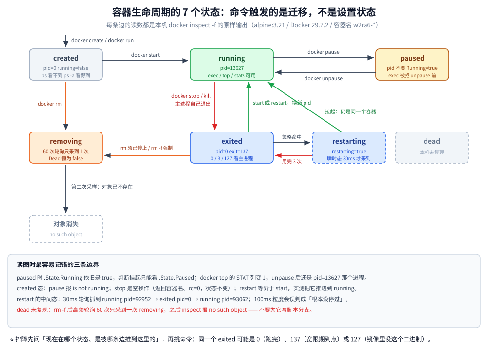
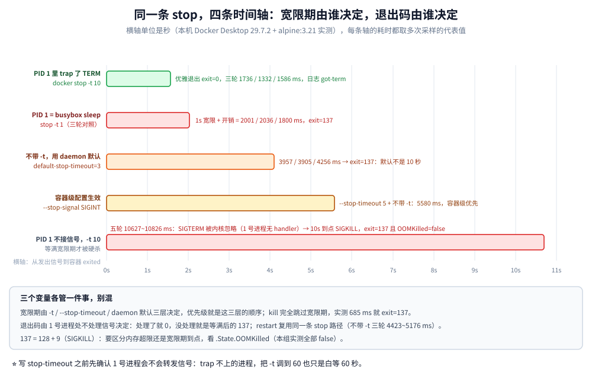

# Docker 命令速查

> 按「镜像管理 → 容器管理 → 网络管理 → 卷管理 → Docker Compose」五节排常用命令，其后是清理、排障组合、`inspect` 取字段、镜像膨胀、`context`、`buildx` 等专题
>
> 内容整理自个人学习笔记；本轮新增的 inspect 取字段、prune 作用范围对照、exec/run、镜像膨胀排查、context、Compose、buildx 等小节，命令语义参考《Docker 技术入门与实战》（第 3 版，杨保华 / 戴王剑 / 曹亚仑）。本文件只收录**命令**，原理与实现见 [容器原理.md](容器原理.md)、[镜像构建与缓存.md](镜像构建与缓存.md)、[网络与存储.md](网络与存储.md)、[资源限制与运维.md](资源限制与运维.md)，CI/CD 见 [CI-CD面试题.md](../CI-CD面试题.md)。

---

## 一、镜像管理

```bash
# 查看本地镜像
docker images

# 查看镜像详情
docker inspect <镜像>

# 拉取镜像
docker pull nginx:latest

# 删除镜像
docker rmi <镜像>

# 构建镜像
docker build -t <镜像名:标签> .
```

| 命令 | 说明 |
|---|---|
| `docker images` | 列出本地镜像（`-a` 含中间层，`-f` 过滤，`--format` 自定义输出） |
| `docker inspect <镜像>` | 查看镜像/容器的详细元数据（JSON） |
| `docker pull <镜像>:<标签>` | 拉取镜像，省略标签默认 `latest` |
| `docker rmi <镜像>` | 删除镜像（`-f` 强制；被容器占用时需先删容器） |
| `docker build -t <镜像名:标签> .` | 构建镜像 |

> ⚠️ **常见错误写法**：`docker build -t Dockerfile` —— `-t` 后面要跟**镜像名:标签**，不是 Dockerfile 名。
> 需要指定 Dockerfile 路径时用 `-f`：
> ```bash
> docker build -t myapp:v1 -f docker/Dockerfile .
> ```
> 末尾的 `.` 表示**构建上下文目录，不可省略**。

## 二、容器管理

### 2.1 创建并运行

```bash
# 运行容器：docker run -d --name <容器名> <镜像>
docker run -d --name myapp -p 80:80 nginx:latest
```

**`docker run` 常用参数**：

| 参数 | 作用 |
|---|---|
| `-d` | 后台运行（detached） |
| `-it` | 分配交互式终端（`-i` 保持 stdin + `-t` 分配 tty） |
| `--name` | 指定容器名 |
| `-p 宿主机端口:容器端口` | 端口映射 |
| `-v 宿主机目录:容器目录` | 挂载卷（持久化数据） |
| `-e KEY=VALUE` | 设置环境变量 |
| `--network` | 指定网络 |
| `--restart=always` | 容器退出后自动重启 |
| `--rm` | 容器退出后自动删除 |

### 2.2 生命周期与查看

```bash
# 查看运行中的容器
docker ps

# 查看所有容器（含已停止）
docker ps -a

# 启动容器
docker start <容器id>

# 停止容器
docker stop <容器id>

# 重启容器
docker restart <容器id>

# 进入容器（推荐）
docker exec -it <容器id> bash

# 实时日志
docker logs -f <容器id>

# 查看容器详情
docker inspect <容器id>

# 删除容器
docker rm <容器id>

# 强制删除运行中的容器
docker rm -f <容器id>

# 实时查看容器资源占用（CPU/内存/IO）
docker stats
```

> ⭐ `docker exec` 与 `docker attach` 的区别：`exec` 会**新开一个进程**（推荐，退出不影响容器）；
> `attach` 是接入容器主进程的 stdin/stdout，`Ctrl+C` 可能**把容器一起停掉**。

### 2.3 生命周期状态机：每条迁移边的实测读数

上面的命令按状态机来记才不会混：**容器只有 7 个状态，命令的作用是「触发迁移」而不是「设置状态」**。
下面每条边都在本机跑过（`alpine:3.21`，Docker 29.7.2，容器名统一 `w2ra6-` 前缀），读数是 `docker inspect -f '{{.State.Status}} ...'` 的原样输出。

| 迁移 | 触发命令 | 实测读数（关键部分） |
|---|---|---|
| —— → `created` | `docker create` | `created pid=0 exit=0 running=false paused=false`；`docker ps` 看不到（0 行），`docker ps -a` 看得到（1 行） |
| `created` → `running` | `docker start` | `running pid=13627`；`StartedAt` 从 `0001-01-01T00:00:00Z` 变成真实时间 |
| `running` → `paused` | `docker pause` | `paused pid=13627 running=true paused=true`；`docker top` 的 STAT 列变 `1`；`docker exec` 被拒（报错见下） |
| `paused` → `running` | `docker unpause` | **同一个 pid**（13627）继续跑，`exec` 立刻返回 `ok` |
| `running` → `exited` | `docker stop` / `docker kill` / 主进程自己退出 | `exited pid=0 exit=137 running=false`（stop/kill）；主进程自然退出时 `exit` 就是它的返回值 `0` / `3` / `127` |
| `exited` → `running` | `docker start` / `docker restart` | 能反复做，**每次都是新 pid**；`exit=0` 的历史值会被下一次的 `0` 覆盖 |
| `exited` → `restarting` → `running` | 重启策略命中 | 采样序列：`running` → `exited pid=0 restarting=false` → `running pid=93062`，`restart` 命令在第 8 次采样（约 30ms 一轮）返回 |
| `exited` / `running` → `removing` → 对象消失 | `docker rm` / `rm -f` | 轮询第 1 次拿到 `status=removing`，第 2 次就 `error: no such object` |

三条容易记错的边界，都有报错原文兜底：

```bash
docker pause w2ra6-cr          # created 态：Error response from daemon: container ca22d2... is not running
docker exec w2ra6-lc echo ok   # paused 态：Error response from daemon: Container w2ra6-lc is paused, unpause the container before exec
docker rm w2ra6-lc2            # running 态：Error response from daemon: cannot remove container "w2ra6-lc2": container is running: stop the container before removing or force remove
```

- **`created` 不是「半个运行态」**：不能 `pause`、不能 `exec`，但 `docker stop` 对它是**空操作**（实测返回容器名、rc=0，状态仍是 `created`），`docker restart` 则等价于 `start`（实测把它变成了 `running`）。
- **`paused` 时 `.State.Running` 仍是 `true`**：判断挂起要看 `.State.Paused`，别看 `Running`；pause 冻结的是 cgroup 里的进程，**不释放 pid**，所以 unpause 后还是同一个 1 号进程。
- **`dead` 态本机没复现**：`rm -f` 后高频轮询 60 次，只采到一次 `removing`（`.State.Dead` 始终 `false`），下一轮对象就没了。⚠️ 它是 Docker 内部标记的「删除失败/残留」状态，日常命令走不到，别为它写脚本分支。

重启策略的中间态是唯一能被采到的瞬时状态，实测把 `--restart=on-failure:3` 配上一条立刻失败的命令（`sh -c 'exit 7'`）：

```text
采样#1: status=running   exit=0 restarting=false | ps列="Restarting (7) Less than a second ago"
采样#2: status=restarting exit=7 restarting=true | ps列="Restarting (7) Less than a second ago"
采样#3: status=exited    exit=7 restarting=false | ps列="Exited (7) Less than a second ago"
最终:   RestartCount=3  status=exited  policy=on-failure-3
```

`RestartCount=3` 正好等于 `on-failure:3` 的上限——**策略用完次数后就 permanently 停在 `exited`**，之后再也不会自己起来（对照实验：`--restart=always` 的同一命令 24 秒内 `RestartCount` 从 1 涨到 6；`--restart=no` 三次采样都是 `RestartCount=0`）。



### 2.4 `stop` 的宽限期：默认值不是 10 秒，退出码由谁决定

`docker stop` = 发 `STOPSIGNAL`（默认 SIGTERM）→ 等 `grace period` → 还没退就 SIGKILL。三个变量各自独立，实测把它们分开：

| 条件（同一个容器 `sh -c 'sleep 3600'`，1 号进程是 busybox `sleep`） | 耗时（多次实测） | 退出码 |
|---|---|---|
| `docker stop -t 10` | 10684 / 10627 / 10826 / 10766 / 10762 ms（另有 10919 / 10698 / 10704 ms） | `exit=137 oom=false` |
| `docker stop -t 1` | 2001 / 2036 / 1800 ms | `exit=137` |
| `docker stop`（不带 `-t`） | **3957 / 3905 / 4256 ms** | `exit=137` |
| `docker kill` | 685 ms | `exit=137` |
| 创建时给 `--stop-timeout 5 --stop-signal SIGINT`，`docker stop` | 5580 ms | `exit=137` |
| 1 号进程 `trap ... TERM; exit 0` 的容器，`docker stop -t 10` | 1736 / 1332 / 1586 ms | **`exit=0`**，日志有 `got-term` |

⚠️ **本机不带 `-t` 的 `stop` 只要 4 秒左右，不是文档常见的「默认 10 秒」**：Docker Desktop 把 daemon 默认值改小了，VM 内 `/run/config/docker/daemon.json` 里有 `"default-stop-timeout": 3`（同文件还有 `"shutdown-timeout": 2`），4 秒 = 3 秒宽限 + 起停开销。要确定性就别依赖默认值，**显式写 `-t`**。

- **为什么 `sleep` 当 1 号进程一定等满宽限期**：`sh -c 'sleep 3600'` 会被 dash 直接 exec 成 `sleep`，容器内 `/proc/1/comm` 就是 `sleep`。它没注册 SIGTERM 处理函数，而**内核会忽略从 PID namespace 外发给该 ns 的 1 号进程的、没有 handler 的信号**——SIGTERM 被吞掉，只能等满后 SIGKILL，于是 `exit=137`。对照组（脚本里 `trap` 了 TERM）1.3~1.6 秒就 `exit=0`，证明卡点就在「1 号进程接没接住信号」。
- **`137` 的两义要靠 `.State.OOMKilled` 区分**：这里 `oom=false`，是宽限期到点；`true` 才是内存超限。判定流程见 [资源限制与运维.md](资源限制与运维.md)。
- **`docker restart` 也是「先 stop 再 start」**：不带 `-t` 耗时 4917 / 4423 / 5176 ms（≈ 3 秒宽限 + 开销），`-t 2` 时 3829 / 3428 / 3908 ms；30ms 一轮的高频轮询能抓到中间的 `exited pid=0`，**100ms 粒度会整个漏掉**（实测只看到 `running` → `running`，误以为没停过）。
- **`docker update --restart=always` 之后 `docker kill` 不会把它拉回来**：三次采样（t+2/4/6s）都是 `status=exited exit=137 restarting=false`；`stop` 同样（`RestartCount` 冻结在 8）。重启策略只兜「进程自己退出」，**不兜运维的显式动作**。



## 三、网络管理

```bash
# 列出网络
docker network ls

# 创建网络：docker network create <名称>
docker network create mynet

# 将已有容器连接到网络
docker network connect <网络名> <容器id>

# 断开容器与网络的连接
docker network disconnect <网络名> <容器id>

# 删除网络
docker network rm <名称>
```

> ⭐ **同一条自定义 bridge 网络内的容器可以通过容器名互相访问**（内置 DNS），
> 这也是 `docker compose` 里服务之间能用服务名当主机名的原因；默认 bridge 网络则只能用 IP。

## 四、卷管理

```bash
docker volume ls                    # 列出卷
docker volume create <卷名>          # 创建命名卷
docker volume inspect <卷名>         # 看 Mountpoint（宿主真实路径）、Driver、Scope
docker volume rm <卷名>              # 删除卷（⚠️ 删的是数据，不可恢复）
docker volume prune                 # 清理未被任何容器引用的卷（⚠️ 同上）
docker volume ls -f dangling=true   # 先出「孤儿卷」清单，再决定删哪些
```

**两种挂载写法**：

| 写法 | 示例 | 说明 |
|---|---|---|
| `-v` 命名卷 | `docker run -v mydata:/data nginx` | 卷不存在时**自动创建** |
| `-v` 绑定挂载 | `docker run -v /host/path:/data nginx` | ⚠️ 宿主路径不存在时会**自动建一个空目录**——「卷看起来是空的」第一嫌疑 |
| `--mount`（推荐） | `docker run --mount type=volume,src=mydata,dst=/data nginx` | 参数写错会**报错**，而不是静默创建 |
| `--mount` 只读 | `docker run --mount type=bind,src=/etc/nginx,dst=/etc/nginx,readonly nginx` | 容器改不了这份配置 |

**三种数据挂载方式**：

| 方式 | 数据落在哪 | 容器删了还在吗 | 典型用途 |
|---|---|---|---|
| **命名卷 / 匿名卷**（volume） | `/var/lib/docker/volumes/<名>/_data` | ✅ 在（要 `volume rm`） | 数据库数据、交给 Docker 管生命周期的数据 |
| **绑定挂载**（bind mount） | 宿主机的指定路径 | ✅ 在 | 配置文件、代码目录（开发期热重载） |
| **tmpfs** | 内存 | ❌ 没了 | 敏感临时数据、不想落盘 |

```bash
docker inspect -f '{{json .Mounts}}' <容器>              # 这个容器实际挂了什么、什么类型、读写权限
docker run --rm -v mydata:/data:ro alpine ls -la /data   # ★ 临时容器只读挂载，看卷里到底有什么
docker rm -v <容器>                                      # 删容器时把它创建的匿名卷一起删
```

> ⚠️ **四条最容易踩的坑**：
> 1. **容器删了卷还在** —— `docker rm` 只删容器，命名卷要 `volume rm`；
> 2. **`system prune` 不动卷**，必须显式加 `--volumes`（各命令的作用范围见第六节）；
> 3. **挂载会遮住容器内该路径原有的内容**——镜像里 `/data` 有文件时，挂上去就被盖住；
>    ⚠️ 例外：**首次挂载空的命名卷 / 匿名卷时，Docker 会把镜像里该目录的内容拷进卷**，bind mount **不会**；
> 4. **权限**：bind mount 下容器里的 uid 与宿主目录属主不一致 → "权限不足"，开发机上最常见。


## 五、Docker Compose

### 5.1 日常命令

```bash
# 后台启动所有服务
docker compose up -d

# 重新构建并启动（仅对带 build 的服务有效）
docker compose up -d --build

# 只重建指定服务
docker compose up -d --build backend

# 在项目根目录，指定 deploy 下的 compose 文件启动
docker compose -f deploy/docker-compose.yml up -d

# 停止，保留容器
docker compose stop

# 停止并删除容器、网络
docker compose down

# 同时删除数据卷（谨慎：会丢数据）
docker compose down -v

# 查看服务状态
docker compose ps

# 实时查看所有服务日志
docker compose logs -f
# 查看指定服务日志
docker compose logs -f <服务>

# 重启指定服务
docker compose restart <服务>

# 拉取所有服务镜像
docker compose pull

# 构建所有服务镜像
docker compose build
```

> 注：新版 Compose 已内置为 Docker CLI 插件，命令是 **`docker compose`**（空格）；
> 老版本是独立的 `docker-compose`（连字符），两者在参数上略有差异。

### 5.2 `--profile`、多文件叠加与 `config`

```bash
docker compose --profile test up -d              # 带 `profiles: [test]` 的服务默认不起，要用 --profile 点名
docker compose --profile "*" up -d               # 全带上
docker compose -f compose.yaml -f compose.prod.yaml up -d --build    # 多文件叠加：后者覆盖前者
docker compose -f compose.yaml -f compose.prod.yaml config           # ★ 先看合并结果，再 up
docker compose --env-file env/staging.env config # 指定变量文件（compose 里 ${VAR} 的来源）
docker compose down -t 30                        # 优雅等待 30s；⚠️ `down -v` 会连数据卷一起删
```

| 用法 | 什么时候用 / 坑 |
|---|---|
| `up -d --build` | 改了代码但没重建 = 跑的还是旧镜像，"我改了怎么没生效"的第一现场 |
| `config` | 排 compose 问题**永远先跑它**（打印最终合并配置，不启动任何东西）；列表类字段默认**整体替换**而不是追加，合并语义以 Compose Spec 为准 |
| `run --rm <svc> <cmd>` | 用同一份服务定义跑一次性命令（迁移、调试）；默认**不做 `ports` 映射**，要外部访问加 `--service-ports` |

## 六、系统清理与 prune 作用范围 ⚠️

```bash
# 查看磁盘占用（镜像/容器/卷/构建缓存四类各多少、可回收多少）
docker system df

# 逐项明细：哪个镜像、哪个卷、被谁用着
docker system df -v

# 清理悬空镜像（<none>:<none>）
docker image prune

# 清理已停止的容器
docker container prune

# 清理构建缓存
docker builder prune -a -f

# 清理所有未使用的镜像、容器、网络（⚠️ 不含卷）
docker system prune -a
```

| 命令 | 会删掉什么 | ⚠️ 风险 |
|---|---|---|
| `docker image prune` | **悬空镜像**（`<none>:<none>` 的层） | 低；运行中容器用的不会删 |
| `docker image prune -a` | **所有没被任何容器（含已停止容器）引用的镜像** | ⚠️ 容器被 `rm` 后基础镜像就成"无主"，Runner 上会被删掉 → 构建变慢/失败（见 [CI-CD面试题.md 第五节](../CI-CD面试题.md)） |
| `docker image prune --filter until=24h` | 同上但**带时间条件** | 推荐这种写法，而不是裸 `-a` |
| `docker container prune` | 所有**已停止**容器（连同可写层与日志） | ⚠️ 容器里的临时产物一起没 |
| `docker network prune` | 未被任何容器使用的**自定义网络** | 低；compose 项目网络删后要重新 `up` |
| `docker volume prune` | 未被任何容器使用的**数据卷** | ⚠️⚠️ **删的是数据，不可恢复**；`system prune` 只有加 `--volumes` 才动卷 |
| `docker builder prune`（`docker buildx prune`） | **构建缓存** | 低（只让下次构建慢）；唯一可以放心定期清的一类 |
| `docker system prune` | 停止容器 + 未用网络 + 悬空镜像 + 构建缓存 | 中；**不动卷** |
| `docker system prune -a --volumes` | 再 + 所有未用镜像 + 所有未用数据卷 | ⚠️⚠️ 最危险的一条，写进脚本前先想清楚 |

> ⚠️ `docker system prune -a` 会删除所有未被容器使用的镜像，**执行前确认没有待用的本地镜像**。
> 要连数据卷一起清需显式加 `--volumes`。

## 七、高频组合场景

| 场景 | 命令 |
|---|---|
| 看容器为啥起不来 | `docker logs --tail 100 <id>` → `docker inspect <id>` 看 `State.ExitCode` |
| 进容器里排查问题 | `docker exec -it <id> sh`（无 bash 的镜像用 sh） |
| 查看容器 IP | `docker inspect -f '{{range .NetworkSettings.Networks}}{{.IPAddress}}{{end}}' <id>` |
| 拷贝文件进出容器 | `docker cp <id>:/path/file ./` / `docker cp ./file <id>:/path/` |
| 导出镜像给别人 | `docker save -o app.tar <镜像>` → `docker load -i app.tar` |
| 清理空间 | `docker system df` → `docker system prune -a` → `docker builder prune -a -f`（各条作用范围见第六节） |

> 💡 排障类三条按"先看日志 → 再进容器 → 最后查网络"的顺序走；`inspect -f` 还能一次取更多字段，见第九节。
> 清理则先 `docker system df` 看清楚**空间被谁占了**，再决定清哪一类，不要一上来就 `prune -a`。

## 八、`exec` 与 `run` 的差别、日志与资源

```bash
docker exec -it <容器> sh            # 在【已运行】容器里新开一个进程（不创建容器）
docker exec -d <容器> sh -c 'sleep 60'   # -d 对 exec 同样有效：后台执行
docker exec -u root <容器> <cmd>      # 以别的用户执行；`docker exec <容器> env` 看容器内真实环境变量
docker run --rm -it --entrypoint sh <镜像>    # 用镜像开一个临时壳，不动现有容器
docker run --rm --network container:<容器> <镜像> curl -s 127.0.0.1:8080/health   # 借用它的网络栈
```

| | `docker exec` | `docker run` |
|---|---|---|
| 对象 | 已存在的容器；**改不了**它的网络/挂载/limit（`docker update` 只能改部分资源） | 新建容器，建的时候给 |
| 进程身份 | 目标容器的**附加进程**，不是 PID 1；容器停了就没了 | 容器主进程 = 容器内 **PID 1** |

```bash
docker logs -f --since 10m <容器>     # 最近 10 分钟并持续跟随（别每次从第一行翻）
docker logs --tail 200 <容器>          # 只看最后 200 行：容器起不来先看这个
docker logs --timestamps <容器>        # 带时间戳，便于和别的组件日志对时间轴
docker stats --no-stream              # 资源快照（不加 --no-stream 是持续刷新）
docker stats --no-stream --format 'table {{.Name}}\t{{.CPUPerc}}\t{{.MemPerc}}\t{{.BlockIO}}'
docker top <容器>                      # 宿主视角看容器进程（含 PPID/STAT，查僵尸进程用它）
```

> ⚠️ `docker stats` 的 `MemPerc` 是**相对该容器 limit**（没设 limit 时相对宿主机）——
> 判断"要不要 OOMKilled 了"看百分比而不是绝对值。

## 九、`docker inspect --format`：一次取出要看的字段

```bash
docker inspect -f 'st={{.State.Status}} exit={{.State.ExitCode}} oom={{.State.OOMKilled}} err={{.State.Error}}' <容器>   # 起不来第一屏看这四个
docker inspect -f '{{.State.Pid}}' <容器>                      # 主进程在宿主机的真实 PID，再用 nsenter/lsns 往里钻
docker inspect -f '{{json .NetworkSettings.Ports}}' <容器>    # 端口映射是否建立（为空 = 没映射成功）
docker inspect -f '{{.GraphDriver.Data.UpperDir}}' <容器>     # 可写层目录（LowerDir / MergedDir 同理）
docker inspect -f 'mem={{.HostConfig.Memory}} cpus={{.HostConfig.NanoCpus}} restart={{.HostConfig.RestartPolicy.Name}}' <容器>   # 限额与重启策略是否下发
docker inspect -f '{{.LogPath}}' <容器>                        # 日志文件真实位置（磁盘被写满时第一步）
docker ps -aq | xargs -r -n1 docker inspect -f '{{.Name}} {{.State.Status}} {{.State.ExitCode}}'    # 批量排查异常
docker inspect -s -f '{{.Name}} writelayer={{.Size}}' <容器>   # 加 `-s` 才统计可写层大小；日常也可 `docker ps -s`
```

> ⭐ 退出码速判：**125** Docker 参数/镜像问题、**126** 命令不可执行、**127** 镜像里没有这个二进制、
> **137** 被 SIGKILL（再分 `OOMKilled=true` 内存超限 / `false` 是 `stop` 宽限期到点，见 [资源限制与运维.md](资源限制与运维.md)）。
> 其余常用字段：`.Config.Entrypoint`/`.Cmd`/`.Env`（实际生效的启动命令）、`.HostConfig.Mounts`（卷挂没挂上）。

> ⚠️ **版本差异（本机 Docker 29.7.2 + containerd snapshotter 实测）**：上面 `.GraphDriver.Data.UpperDir` 这一条**取不到**，
> 原样报错 `template parsing error: ... map has no entry for key "GraphDriver"`——因为存储驱动已是 `overlayfs`
> （`driver-type: io.containerd.snapshotter.v1`），inspect 里不再输出 `GraphDriver` 字段。
> 同理 `.Config.StopTimeout` / `.HostConfig.StopTimeout` 在未显式设置时也会报 `map has no entry`。
> 排查可写层改用 `docker ps -s` / `docker diff`，或到 VM 内按容器 ID 查 snapshot 目录。

## 十、镜像膨胀排查与“救急”命令

```bash
docker history --no-trunc -H <镜像>           # 哪一层最胖、是哪条 RUN 造成的（瘦身第一步）
docker image inspect -f '{{.Size}}' <镜像>     # 未压缩总大小（≈ save 出来的 tar）
docker diff <容器>                             # 可写层改了什么：A=新增 C=修改 D=删除
docker commit -m 'save debug env' <容器> myrepo/debug:<自定 tag>   # ⚠️ 救急抢救现场，不是交付方式
docker save -o app.tar <镜像> / docker load -i app.tar    # 离线搬镜像：保留层与元数据
docker export <容器> > fs.tar / docker import fs.tar      # 只要拍平的文件系统（⚠️ 丢 CMD/ENV/历史）
```

> ⚠️ `docker history` 的每层大小是"该层增量"，**whiteout 删除不会让它变小**（见 [网络与存储.md](网络与存储.md)）；
> `docker diff` 只看可写层，写进 volume 的数据不在这里。交付必须回到 Dockerfile 重新 build。

## 十一、切远端 daemon：`docker context`

```bash
docker context ls                        # 有哪些上下文，* 标的是正在用的
docker context create prod --docker host=ssh://deploy@prod.example.com
docker context use prod / docker context use default   # 切过去 / 切回本机
docker --context staging ps              # ★ 只这一条命令打另一套环境，不改当前上下文（更安全）
```

> ⚠️ `use` 完忘了切回来 = **最容易误操作生产容器的一类事故**；单次命令一律用 `--context`。
> 优先级：命令行 `-H` > `DOCKER_HOST` 环境变量 > 当前 context。

## 十二、网络与卷的调试

```bash
docker network inspect mynet     # 该网络里有哪些容器、各自 IP 与别名
docker network connect myother <容器> / docker network disconnect bridge <容器>   # 运行中换网络（跨网段排查常用）
docker network rm mynet          # 删网络（有容器在用会报错）
docker exec <容器> getent hosts <服务名>    # 服务名解析失败时：看走的是内嵌 DNS(127.0.0.11) 还是宿主 resolv.conf
```

> 两个容器互访不通 → 先 `network inspect` 确认**是不是同一个网络**（默认 bridge 还不能按名字解析）。
> "卷看起来是空的" → 多半是**挂错了卷名（新建了一个空卷**）或 bind mount 路径不存在被创建成空目录。
> ⭐ 卷的**管理命令**（`ls` / `create` / `inspect` / `rm` / `prune`、两种挂载写法）在**第四节**，本节只讲怎么验证。

## 十三、`buildx` 多平台构建入口

```bash
docker buildx ls                        # 有哪些 builder、当前用哪个、支持哪些平台
docker buildx create --name myb --use   # 建一个并切过去
docker buildx inspect --bootstrap       # 初始化并查看它真正支持的平台
docker buildx build --platform linux/amd64,linux/arm64 -t myrepo/app:<SHA tag> --push .   # 多架构：必须直接推仓库
docker buildx build --platform linux/amd64 -t myrepo/app:dev --load .                     # 单架构：可导入本地 daemon
docker buildx imagetools inspect myrepo/app:<tag>    # 验证 manifest 里到底有哪些架构
```

> ⚠️ 多平台产物是一个 **manifest list**（一个 tag 对应多架构），所以**不能用 `--load` 导回本地**；
> tag 用 commit SHA 而不是 `latest`（原因见 [CI-CD面试题.md 第二节](../CI-CD面试题.md)）。

---

## 延伸追问
- **`docker exec` 和 `docker run` 混用的后果？** → exec 进的是**已有容器**、共享它的命名空间与文件系统；run 是新建容器，两边完全隔离。「我明明改了配置怎么没生效」多半就是拿 run 当 exec 用了。
- **`docker system prune -a` 会不会删数据卷？** → 不会，卷必须显式加 `--volumes`；⚠️ 但 `-a` 会删掉所有**未被容器使用**的镜像，本地缓存全没，下次构建从头拉。
- **退出码 137 怎么判断是 OOM 还是超时？** → `docker inspect` 看 `.State.OOMKilled`：`true` = 内存超限被杀；`false` = `stop` 宽限期到点被 SIGKILL。两者处置完全不同。
- **为什么 `docker history` 各层大小加起来不等于镜像大小？** → 删文件只写 whiteout 标记、不减小下层体积；层是累加的，这也是「`RUN rm` 清不掉敏感文件」的原因。
- **容器把磁盘写满，怎么定位？** → `docker system df` 看总量分布 → `du -sh /var/lib/docker/*` 定位 → 重点查**日志没轮转**与**大文件写进可写层**这两类。

## 关联
- [容器原理.md](容器原理.md) — 这些命令背后的隔离机制
- [镜像构建与缓存.md](镜像构建与缓存.md) — Dockerfile 与构建缓存
- [网络与存储.md](网络与存储.md) — 端口映射与卷挂载的细节
- [资源限制与运维.md](资源限制与运维.md) — 137 与 OOMKilled 的判定
- [CI-CD面试题.md](../CI-CD面试题.md) — 这些命令在流水线里的位置

> 反向引用（本篇被下列文档引到）：[进入运行中的容器.md](进入运行中的容器.md)
