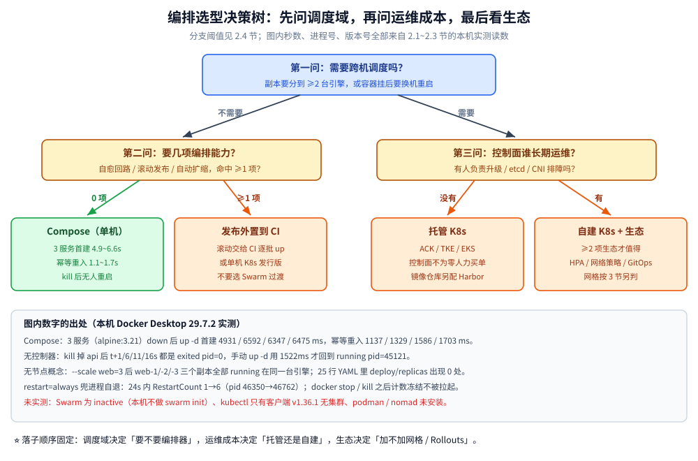
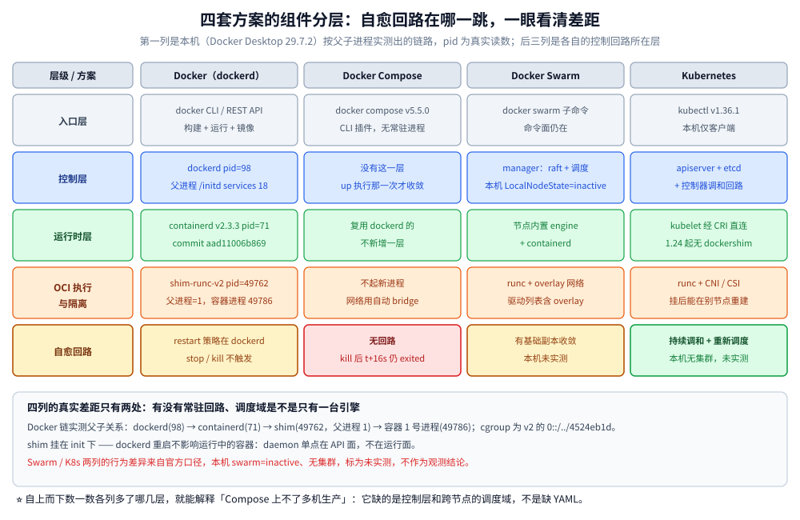

# 容器与编排选型

> 容器运行时（Docker / containerd / Podman）、编排（K8s / Compose / Swarm / Nomad）、服务网格（Istio / Linkerd / Cilium）、CI/CD（Jenkins / GitLab CI / GitHub Actions / Argo CD）四个层面的横向选型，以及三套推荐组合。
>
> 内容整理自个人学习笔记。单技术深入见 [容器原理.md](docker/容器原理.md)、[镜像构建与缓存.md](docker/镜像构建与缓存.md)、[K8s部署与生命周期面试题.md](k8s/K8s部署与生命周期面试题.md)、[CI-CD面试题.md](CI-CD面试题.md)。

---

## 一、容器运行时怎么选？

**Docker 不等于容器**：Docker 只是最流行的容器工具链，底层依赖 containerd 与 runc。

| 维度 | **Docker**（dockerd） | **containerd + runc** | **Podman** |
| --- | --- | --- | --- |
| 定位 | 完整工具链：构建 + 运行 + Compose + CLI | 底层运行时（**K8s 的默认选择**） | 无守护进程的容器工具 |
| 架构 | `dockerd`（守护进程）→ containerd → runc | containerd → runc，无额外 daemon | 直接 fork 容器进程，**无 daemon** |
| 权限模型 | 默认 root（dockerd 以 root 运行） | 依赖上层配置 | ⭐ **原生 rootless** |
| 优点 | 生态最全、开发者体验最好、Compose 一体化、文档最多 | 轻量、无 daemon 单点、K8s 原生 | 无守护进程、更安全、与 systemd 集成好、**兼容 docker CLI** |
| 缺点 | daemon 单点故障、默认 root 权限、启动链路长 | 只有运行时，构建与开发体验弱 | 生态与资料少于 Docker，个别场景行为有差异 |
| 适用 | 本地开发、单机部署、CI 构建 | **K8s 节点**、追求最小攻击面 | 安全要求高、不便跑 root daemon 的环境 |

⭐ **实践结论**：**开发用 Docker CLI，生产 K8s 节点上是 containerd**。K8s 从 1.24 起移除 dockershim，Docker 已不再是 K8s 支持的运行时——这不是「Docker 不能用了」，而是 K8s 直接对接 CRI（containerd）。原理与 namespace / cgroup 隔离机制见 [容器原理.md](docker/容器原理.md)。

---

## 二、编排怎么选？

| 维度 | **Kubernetes** | **Docker Compose** | **Docker Swarm** | **Nomad** |
| --- | --- | --- | --- | --- |
| 定位 | 容器编排事实标准 | 单机多容器编排（开发/单机） | 轻量多机编排 | 通用工作负载编排 |
| 学习与运维成本 | **高**（组件多、概念多） | ⭐ 极低（一个 YAML） | 低 | 中 |
| 自愈与调度 | ⭐ 完整（探针 + 重启 + 重新调度） | ❌ 无（容器挂了不会重建） | 有基础自愈 | 有 |
| 滚动发布 / 回滚 | ⭐ 内置（Deployment 策略） | ❌ 无 | 有基础能力 | 有 |
| 自动扩缩 | ⭐ HPA / VPA / Cluster Autoscaler | ❌ | ❌ | 有（Nomad Autoscaler） |
| 支持非容器负载 | ❌ 只调度容器 | ❌ | ❌ | ⭐ 可调度二进制 / Java 进程 |
| 生态与就业 | ⭐ 绝对主流 | 广泛用于开发环境 | ⚠️ 已基本停滞，不建议新项目 | 小众但稳定 |
| 适用 | 生产多机集群 | **本地开发、单机小项目、CI 环境** | 不推荐新项目 | 混合负载、中小规模、不想扛 K8s 复杂度 |

⭐ **一句话**：**本地开发 Compose，生产 K8s**。二者的能力差距不在「能不能跑容器」，而在**自愈、调度、滚动发布、扩缩容**——Compose 一个都没有，所以它**上不了多机生产**。K8s 的部署形态与生命周期管理见 [K8s部署与生命周期面试题.md](k8s/K8s部署与生命周期面试题.md)。

上面的表是结论，下面 4 小节把结论拆开：**自愈到底由谁做**（2.1）、**Compose 的边界在哪**（2.2）、**Docker 与 containerd 差几跳**（2.3）、**拿到一个项目怎么按三条轴落子**（2.4）。

### 2.1 自愈到底发生在哪一层？

容器挂了会不会自己被拉起来，取决于**有没有一个持续运行的回路在比对「期望状态」和「实际状态」**。这条回路在本机有三层，能力和触发条件完全不同。

| 层 | 谁在盯 | 盯的粒度 | 什么时候不生效 | 本机实测 |
| --- | --- | --- | --- | --- |
| **单容器 `--restart` 策略** | `dockerd` 本身 | 一个容器的进程退出事件 | ⚠️ 运维显式动作（`docker stop` / `docker kill`）**不触发** | ✅ 已实测 |
| **Compose** | 无人常驻，只有 `up` 命令执行的那一次 | 一个项目内的服务集合 | 主进程退出后不会自动重建，要再敲一次 `up -d` | ✅ 已实测 |
| **K8s 控制回路** | 控制面的控制器 + 各节点 kubelet | Deployment/ReplicaSet 声明的副本数 | —— | ❌ 未实测（本机无集群，见 2.3） |

`--restart=always` 的容器，主进程**自己跑完退出**时 dockerd 会立刻重开，进程号每次都变；16 秒内重启计数从 1 涨到 6：

```text
t+ 4s status=running pid=46350 exit=0 restarting=false RestartCount=1 policy=always
t+ 8s status=running pid=46477 exit=0 restarting=false RestartCount=2 policy=always
t+12s status=running pid=46560 exit=0 restarting=false RestartCount=3 policy=always
t+16s status=running pid=46680 exit=0 restarting=false RestartCount=4 policy=always
t+20s status=running pid=46762 exit=0 restarting=false RestartCount=5 policy=always
t+24s status=restarting pid=0 exit=7 restarting=true RestartCount=6 policy=always
```

对照实验（同一条命令 `sh -c 'sleep 3; exit 7'`，`alpine:3.21`）：`--restart=no` 的容器三次采样（t+4/8/12s）全是 `status=exited exit=7 RestartCount=0`，一直躺平；而 `always` 的策略在**显式动作面前失效**——`docker stop` 之后 t+3/6/9s 三次采样都是 `status=exited RestartCount=8`（计数不再增长），`docker kill` 之后 t+2/4/6s 三次采样都是 `status=exited exit=137 restarting=false`（kill 前 pid=44784）。

⚠️ 这条边界很重要：**`--restart` 只兜「进程意外退出」，不兜「人为停掉」**，也不兜宿主重启后的调度决策。它是单容器粒度的，压根不知道「这个服务该有几个副本、该落在哪台机」。

Compose 层实测：起一个 3 服务（db/api/web）的项目，`docker kill` 掉 api，之后 t+1/6/11/16 秒四次采样都是 `status=exited exit=137 pid=0`——**没有任何东西把它拉回来**；直到人工再执行一次 `docker compose up -d`，1522ms 后 api 变成 `running pid=45121`，db/web 未被重建。

所以 Compose 的「期望状态对齐」是**一次性的命令行为，不是常驻控制器**：你敲 `up` 它才比对一次，不敲就一直停在偏差状态。这正是第二节表格中「自愈 ❌」的准确含义——不是「完全做不到」，而是**得有人手动触发**。

### 2.2 Compose 的能力边界：能扩副本，但不认识「节点」

同一份 3 服务 YAML（25 行，`image: alpine:3.21`，db 带 healthcheck，api `depends_on: db: condition: service_healthy`）的实测：

| 行为 | 实测读数 | 说明 |
| --- | --- | --- |
| `up -d` 首建（先 `down`） | 4931 / 6592 / 6347 / 6475 ms | 4 轮，**4.9~6.6s** |
| `up -d` 幂等重入（状态已对齐） | 1137 / 1329 / 1586 / 1703 ms | 4 轮，**1.1~1.7s**，首建约为重入的 3.7~5.0 倍 |
| 自动创建的网络 | `w2ra6-lab_default` driver=`bridge` scope=`local` 网段 `192.168.192.0/20` | 每个项目一张 bridge |
| 服务名解析 | `nameserver 127.0.0.11`；`ping api` → `192.168.192.3: 56 data bytes ... time=0.407 ms` | db=`.2`、api=`.3`、web=`.4` |
| `up -d --scale web=3` | `w2ra6-lab-web-1/-2/-3` 三个全部 `running` | 副本数来自命令行，YAML 里 `deploy`/`replicas` 出现 **0 处** |

两条判据从这些数字里直接长出来：

- **重入只要 1 秒级、首建要 5 秒级**：Compose 的价值在「一条命令把拓扑铺出来」，铺完之后它就不管了；
- **`--scale` 能把 web 变成 3 份，但三份都在同一台引擎上**：Compose 的调度域 = **一个 Docker 引擎**，它没有「节点」这个概念，也就没有反亲和、没有资源请求、没有跨节点漂移。

`--scale` 这种「横向多份」和编排器的「副本数 + 放置约束」差在**放置**：Compose 只会 `docker run` N 次， placement 完全不看负载。要跨机，就得上 Swarm 或 K8s——而 Swarm 在本机的真实状态是 `Swarm=inactive`、`ControlAvailable=false`，`docker node ls` 直接报：

```text
Error response from daemon: This node is not a swarm manager. Use "docker swarm init" or "docker swarm join" to connect this node to swarm and try again.
```

### 2.3 组件分层：Docker 比 containerd 多几跳？

第一节的表说「Docker 启动链路长」，本机能直接把这条链量出来。在 VM 内按进程父子关系查一个正在跑的容器（容器主进程 `sleep 3600`）：

```text
49786 49762 sleep 3600
49762     1 /usr/bin/containerd-shim-runc-v2 -namespace moby -id 4524eb1d0c042b... -address /run/containerd/containerd.sock
   98    18 /usr/local/bin/dockerd --config-file /run/config/docker/daemon.json
   71    18 /usr/bin/containerd --config /etc/containerd/containerd.toml
   18     1 /initd services
```

读法是四跳：`dockerd`(pid 98) 把请求交给 `containerd`(pid 71)，containerd 拉起 **一个容器一个** `containerd-shim-runc-v2`(pid 49762)，shim 再 fork 出容器里的 1 号进程(pid 49786)。两个细节值得记：

- **shim 的父进程是 1（`/initd`），不是 dockerd**：容器进程被托管在 shim 下，`dockerd` 崩溃或升级重启时容器不死——这就是第一节里「daemon 单点」的实际严重程度：**API 面单点，运行面不单点**；
- 容器 cgroup 是 `0::/../4524eb1d0c042b...`（**Cgroup v2**，路径直接用容器 ID），与 cgroupfs 驱动一致。

版本与能力面（`docker version` / `docker info` 原样读数）：

| 项 | 本机读数 |
| --- | --- |
| Docker Server / API | `29.7.2` / `1.55`（client 同为 29.7.2） |
| containerd | `v2.3.3` commit `aad11006b869517fcd3009450b6f82da282e1a9b` |
| runc | `v1.4.3-0-gbb14dabe`；`Runtimes: io.containerd.runc.v2 nvidia runc`，默认 `runc` |
| 存储 | `Storage Driver: overlayfs`，`driver-type: io.containerd.snapshotter.v1` |
| 宿主内核 | `6.18.54.1-microsoft-standard-WSL2`，`Operating System: Docker Desktop (containerized)` |
| 网络插件 | `bridge host ipvlan macvlan null overlay` |
| Compose | `Docker Compose version v5.5.0`（CLI 插件，无独立 daemon） |
| Swarm | `LocalNodeState=inactive`、`ControlAvailable=false` |
| K8s | 只有 `kubectl` 客户端 `v1.36.1`（Kustomize `v5.8.1`）；`kubectl config current-context` → `error: current-context is not set` |
| Podman / Nomad / Helm / kind / minikube | 本机 `command -v` 全部 not found |

⚠️ **本片的未实测项与原因**：① Swarm 的多机行为——`docker swarm init` 会把这台开发机的 daemon 变成 swarm manager，属于改用户环境状态，不在实测口径内，因此 Swarm 只保留「命令面存在 + inactive」这两条事实；② K8s 的控制回路、重新调度、HPA——本机没有集群，`kubectl` 只有客户端；③ Podman 的 rootless 与行为差异——未安装。**上面表格里凡标 ❌ 的结论都来自官方文档口径，不是本机观测**。

关于 K8s 1.24 移除 dockershim 后「Docker 不再是被支持的运行时」，本机这组数字给了个直观注解：**K8s 要的是 containerd 那一跳，Docker 多出来的只有 `dockerd` 这一层 API/CLI 体验**（构建、Compose、镜像管理）。运行时链的其余部分完全共用，所以「用 Docker 构建的镜像照样在 K8s 里跑」。

### 2.4 三条轴与决策树：什么规模落在哪个方案

把前面表格里的定性描述换成可核对的三条轴，落子顺序固定为**先看调度域，再看运维成本，最后看生态**：

| 轴 | 判据 | 落在哪 |
| --- | --- | --- |
| **调度域** | 只需要 1 台引擎；跨机后是否要求「挂了的容器换台机器再起」 | 单机 → Compose；跨机 → 只有 K8s（Swarm 已停滞，不建议新项目） |
| **运维成本** | 有没有人**长期**负责控制面（升级、证书、etcd、CNI/CSI 排障）；组件数每个都要付这份钱 | 没有平台团队 → 托管 K8s 或继续 Compose；有 → 自建才谈得上 |
| **生态** | 需要 HPA / GitOps / 网络策略 / 存储 CSI / 服务网格中的几项 | 需要 ≥2 项 → K8s；一项都不要 → 别为了「以后可能用」上 K8s |

**阈值口径（经验值，不是实测结论）**：单台主机、服务数 ≤10、不需要滚动发布 → Compose 直接够；出现「要在 2 台以上机器上放置副本」或「要 HPA」这类需求 → 直接进 K8s（托管版），**不要**把 Swarm 当「K8s 之前的过渡」——它的命令面还活着，但生态与自愈能力已经停在原地，过渡成本将来要再付一次。中间地带（3~10 台、有 1 个半个人的运维预算、混合负载含非容器进程）才轮到 Nomad 考虑。

决策路径与组件分层见下面两张图：图内的秒数、进程号、版本号全部来自本节实测读数。





---

## 三、服务网格要不要上？

服务网格把「流量治理」从业务代码里抽出来，代价是多一跳与一套新组件。

| 方案 | 优点 | 缺点 | 适用场景 |
| --- | --- | --- | --- |
| **不上网格**（框架内做） | 零额外组件、延迟最低、排障链路短 | 每个语言各实现一套（重复建设）、升级要改业务代码 | ⭐ 服务数少（< 20）、语言统一 |
| **Istio**（Sidecar） | 功能最全：流量治理、mTLS、灰度、遥测、故障注入 | 组件多（istiod + Envoy）、资源开销大、**多一跳导致排障复杂** | 多语言、需要统一 mTLS 与流量治理、有平台团队 |
| **Linkerd** | 比 Istio 轻量、安装与运维更简单、性能更好 | 功能少于 Istio（无 Envoy 生态的丰富过滤器） | 想要网格但嫌 Istio 重 |
| **Cilium**（Sidecarless / eBPF） | ⭐ 无 Sidecar 开销、内核层拦截、与服务网格功能合一 | 依赖较新内核（eBPF），生态相对新，排障需要内核知识 | 追求性能、内核版本可控、已用 Cilium 做 CNI |

⭐ **判断标准**：**收益 = 多语言统一治理 + 合规要求（如全链路 mTLS）+ 灰度发布能力**；**成本 = 一套新组件 + 一跳延迟 + 排障复杂度**。服务数不多、语言统一时，**框架层（Kratos 中间件 / Spring Cloud）就能覆盖大部分需求，不要上网格**。

---

## 四、CI/CD 怎么选？

| 方案 | 托管方式 | 优点 | 缺点 | 适用 |
| --- | --- | --- | --- | --- |
| **Jenkins** | 自建 | 插件生态最大、最灵活、支持任意流水线 | ⚠️ **维护成本高**（插件冲突、版本升级、Groovy 门槛）、Master 易成瓶颈 | 存量复杂流水线、需要高度定制 |
| **GitLab CI** | 自建 / 云 | 与代码仓库一体化（`.gitlab-ci.yml`）、Runner 可弹性 | 绑定 GitLab；大规模 Runner 管理要自行运维 | 使用 GitLab 的团队 |
| **GitHub Actions** | SaaS（Runner 可自建） | ⭐ 开箱即用、免运维、生态丰富（Marketplace） | 绑定 GitHub；私有 Runner 需自建；分钟数计费 | 开源项目、GitHub 团队 |
| **Argo CD / Flux**（GitOps） | 自建（部署到 K8s） | ⭐ **声明式、Git 为唯一真相源、可审计 + 一键回滚**；自动纠正配置漂移 | 只做部署（CI 仍需另外的方案）；学习曲线 | K8s 部署标准化的团队 |

⭐ **现代组合**：**CI 用 GitLab CI / GitHub Actions（构建、测试、推镜像），CD 用 Argo CD（GitOps 拉模式部署）**。⚠️ 传统「CI 脚本里 `kubectl apply`」的**推模式**问题在于：集群凭证散落在 CI 里、无状态记录、配置漂移不可见——GitOps 把期望状态放进 Git，集群自己拉取并对齐。详见 [CI-CD面试题.md](CI-CD面试题.md)。

---

## 五、配套组件的选型

| 层面 | 选项 | 取舍 |
| --- | --- | --- |
| **镜像仓库** | Docker Hub（公共）/ Harbor（自建）/ 云 ACR、TCR | 生产用私有仓库；Harbor 提供镜像扫描、签名、复制与配额管理 |
| **容器网络（CNI）** | Flannel / Calico / Cilium | Flannel 最简单够用；Calico 支持网络策略、成熟稳定；Cilium 基于 eBPF、性能与可观测性最好 |
| **存储（CSI）** | local / NFS / Ceph / 云盘 | 有状态服务优先云盘或 Ceph；`local` 卷性能好但**绑定节点**（Pod 漂移后数据不可达） |
| **Ingress** | Nginx Ingress / Traefik / Gateway API | 简单路由用 Nginx Ingress；多协议与新特性看 Gateway API（Ingress 的继任者） |
| **配置与密钥** | ConfigMap / Secret / 外部方案（Vault / Nacos） | ⚠️ K8s Secret 默认只是 **base64 编码，不是加密**；敏感配置要么开 EncryptionConfiguration，要么放外部密钥管理 |

---

## 六、三套推荐组合

### 6.1 本地开发

```text
运行时：Docker Desktop（含 Compose）
编排：  Docker Compose（一键起依赖：MySQL / Redis / Nacos / MQ）
镜像：  本地构建，不推仓库
```

⭐ 好处是把「依赖中间件」也纳入 Compose，做到**一条命令拉起完整环境**；配合 init 容器解决「数据库初始化 → 建库建表 → 服务启动」的数据级依赖。

### 6.2 中小规模生产（推荐起点）

```text
运行时：containerd（托管 K8s 节点的默认）
编排：  K8s 托管版（ACK / TKE / EKS），避免自建控制面
镜像：  Harbor（自建，含扫描与配额）
网络：  Calico（要网络策略）或云厂商 CNI
CD：    Argo CD（GitOps）
CI：    GitLab CI / GitHub Actions
网格：  不上（框架层解决）
可观测：Prometheus + Grafana + Loki（或云托管）
```

### 6.3 大规模 / 多集群

```text
在上面基础上追加：
多集群管理：Karmada / 云厂商的多集群方案
服务网格：  Istio（要生态）或 Cilium（要性能，Sidecarless）
灰度发布：  Argo Rollouts / Flagger（金丝雀 + 自动回滚）
镜像：     多地域仓库复制 + 镜像签名（Cosign）
```

⚠️ **规模不是「上更多组件」的理由**：每增加一个组件就多一份运维与排障成本。**能靠云托管解决的不要自建**，把人力留给业务。

---

## 七、延伸追问

- **K8s 为什么弃用 Docker？** → Docker 与 K8s 之间原本靠 **dockershim** 适配层桥接，多一层维护成本；K8s 定义了 **CRI（容器运行时接口）**，可直接对接 containerd / CRI-O。1.24 移除 dockershim 后，**用 Docker 构建的镜像依然能跑**（镜像遵循 OCI 标准），只是节点上不再需要 Docker 这个运行时。
- **Docker 与 Podman 的核心差异？** → ①**有无守护进程**：dockerd 是 root 权限的常驻进程（单点、攻击面大），Podman 直接 fork 容器进程；②**权限模型**：Podman 原生 rootless；③Podman 兼容 docker CLI，迁移成本低。⚠️ 差异也带来行为不一致（如 `--restart` 策略、网络模式），生产迁移要验证。
- **Compose 能上生产吗？** → 单机可以（能满足「一台上跑多个容器 + 依赖编排」），但**多机不行**：Compose 没有调度、没有自愈、没有滚动发布、没有跨节点网络。判断标准是「有没有多节点与高可用要求」。
- **什么情况下该上服务网格？** → 三条同时满足才值得：①**多语言**（每个语言各实现一套治理逻辑成本高）②需要**统一 mTLS / 合规**③有**平台团队**能承担网格的运维与排障。服务数少于 20、语言统一时，框架层中间件足够。
- **Ingress 和 Gateway API 什么关系？** → Ingress 是早期的入口抽象，**能力有限**（只覆盖 HTTP 基础路由，扩展靠注解，各家实现不统一）；Gateway API 是继任者，把角色（基础设施 / 集群运维 / 应用开发者）与协议（HTTP / TCP / gRPC）分离，**可移植性与表达力更强**。目前二者并存，新项目可优先 Gateway API。
- **GitOps 与传统 CI/CD 的区别？** → **推 vs 拉**：传统方式在 CI 里执行 `kubectl apply`（需要把集群凭证给 CI，状态无记录）；GitOps 由集群内的控制器（Argo CD）**拉取 Git 中的期望状态并对齐**——好处是 Git 成为唯一真相源（可审计、可回滚）、集群凭证不外泄、配置漂移会被自动纠正。
- **K8s 的 Secret 安全吗？** → ⚠️ 默认**不安全**：Secret 只是 base64 编码（可逆），存在 etcd 里；能读 Pod 或能访问 etcd 就能拿到。加固手段：开启 etcd 静态加密（EncryptionConfiguration）、用 RBAC 限制读取、引入外部密钥管理（Vault / 云 KMS），敏感配置走加密方案（如字段级密文 + 应用侧解密）。
- **怎么判断该不该自建 K8s？** → 看三件事：**有没有平台团队**（K8s 的复杂度是持续的运维投入）、**集群规模**（几个节点用托管版更划算）、**是否有多云/混合云需求**（那才可能需要自建或统一管理面）。小团队上托管版是性价比最高的选择。

---

## 关联

- [容器原理.md](docker/容器原理.md) — 容器隔离机制：namespace / cgroup / rootfs 与共享内核
- [镜像构建与缓存.md](docker/镜像构建与缓存.md) — 镜像分层、构建缓存与多阶段构建
- [镜像瘦身与构建缓存.md](docker/镜像瘦身与构建缓存.md) — 镜像体积优化的具体手段
- [K8s部署与生命周期面试题.md](k8s/K8s部署与生命周期面试题.md) — K8s 的部署形态、Pod 生命周期与常用对象
- [K8s部署流程.md](k8s/K8s部署流程.md) — 选定编排方案之后的落地流程：集群搭建、基础组件与应用上线
- [CI-CD面试题.md](CI-CD面试题.md) — 流水线设计、构建缓存与制品管理
- [资源限制与运维.md](docker/资源限制与运维.md) — cgroup 限额、OOM 与容器运维
- [可观测性选型对比.md](../../03-数据与中间件/中间件/可观测性/可观测性选型对比.md) — 采集组件（OAP / Collector）在容器中的部署形态
- [网关选型对比.md](../../03-数据与中间件/中间件/网关与代理/网关选型对比.md) — 网关侧选型：本篇第三节「要不要上网格」的**边界判据**（南北向 vs 东西向）与 K8s 入口（Ingress / Gateway API）在网关谱系里的位置
- [中间件选型.md](../../03-数据与中间件/中间件/中间件选型.md) — 中间件侧选型（与平台层选型互补）

> 反向引用（本篇被下列文档引到）：[分布式与微服务.md](../../04-架构与系统/分布式/分布式与微服务.md)、[集群基础.md](../../04-架构与系统/分布式/集群基础.md)、[GitLab-CI-CD.md](GitLab-CI-CD.md)
