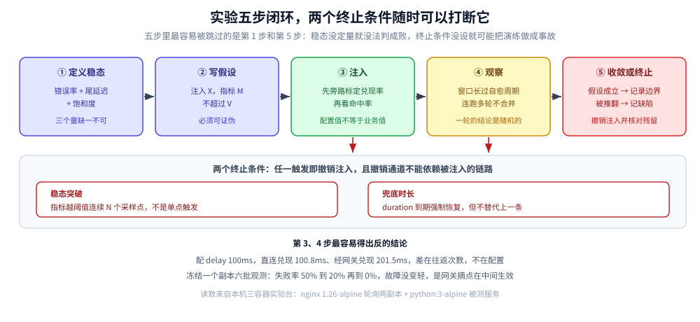
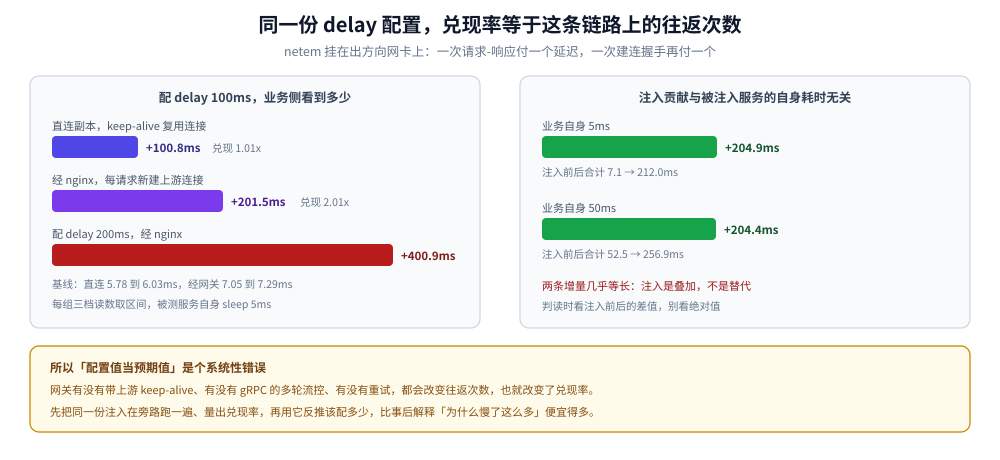
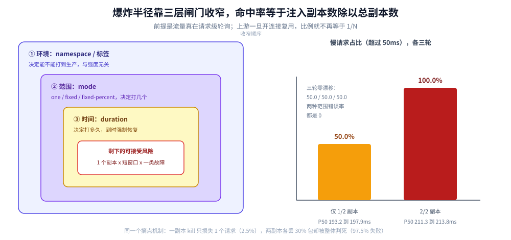

# 混沌工程

> 覆盖：一次混沌实验怎么定义（稳态 → 假设 → 注入 → 观察 → 收敛）、五类故障的注入手段与实测兑现率、
> Chaos Mesh 的对象模型、爆炸半径的三层收窄，以及什么阶段不该做。
>
> 不覆盖：故障分类与「部分失效」的理论在 [故障模型与分布式谬误.md](../../04-架构与系统/分布式/理论基础/故障模型与分布式谬误.md)；
> 造流量、影子库与容量拐点在 [全链路压测设计.md](../../04-架构与系统/系统设计/全链路压测设计.md)；
> 稳态指标怎么变成可维护的告警规则在 [告警规则与阈值设计.md](../../03-数据与中间件/中间件/可观测性/告警与响应/告警规则与阈值设计.md)。
>
> ✅ **本篇的注入读数全部本机实跑**：Docker 三容器（nginx 1.26-alpine 轮询两个副本 + python:3-alpine 被测服务，各 1 vCPU / 256MB），
> 注入手段是 `tc netem` / `SIGSTOP` / `SIGKILL` / 忙循环——也就是 Chaos Mesh 的 `NetworkChaos` / `PodChaos` / `StressChaos`
> **落到节点上的那一步**。⚠️ **Chaos Mesh 本身没跑**（本机无 K8s 集群），它的 CRD 字段、`mode` 取值与控制器行为按官方文档陈述，
> 在 `## 校验口径` 里逐条标注。

混沌工程最容易做错的三个位置，都不在「怎么注入」：

1. **稳态没定义**——注入完看什么都说「还行」，实验就退化成一次有风险的演练；
2. **拿配置值当预期值**——配 `delay 100ms`，业务侧看到 100ms 还是 200ms，取决于这条链路上有几个往返；
3. **只跑一轮**——同一个持续故障，第 1 轮和第 3 轮的读数可能完全相反，因为网关的摘点机制在中间生效了。

后两条都是本篇实测出来的，不是推演。先从一个反直觉的读数开始。

## 一、定位：混沌工程和「故障演练」差在哪

**本节要点**：差别不在「有没有注入故障」，而在**有没有事先定量的稳态、有没有可证伪的假设、有没有自动中止**。

### 1.1 三个判据

| | 故障演练 | 混沌工程 |
|---|---|---|
| 起点 | 一份剧本（「演练数据库主从切换」） | 一个可证伪的假设（「任意副本挂掉，P99 不超过 X」） |
| 稳态 | 跑完看「功能是否正常」 | 注入**前后**对比同一组定量指标 |
| 结束条件 | 剧本走完 | 假设被证伪，或稳态被突破超过阈值 → 中止 |
| 产物 | 一份演练记录 | 一条「系统能承受什么」的边界 + 一个待修缺陷 |
| 失败长什么样 | 演练没跑完 | 假设被推翻——**这是成功，不是失败** |

最后一行是关键：混沌实验**期望**找到缺陷。假设被推翻说明实验有效；实验跑完什么都没发现，要么系统真的很稳，要么注入根本没生效（差别要靠 3.6 的兑现率来判定）。

### 1.2 同一次注入，两层口径两个结论

`netem loss 30%` 注入到两个副本上，同时从两个位置观测：

| 观测位置 | 失败率 | 延迟 |
|---|---|---|
| 经 nginx（网关） | **97.5%**（200 个请求只成 5 个，其中 2 个 504、193 个 502） | 成功的 5 个 p50 8.65ms |
| 直连副本（keep-alive） | **0%**（200 个全 200） | p50 6.65~7.25ms，但 p90 267~270ms、p99 **738~936ms**、max **1532~1552ms**，18%~23% 的请求超过 50ms |

同一时刻、同一份注入、同一批机器：**网关说「基本全挂」，应用说「零错误，只是偶尔很慢」**。

两边都没撒谎：

- 应用侧 0 错误，是因为丢的包被 **TCP 重传**兜住了——代价全落在尾延迟上；
- 网关侧 97.5% 失败，是因为 nginx 的 `max_fails` / `fail_timeout` 把**两个**副本都标记成了不可用，之后直接回 `no live upstreams`（容器日志原文）。

⭐ 所以第一个判据是：**稳态指标必须在你要保护的那一层取，而且要同时含错误率和尾延迟**。只在网关看，你测的是网关的摘点策略；只在应用看，你会漏掉「上游已经被整体判死」这件事。

## 二、实验五步：从稳态到收敛

**本节要点**：五步里最容易漏的是第 1 步和第 5 步——稳态没定义就没法判成败，终止条件没设就可能把演练做成事故。



五个方块是实验的执行顺序，箭头只表示推进方向而不是流水线：第 4 步的观察结果随时可能让实验回到第 2 步（假设写错了）或直接跳到终止。红色标注的两个终止条件悬在整条流程上——稳态越阈值连续若干采样点就撤销，`duration` 到期强制恢复，后者是兜底而不是替代。底部三行是本篇在第 3、4 步实测到的两个反直觉读数，也是这两步最容易得出反结论的原因。

### 2.1 第一步：稳态指标要选对分位

CPU 打满（4 个忙循环抢 1 vCPU 配额）前后，同一服务直连测三组：

| 指标 | 加压前（3 轮） | 加压中（3 轮） | 变化 |
|---|---|---|---|
| P50 | 6.07 / 6.13 / 5.78 ms | 7.64 / 6.81 / 6.73 ms | **+1.5ms，几乎不动** |
| P90 | 6.38 / 6.27 / 6.05 ms | **59.93 / 63.16 / 9.02 ms** | 最高涨 10 倍 |
| P99 | 6.63 / 6.39 / 6.17 ms | **67.31 / 68.33 / 48.67 ms** | 最高涨 11 倍 |
| 慢请求占比（>50ms） | 0% | 15% / 15% / 0% | — |
| 错误率 | 0% | 0% | 无变化 |

⭐ **把稳态定义成「P50 响应时间」，这个实验会得出「CPU 打满没有影响」**；定义成 P90 或「慢请求占比」才看得见 10 倍劣化。中位数天然免疫尾部劣化，而故障恰恰先打尾部。

稳态至少要三个量，缺一个就会漏掉一类故障：

| 量 | 抓什么故障 | 漏什么 |
|---|---|---|
| 错误率（按状态码/异常分类） | 直接失败、连接被拒 | 慢失败、被重传兜住的丢包 |
| 尾延迟（P99 或慢请求占比） | 丢包、GC、CPU 争抢、锁等待 | 彻底不可用（此时没有响应可计时） |
| 饱和度（队列长度、在途数、CPU throttling） | 资源类故障的**根因** | 不告诉你业务影响面 |

### 2.2 第二步：假设写成可证伪的一句话

模板：**「注入 `X`（范围 R、强度 S、时长 T），指标 `M` 不超过 `V`；超过则假设不成立」**。

- 对：`注入单副本 100ms 延迟（R=1/2 副本，T=10 分钟），网关层 P99 不超过 150ms，错误率不超过 0.1%`
- 错：`验证系统的高可用能力`——这句话永远为真，实验做完了也无法判定。

一句话里必须出现**可测量的 M 和明确的 V**，否则第 5 步的自动中止条件也无从设置。

### 2.3 第三步：注入参数先在旁路标定

配 `delay 100ms`，业务侧究竟看到多少？同一份注入，换一个观测路径，答案差一倍：

| 观测路径 | P50（3 轮） | 相对基线增量 | 兑现率 |
|---|---|---|---|
| 直连副本，keep-alive 复用连接 | 106.68 / 106.74 / 106.90 ms | **+100.8ms** | 1.01× |
| 经 nginx，每请求新建上游连接 | 208.62 / 208.43 / 207.89 ms | **+201.5ms** | 2.01× |
| 经 nginx，配 `delay 200ms` | 408.06 ms（单轮 20 个请求） | **+400.9ms** | 2.00× |

基线：直连 5.78~6.03ms，经网关 7.05~7.29ms（被测服务自身 sleep 5ms）。

原因很直接：`netem` 挂在容器的**出方向**网卡上，一次「请求-响应」付一个延迟，一次「建连握手」再付一个。nginx 用 HTTP/1.0 转发、不带上游 keep-alive，所以每个业务请求都多付一次握手——业务侧看到的就是 2×。

⭐ 判据：**注入的兑现率 = 这条链路上的往返次数，不是 1**。同一份配置在不同架构上（有没有网关、上游是否 keep-alive、有没有 gRPC 的多次流控往返）兑现率完全不同，**必须先在旁路标定再用它当预期值**。

同组实验还确认了叠加性：被测服务自身耗时 5ms 时注入贡献 +204.9ms，自身耗时 50ms 时注入贡献 +204.4ms。**注入是叠加，不是替代**——所以不必担心「业务本来就慢，注入看不出来」，你只需要看**注入前后同一接口的差值**。



左侧是三个真值：直连 keep-alive 加 100ms 只兑现 100.8ms，经 nginx 每请求建连兑现 201.5ms，配 200ms 则兑现 400.9ms——兑现率等于往返次数。右侧是叠加性的验证：服务自身耗时 5ms 与 50ms 两种情况下，注入贡献都稳定在 204ms 左右，说明注入量与被注入对象的原有耗时无关，判读时应看注入前后的差值而不是绝对值。

### 2.4 第四步：观察窗口要覆盖「机制生效」那一刻

`SIGSTOP` 冻结一个副本（另一个健康），经网关连续观测六批、每批 10 个请求，**失败率是这样走的**：

```text
第 1 批  50.0%   （5 个 TimeoutError）
第 2 批  20.0%   （2 个 TimeoutError）
第 3 批   0.0%
第 4 批   0.0%
第 5 批   0.0%
第 6 批  10.0%   （1 个 TimeoutError）
```

冻结全程没有解除，六批之间也没有改任何配置。同一组实验先跑的三轮长读数也是同一个形状：30% / 0% / 0%。

nginx 容器日志给出了机理：

```text
[warn] upstream server temporarily disabled while connecting to upstream, upstream: "http://172.20.0.2:8080/..."
[error] upstream timed out (110: Operation timed out) while connecting to upstream, upstream: "http://172.20.0.2:8080/..."
```

进程被冻结后，内核的 accept 队列很快被填满，后续 SYN 被丢弃 → 网关在 `proxy_connect_timeout 1s` 判连接超时 → 按 `max_fails` 摘点、进入 `fail_timeout`（默认 10 秒）→ 流量全走健康副本；10 秒后重试一次，超时一次再摘。**故障从「慢」退化成了「被摘点」**，业务侧的失败率因此衰减，而注入强度一点没减。

⭐ 两条判据：

1. **只跑一轮 = 结论随机**。跑第 1 批会得出「影响 50%」，只跑第 3 批会得出「注入无效」；真实结论是「故障被摘点机制转化成了间歇性失败」。
2. **观察窗口要长过系统的自愈周期**（这里是 `fail_timeout` 10 秒 + 连接超时 1 秒）。窗口短于自愈周期，你测到的只是机制的过渡态。

### 2.5 第五步：两个终止条件

| 条件 | 谁来触发 | 要点 |
|---|---|---|
| 稳态突破 | 自动化 | 指标越阈值 × 连续 N 个采样点（不是单点）→ 立刻撤销注入 |
| 兜底时长 | 平台 | Chaos Mesh 的 `duration` 到期强制恢复；**它不替代上一条** |
| 人工熔断 | 值班人 | 一键撤销开关，且**不依赖被注入的那条链路** |

⭐ 第三条最容易做错：把「停止实验」的按钮放在正在被演练的集群里，集群一断，按钮也点不动。撤销通道必须是独立的（独立控制面 / 独立网络路径 / 甚至命令行直连节点）。

## 三、五类故障与注入手段

**本节要点**：同一份配置在不同链路上兑现不同；同一个「不可用」，kill 与 stop 对调用方是两种完全不同的失败形态。

### 3.1 网络：延迟、丢包、分区

| 注入 | 命令 | 实测读数 | 业务侧看到什么 |
|---|---|---|---|
| 延迟 100ms±10ms | `netem delay 100ms 10ms` | 直连 +100.8ms / 经网关 +201.5ms，0 失败 | 全部变慢，没有一个失败 |
| 丢包 30% | `netem loss 30%` | 直连 0 失败但 P99 738~936ms；经网关 97.5% 失败 | 取决于链路上有没有会摘点的网关 |
| 丢包 100% | `netem loss 100%` | 直连 10/10 在建连阶段 `TimeoutError`；经网关 100% 5xx | 完全不可用 |

⭐ 第一行与第二行的对照是全篇最该记住的：**丢包在应用层的表现是尾延迟尖刺，不是错误**。30% 的包被丢，业务侧错误率 0%——不是注入没生效，是 TCP 重传替你扛下来了，账单全在 P99 上（从 6.5ms 涨到 900ms 量级）。只看错误率的稳态指标会把这次注入判成「无效」。

第三行同时说明：`loss 100%` 的失败发生在 `connect()` 阶段，**已建立的连接此时还在**。所以「DNS 挂了」「某条路由断了」这类故障，影响的是新建连接，长连接会继续工作到你重启它们为止。

分区比丢包多一步：`netem loss 100%` 只作用在一个方向，真分区要**双向**都加（Chaos Mesh 的 `partition` 就是给选定 target 加双向规则）。单向全丢的典型表现是「对端认为自己在发，本端收不到」，与真正的网络分区不同。

### 3.2 资源：CPU 与内存

CPU 用忙循环抢配额，读数见 2.1：P50 几乎不动、P90 涨 10 倍、错误率不变。这类注入的判据要放到饱和度上（`container_cpu_cfs_throttled_seconds_total` 这类 throttling 指标），否则你只能看到结果、看不到原因。

内存打满的表现和 CPU 完全不同：cgroup 上限被打穿 → OOM kill → **进程重启**。它伪装成「延迟尖刺 + 少量 5xx」，如果不看 `restart_count`，会误判成网络问题。

### 3.3 进程：kill 与 stop 是两回事

| 手段 | 等价 CRD | 实测失败率（3 轮） | 客户端看到 | 网关日志原文 |
|---|---|---|---|---|
| `SIGKILL` 容器 | `PodChaos` container-kill | 2.5% / 0% / 2.5%（每轮 1 个 502） | 立即失败，p50 从 7ms 涨到 10~15ms | `connect() failed (111: Connection refused)` |
| `SIGSTOP` 冻结 | `PodChaos` pod-failure | 30% / 0% / 0%（另一组 50%→20%→0） | 挂住到超时，p50 不变 | `upstream timed out (110) while connecting to upstream` |

两者都让副本「不可用」，但调用方的体验完全不同：

- **进程没了** → 连接被拒，毫秒级失败，网关第一次失败就摘点，爆炸半径被压到 **1 个请求**（2.5%）；
- **进程还在但不响应** → socket 由内核接手，连接能建立、请求能发出，然后**等到超时**。失败是慢失败。

⭐ 这是混沌实验里最重要的一个区分：**「进程在但不响应」比「进程没了」更难被发现**，因为端口探测式健康检查会通过——端口是内核在 listen，进程死没死它不知道。要覆盖这种故障，探针必须走**业务逻辑**（HTTP 端点返回真实依赖状态），而不是 TCP 端口。

### 3.4 时钟与 DNS

- **时钟偏移**：影响 token / 证书有效期、雪花 ID、日志时间线。最难受的不是报错，而是**跨服务日志对不齐**——排障时你会怀疑链路而不是时钟。
- **DNS 故障**：让解析报错或返回错 IP。因为已有长连接不走解析，表现是「新连接全失败、老连接照常」，观测延迟等于连接池的生命周期（这正是 3.1 第三行那条性质的另一个应用面）。

这两类都没有在本机实测（见 `## 校验口径`），写法按 Chaos Mesh 文档归纳。

### 3.5 存储 IO 与 JVM

- `IOChaos` 依赖 fuse 挂载，只对指定 `volumePath` + `path` 生效。⚠️ 不配 path 就是全盘注入，而且延迟/错误是**按系统调用**注入的，读小文件的程序会比读写大块的程序更早崩。
- `JVMChaos` 需要目标 JVM 预装 agent（byteman），能做的事是「在指定方法上抛异常 / 改返回值 / 加延迟」——它是**唯一能注入业务语义故障**的手段（比如「让库存扣减方法抛异常」）。

### 3.6 注入的兑现率：一张跨手段的汇总

| 注入 | 配置值 | 业务侧看到的 | 兑现率偏离 1 的来源 |
|---|---|---|---|
| 网络延迟（直连 keep-alive） | 100ms | +100.8ms | — |
| 网络延迟（经网关每请求建连） | 100ms | +201.5ms | **往返次数**（握手 +1） |
| 网络丢包（直连） | 30% | 错误率 0%，P99 涨 130 倍 | **TCP 重传** |
| 网络丢包（经网关） | 30% | 失败率 97.5% | **网关摘点**（把局部劣化放大成全量） |
| 进程冻结 | 1/2 副本 | 失败率 50%→0%（随时间衰减） | **摘点 + fail_timeout 重试** |
| 进程杀死 | 1/2 副本 | 失败率 2.5%（只丢 1 个请求） | **摘点**（把局部故障收窄） |
| CPU 饱和 | 1 vCPU | P50 +1.5ms / P90 涨 10 倍 | **指标分位选择** |

⭐ 这张表是「实验没发现缺陷」时的归因清单：先在这里找一行，确认自己注入的东西**真的以预期形态到达了业务侧**，再去讨论系统是不是稳。

## 四、Chaos Mesh 的对象模型

**本节要点**：CRD 只是声明，真正起作用的是「选择器 × 模式 × 时长」这三个字段；三个字段各自对应爆炸半径的一层。

### 4.1 对象与注入对象

| CRD | 注入对象 | 主要 action | 本篇是否实测等价物 |
|---|---|---|---|
| `NetworkChaos` | 网络栈（netns 内 tc / iptables） | `delay` `loss` `duplicate` `corrupt` `partition` `bandwidth` | ✅ 已用 `tc netem` 实测 |
| `PodChaos` | 容器进程 | `pod-kill` `pod-failure` `container-kill` | ✅ 已用 `SIGKILL` / `SIGSTOP` 实测 |
| `StressChaos` | cgroup 资源 | CPU / 内存压力（stress-ng） | ✅ 已用忙循环实测 |
| `IOChaos` | 挂载点（fuse） | 延迟 / 错误 / 只读 | ⚠️ 未实测 |
| `DNSChaos` | DNS 解析 | 返回错误 / 返回错 IP | ⚠️ 未实测 |
| `TimeChaos` | 时钟读数 | 时间偏移 | ⚠️ 未实测 |
| `HTTPChaos` | HTTP 请求/响应 | abort / delay / replace | ⚠️ 未实测 |
| `JVMChaos` | JVM 方法 | 抛异常 / 改返回值 / 延迟 | ⚠️ 未实测 |

### 4.2 选择器与 mode

选择器决定「打在谁身上」，`mode` 决定「打几个」：

| 字段 | 取值 | 用途 |
|---|---|---|
| `selector.namespaces` | 命名空间列表 | 第一层闸：只在指定 namespace 内生效 |
| `selector.labelSelectors` | 标签 | 第二层闸：只打带某个标签的 Pod |
| `mode` | `one` / `all` / `fixed` / `fixed-percent` / `random-max-percent` | 第三层闸：打几个 |

⭐ `fixed-percent` 是**按当时的副本数现算的**。滚动更新期间副本数在变，同一个 30% 在不同时刻命中不同数量的 Pod——爆炸半径会随发布流程漂移。要可复现，用 `fixed` 写死数量，或先把副本数固定住。

### 4.3 duration 与 scheduler

- `duration` 是**安全阀**：到期强制恢复。没有它，一旦控制器本身出问题（被驱逐、被网络分区、被自己注入的故障搞挂），故障会永久留在集群里。
- `scheduler` 用 cron 做常态化实验（「每周三凌晨打一次单副本延迟」），把它当成回归测试而不是一次性演练。

⚠️ 这条在单机 Docker 实验里没有对应物——我实测的恢复是手动 `tc qdisc del`：两条规则清除耗时 **648ms**，之后第一批请求立刻回到 p50 7.03ms。手工恢复靠得住，是因为我坐在键盘前；生产上靠的是 `duration`。

### 4.4 CRD 落到节点上是什么

这一层是理解「为什么兑现率不是 1」的关键，也是本篇能用 Docker 复现的原因：

```text
NetworkChaos(delay)  → chaos-daemon 进 Pod 的 netns → tc qdisc add dev eth0 root netem delay 100ms
NetworkChaos(loss)   → 同上 → tc qdisc ... netem loss 30%
NetworkChaos(partition) → iptables 按 target IP 双向 DROP
PodChaos(container-kill) → 容器运行时 kill 进程（SIGKILL）
PodChaos(pod-failure)    → 让容器在一段时间内不可用（进程不响应，但端口仍在 listen）
StressChaos(cpu)     → stress-ng 在容器 cgroup 内压 CPU
```

我实测的正是这一层的等价物，所以第三节的读数可以直接迁到 Chaos Mesh 上：**CRD 只负责「打进哪个 netns / 哪个 cgroup」，打进之后的行为完全由 Linux 决定**。

## 五、爆炸半径：三层收窄

**本节要点**：命中率是「注入副本数 ÷ 总副本数」，前提是流量真在请求级轮询；一旦上游开了连接复用，这个比例就不再成立。

### 5.1 三层闸门

| 层 | 手段 | 收的是什么 |
|---|---|---|
| 环境 | namespace / 标签 / 集群隔离 | 能不能打到生产 |
| 范围 | `mode`（one / fixed / percent） | 打几个副本 |
| 时间 | `duration` + 观察窗口 | 打多久，超时强制恢复 |

三层都收窄之后，剩下的就是**不可再收窄的那部分风险**——通常是「一个副本 × 一个短窗口 × 一类故障」。

### 5.2 实测：1/2 与 2/2 副本

注入 `delay 100ms` 到 nginx 后面的两个副本，各跑 3 轮 × 100 请求：

| 注入范围 | 慢请求占比（>50ms） | P50 |
|---|---|---|
| 仅 `api1`（1/2） | **50.0% / 50.0% / 50.0%** | 193.21 / 197.88 / 196.45 ms |
| 两副本都注入（2/2） | 100.0% / 100.0% / 100.0% | 213.81 / 211.60 / 211.28 ms |

命中率精确等于 1/2，三轮零漂移。原因是 nginx 对上游用 HTTP/1.0 且不带 keep-alive，**每个请求都新建一条上游连接**，轮询是请求级的。

⚠️ 这个前提很容易被忽略：**如果上游开了连接复用（keep-alive），轮询就变成按连接分配**。100 个长连接打在两个副本上，可能是 100/0 而不是 50/50——同一份 1/2 的注入，业务侧可能几乎无感，也可能全量命中。判据是去数上游连接数，而不是数请求数。



上半部分是三层闸门的收窄顺序：namespace 决定能不能打、mode 决定打几个、duration 决定打多久，三层叠加后剩下的才是可接受的风险面。下半部分是 1/2 与 2/2 两种范围的实测：仅注入一个副本时慢请求占比三轮都是 50.0%，两副本同时注入时是 100%，两种情况下错误率都是 0——延迟类故障不会产生错误，只会把命中那部分请求整体拖慢。

### 5.3 网关会替你收窄，也会替你放大

同一个摘点机制，在两种故障下给出完全相反的结论：

| 故障 | 摘点后的结果 | 业务侧失败率 |
|---|---|---|
| 一个副本被 `SIGKILL` | 只丢掉第一个落到它身上的请求，之后 10 秒内不再分配 | **2.5%**（每轮 1 个 502） |
| 两个副本各丢 30% 的包 | 两个副本都被标记不可用 → `no live upstreams` | **97.5%** |

⭐ 所以「爆炸半径」不只看你注入了几个 Pod，还要看**你的网关在什么条件下会把它们全部摘掉**。一个健康检查阈值设得过松的网关，会把「两个副本都半坏」放大成「全量不可用」——这是我在 C 组里唯一没预料到的读数。

## 六、和压测、故障演练、红蓝对抗的分工

**本节要点**：四件事都在「制造异常」，区别是**制造的是哪种异常**、**观测的是哪个指标**。

| | 压测 | 故障演练 | 混沌工程 | 红蓝对抗 |
|---|---|---|---|---|
| 制造什么 | 大流量 | 既定剧本里的故障 | 假设驱动的故障组合 | 攻击者的真实手法 |
| 回答什么 | 「能扛多少」 | 「预案跑得通吗」 | 「系统能承受什么故障」 | 「防线有没有洞」 |
| 观测什么 | 容量拐点（QPS / RT / 错误率） | 流程与恢复时间 | 稳态指标的偏离 | 是否被发现、多久被发现 |
| 流量从哪来 | 发压器 / 录制回放 | 真实或影子流量 | 真实或影子流量 | 真实（授权范围内） |
| 典型节奏 | 上线前、容量变更后 | 季度 | 常态化（每周） | 半年 |

三者的衔接方式：**压测先给出容量基线**（[全链路压测设计.md](../../04-架构与系统/系统设计/全链路压测设计.md) 第七节的拐点读数），混沌工程再把「故障 + 部分容量」组合起来——「剩两个副本、每个 100ms 延迟时，系统还能不能吃掉 60% 的峰值流量」这种问题，单靠压测或单靠故障注入都答不了。

## 七、什么阶段不该做

**本节要点**：混沌工程是放大器，不是修复手段。下面五条缺任何一条，注入的风险都会大于收益。

1. **没有稳态指标** —— 注入完无法判定，等于花钱制造一次事故。
2. **没有一键撤销** —— 尤其是撤销通道走到了被注入的链路上（第二节第 5 步）。
3. **没有独立观察通道** —— 指标、日志、链路都在被演练的集群里，集群一挂你就瞎了。
4. **没有回滚能力** —— 故障期间写进去的数据按新逻辑落库，回滚等于丢数据（同 [灰度发布与流量路由.md](灰度发布与流量路由.md) 第五节的兼容窗口问题）。
5. **没有最小流量窗口与值班** —— 生产注入必须有人盯着，且窗口内没有其他变更在跑（变更 + 注入同时发生，读数无法归因）。

⭐ 一条经验判据：**先在生产之外把同一个实验跑通三次**（读数稳定、能自动恢复、结论一致），再考虑搬进生产。我这次的六批观测里失败率从 50% 走到 0%，如果只跑一次就搬生产，团队会得到一条错误的「影响面」结论。

## 校验口径

| 部分 | 状态 | 依据 |
|---|---|---|
| 1.2 丢包两种口径（97.5% vs 0%） | ✅ 实跑 | `netem loss 30%` 两副本，200 请求 × 2 个观测点 |
| 2.1 CPU 饱和的 P50/P90/P99 | ✅ 实跑 | 4 个忙循环抢 1 vCPU，直连 3 轮 × 40~60 请求 |
| 2.3 延迟兑现率 1.01× / 2.01× / 2.00× | ✅ 实跑 | 直连 keep-alive、经 nginx、配 200ms 三组各 3 轮 |
| 2.4 冻结后的失败率衰减 50→20→0→0→0→10 | ✅ 实跑 | 6 批 × 10 请求，注入全程未解除 |
| 3.1 丢包 100% 的建连失败 | ✅ 实跑 | 直连 10/10 `TimeoutError`（`connect_error: timed out`） |
| 3.3 kill 与 stop 的失败形态差异 | ✅ 实跑 | 各 3 轮；nginx 日志原文 `111` / `110` |
| 3.6 兑现率汇总表 | ✅ 实跑 | 上列各组读数汇总 |
| 5.2 1/2 与 2/2 命中率 50.0% / 100% | ✅ 实跑 | 各 3 轮 × 100 请求，慢阈值 50ms |
| 5.3 摘点把 30% 丢包放大成 97.5% 失败 | ✅ 实跑 | 容器日志 `no live upstreams` |
| 4.1 Chaos Mesh 八个 CRD 与 action | ⚠️ 按文档未实测 | 本机无 K8s 集群（`kubectl` 连不上） |
| 4.2 `mode` / 选择器语义 | ⚠️ 按文档未实测 | 同上 |
| 4.3 `duration` 到期恢复 | ⚠️ 未实测 | 手动 `tc qdisc del` 替代，两条规则 648ms |
| 3.4 时钟偏移、DNS 故障 | ⚠️ 未实测 | 无 TimeChaos / DNSChaos 环境 |
| 3.5 IOChaos、JVMChaos | ⚠️ 未实测 | 需要 fuse 挂载与 JVM agent |

⚠️ 实验台的全部注入都是 **Linux 层等价物**（`tc netem` / `SIGSTOP` / `SIGKILL` / 忙循环），跑在 Docker Desktop 的 Linux VM 上。宿主是 Windows，网络栈经过一层虚拟化，**绝对延迟数值不能直接搬**（容器间基线 p50 约 6~7ms，裸机会更低）；可迁移的是**相对关系**：兑现率 2×、命中率 1/N、失败率随摘点衰减这些比例结论。

实验台：`.workbuddy/tmp/chaos-lab/`（`docker-compose.yml` + `server.py` + `client.py` + `run.py` + `probe_d.py`，容器已停）。⚠️ 容器内装 `tc` 要注意：alpine 默认源 `dl-cdn.alpinelinux.org` 在本机 TLS 失败并会一直挂住，换 `mirrors.aliyun.com` 才装上（iproute2 7.0.0）。

## 延伸追问

- **混沌工程会不会把系统搞坏？** → 会，所以它有三层闸门（namespace / mode / duration）、两个终止条件（稳态阈值 + 到时恢复）和一个独立撤销通道。有这四样才叫实验，缺一样就是「在生产上随机杀进程」。
- **为什么稳态指标要含尾延迟？** → 因为两类最常见的故障（丢包、CPU 争抢）都不改变中位数：实测 CPU 打满时 P50 只涨 1.5ms，P90 涨 10 倍。中位数天然免疫尾部劣化。
- **配 `delay 100ms` 却测到 200ms，是注入有问题吗？** → 不是。延迟挂在出方向网卡上，一次请求付一个往返、一次建连再付一个；经不带上游 keep-alive 的网关转发就是 2×。先在旁路标定兑现率，再用它反推配置值。
- **丢了 30% 的包业务却零错误，是不是注入没生效？** → 大概率是 TCP 重传兜住了，代价在 P99（实测从 6.5ms 涨到 900ms 量级）。要确认注入生效，看尾延迟和重传计数，不要看错误率。
- **kill 和 stop 到底该用哪个模拟故障？** → 看你要验证什么。`kill` 模拟进程崩溃（快速失败、网关立刻摘点）；`stop` 模拟进程假死（连接能建立、等超时）——后者才能测出「端口探针通过但业务已死」这个最危险的形态。
- **为什么第一轮失败 50%、第三轮变成 0%？** → 网关的 `max_fails` / `fail_timeout` 在中间生效了：冻结的进程让 accept 队列填满 → SYN 被丢 → 网关判连接超时并摘点。故障没有变轻，是被摘点机制转化了。
- **爆炸半径按副本比例设就够了吗？** → 不够。`fixed-percent` 是按当时副本数现算的，滚动更新期间会漂移；更关键的是网关的摘点阈值——两个副本各半坏时，它可能把局部劣化放大成全量不可用（实测 30% 丢包 → 97.5% 失败）。
- **什么时候开始做混沌工程？** → 有稳态指标、有自动撤销、有独立观测、有回滚、有值班之后。先在生产之外把同一个实验跑通三次，读数稳定再谈生产。

## 关联

- **上游/总纲**：[故障模型与分布式谬误.md](../../04-架构与系统/分布式/理论基础/故障模型与分布式谬误.md) — 故障分类与「部分失效」的理论基础，本篇是它的执行面
- **上游/总纲**：[稳定性/README.md](../../04-架构与系统/分布式/稳定性/README.md) — 熔断、限流、降级的判据，混沌实验就是验证这些机制真的会打开
- **对照/互补**：[全链路压测设计.md](../../04-架构与系统/系统设计/全链路压测设计.md) — 造流量给容量，本篇造故障给边界；两者组合才能回答「剩几个副本还能扛多少」
- **对照/互补**：[灰度发布与流量路由.md](灰度发布与流量路由.md) — 灰度管「换版本时的流量风险」，混沌管「运行中的故障风险」，共用染色与爆炸半径的思路
- **对照/互补**：[告警规则与阈值设计.md](../../03-数据与中间件/中间件/可观测性/告警与响应/告警规则与阈值设计.md) — 稳态指标与告警指标是同一批指标，本篇的「阈值中止」依赖它的规则设计
- **下游机制**：[重试与超时.md](../../04-架构与系统/分布式/稳定性/重试与超时.md) — 丢包被重传兜住、超时决定慢失败的下限，直接决定注入的兑现形态
- **下游机制**：[幂等设计.md](../../04-架构与系统/分布式/稳定性/幂等设计.md) — 故障期间的重复请求会打到业务上，幂等是「注入不产生脏数据」的前提
- **下游机制**：[负载保护.md](../../04-架构与系统/分布式/稳定性/负载保护.md) — 混沌实验里最先被触发的保护机制，也是最先失效的
- **运维/配置**：[K8s部署流程.md](k8s/K8s部署流程.md) — Chaos Mesh 的运行载体，注入的 daemon 以 DaemonSet 形式部署在节点上
- **运维/配置**：[容器与编排选型.md](容器与编排选型.md) — 本篇实验台的容器形态与资源上限设置
