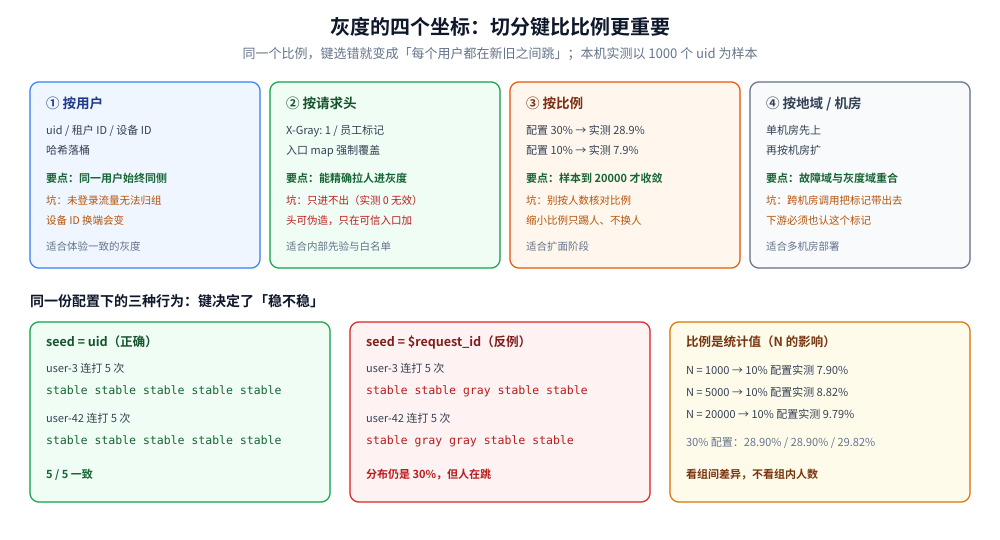
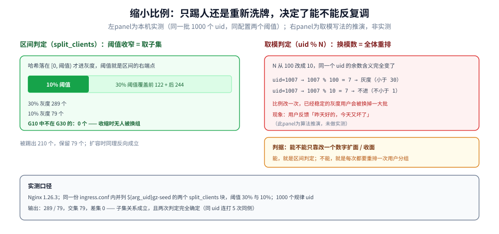
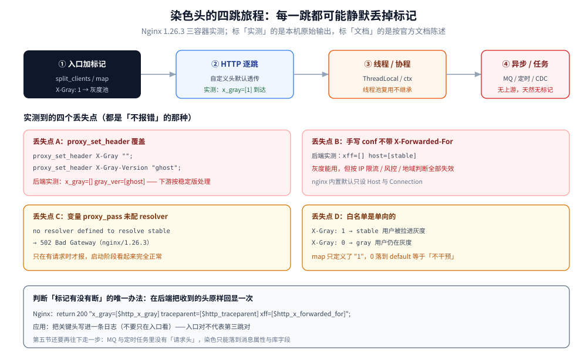

# 灰度发布与流量路由

> 灰度**怎么切、切完怎么把标记传下去、出问题怎么退**：四个切分坐标 → 染色头的四跳旅程 → 四种实现形态
> → 全链路灰度为什么难 → 数据与消息的兼容窗口 → 回滚判据，以及与蓝绿 / 金丝雀 / A/B 的判定表。
>
> 内容整理自个人学习笔记。**各网关能不能做灰度、`split_clients` 的分布准不准**属于产品能力面，见
> [网关选型对比.md](../../03-数据与中间件/中间件/网关与代理/网关选型对比.md) 3.4 节，本篇只在第三节引一行；
> 配置下发的灰度（Nacos 的 beta 发布）不是流量灰度，见 [Nacos.md](../../03-数据与中间件/中间件/注册与配置中心/Nacos.md)。
>
> ✅ **本篇的分布、单调性、染色穿透三组结论均为本机实跑**：Nginx 1.26.3 三容器（ingress + stable + gray），
> 1000 / 5000 / 20000 个 uid 的真实请求；Istio、APISIX、Nacos 权重、Argo Rollouts 与 MQ 染色**未实测**，
> 按官方文档陈述并在第八节逐条标注。

灰度最容易做错的地方不在"能不能分流"，而在**三个更靠后的位置**：

1. **切分键选错**——用了每次请求都会变的键，同一个用户一会儿新一会儿旧，会话状态、缓存、埋点全乱；
2. **标记传不下去**——入口认了，到第三跳被某个组件吃掉，灰度实际变成了"随机混合"；
3. **退不回去**——流量能切回去，但数据库字段已经写了新版本的值，回滚等于丢数据。

先说结论：**流量灰度是分布式系统里最容易实现、也最容易被误认为"已经做完"的一项能力**。第一节从"切什么"开始。

## 一、灰度在切什么：四个坐标

**本节要点**：灰度不是"发两套版本"，而是"按某个稳定的键把请求分到两组"。**键的选择比比例更重要**。

| 坐标 | 典型写法 | 适合什么 | 坑在哪 |
|---|---|---|---|
| **按用户** | `uid` / 租户 ID / 设备 ID 哈希 | 体验一致的灰度（同一个用户始终同一版本） | 需要登录态；未登录流量无法归组 |
| **按请求头** | `X-Gray: 1`、内部员工标记 | 白名单、内部先验 | 头可以被伪造，只在可信入口加；**只进不出**（见第四节） |
| **按比例** | 哈希落桶 10% / 30% | 扩面阶段 | 比例是**统计意义**上的，小样本偏差可达 2 个百分点（见下） |
| **按地域 / 机房** | 单机房先上 | 多机房部署 | 跨机房调用会把标记带出去，需要下游也认 |

### 1.1 切分键必须稳定

`split_clients` 对指定字符串做哈希（nginx 文档口径：MurmurHash2，取 `hash / 2^32 × 100` 落桶），因此**同一个键永远落在同一侧**：

```text
=== 同一 uid 连打 5 次 /pick30（本机实测）===
user-3     -> ['stable', 'stable', 'stable', 'stable', 'stable']
user-7     -> ['stable', 'stable', 'stable', 'stable', 'stable']
user-42    -> ['stable', 'stable', 'stable', 'stable', 'stable']
```

用**每次请求都不同的值**当种子，这个性质立刻消失：

```text
=== 反例：种子换成 $request_id（每个请求都变）===
user-3     -> ['stable', 'stable', 'gray', 'stable', 'stable']      ← 5 次里 1 次走了新版本
user-7     -> ['stable', 'stable', 'stable', 'stable', 'stable']
user-42    -> ['stable', 'gray', 'gray', 'stable', 'stable']        ← 5 次里 2 次
```

⚠️ 这就是灰度最典型的翻车方式：**分布看起来完全正常（还是 30%），但每个用户都在新旧之间跳**。
现象是"购物车偶尔为空""消息列表偶尔少一条""埋点里同一个用户有两条路径"——排查时几乎不会怀疑到灰度配置上。

⭐ 判断一个键能不能当切分键，问一句：**同一业务主体在灰度窗口内，这个值会变吗？**
`uid` 不变 ✅；`request_id`、时间戳、随机数 ❌；IP 在 NAT / 移动网络下会变 ⚠️；设备 ID 在换端场景会变 ⚠️。

### 1.2 比例是统计值，不是配置值

配置写 `10%` 不代表真的 10% 流量走灰度。本机用规律性 uid（`user-1` … `user-N`）实测：

```text
=== 阈值 10% ===
N=  1000  灰度   79 个   7.90%
N=  5000  灰度  441 个   8.82%
N= 20000  灰度 1959 个   9.79%

=== 阈值 30% ===
N=  1000  灰度  289 个  28.90%
N=  5000  灰度 1445 个  28.90%
N= 20000  灰度 5964 个  29.82%
```

三条结论：

- **小样本偏低明显**：1000 个 uid 时 10% 只落 7.9%，比配置值少 2.1 个百分点；样本到 20000 才收敛到 9.79%。
- **这不是 bug**，是哈希分桶 + 样本量的必然。日活几千的服务按 10% 灰度，实际可能只覆盖 8%。
- **`30%` 那一行反而稳**（28.90% 两次一样）——因为同一个前缀空间里，桶的偏差在 30% 处被摊平了。

⚠️ 实操含义：**别用"灰度组的人数"反推比例是否正确**；要看的是**灰度组内的指标与稳定组的差异**，比例偏一点不影响判断。



上半部分把四个切分坐标的适用面与各自的坑并排列出，下半部分是同一条 `split_clients` 配置换三种种子串后的真实行为：`uid` 作种子 5 次结果全同，`$request_id` 作种子会出现"5 次里 1 到 2 次走灰度"，而分布比例在两个面板里都是 30%。右下角那格是 1000 / 5000 / 20000 三种样本量下 10% 阈值的落点，说明配置值 10% 在小流量下可能只兑现 7.9%。

### 1.3 缩小比例是"只踢人、不换人"

从 30% 收到 10%，有两种完全不同的行为：

```text
=== 同一批 uid，同一份配置里两个阈值（本机实测，N=1000）===
30% 阈值 → 灰度 289 个，占 28.9%
10% 阈值 → 灰度  79 个，占  7.9%
G10 ⊆ G30 ? 是（G10 中不在 G30 的：0 个）
从 30% 缩到 10% 时，被踢出灰度的用户 210 个，保留 79 个
```

`split_clients` 的判定是"哈希值落在 `[0, 阈值)` 区间"，所以**阈值下调时新集合必然是旧集合的子集**——289 个人里 79 个留下，其余 210 个回到稳定组，**没有任何一个人被换过去**。

这条性质决定了一件事：**只调阈值就能安全扩面和收面**。反过来，如果实现方式是"重新算一遍哈希取模"（比如 `uid % 100` 改成 `uid % 10`），模数一变，所有人都重新洗牌——原本稳定的 10% 会被换成另一批人。第三节的判定表里，这一条是"能不能反复调比例"的分水岭。



左侧是区间判定的几何解释：阈值就是区间的右端点，30% 收到 10% 时只是把右端点往左移，落在外面的用户回到稳定组，落里面的一个都不会被换走；实测 289 个灰度用户收到 79 个，交集 79、差集 0。右侧是对比写法（取模）的推演：模数从 100 改成 10，同一个 uid 的余数含义完全变了，已经稳定的灰度用户会被大面积换掉，用户侧的体感是"昨天好的今天又坏了"。

## 二、染色头的四跳旅程

**本节要点**：灰度的标记是一个**自定义请求头**，它的生命周期比想象中短。入口加的东西，到第三跳可能已经没了。

一次带灰度的请求要经过四段：入口标记 → 应用上下文 → 逐跳透传 → 异步落盘。每一段都是独立的失败点。

### 2.1 第一跳：入口加标记，Nginx 默认全透传

本机用一个 ingress（`split_clients` + `map` 选上游）转发到 stable / gray 两个后端，请求里带四类头：灰度的两个、`traceparent`、`sw8`。

```text
=== 后端实际收到的头（默认转发，不碰任何 header）===
backend=gray x_gray=[1] gray_ver=[v2]
traceparent=[00-4bf92f3577b34da6a3ce929d0e0e4736-00f067aa0ba902b7-01]
sw8=[1-AAA-BBB-1-dGVzdA==-dGVzdA==-L2FwaS9wYXk=-MTI3LjAuMC4xOjgwODA=]
xff=[]  host=[gray]
```

两件事同时成立：

- ✅ **自定义头默认透传**：`X-Gray`、`X-Gray-Version`、`traceparent`、`sw8` 全部到达后端。nginx 的 `proxy_pass_request_headers` 默认 `on`，不需要显式声明。
- ❌ **`X-Forwarded-For` 是空的**：因为这份 `nginx.conf` 是手写的，没有 `include proxy_params`，而 nginx 内置默认只设 `Host` 与 `Connection`，**不会自动加 XFF**。

⚠️ 第二个是个高频事故：灰度能跑、链路能看，但下游拿到的客户端 IP 是 `-` 或网关自己的 IP，按 IP 限流、风控、地域判断全部失效。补一行即可，但**只有主动测一次"后端到底收到了什么"才会发现**。

### 2.2 第二跳：`proxy_set_header` 会把标记清掉

染色头能透传，也能被**静默覆盖**——只要配置里写了同名 `proxy_set_header`：

```text
=== 反例：proxy_set_header X-Gray "" + 覆盖 X-Gray-Version ===
backend=gray x_gray=[] gray_ver=[ghost]
traceparent=[00-4bf92f35...-01] sw8=[1-AAA-BBB-...]
```

`x_gray=[]` 意味着灰度标记在中途消失，`gray_ver=[ghost]` 意味着它被改写成了一个固定值（这里是故意写成的反例值）。下游拿不到标记时会默认按"稳定版"处理——**灰度组里的实例被自己人当成了稳定组**，链路两端的版本判断从此不一致。

⭐ 这一类覆盖最常见于模板复制：某个 location 里为了改 `Host` 顺手写了十几行 `proxy_set_header`，把客户端头一个个"点名重设"了一遍，漏掉的、写死的都在其中。**判据：只要开始点名写头，就必须把染色头一起点名写全**（`proxy_set_header X-Gray $http_x_gray;`）。

### 2.3 第三跳：变量的 `proxy_pass` 要 resolver

按标记选上游，最自然的写法是拿变量当上游地址：

```nginx
location = /route {
    set $up stable:80;
    if ($target = "gray") { set $up gray:80; }
    proxy_pass http://$up;
}
```

不配 resolver 直接报错，而且**只在有请求时才报**：

```text
[error] 30#30: *2 no resolver defined to resolve stable,
        client: 172.19.0.1, server: , request: "GET /route?uid=user-3 HTTP/1.1"
→ 502 Bad Gateway（nginx/1.26.3）
```

原因是静态 `proxy_pass http://backend;`（不带变量）在 **reload 时解析一次**域名并缓存；一旦写成变量形式，地址在运行时才确定，**每次请求都要走 DNS**。补上即可：

```nginx
http {
    resolver 127.0.0.11 valid=10s ipv6=off;   # Docker 内置 DNS
}
```

⚠️ 代价要说清：变量形式的 `proxy_pass` 把"启动时解析"变成了"运行期解析"。`valid=10s` 意味着每 10 秒重新解析一次（不是每请求，有缓存），但**DNS 抖动现在会直接变成 502**。这是灰度网关常见的一层隐形依赖。

### 2.4 第四跳：越过线程与进程，标记就断了

前三跳都在 HTTP 上，第四跳开始分叉：

| 载体 | 标记怎么带 | 断在哪 |
|---|---|---|
| **HTTP / gRPC** | 请求头 / metadata | 头名大小写、头数量上限、网关白名单 |
| **MQ** | 消息属性（RocketMQ `userProperty`、Kafka header） | 生产者忘了带；**消息体里的业务字段才是可靠的兜底** |
| **线程池 / 协程** | `ThreadLocal` / `context.Context` | 线程池复用不继承；`@Async`、Go 的不带 ctx 调用 |
| **定时任务 / 补偿** | 无上游，天然没有标记 | 只能从**数据**里读（订单上记的版本号、`gray` 字段） |
| **CDC / 数据同步** | 无 | 同上，靠表字段 |

⭐ 所以全链路灰度的最小要求是：**染色必须落到一处持久化载体上**（MQ 消息属性 + 数据库字段），不能只活在一次请求的内存里。第三节的"能不能覆盖异步"一栏，判的就是这一点。



图的上排是标记的四段旅程：入口用 `split_clients` 或 `map` 决定去哪个池，HTTP 段靠自定义头透传，进到线程池或协程后依赖上下文传递，到了 MQ 消费与定时任务就完全没有"请求头"这个概念了。下排是四个都"不报错"的丢失点：`proxy_set_header` 覆盖、手写配置遗漏 `X-Forwarded-For`、变量 `proxy_pass` 未配 resolver、白名单只写了单向，每一个都会让灰度标记在路上消失或失效。

## 三、四种实现形态与各自落点

**本节要点**：四种形态不是替代关系，是**粒度与覆盖面**的取舍。多数团队最终是"网关做主、应用内开关做细"。

| 形态 | 代表 | 切换粒度 | 生效速度 | 覆盖异步 | 改动面 |
|---|---|---|---|---|---|
| **流量网关** | Nginx `split_clients` / `map`、APISIX `traffic-split` | 请求级（按 uid / header / 比例） | reload 秒级 | ❌ 只覆盖入口流量 | 不改业务代码 |
| **服务网格** | Istio `VirtualService` + `DestinationRule` subset | 请求级 + 版本子集 | 秒级（xDS 推送） | ❌ 只管服务间 RPC | 要注入 sidecar |
| **应用内开关** | Feature Flag（配置中心 + SDK） | 代码块级 | 秒级（配置推送） | ✅ 只要开关判断在异步链路里 | 代码里要埋判断 |
| **注册中心元数据** | Nacos 权重 / 元数据 + 客户端负载均衡 | 实例级 | 秒级 ~ 十秒级 | ⚠️ 取决于客户端是否带元数据路由 | 要改负载均衡策略 |

### 3.1 网关形态：能力边界与一个计算成本

`split_clients` 的能力边界（能按 uid 哈希、能白名单、能调比例），以及"配置声明 30% 实测 28.9%"这个读数，已经在 [网关选型对比.md](../../03-数据与中间件/中间件/网关与代理/网关选型对比.md) 3.4 节实测过，本篇不重复。

这里只补 2.3 那一处**计算成本**：变量形式的 `proxy_pass` 让上游解析从"reload 时一次"变成"运行期按 `valid` 周期重复"。这是网关形态做灰度的固有开销——**要按标记换上游，上游就必然是动态的**。

### 3.2 网格形态：靠标签子集，不靠哈希

Istio 的做法是把"版本"变成 Pod 标签（`version: v2`），再用 `DestinationRule` 定义子集、`VirtualService` 按权重或 header 路由：

```yaml
apiVersion: networking.istio.io/v1
kind: VirtualService
metadata:
  name: order
spec:
  hosts: [order]
  http:
    - match:
        - headers:
            x-gray:
              exact: "1"
      route:
        - destination: {host: order, subset: v2}
    - route:
        - destination: {host: order, subset: v1}
          weight: 90
        - destination: {host: order, subset: v2}
          weight: 10
```

⚠️ **本篇未实测 Istio**（本机没有可用集群），以上按官方文档陈述。要提醒的是网格形态的隐性前提：**所有参与灰度的服务都必须注入 sidecar**，任何一个没注入的服务都会成为"标记消失点"——和 2.2 的 `proxy_set_header` 是同一类问题，只是发生在集群层。

### 3.3 应用内开关：唯一能覆盖异步的形态

只有当"这个请求走不走新逻辑"的判断写在**业务代码里**（且能读到一个持久的标记），它才能覆盖 MQ 消费、定时任务、补偿流程。代价是：

- 判断点会散落在多处（入口、消费端、任务里），需要统一的上下文读取函数；
- 开关翻车比网关严重——**网关翻车只影响入口流量，开关翻车会同时影响所有异步链路**。

### 3.4 注册中心元数据：实例级而非请求级

把灰度版本作为实例元数据注册上去，客户端按元数据选实例。它的粒度是**实例**，不是请求：一旦某个灰度实例被选中，这个实例上所有请求都走新逻辑。所以这种形态通常配合"灰度实例单独一组"使用，而不是做比例灰度。

## 四、全链路灰度到底要求什么

**本节要点**：全链路灰度的判据只有一句——**一次请求经过的所有环节，版本必须一致**。做不到就不叫灰度，叫"随机混合"。

### 4.1 同版本路由：A 调 B 也必须打到 B 的灰度实例

入口把请求分给了订单服务 v2，订单服务再调库存服务时必须也走 v2。如果这一跳重新按比例哈希，会出现 **v2 的订单调 v1 的库存**——新版本依赖的新字段在老版本里不存在，报错位置和根因隔了两跳。

三种做法：

| 做法 | 机制 | 代价 |
|---|---|---|
| **透传标记** | 调用时把 `X-Gray` 放进 RPC metadata，下游按标记选实例 | 每个调用点都要带上下文；漏一个就断 |
| **按调用者版本路由** | 服务网格按"上游 workload 版本"自动选同名子集 | 需要网格；非网格环境难做 |
| **灰度实例成组** | 灰度实例单独一组，组内互调 | 资源翻倍；组间比例固定不可调 |

### 4.2 白名单是单向的

线上最常用的组合是"内部员工全量 + 外部用户 30%"。用 `map` 做强制白名单时要注意一个真实限制：

```text
=== 白名单强制灰度（本机实测）===
稳定组用户 user-1：不带 header -> stable；带 X-Gray:1 -> gray      ✅ 能拉进
灰度组用户 user-2：不带 header -> gray；带 X-Gray:0 -> gray        ❌ 拉不出来
```

`X-Gray: 0` **不能让灰度组用户回到稳定版**——因为 `map` 只定义了 `"1" → 1`，`0` 走 `default 0`，而 `default 0` 的语义是"不强制"，不是"强制稳定"。要做双向控制得再加一档：

```nginx
map $http_x_gray $force {
    default  "auto";     # 不干预，按哈希
    "1"      "gray";     # 强制灰度
    "0"      "stable";   # 强制稳定
}
```

⚠️ 这类"看起来对称、实际单向"的配置，在灰度里格外危险：**运维想用 header 把某个用户摘出灰度来止血，结果摘不掉，还在灰度里继续出错**。上线前必须双向各测一次。

### 4.3 异步链路：三个必查点

- **MQ 生产端**：染色写进消息属性，且**消费端要能读到**（有些客户端封装只暴露消息体）；
- **消费端重试 / 死信**：重试消息会换 topic，属性可能被重建；
- **定时任务**：没有上游请求，只能按"数据里记的版本"决定逻辑分支——**这就是染色必须落库的原因**。

## 五、数据与消息的兼容窗口

**本节要点**：**流量可以回滚，数据不能回滚**。灰度真正的风险不在流量切换，而在新版本已经写下的数据。

### 5.1 字段变更的三步走

| 步骤 | 动作 | 必须做到 |
|---|---|---|
| **① 先加** | 加新字段 / 新表，**不改不删旧字段** | 旧版本代码不认识新字段，必须能安全忽略 |
| **② 双写** | 新版本同时写新旧两份；读仍读旧的 | 写到"读切过去"为止，期间两份可能不一致，要能对账 |
| **③ 后删** | 等**灰度窗口 + 回滚窗口**都过去，再删旧字段 | 删之前确认线上没有旧版本实例在跑 |

⚠️ **`ALTER TABLE` 本身也是发布动作**：加索引、改字段类型在 MySQL 上可能锁表（在线 DDL 也有代价）。灰度期做 DDL 等于把"流量灰度"和"结构变更"两个风险叠在同一个窗口里。

### 5.2 消息兼容：版本号放哪里

| 方案 | 做法 | 适用 |
|---|---|---|
| **消息体带 version** | 消息里加 `schema_version`，消费端按版本分支 | 小团队，消息类型少 |
| **只加字段** | 新字段可选、消费端容忍缺失 | 兼容性最好，但要纪律 |
| **Schema Registry** | 契约集中管理，兼容性由工具校验 | 多团队、消息类型多 |

⭐ 判据：**旧消费者的存活期 ≥ 灰度窗口 + 回滚窗口**。灰度跑三天、回滚预留一天，那旧版本消费者至少要留四天——因为一旦旧实例还在，它读到的每条新消息都可能是"它不认识的结构"。

## 六、回滚判据与观察窗口

**本节要点**：回滚的难点不是"能不能切回去"，而是**什么时候判定该切**。判早了白折腾，判晚了用户已经在骂。

### 6.1 看哪四个指标

| 指标 | 为什么是它 | 判据示例 |
|---|---|---|
| **新版本错误率 vs 稳定组** | 直接反映新代码质量 | 5xx 比例超过稳定组 2 倍且持续 5 分钟 |
| **P99 延迟** | 新逻辑引入的慢查询 / 额外 RPC | P99 超过稳定组 30% |
| **核心业务成功率** | 错误率可能被兜底掩盖 | 下单成功率下降 > 1% |
| **下游侧错误** | 新版本可能只在调用别人时出错 | 下游对 v2 的 4xx/5xx 明显高于 v1 |

⚠️ **只看服务自身指标会漏**：灰度实例 200 全绿、下游 500 一片，这种"成功地把错误传下去"的情况很常见。

### 6.2 观察窗口要多长

- **至少覆盖一个完整业务周期**。日结、对账、定时补偿都按天跑，5 分钟内看不出问题。
- **按流量类型分窗口**：读请求几分钟就够，写请求要等到"数据被下游消费完"（一个 MQ 消费周期 + 一个补偿周期）。
- **数据类变更单独放量**：结构变更的回滚窗口比流量长得多。

### 6.3 谁有权停

**发布人有权随时停**，不需要审批——这是让灰度真正起作用的前提。判据是"停"这个动作必须**只依赖一个开关**（改比例 / 改白名单 / 关开关），不能是"重新发一次版"。

## 七、灰度、蓝绿、金丝雀、A/B 到底差在哪

**本节要点**：四者的差别不在"分多少流量"，而在**同时跑几套、怎么退、要不要双份容量**。

| | 灰度发布 | 蓝绿部署 | 金丝雀 | A/B 测试 |
|---|---|---|---|---|
| **同时在线版本** | 2 套 | 2 套（整套环境） | 2 套 | 2 套以上 |
| **分流单位** | 请求（按 uid / header / 比例） | **全量切换**（切 DNS / 负载均衡） | 请求（比例） | 用户分组（实验组） |
| **回滚方式** | 调比例 / 关开关 | **切回另一套环境** | 调比例 | 关实验 |
| **资源成本** | 增量（灰度实例） | **双份**（整套） | 增量 | 增量 |
| **是否看业务指标** | 看稳定性指标 | 看稳定性指标 | 看稳定性指标 | **看业务指标（转化率等）** |
| **主要目的** | 降低发布风险 | 切换零等待 | 用最小流量验证 | 验证产品假设 |

三句话区分：

- **灰度**是为了"**出问题只影响一小部分人**"；
- **蓝绿**是为了"**切换和回滚都在秒级**"，代价是整套资源翻倍；
- **A/B** 是为了"**验证哪个更好**"，主指标是业务指标，不是错误率。

⚠️ 常见误用：把 A/B 的框架拿来做灰度（按 uid 固定分组、但不看稳定性指标），结果是**新版本有 5% 的请求 500，但业务指标因为随机噪声看不出差异**，灰度形同虚设。

## 校验口径

逐块标注本篇每类结论的来源，便于复核。

| 结论 | 状态 | 依据 |
|---|---|---|
| `split_clients` 同一 uid 结果稳定、`$request_id` 作种子会抖动 | ✅ 实跑 | nginx:1.26.3，1000 uid × 2 组 × 5 次 |
| 30% → 28.9%、10% → 7.9%（1000 样本）；20000 样本收敛到 29.82% / 9.79% | ✅ 实跑 | 同一 ingress，keep-alive 顺序请求 |
| G10 ⊆ G30（子集成立，0 例外） | ✅ 实跑 | 同一份配置里两个 `split_clients` 块 |
| 自定义头（`X-Gray` / `traceparent` / `sw8`）默认透传 | ✅ 实跑 | 后端 `return 200` 回显 `$http_*` |
| 手写 `nginx.conf` 不带 XFF（`xff=[]`） | ✅ 实跑 | 同上，未 `include proxy_params` |
| `proxy_set_header X-Gray ""` 使标记丢失、覆盖值生效 | ✅ 实跑 | `/route-clear` location |
| 变量 `proxy_pass` 未配 resolver 报 `no resolver defined` → 502 | ✅ 实跑 | ingress 容器日志原文 |
| 白名单单向（`X-Gray: 0` 无法拉出灰度组） | ✅ 实跑 | `map` 只定义 `"1"` 时的实际行为 |
| Istio `VirtualService` / `DestinationRule` 子集路由 | ⚠️ 按文档未实测 | 本机无可用 K8s 集群 |
| APISIX `traffic-split`、Nacos 权重与元数据路由 | ⚠️ 按文档未实测 | 未起对应组件 |
| MQ 染色（RocketMQ `userProperty`、Kafka header） | ⚠️ 按文档未实测 | 本篇聚焦路由机制，未搭消息链路 |
| 字段三步走、双写与旧消费者存活期 | ⚠️ 经验判据 | 无对应实验，属工程约定 |

实验台：`.workbuddy/tmp/gray-lab/`（`ingress.conf` + `stable.conf` + `gray.conf` + `measure.py`，容器已停）。

---

## 延伸追问

- **灰度比例为什么不能按"人数"核对？** → 因为它是哈希分桶的统计结果：1000 个 uid 按 10% 配置实测只落 7.9%，20000 个才收敛到 9.79%。核对比例是否正确没有意义，有意义的是**灰度组与稳定组的指标差异**。
- **用 IP 当切分键行不行？** → 不行。NAT、移动网络切换、企业出口都会让同一个用户的 IP 变；反过来一个出口 IP 后面可能是几万人，按 IP 哈希会把整栋楼一起切进灰度。除非灰度对象就是"某个机房 / 某个地区"。
- **为什么缩小比例不会打乱已经灰度的用户？** → `split_clients` 判的是"哈希值落在 `[0, 阈值)`"，阈值收窄时新集合必然是旧集合的子集（实测 G10 ⊆ G30，0 例外）。换成 `uid % N` 这类取模就不成立——模数一变所有人重新洗牌。
- **`X-Gray: 0` 为什么关不掉灰度？** → 因为 `map` 里通常只写了 `"1" → 1`，`0` 会落到 `default`，而 `default` 的语义是"不干预"而不是"强制稳定"。要做双向控制必须显式写 `"0" → "stable"`，并在上线前双向各测一次。
- **网关做了灰度，为什么还要在代码里做开关？** → 网关只覆盖入口流量，覆盖不了 MQ 消费、定时任务、补偿流程。凡是没有上游请求的链路，判断依据只能来自**数据**（消息属性、库里的版本字段），这只能由业务代码读。
- **灰度期间能不能改表结构？** → 能但要分三次：先加字段（旧代码忽略）、双写、等窗口过去再删旧字段。把 DDL 塞进灰度窗口，等于让"流量风险"和"结构风险"叠加，而**流量能回滚、数据不能**。
- **观察窗口到底要多久？** → 至少一个完整业务周期。读请求几分钟够，写请求要等"数据被下游消费完"（一个 MQ 周期 + 一个补偿周期），日结 / 对账类必须跨天。
- **蓝绿和灰度能同时用吗？** → 常见组合是"蓝绿做机房级切换 + 灰度做实例级比例"。但要注意蓝绿的整套环境切换会把灰度的染色一起带走——切过去之后，`split_clients` 的键空间还是同一个，灰度比例会重新生效。

---

## 关联

- **上游/总纲**：[网关选型对比.md](../../03-数据与中间件/中间件/网关与代理/网关选型对比.md) — 各网关能不能做灰度、`split_clients` 分布实测（本篇第三节引其结论）
- **上游/总纲**：[可观测性选型对比.md](../../03-数据与中间件/中间件/可观测性/可观测性选型对比.md) — 灰度判据依赖的指标与链路能力
- **对照/互补**：[Nacos.md](../../03-数据与中间件/中间件/注册与配置中心/Nacos.md) — 配置灰度（beta 发布）是下发面，与流量灰度互补
- **对照/互补**：[容器与编排选型.md](容器与编排选型.md) — 声明式部署与 GitOps 的回滚边界
- **对照/互补**：[幂等设计.md](../../04-架构与系统/分布式/稳定性/幂等设计.md) — 灰度回滚后的重复请求由谁裁决
- **下游机制**：[GitLab-CI-CD.md](GitLab-CI-CD.md) — 灰度是流水线的下游环节：构建产物 → 部署 → 切流
- **下游机制**：[K8s部署与生命周期面试题.md](k8s/K8s部署与生命周期面试题.md) — 滚动更新与 `rollout undo` 是灰度在 K8s 层的基础
- **下游机制**：[熔断器.md](../../04-架构与系统/分布式/稳定性/熔断器.md) — 灰度期新版本的异常要能快速触发熔断，而不是慢慢放量
